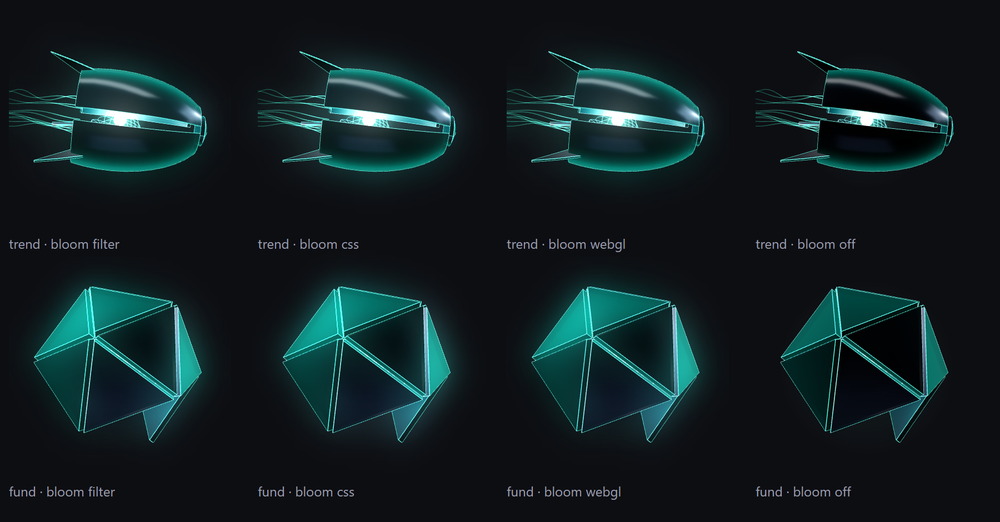

# Build S0: Agent form engine port and phone lab

**Run date:** October 29, 2026 · **Model:** Opus · **Branch:** `claude/agent-form-s0`, cut from `claude/phase0-agent-identity` @ `70144817` (pushed from the worktree branch `claude/agent-form-s0-09e02e` by refspec), so this PR carries the Phase 0 docs · **Smoke branch:** `claude/agent-form-s0-smoke` · **Preview:** https://trade-seven-t8mgfudwl-fais-projects-bc179554.vercel.app (the smoke head `f2e759f7`; open it with `?agentFormLab=1`)

**Preamble.** `git fetch origin` ran first. `origin/claude/phase0-agent-identity` = `70144817`, as the prompt names. `origin/main` = `be52068c`, the Phase 0 base: nothing landed on `main` since, so nothing contradicts the Phase 0 report. The tree was clean. `claude/agent-form-s0` did not exist locally or on `origin`. Fenced files read: none. Fenced functions called: none. Fenced files edited: none. The hub, the battle view and the picker are untouched: no file under `src/components/CommandCenter/`, `src/screens/battleView/` or `src/components/Dashboard/` changed.

---

## Executive verdict

| # | Item | Result |
|---|---|---|
| 1 | The port | **Done, every item of Phase 0 §4.** The engine is an ES module under `src/components/AgentForm/engine/`, on bundled `three@0.184.0` (pinned exactly, in `package.json` and the lockfile). **Its still frames are byte-identical to the design's engine on the same three: 28 of 28** (7 forms × armor stages 1 and 3 × idle and celebrating, 200 px, headless Edge). Unbatched draw calls equal Phase 0's table at both stages (28; 64/93; 49/59; 67/99; 94/196; 59/78; 73/128). |
| 2 | Teardown | **Everything is released at zero views.** A dispose census that is complete by construction (it records every geometry, material, texture and render target three makes, not the ones the engine lists) saw 1,072 geometries, 300 materials, 17 textures and 7 render targets at peak: each disposed exactly once. Renderers disposed and force-lost once each, observer disconnected, visibility listener removed, no frame pending, icosahedron cache cleared, every 2D backing store zeroed. **The census found a real leak in the first version of the teardown** (12 materials no object referenced); fixed. |
| 3 | Context loss | On loss every view shows its own still (its designed `stillT` frame, cached at mount); with none cached, the fallback still. On restore the studio is rebuilt, the target cleared with alpha, drawing resumes. **Measured, same still frame before and after a loss + restore at 3×: the design's engine differs in 153,881 of 160,000 pixels, 81,222 of them opaque black (the black square, and flat reflections); the port differs in 0.** |
| 4 | Bit-exact frames | `draw(spec, t)` is bit-exact: **0 of 168** frames differ across build orders (7 forms × 6 moods × 40/200 px × 2 times, on a fresh page, in reverse order, and with other forms built first), and **0 of 56** after the form was drawn in another mood first, batched or not. **The port fixed a history effect the design's engine has:** three sorts a line by a bounding sphere it computes only once, so a Speculator or Diversifier frame depended on the form's earlier moods (11 of 56 cases, up to 1.3 % of pixels) until each fade line refreshed its sphere (§4.5). |
| 5 | Frame-cost self-downgrade | **Removed (R-S7-2).** The design's 5 ms round-robin budget, its "under 100 px every third frame" and its "under 60 px never animate" rules are gone. **Nothing measured replaced them:** every visible view draws on every frame its rate allows: live every frame, half every other frame (on purpose), still once. Twelve 40 px views all draw every frame even when a frame is slow (a test row). |
| 6 | Mutable view, equip | Mood, stage, allegiance and size change without a remount. Equip runs 900 ms and unequip 700 ms through board 2's five keys each, piecewise-linear; the per-plate curves are the design's own. |
| 7 | Batched plates | Draw calls drop to **12–19 per form** (from 49–196) with `THREE.BatchedMesh` and merged lines, per-plate motion intact. Look within a small tolerance: **at most 2.3 % of pixels differ by more than 8 levels, mean ≤ 1.04 levels** (§4.3). Without `WEBGL_multi_draw` a batched mesh issues one call per plate; the readout shows whether the phone has it. |
| 8 | Bloom | Four options: the design's canvas filter (no blur on iOS Safari 18–26.3), a CSS-blurred overlay, a WebGL blur, off. The lab shows all four side by side (a preset), to pick by eye. In Chromium the three blooms look alike (picture in §4.4). Cost in §3. |
| 9 | The lab | `?agentFormLab=1`, full screen, while `AGENT_FORM_LAB_ENABLED` is true. Every control of Phase 0 §5, the four founder presets (and the four blooms side by side), the S7 readout plus a 5 min line and draw calls, and "Copy reading". |
| 10 | Flag off | **Every JavaScript chunk, entry included (44 of 44), and `index.html` are identical to `main`'s once chunk hashes are masked** (unminified builds of LF archives). The App gate folds away entirely. **The one real change is the stylesheet:** the 17 new `--ft-agent-*` declarations on `:root`, which nothing renders with while the flag is off; their new CSS hash renames every chunk, so the raw files differ by name only. App rendered in jsdom with `?agentFormLab=1` is byte-identical to App without it. |
| 11 | Tests | **99 new rows in 10 files**, plus the moved token pins and the guard registrations. **Linux (WSL, `TZ=UTC`, 8 workers, CI's Node 20.20.2 / npm 10.8.2, a fresh `npm ci` of the new lockfile): 26,928 rows, 26,839 pass, 0 fail, 89 skipped**, on the code head `7d8cf195`. `lint:gate` exit 0, `vite build` exit 0. **Mutation: 34 mutants on the teardown, context-loss and other rows, 33 killed; the one survivor was a dead guard, now removed.** Four headless mutants (§6). |
| 12 | Phone | The founder's checklist is §7; the blank table §8. |

---

## 1. What was built

| File | What |
|---|---|
| `src/components/AgentForm/engine/vocab.js` | The design's vocabulary (states, growth tables, forms, stills), seeded rng and hash, the fit stagger, the equip timeline. Pure: no three, no DOM. |
| `engine/core.js`, `engine/armor.js` | Geometry, materials, plates and Shadow's brain; the six sets. The design's code line for line, with the GPU state per render context and colours from the theme. |
| `engine/form.js` | Build a form; number its objects in build order; pose it for (spec, t); list and dispose everything it owns. |
| `engine/batch.js` | The batched variant (two sorted `BatchedMesh`, merged edges with per-plate matrices, merged fade lines). |
| `engine/bloom.js` | The four glows. |
| `engine/glPlatform.js` | The one module that makes a `WebGLRenderer` and the PMREM studio (tests swap it via `__mocks__`). |
| `engine/engine.js` | The runtime: contexts, views, the loop, the observer and listener, loss and restore, teardown, the frame samples the readout reads. |
| `engine/index.js`, `loadEngine.js` | The lazy entry and the one `import()` of it. |
| `AgentForm.jsx`, `AgentFormStill.jsx` | The wrapper (`archetype mood coreStage armorStage allegiance size` + the lab's options + `equipped`) and its SVG still. |
| `agentFormSpec.js`, `agentFormTokens.js`, `agentGrowth.js` | The code-id table (a local literal), the theme from tokens, growth at stage 1. |
| `src/screens/AgentFormLab.jsx`, `agentFormLabReadout.js` | The lab and its readout lines. |
| `src/config/agentFormFlags.js` | `AGENT_FORM_LAB_ENABLED = false`. |
| `src/App.jsx` | One import, one lazy declaration, one early return (+19 lines). |
| `src/theme/tokens.css`, `tokenBaseline.json` | 17 new `--ft-agent-*` tokens. |
| `package.json`, `package-lock.json` | `"three": "0.184.0"`. |

**Why the flag is not in `featureFlags.js`.** `App.jsx:4087` dynamically imports `featureFlags.js` (`await import('./config/featureFlags')`), so Rollup keeps that module's whole namespace object in the entry chunk: a new export there adds two lines to the entry (measured: `AGENT_FORM_LAB_ENABLED` and its namespace key). A module of its own that nothing live reads folds away. It is registered in `flagPinGuard.test.js` (`FLAG_SOURCE_MODULES` and `DARK_BY_DESIGN`), with a `// Pinned by:` pointer and its pin row.

**Where the lab mounts.** As an early return in `App`, after its hooks and before the onboarding gate and the unified return. Signed in or out, nothing of the app shell draws beside it (no nav, EarningsGame, ClashBot, starfield), so the readout times the forms alone. App's background effects (auth, polls) still run, as they do under the hub.

**Tokens (BUILD_RULES §10).** The engine has no colour literal. Exact matches reuse tokens: teal near/far = `--ft-teal`/`--ft-teal-2`, copper near = `--ft-copper`, the fog = `--ft-bg-card`, the mono core and the studio's top softbox = `--ft-white`. New, at the design's values: `--ft-agent-copper-far`, `-teal-core`, `-copper-core`, `-mono-near`, `-mono-far`, `-unlit-near`, `-unlit-far`, `-unlit-core`, `-plate`, `-studio-box`, `-studio-key`, `-studio-fill`, `-studio-under`, and the four light colours `-light-key`, `-light-rim`, `-light-sky`, `-light-ground` (the "studio" includes its lights). **Stated exceptions:** the glow sprite's falloff is a white-to-transparent luminance mask, tinted by each sprite's token colour when drawn; the renderer clears to transparent black. The 17 new source files join the token guard at zero core-palette literals. Note: the hub's `ShadowStill.jsx:29` comment says `#ECFFFB` "has no token"; it now has one (`--ft-agent-teal-core`). The hub is not touched here.

**Labels.** The wrapper's accessible name is "Shadow, armored — idle" / "Shadow, unarmored — …": no archetype name, so no second copy of the display table (§9 display-agreement; S1 takes names from `hub/archetypeLines.js`). A `label` prop overrides it.

---

## 2. The port, item by item (Phase 0 §4)

| Phase 0 item | Done |
|---|---|
| Globals, CDN, blob module | `import * as THREE from 'three'`. No `window.*`, no events, no `matchMedia`, no `__resources`, no blob URL. Reduced motion, bloom, rate, path, batching and the pixel ratio are view options. A source scan bans each (with planted self-checks). |
| Work at load | None. Renderer, studio, scene and lights are made on the first mount, reference-counted; a form is built on first use and disposed when no view draws it. |
| Teardown | At zero views: every form's geometries and materials, the glow texture (and its canvas), the fade material, the icosahedron cache, the studio, the bloom canvases and WebGL passes, the lights and the renderer (`dispose` + `forceContextLoss`). The observer is disconnected, the visibility listener removed, the loop stopped; the views' 2D canvases are zeroed (iOS caps total canvas memory). The loop also stops whenever no view is live (all still, reduced motion, hidden or lost). |
| Context loss | `webglcontextlost` → every view of that context reports `lost`; the wrapper shows the view's cached `stillT` frame (drawn on its own 2D canvas at mount and on every spec change), or the SVG still if none was cached. `webglcontextrestored` → the PMREM studio is rebuilt and every plate re-pointed at it, the clear colour set to transparent, the whole target cleared, every view redrawn and back to `live`. |
| Build order | Every form's objects and materials are numbered in a fixed traversal at build; the render context sorts with those numbers, never three's global ids. Measured: 0 of 168 frames differ across build orders (§4.2). |
| Scheduler (R-S7-2) | See verdict row 5. |
| Mutable spec, equip | `view.update(patch)`, `view.setOptions(patch)`, `view.equip(on)`. Reversal mid-tween continues from the plates' current fit. Under reduced motion or the still rate, equip snaps. |
| Direct path | One view draws straight into its own WebGL canvas (made by the engine inside the wrapper's slot, force-lost at unmount, never reused). Mirroring by CSS. One view only: the lab disables the option above one view. |
| Bloom on iOS | Three alternatives beside the design's (§4.4). |
| Determinism of the builders | Every form at every stage builds the same geometry, byte for byte, in any build order (Node rows). A pose writes the same state for the same (spec, t) after any other poses (Node rows). |

**Draw-call and size notes.** The dpr rule is the design's: canvases up to 3× under 100 px, renders up to 3× under 90 px, else 2×. The shared renderer's buffer stays 1,024 px.

---

## 3. Headless measurements

Headless Edge, ANGLE/D3D11, Intel Iris Xe (`ANGLE (Intel, Intel(R) Iris(R) Xe Graphics … Direct3D11 …)`, `WEBGL_multi_draw` present), dpr 3, one 200 px hero, core stage 1 (the stage every agent has today), the real clock and `requestAnimationFrame`, 1.6 s per cell after 10 warm-up frames. **Cost** is the engine's own frame sample: every render and every copy of the frame, in ms. These are laptop numbers: relative cost and draw calls, not the phone's frame rate. The matrix ran on `2c2974fb`, before each fade line refreshed its bounding sphere (§4.5): a per-frame sphere over about 30 lines of at most 44 points, which this timing cannot see.

### 3.1 Per form: draw calls, and cost by bloom (shared path)

Each cost cell is `avg / p95 ms`, unbatched → batched.

| Form · armor stage | Draw calls (one / batched) | filter | css | webgl | off |
|---|---|---|---|---|---|
| Shadow (bare) · 1 | 22 | 1.16 / 2.10 | 1.35 / 2.00 | 1.40 / 2.10 | 1.26 / 1.90 |
| Trend Follower · 1 | 58 / 13 | 2.09 / 3.70 → 1.45 / 2.40 | 2.01 / 3.50 → 1.66 / 2.80 | 2.39 / 3.70 → 2.06 / 3.00 | 1.77 / 3.20 → 1.72 / 2.70 |
| Trend Follower · 3 | 87 / 13 | 3.33 / 4.70 → 1.10 / 1.80 | 2.36 / 4.00 → 0.91 / 1.40 | 2.56 / 3.80 → 1.60 / 2.80 | 2.23 / 3.80 → 1.59 / 2.50 |
| Contrarian · 1 | 43 / 15 | 2.10 / 2.90 → 1.92 / 2.80 | 1.83 / 3.10 → 1.72 / 2.70 | 2.23 / 3.20 → 1.83 / 2.80 | 0.99 / 1.50 → 1.56 / 2.30 |
| Contrarian · 3 | 53 / 15 | 2.58 / 3.70 → 1.90 / 2.70 | 2.36 / 3.30 → 1.76 / 2.80 | 2.29 / 3.90 → 1.86 / 2.60 | 2.14 / 3.00 → 1.69 / 2.40 |
| Speculator · 1 | 61 / 15 | 2.29 / 3.80 → 1.08 / 1.80 | 1.13 / 2.10 → 1.58 / 2.50 | 1.26 / 2.20 → 1.42 / 2.40 | 1.72 / 3.10 → 1.48 / 2.40 |
| Speculator · 3 | 93 / 19 | 2.35 / 4.60 → 1.37 / 2.50 | 1.99 / 2.90 → 1.24 / 2.00 | 1.87 / 2.90 → 1.79 / 2.80 | 2.16 / 3.10 → 1.53 / 2.40 |
| Capital Preserver · 1 | 88 / 12 | 3.65 / 5.10 → 1.15 / 2.20 | 1.91 / 3.20 → 1.28 / 2.10 | 2.84 / 4.70 → 1.32 / 2.40 | 3.20 / 4.70 → 1.59 / 2.40 |
| Capital Preserver · 3 | 190 / 12 | 5.00 / 6.70 → 1.93 / 2.90 | 3.83 / 6.30 → 1.46 / 2.30 | 3.71 / 6.20 → 1.82 / 2.80 | 4.21 / 6.50 → 1.70 / 2.40 |
| Diversifier · 1 | 53 / 16 | 2.53 / 3.80 → 1.72 / 2.70 | 2.15 / 3.10 → 1.36 / 2.00 | 2.13 / 3.50 → 1.22 / 2.00 | 1.53 / 2.50 → 1.23 / 1.90 |
| Diversifier · 3 | 72 / 17 | 4.08 / 6.50 → 1.80 / 2.50 | 4.68 / 7.10 → 1.57 / 2.60 | 3.71 / 6.10 → 2.52 / 4.70 | 3.59 / 5.90 → 2.16 / 2.90 |
| Fundamental Investor · 1 | 67 / 12 | 4.67 / 7.50 → 2.75 / 4.60 | 4.72 / 8.30 → 2.71 / 5.00 | 4.32 / 6.70 → 2.55 / 4.50 | 4.21 / 7.30 → 2.42 / 4.50 |
| Fundamental Investor · 3 | 122 / 12 | 5.88 / 8.60 → 2.59 / 4.30 | 5.90 / 9.40 → 2.44 / 4.60 | 5.71 / 10.50 → 2.61 / 4.70 | 5.57 / 9.80 → 2.24 / 4.50 |

Draw calls here are at core stage 1 (15 brain loops), so they run 6 lower than §4.3's core-stage-2 counts, which match Phase 0's table. Run-to-run noise on this machine is about ±0.5 ms on a cell (each cell is 1.6 s); read rows, not single cells. **What it shows:** batching roughly halves the cost of the heavy sets (Capital Preserver at stage 3: 5.0 → 1.9 ms; Fundamental Investor: 5.9 → 2.6 ms) and cuts draw calls to 12–19; the four blooms cost about the same here (the CSS overlay's blur is done by the browser's compositor, outside this timing); one hero is well inside a frame on this laptop either way.

### 3.2 The four founder presets × rate × batching (shared path, the design's bloom)

| Preset | Views | Rate | Batched | fps | avg ms | p95 ms | late % | calls / frame |
|---|---|---|---|---|---|---|---|---|
| hero200 | 1 | live | no | 60 | 3.27 | 4.40 | 0 | 58 |
| hero200 | 1 | live | yes | 60 | 2.62 | 4.40 | 0 | 13 |
| hero200 | 1 | half | no | 30 | 4.88 | 13.40 | 0 | 58 |
| hero200 | 1 | half | yes | 30 | 2.88 | 6.30 | 0 | 13 |
| battle230 | 2 | live | no | 60 | 8.52 | 13.50 | 0 | 116 |
| battle230 | 2 | live | yes | 60 | 5.83 | 9.30 | 0 | 26 |
| battle230 | 2 | half | no | 30 | 6.69 | 10.10 | 0 | 116 |
| battle230 | 2 | half | yes | 30 | 5.03 | 9.30 | 0 | 26 |
| armory | 8 | live | no | 38.2 | 25.39 | 33.60 | 56.11 | 450 |
| armory | 8 | live | yes | 54 | 17.30 | 23.70 | 11.11 | 120 |
| armory | 8 | half | no | 27.3 | 27.29 | 36.30 | 7.94 | 450 |
| armory | 8 | half | yes | 30 | 18.62 | 25.60 | 0 | 120 |
| chat40 | 12 | live | no | 26 | 37.52 | 49.30 | 95.87 | 695 |
| chat40 | 12 | live | yes | 40.7 | 23.66 | 33.10 | 45.26 | 180 |
| chat40 | 12 | half | no | 20.2 | 39.41 | 47.70 | 34.83 | 695 |
| chat40 | 12 | half | yes | 28.4 | 25.51 | 33.30 | 3.82 | 184 |

**What it shows (laptop):** one hero and the two-form battle header hold 60 fps at every setting. The armory sheet (8 forms) and twelve 40 px avatars do not: unbatched, 25 and 37 ms a frame (38 and 26 fps); batched, 17 and 24 ms (54 and 41 fps); at half rate, batched, the armory holds 30 fps with 0 % late. Every view pays its own 2D copy of the shared renderer, so cost grows with the number of views more than with their size (Phase 0 §4's "cost follows draw calls, not pixels" holds per view). The phone decides; these rows say which layouts to watch.

The full matrix, every form × armor stage × batching × path × bloom (200 cells), is the appendix.

---

## 4. Correctness, measured

### 4.1 The port draws what the design draws

The design's engine (`af3-standalone.js.txt`, unmodified, three served locally) and the port, both drawing each form's designed still at 200 px, 1×, the design's bloom: **28 of 28 frames byte-identical** (7 forms × armor stage 1 and 3 × idle and celebrating). In a run that draws every case on one page, 4 frames differ: each is a frame the design's engine drew on a form it had drawn in another mood first, the history effect of §4.5, which the design's engine still has. On a fresh page the same four are identical.

### 4.2 Build order

168 frames (7 forms × 6 moods × 40 and 200 px), at t = 2.5 and 7.7, on fresh pages: built in order, built in reverse, and with seven other forms built first. **0 differ, batched or not.** With three's default sorts restored (a headless mutant), still 0: in this browser build order does not change a frame either way, and the build-local sort keeps it so by construction. Phase 0's "44 of 168 differ, by at most 1 level in 8–15 pixels" is not reproduced here, and its cause is unknown (the history effect of §4.5 is a different size, up to 200 levels).

### 4.3 Batched vs unbatched

| Form · armor stage (core stage 2, 200 px) | Draw calls (one / batched) | Worst of four frames (idle, celebrating, worried, researching at fit .55): max level · % px > 8 levels · mean level |
|---|---|---|
| Shadow (bare) · 1 | 28 / 28 | 0 · 0 · 0 |
| Shadow (bare) · 3 | 28 / 28 | 0 · 0 · 0 |
| Trend Follower · 1 | 64 / 13 | 214 · 1.49 % · 0.77 |
| Trend Follower · 3 | 93 / 13 | 227 · 2.07 % · 1.04 |
| Contrarian · 1 | 49 / 15 | 222 · 0.40 % · 0.15 |
| Contrarian · 3 | 59 / 15 | 250 · 0.95 % · 0.40 |
| Speculator · 1 | 67 / 19 | 228 · 0.04 % · 0.03 |
| Speculator · 3 | 99 / 15 | 198 · 0.07 % · 0.04 |
| Capital Preserver · 1 | 94 / 12 | 227 · 1.24 % · 0.64 |
| Capital Preserver · 3 | 196 / 12 | 216 · 1.20 % · 0.54 |
| Diversifier · 1 | 59 / 16 | 111 · 0.06 % · 0.02 |
| Diversifier · 3 | 78 / 17 | 111 · 0.08 % · 0.02 |
| Fundamental Investor · 1 | 73 / 12 | 120 · 1.02 % · 0.30 |
| Fundamental Investor · 3 | 128 / 12 | 170 · 2.33 % · 0.76 |

The residue is edge and etch lines testing depth against their own plate: unbatched, a plate's edges and the plate share one program's projection; batched, two programs project them, and a few grazing-angle pixels fall the other side. A first version filed the Contrarian's rings (centred exactly on the brain) behind the brain's light (13–17 % of pixels); a tie now counts as in front, as unbatched build order has it.

### 4.4 The four blooms

Trend Follower and Fundamental Investor, confident, 200 px, 2×. In Chromium, where `ctx.filter` works, the canvas filter, the CSS overlay and the WebGL blur look alike; off is visibly darker. On the iPhone the canvas filter will show an unblurred copy instead (Phase 0 §4). That comparison is the founder's.

### 4.5 Fixed: a frame that remembered the form's previous mood

The same frame (spec, t) drawn on a fresh form, and on a form drawn first in another mood (4 mood pairs × 7 forms × armor stages 1 and 3): **11 of 56 cases differed** before the fix, all Speculator or Diversifier, up to 1.3 % of pixels. The design's engine does the same.

**Cause.** three sorts a line by its geometry's bounding-sphere centre and computes that sphere once, on first draw (`three.module.js:17826-17832`). The fade lines are rewritten every frame, so their sort position froze wherever the form was first drawn. The Speculator's arcs and the Diversifier's tethers move far from the centre; the brain's loops and the Trend Follower's streams stay near it. Ruled out on the way: the CPU pose (Node rows), hidden zero-opacity sprites, stale GPU buffers (drawing twice), light uniforms.

**Fix.** `flag()` refreshes each fade line's sphere (`engine/core.js`). **After: 0 of 56.** Build order is still 0 of 168, and fresh stills are still byte-identical to the design's engine. A Node row pins it (each fade line's sphere is its current pose's). With the refresh removed, the sphere stays unset and the row fails. The batched path never had the effect: its merged lines sort by render class, not depth.

### 4.6 Context loss

`WEBGL_lose_context`, 200 px, 3×: during the loss the design's engine draws nothing (0 lit pixels, as Phase 0 measured); the port's views show their cached stills. After restore, the same still frame:

| | Pixels that differ (of 160,000) | Opaque black pixels |
|---|---|---|
| Design's engine | 153,881 | 81,222 |
| Port | 0 | 2 (as before the loss) |
| Port without the studio rebuild (mutant) | 68,338 | 2 |
| Port without the clear and the clear-colour reset (mutants) | 0 | 2 |

So the studio rebuild carries the restore. In this browser the full clear is defensive: each view's own scissored clear already covers it. The iPhone's lock and unlock is the real check (§7).

---

## 5. Not built in S0

From the boards and Phase 0 §4, listed as the prompt asks:
- **The seam flash** at lock and release (board 2).
- **The ring burst** every 2.4 s while celebrating (board 4).
- **Unworn sets at 70 % light**, idle starting on hover (board 6).
- **Emphasis by area**: armor edges or core brightening with the selected hub area (board 5).
- **Trailing streams at 40 px** (board 7). The engine never animated small sizes; the port animates every size now, but has no 40 px "trail" of its own.
- Also not built: the bare-Shadow → armored scale step (bare Shadow draws at 1.25×, an armored form at 0.74–0.95×, so an equip that starts from bare Shadow jumps size at its first frame; the lab plays equip on the armored form, from fit 0). This is a founder question for S1.

---

## 6. Tests and checks

| File | Rows | What |
|---|---|---|
| `engine/vocab.test.js` | 8 | The design's tables; stillT; fitK; the equip keys exactly, interpolation, reversal |
| `engine/builders.test.js` | 14 | Every form at every stage builds identical geometry twice and in reverse order; plate counts; build-local numbering; pose purity per form; a used form equals a fresh one; **each fade line's sort sphere is its current pose's**; batched poses equal unbatched |
| `engine/engine.lifecycle.jsdom.test.js` | 21 | Nothing at load; one renderer per first mount; **the dispose census** (every path: both draw paths, four blooms, batched, every rate, an equip, swaps); a released form disposed while others live; reuse after teardown; the loop stops and resumes (still, reduced motion, hidden, offscreen); `resumed` samples; **no budget: 12 × 40 px draw every frame under a slow clock**; half rate; equip and unequip on the keys; **loss → stills, restore → new studio, re-pointed plates, alpha clear, live**; a direct view's loss; no WebGL; a studio failure releases its renderer; the blooms; the direct path; the sort |
| `AgentForm.jsdom.test.jsx` | 15 | **No WebGL → the still, engine never requested**; mount with the mapped spec; update without remount; options; equip; only the path remounts; **lost → cached still or fallback, restored → live**; chunk failure; unmount; the code-id table (incl. 'unknown', legacy and prototype keys); allegiance; stages; growth at stage 1 |
| `AgentForm.engine.jsdom.test.jsx` | 2 | The real engine under the wrapper (GPU module mocked): **unmount releases everything** (census + renderers, observer, listener, frames, icosahedron); loss and restore through the wrapper |
| `agentForm.guard.test.js` | 17 | **The source scan** (no CDN, blob module, window global or event, random, wall clock or media query in the engine; none of the last two in the wrapper and lab), with planted self-checks; **the import graph** (three only in engine/; one lazy edge into it; App's static graph has no agent form module and no three; the lab only by `import()`), with a self-check |
| `config/agentFormLabFlags.test.js` | 6 | The pin; not in featureFlags.js; flagPinGuard registration; App's three uses of the flag, the URL read only inside the `&&`, the early return's place |
| `App.agentFormLab.jsdom.test.jsx` | 3 | The real App: **flag off, `?agentFormLab=1` renders byte-identically and the lab never loads**; flag on, the lab opens ahead of login; other values change nothing |
| `screens/AgentFormLab.jsdom.test.jsx` | 8 | The controls; the four presets; opponent and all-seven layouts; the four blooms side by side; custom layouts and the direct path's one-view rule; equip buttons; Copy reading (and its naming of the bloom preset) |
| `screens/agentFormLabReadout.test.js` | 5 | S7's format; late and p95; half rate's 50 ms threshold; a hidden gap left out; windows |

The first Linux run (on an earlier head) was red in one of these rows: the flag-on App row waited a fixed number of turns for the lazy lab chunk, too few on a loaded 8-worker run. It now waits in real time (capped at 15 s). On Windows, two rows in untouched `AgentBattleScreen` suites are red: the known Windows-only line-ending class. Linux is the record.

**Mutation round** (each mutant one exact replacement in an LF snapshot, its rows run, the file restored byte for byte):

| Mutant | Result |
|---|---|
| T1–T16: renderer not disposed; not force-lost; observer not disconnected; visibility listener kept; icosahedron cache kept; glow texture kept; studio kept; bloom resources kept; fade material kept; unreferenced materials kept (the census's own find); a released form not disposed; view canvases keep their stores; a pending frame never cancelled; the loop runs with no live view; context listeners kept; the direct canvas left in the slot | **16 of 16 killed** |
| L1–L9: restore keeps the dead studio; plates not re-pointed; no clear; old clear alpha; loss not reported; a lost context still renders; no still cached; the wrapper never shows the still; restore does not resume | **8 of 9 killed.** L6 survived: `drawView`'s own lost-check was unreachable (the loop, `drawNow` and restore each check first). It was dead code and is removed. |
| O1–O8: the design's small-size skip back; an equip key moved; analyst → the wrong set; the sort ties on three's ids; App reads the URL without the flag; half rate draws every frame; copper follows a colour; a pose reads the clock | **8 of 8 killed** |
| S1: a fade line's sort sphere is not refreshed | **killed** (the sphere row) |

**Headless mutants** (harness builds, §4): three's default sorts → still 0 of 168 across build orders (the build-local sort is not load-bearing in this browser, §4.2); no studio rebuild on restore → 68,338 px differ (killed); no full clear on restore, and no clear-colour reset → 0 px (the full clear is defensive here, §4.6).

**Bundle (the smoke build, Linux):** the engine chunk is `index-*.js` (named after `engine/index.js`): **610,917 B raw, 160,553 B gzip**, against Phase 0's estimate of 574 KB / 150 KB (the batched path and the blooms are the difference). The lab chunk is 14,180 B / 5,770 B gzip (first smoke build; the sphere refresh and the bloom preset add a few hundred bytes). With the flag on, the entry chunk is 215 B larger than the flag-off entry (4,830,493 B against 4,830,278 B, both Linux builds; the lazy declaration and the gate). With the flag off, nothing (row 10).

**Preview check:** the deployed smoke app, at 390 × 844 and 3×, signed out, every non-preview request blocked. `?agentFormLab=1` opens the lab, the form is live (60 fps over the last second, laptop), the readout runs, and there are no page errors. Without the parameter the lab is absent.

---

## 7. The phone checklist (iPhone 16)

1. On the iPhone, open **https://trade-seven-t8mgfudwl-fais-projects-bc179554.vercel.app/?agentFormLab=1** in Safari. Signed in or out does not matter.
2. The lab opens with one form at 200 and a readout at the top. Wait for the readout's second line to say `60 s:` (one minute).
3. For each of the four buttons — **1 hero at 200**, **2 at 230**, **7 at 72 + 1 at 190**, **12 at 40**:
   - tap it, leave the phone still for **60 seconds**, tap **Copy reading**, paste it into a note;
   - leave it another **4 minutes** (5 in all), tap **Copy reading** again, paste.
4. Repeat step 3 with **Rate → half (every other)**, then with **Plates → batched**. (Tap **Reset readout** after changing a setting.)
5. **Lock and unlock:** with the lab open, lock the phone, wait 10 seconds, unlock. The forms should come back moving, with no black square and the same metal reflections. Tap **Copy reading** (it counts lost and restored contexts).
6. **Reduce Motion:** Settings → Accessibility → Motion → Reduce Motion on. Back in the lab, every form should stand still (the readout says "no frames"). Turn it off again.
7. **Bloom by eye:** tap **4 blooms side by side**. The four glows run at once, each captioned: canvas filter (the design's), CSS-blurred overlay, WebGL, off. Pick the one you like. On the iPhone the canvas filter should show a sharp double instead of a glow; that is the iOS limit Phase 0 found.
8. Paste every copied reading back to Claude. The fallback rule (Phase 0 §5): live if the 60 s line holds ≥ 55 fps, the 5 min line ≥ 50 fps, p95 ≤ 8 ms and late ≤ 2 %; half rate if it holds a steady 30 fps with late ≤ 5 %; otherwise stills.

---

## 8. The founder's readings

**Filled by the review session** (Fable, October 29, 2026; `docs/audits/20261029_REVIEW_AGENT_FORM_S0.md`) from the founder's summary of his iPhone 16 run on October 29, 2026. **The raw "Copy reading" lines were not kept**, so the 60 s and 5 min lines, the draw calls per frame and the multiDraw flag are recorded as *not kept*. The founder's words, as relayed to the review: every preset he ran passed, with a smooth frame rate, a flawless equip and unequip, a clean lock and unlock, and Reduce Motion stills; he ran batched plates; he chose the CSS-blurred overlay glow. The bloom in use during the preset runs was not stated; the "Bloom" column keeps the lab's default. Rows the summary does not name (the half-rate runs) are marked *not stated*, not failed.

| Preset | Rate | Plates | Bloom | 60 s line | 5 min line | calls / frame | multiDraw | Pass? |
|---|---|---|---|---|---|---|---|---|
| 1 hero at 200 | live | one per plate | canvas filter (default) | not kept | not kept | not kept | not kept | **Pass** (founder's summary: smooth) |
| 1 hero at 200 | half | one per plate | canvas filter (default) | not kept | not kept | not kept | not kept | not stated |
| 1 hero at 200 | live | batched | canvas filter (default) | not kept | not kept | not kept | not kept | **Pass** (founder's summary: batched plates run, smooth) |
| 2 at 230 | live | one per plate | canvas filter (default) | not kept | not kept | not kept | not kept | **Pass** (founder's summary: smooth) |
| 2 at 230 | half | one per plate | canvas filter (default) | not kept | not kept | not kept | not kept | not stated |
| 2 at 230 | live | batched | canvas filter (default) | not kept | not kept | not kept | not kept | **Pass** (founder's summary: batched plates run, smooth) |
| 7 at 72 + 1 at 190 | live | one per plate | canvas filter (default) | not kept | not kept | not kept | not kept | **Pass** (founder's summary: smooth) |
| 7 at 72 + 1 at 190 | half | one per plate | canvas filter (default) | not kept | not kept | not kept | not kept | not stated |
| 7 at 72 + 1 at 190 | live | batched | canvas filter (default) | not kept | not kept | not kept | not kept | **Pass** (founder's summary: batched plates run, smooth) |
| 12 at 40 | live | one per plate | canvas filter (default) | not kept | not kept | not kept | not kept | **Pass** (founder's summary: smooth) |
| 12 at 40 | half | one per plate | canvas filter (default) | not kept | not kept | not kept | not kept | not stated |
| 12 at 40 | live | batched | canvas filter (default) | not kept | not kept | not kept | not kept | **Pass** (founder's summary: batched plates run, smooth) |
| Lock / unlock | | | | lost — restored — (counts not kept) | | | | **Pass**: "a clean lock and unlock" (the forms came back; no black square reported) |
| Reduce Motion | | | | | | | | **Pass**: stills |
| Equip / unequip | | | | | | | | **Pass**: "flawless" |
| Bloom chosen | | | **CSS-blurred overlay** | | | | | Chosen by eye on the "4 blooms side by side" preset |

**What this fills and what it does not.** The founder's run settles Phase 0 §5's device questions in the direction the plan hoped for: the armored forms animate live on the iPhone 16 at every preset he ran, context loss recovers cleanly, Reduce Motion stills work, and the iOS bloom choice is made (the CSS overlay; the canvas filter is unblurred on iOS Safari, Phase 0 §4). Because the raw lines were not kept, the §5 pass rule (≥ 55 fps on the 60 s line, ≥ 50 fps on the 5 min line, p95 ≤ 8 ms, late ≤ 2 %) is attested by the founder's eye rather than by the readout's numbers; `AGENT_FORM_PHONE` can be set to `live` on that basis, with the numbers to be captured on the S1 hub reading if wanted (the review's "Carry into S1").

---

## 9. Questions for the founder

1. **Late at half rate.** S7's "late" is a gap over 25 ms. At half rate every gap is 33 ms, so the lab counts late as over 50 ms there (the same 1.5 × the intended frame). Is that the floor you meant by "late ≤ 5 %"?
2. **The equip timeline.** Fit runs straight between board 2's five keys (0/.28/.55/.8/1 at 0/220/450/700/900 ms); the "ease-out" is the design's per-plate curve. Keep, or add an overall ease?
3. **Bare Shadow → armored.** The engine draws bare Shadow larger (1.25×) than any armored form (0.74–0.95×). An archetype change from bare Shadow would jump size before the plates arrive. Smooth it in S1, or keep the design's sizes?

---

## 10. Commits and artifacts

On `claude/agent-form-s0`, after the Phase 0 commits (`556e5f83`, `03b3de07`, `70144817`):
- `fe8720f3` three@0.184.0, and the engine's colours as tokens
- `0a2dde75` the engine as an ES module, and its wrapper
- `bb59544b` the lab, behind `AGENT_FORM_LAB_ENABLED = false`
- `2c2974fb` tests
- `7d8cf195` each fade line refreshes its sort sphere (§4.5); the four blooms side by side (the code head the final checks ran on)
- this report and its bloom picture (`docs/audits/assets/agent-form-s0-blooms.png`), the PR's last commit

`claude/agent-form-s0-smoke` = `f2e759f7`: one commit on `7d8cf195`, "SMOKE ONLY, NEVER MERGE", the flag's one line. It does not carry this report (docs only). On it, the flag pin and flagPinGuard are red by design.

**Review threshold (BUILD_RULES §2):** the branch diff is far over 1,500 lines (it carries the Phase 0 docs). The multi-lens adversarial review runs in its own session before merge; it is not claimed here.

**Copies:** this report is also at `C:\Users\fashr\Documents\FantasyTrades\AgentForm\20261029_BUILD_AGENT_FORM_S0.md` (BUILD_RULES §3). The scratch harness (the measurement page, the Playwright runners, the mutant runner) is not committed.

---

## Appendix: the full headless matrix

| Form | Armor | Batched | Path | Bloom | fps | avg ms | p95 ms | late % | calls |
|---|---|---|---|---|---|---|---|---|---|
| Shadow (bare) | 1 | no | shared | filter | 60 | 1.16 | 2.10 | 0 | 22 |
| Shadow (bare) | 1 | no | shared | css | 60 | 1.35 | 2.00 | 0 | 22 |
| Shadow (bare) | 1 | no | shared | webgl | 60 | 1.40 | 2.10 | 0 | 25 |
| Shadow (bare) | 1 | no | shared | off | 60 | 1.26 | 1.90 | 0 | 22 |
| Shadow (bare) | 1 | no | direct | filter | 60 | 1.39 | 2.10 | 0 | 22 |
| Shadow (bare) | 1 | no | direct | css | 60 | 1.25 | 2.20 | 0 | 22 |
| Shadow (bare) | 1 | no | direct | webgl | 60 | 1.13 | 1.80 | 1.14 | 25 |
| Shadow (bare) | 1 | no | direct | off | 60 | 0.92 | 1.40 | 0 | 22 |
| Trend Follower | 1 | no | shared | filter | 60 | 2.09 | 3.70 | 0 | 58 |
| Trend Follower | 1 | no | shared | css | 60 | 2.01 | 3.50 | 0 | 58 |
| Trend Follower | 1 | no | shared | webgl | 60 | 2.39 | 3.70 | 0 | 61 |
| Trend Follower | 1 | no | shared | off | 60 | 1.77 | 3.20 | 0 | 58 |
| Trend Follower | 1 | no | direct | filter | 60 | 2.52 | 3.50 | 0 | 58 |
| Trend Follower | 1 | no | direct | css | 60 | 1.96 | 3.20 | 0 | 58 |
| Trend Follower | 1 | no | direct | webgl | 60 | 1.28 | 2.00 | 0 | 61 |
| Trend Follower | 1 | no | direct | off | 60 | 1.17 | 2.30 | 0 | 58 |
| Trend Follower | 1 | yes | shared | filter | 60 | 1.45 | 2.40 | 0 | 13 |
| Trend Follower | 1 | yes | shared | css | 60 | 1.66 | 2.80 | 0 | 13 |
| Trend Follower | 1 | yes | shared | webgl | 60 | 2.06 | 3.00 | 0 | 16 |
| Trend Follower | 1 | yes | shared | off | 60 | 1.72 | 2.70 | 0 | 13 |
| Trend Follower | 1 | yes | direct | filter | 60 | 1.16 | 2.30 | 0 | 13 |
| Trend Follower | 1 | yes | direct | css | 60 | 1.36 | 2.40 | 0 | 13 |
| Trend Follower | 1 | yes | direct | webgl | 60 | 1.06 | 2.20 | 0 | 16 |
| Trend Follower | 1 | yes | direct | off | 60 | 1.63 | 2.30 | 0 | 13 |
| Trend Follower | 3 | no | shared | filter | 60 | 3.33 | 4.70 | 0 | 87 |
| Trend Follower | 3 | no | shared | css | 60 | 2.36 | 4.00 | 0 | 87 |
| Trend Follower | 3 | no | shared | webgl | 60 | 2.56 | 3.80 | 0 | 90 |
| Trend Follower | 3 | no | shared | off | 60 | 2.23 | 3.80 | 0 | 87 |
| Trend Follower | 3 | no | direct | filter | 60 | 2.39 | 4.00 | 0 | 87 |
| Trend Follower | 3 | no | direct | css | 60 | 2.73 | 3.80 | 0 | 87 |
| Trend Follower | 3 | no | direct | webgl | 60 | 2.42 | 3.50 | 0 | 90 |
| Trend Follower | 3 | no | direct | off | 60 | 2.49 | 3.50 | 0 | 87 |
| Trend Follower | 3 | yes | shared | filter | 60 | 1.10 | 1.80 | 0 | 13 |
| Trend Follower | 3 | yes | shared | css | 60 | 0.91 | 1.40 | 0 | 13 |
| Trend Follower | 3 | yes | shared | webgl | 60 | 1.60 | 2.80 | 0 | 16 |
| Trend Follower | 3 | yes | shared | off | 60 | 1.59 | 2.50 | 0 | 13 |
| Trend Follower | 3 | yes | direct | filter | 60 | 2.23 | 3.10 | 0 | 13 |
| Trend Follower | 3 | yes | direct | css | 60 | 1.78 | 2.80 | 0 | 13 |
| Trend Follower | 3 | yes | direct | webgl | 60 | 1.94 | 2.80 | 0 | 16 |
| Trend Follower | 3 | yes | direct | off | 60 | 1.44 | 2.40 | 0 | 13 |
| Contrarian | 1 | no | shared | filter | 60 | 2.10 | 2.90 | 0 | 43 |
| Contrarian | 1 | no | shared | css | 60 | 1.83 | 3.10 | 0 | 43 |
| Contrarian | 1 | no | shared | webgl | 60 | 2.23 | 3.20 | 0 | 46 |
| Contrarian | 1 | no | shared | off | 60 | 0.99 | 1.50 | 0 | 43 |
| Contrarian | 1 | no | direct | filter | 60 | 1.00 | 1.80 | 0 | 43 |
| Contrarian | 1 | no | direct | css | 60 | 1.56 | 2.60 | 0 | 43 |
| Contrarian | 1 | no | direct | webgl | 60 | 1.45 | 2.60 | 0 | 46 |
| Contrarian | 1 | no | direct | off | 60 | 1.19 | 2.10 | 0 | 43 |
| Contrarian | 1 | yes | shared | filter | 60 | 1.92 | 2.80 | 0 | 15 |
| Contrarian | 1 | yes | shared | css | 60 | 1.72 | 2.70 | 0 | 15 |
| Contrarian | 1 | yes | shared | webgl | 60 | 1.83 | 2.80 | 0 | 18 |
| Contrarian | 1 | yes | shared | off | 60 | 1.56 | 2.30 | 0 | 15 |
| Contrarian | 1 | yes | direct | filter | 60 | 1.65 | 2.40 | 0 | 15 |
| Contrarian | 1 | yes | direct | css | 60 | 1.25 | 2.60 | 0 | 15 |
| Contrarian | 1 | yes | direct | webgl | 60 | 1.60 | 2.40 | 0 | 18 |
| Contrarian | 1 | yes | direct | off | 60 | 1.21 | 2.10 | 0 | 15 |
| Contrarian | 3 | no | shared | filter | 60 | 2.58 | 3.70 | 0 | 53 |
| Contrarian | 3 | no | shared | css | 60 | 2.36 | 3.30 | 0 | 53 |
| Contrarian | 3 | no | shared | webgl | 60 | 2.29 | 3.90 | 0 | 56 |
| Contrarian | 3 | no | shared | off | 60 | 2.14 | 3.00 | 0 | 53 |
| Contrarian | 3 | no | direct | filter | 60 | 2.23 | 3.40 | 0 | 53 |
| Contrarian | 3 | no | direct | css | 60 | 2.29 | 3.20 | 0 | 53 |
| Contrarian | 3 | no | direct | webgl | 60 | 2.00 | 3.10 | 0 | 56 |
| Contrarian | 3 | no | direct | off | 60 | 2.01 | 2.90 | 0 | 53 |
| Contrarian | 3 | yes | shared | filter | 60 | 1.90 | 2.70 | 0 | 15 |
| Contrarian | 3 | yes | shared | css | 60 | 1.76 | 2.80 | 0 | 15 |
| Contrarian | 3 | yes | shared | webgl | 60 | 1.86 | 2.60 | 0 | 18 |
| Contrarian | 3 | yes | shared | off | 60 | 1.69 | 2.40 | 0 | 15 |
| Contrarian | 3 | yes | direct | filter | 60 | 1.52 | 2.40 | 0 | 15 |
| Contrarian | 3 | yes | direct | css | 60 | 0.86 | 1.80 | 0 | 15 |
| Contrarian | 3 | yes | direct | webgl | 60 | 1.62 | 2.40 | 0 | 18 |
| Contrarian | 3 | yes | direct | off | 60 | 1.56 | 2.20 | 0 | 15 |
| Speculator | 1 | no | shared | filter | 60 | 2.29 | 3.80 | 0 | 61 |
| Speculator | 1 | no | shared | css | 60 | 1.13 | 2.10 | 0 | 61 |
| Speculator | 1 | no | shared | webgl | 60 | 1.26 | 2.20 | 0 | 64 |
| Speculator | 1 | no | shared | off | 60 | 1.72 | 3.10 | 0 | 61 |
| Speculator | 1 | no | direct | filter | 60 | 1.38 | 3.30 | 0 | 61 |
| Speculator | 1 | no | direct | css | 60 | 2.18 | 3.40 | 0 | 61 |
| Speculator | 1 | no | direct | webgl | 60 | 1.84 | 3.20 | 0 | 64 |
| Speculator | 1 | no | direct | off | 60 | 1.23 | 2.50 | 0 | 61 |
| Speculator | 1 | yes | shared | filter | 60 | 1.08 | 1.80 | 0 | 15 |
| Speculator | 1 | yes | shared | css | 60 | 1.58 | 2.50 | 0 | 15 |
| Speculator | 1 | yes | shared | webgl | 60 | 1.42 | 2.40 | 0 | 18 |
| Speculator | 1 | yes | shared | off | 60 | 1.48 | 2.40 | 0 | 15 |
| Speculator | 1 | yes | direct | filter | 60 | 1.52 | 2.80 | 0 | 15 |
| Speculator | 1 | yes | direct | css | 60 | 1.35 | 2.30 | 0 | 15 |
| Speculator | 1 | yes | direct | webgl | 60 | 1.69 | 2.80 | 0 | 18 |
| Speculator | 1 | yes | direct | off | 60 | 1.52 | 2.30 | 0 | 15 |
| Speculator | 3 | no | shared | filter | 60 | 2.35 | 4.60 | 0 | 93 |
| Speculator | 3 | no | shared | css | 60 | 1.99 | 2.90 | 0 | 93 |
| Speculator | 3 | no | shared | webgl | 60 | 1.87 | 2.90 | 0 | 96 |
| Speculator | 3 | no | shared | off | 60 | 2.16 | 3.10 | 0 | 93 |
| Speculator | 3 | no | direct | filter | 60 | 1.98 | 3.00 | 0 | 93 |
| Speculator | 3 | no | direct | css | 60 | 1.54 | 2.60 | 0 | 93 |
| Speculator | 3 | no | direct | webgl | 60 | 1.88 | 2.80 | 0 | 96 |
| Speculator | 3 | no | direct | off | 60 | 1.81 | 3.30 | 0 | 93 |
| Speculator | 3 | yes | shared | filter | 60 | 1.37 | 2.50 | 0 | 17 |
| Speculator | 3 | yes | shared | css | 60 | 1.24 | 2.00 | 0 | 17 |
| Speculator | 3 | yes | shared | webgl | 60 | 1.79 | 2.80 | 0 | 22 |
| Speculator | 3 | yes | shared | off | 60 | 1.53 | 2.40 | 0 | 19 |
| Speculator | 3 | yes | direct | filter | 60 | 1.47 | 2.40 | 0 | 21 |
| Speculator | 3 | yes | direct | css | 60 | 2.00 | 2.90 | 0 | 17 |
| Speculator | 3 | yes | direct | webgl | 60 | 1.29 | 2.30 | 0 | 22 |
| Speculator | 3 | yes | direct | off | 60 | 1.34 | 2.20 | 0 | 19 |
| Capital Preserver | 1 | no | shared | filter | 60 | 3.65 | 5.10 | 0 | 88 |
| Capital Preserver | 1 | no | shared | css | 60 | 1.91 | 3.20 | 0 | 88 |
| Capital Preserver | 1 | no | shared | webgl | 60 | 2.84 | 4.70 | 0 | 91 |
| Capital Preserver | 1 | no | shared | off | 60 | 3.20 | 4.70 | 0 | 88 |
| Capital Preserver | 1 | no | direct | filter | 60 | 3.19 | 5.20 | 0 | 88 |
| Capital Preserver | 1 | no | direct | css | 60 | 2.96 | 4.90 | 0 | 88 |
| Capital Preserver | 1 | no | direct | webgl | 60 | 3.02 | 4.90 | 0 | 91 |
| Capital Preserver | 1 | no | direct | off | 60 | 2.19 | 3.50 | 0 | 88 |
| Capital Preserver | 1 | yes | shared | filter | 60 | 1.15 | 2.20 | 0 | 12 |
| Capital Preserver | 1 | yes | shared | css | 60 | 1.28 | 2.10 | 0 | 12 |
| Capital Preserver | 1 | yes | shared | webgl | 60 | 1.32 | 2.40 | 0 | 15 |
| Capital Preserver | 1 | yes | shared | off | 60 | 1.59 | 2.40 | 0 | 12 |
| Capital Preserver | 1 | yes | direct | filter | 60 | 1.64 | 2.50 | 0 | 12 |
| Capital Preserver | 1 | yes | direct | css | 60 | 1.58 | 2.80 | 0 | 12 |
| Capital Preserver | 1 | yes | direct | webgl | 60 | 1.71 | 2.70 | 0 | 15 |
| Capital Preserver | 1 | yes | direct | off | 60 | 1.50 | 2.40 | 0 | 12 |
| Capital Preserver | 3 | no | shared | filter | 60 | 5.00 | 6.70 | 0 | 190 |
| Capital Preserver | 3 | no | shared | css | 60 | 3.83 | 6.30 | 0 | 190 |
| Capital Preserver | 3 | no | shared | webgl | 60 | 3.71 | 6.20 | 0 | 193 |
| Capital Preserver | 3 | no | shared | off | 60 | 4.21 | 6.50 | 0 | 190 |
| Capital Preserver | 3 | no | direct | filter | 60 | 4.33 | 7.50 | 0 | 190 |
| Capital Preserver | 3 | no | direct | css | 60 | 4.54 | 6.10 | 0 | 190 |
| Capital Preserver | 3 | no | direct | webgl | 60 | 4.01 | 5.60 | 0 | 193 |
| Capital Preserver | 3 | no | direct | off | 60 | 4.11 | 6.30 | 0 | 190 |
| Capital Preserver | 3 | yes | shared | filter | 60 | 1.93 | 2.90 | 0 | 12 |
| Capital Preserver | 3 | yes | shared | css | 60 | 1.46 | 2.30 | 0 | 12 |
| Capital Preserver | 3 | yes | shared | webgl | 60 | 1.82 | 2.80 | 0 | 15 |
| Capital Preserver | 3 | yes | shared | off | 60 | 1.70 | 2.40 | 0 | 12 |
| Capital Preserver | 3 | yes | direct | filter | 60 | 2.06 | 3.10 | 0 | 12 |
| Capital Preserver | 3 | yes | direct | css | 60 | 1.94 | 2.70 | 0 | 12 |
| Capital Preserver | 3 | yes | direct | webgl | 60 | 1.67 | 2.50 | 0 | 15 |
| Capital Preserver | 3 | yes | direct | off | 60 | 1.43 | 2.30 | 0 | 12 |
| Diversifier | 1 | no | shared | filter | 60 | 2.53 | 3.80 | 0 | 53 |
| Diversifier | 1 | no | shared | css | 60 | 2.15 | 3.10 | 0 | 53 |
| Diversifier | 1 | no | shared | webgl | 60 | 2.13 | 3.50 | 0 | 56 |
| Diversifier | 1 | no | shared | off | 60 | 1.53 | 2.50 | 0 | 53 |
| Diversifier | 1 | no | direct | filter | 60 | 2.15 | 3.00 | 0 | 53 |
| Diversifier | 1 | no | direct | css | 60 | 2.13 | 3.20 | 0 | 53 |
| Diversifier | 1 | no | direct | webgl | 60 | 1.97 | 2.80 | 0 | 56 |
| Diversifier | 1 | no | direct | off | 60 | 1.76 | 2.90 | 0 | 53 |
| Diversifier | 1 | yes | shared | filter | 60 | 1.72 | 2.70 | 0 | 16 |
| Diversifier | 1 | yes | shared | css | 60 | 1.36 | 2.00 | 0 | 16 |
| Diversifier | 1 | yes | shared | webgl | 60 | 1.22 | 2.00 | 0 | 19 |
| Diversifier | 1 | yes | shared | off | 60 | 1.23 | 1.90 | 0 | 16 |
| Diversifier | 1 | yes | direct | filter | 60 | 2.05 | 3.00 | 0 | 16 |
| Diversifier | 1 | yes | direct | css | 60 | 1.35 | 2.50 | 0 | 16 |
| Diversifier | 1 | yes | direct | webgl | 60 | 1.84 | 2.80 | 0 | 19 |
| Diversifier | 1 | yes | direct | off | 60 | 1.62 | 2.50 | 0 | 16 |
| Diversifier | 3 | no | shared | filter | 60 | 4.08 | 6.50 | 0 | 72 |
| Diversifier | 3 | no | shared | css | 60 | 4.68 | 7.10 | 0 | 72 |
| Diversifier | 3 | no | shared | webgl | 60 | 3.71 | 6.10 | 0 | 75 |
| Diversifier | 3 | no | shared | off | 60 | 3.59 | 5.90 | 0 | 72 |
| Diversifier | 3 | no | direct | filter | 60 | 3.14 | 5.50 | 0 | 72 |
| Diversifier | 3 | no | direct | css | 60 | 2.16 | 3.10 | 0 | 72 |
| Diversifier | 3 | no | direct | webgl | 60 | 2.38 | 3.30 | 0 | 75 |
| Diversifier | 3 | no | direct | off | 60 | 2.59 | 3.20 | 0 | 72 |
| Diversifier | 3 | yes | shared | filter | 60 | 1.80 | 2.50 | 0 | 17 |
| Diversifier | 3 | yes | shared | css | 60 | 1.57 | 2.60 | 0 | 17 |
| Diversifier | 3 | yes | shared | webgl | 60 | 2.52 | 4.70 | 0 | 20 |
| Diversifier | 3 | yes | shared | off | 60 | 2.16 | 2.90 | 0 | 17 |
| Diversifier | 3 | yes | direct | filter | 60 | 1.87 | 2.50 | 0 | 17 |
| Diversifier | 3 | yes | direct | css | 60 | 1.91 | 2.60 | 0 | 17 |
| Diversifier | 3 | yes | direct | webgl | 60 | 1.80 | 2.40 | 0 | 20 |
| Diversifier | 3 | yes | direct | off | 60 | 1.67 | 2.40 | 0 | 17 |
| Fundamental Investor | 1 | no | shared | filter | 60 | 4.67 | 7.50 | 0 | 67 |
| Fundamental Investor | 1 | no | shared | css | 60 | 4.72 | 8.30 | 0 | 67 |
| Fundamental Investor | 1 | no | shared | webgl | 60 | 4.32 | 6.70 | 0 | 70 |
| Fundamental Investor | 1 | no | shared | off | 60 | 4.21 | 7.30 | 0 | 67 |
| Fundamental Investor | 1 | no | direct | filter | 60 | 4.10 | 6.50 | 0 | 67 |
| Fundamental Investor | 1 | no | direct | css | 60 | 4.08 | 6.30 | 0 | 67 |
| Fundamental Investor | 1 | no | direct | webgl | 60 | 3.47 | 5.00 | 0 | 70 |
| Fundamental Investor | 1 | no | direct | off | 60 | 3.27 | 4.80 | 0 | 67 |
| Fundamental Investor | 1 | yes | shared | filter | 60 | 2.75 | 4.60 | 0 | 12 |
| Fundamental Investor | 1 | yes | shared | css | 60 | 2.71 | 5.00 | 0 | 12 |
| Fundamental Investor | 1 | yes | shared | webgl | 60 | 2.55 | 4.50 | 0 | 15 |
| Fundamental Investor | 1 | yes | shared | off | 60 | 2.42 | 4.50 | 0 | 12 |
| Fundamental Investor | 1 | yes | direct | filter | 60 | 2.38 | 4.30 | 0 | 12 |
| Fundamental Investor | 1 | yes | direct | css | 60 | 2.14 | 4.20 | 0 | 12 |
| Fundamental Investor | 1 | yes | direct | webgl | 60 | 2.00 | 3.50 | 0 | 15 |
| Fundamental Investor | 1 | yes | direct | off | 60 | 2.04 | 3.90 | 0 | 12 |
| Fundamental Investor | 3 | no | shared | filter | 60 | 5.88 | 8.60 | 0 | 122 |
| Fundamental Investor | 3 | no | shared | css | 60 | 5.90 | 9.40 | 0 | 122 |
| Fundamental Investor | 3 | no | shared | webgl | 60 | 5.71 | 10.50 | 0 | 125 |
| Fundamental Investor | 3 | no | shared | off | 60 | 5.57 | 9.80 | 0 | 122 |
| Fundamental Investor | 3 | no | direct | filter | 60 | 6.27 | 10.40 | 0 | 122 |
| Fundamental Investor | 3 | no | direct | css | 60 | 4.95 | 8.30 | 0 | 122 |
| Fundamental Investor | 3 | no | direct | webgl | 60 | 5.11 | 7.70 | 0 | 125 |
| Fundamental Investor | 3 | no | direct | off | 60 | 4.73 | 8.70 | 0 | 122 |
| Fundamental Investor | 3 | yes | shared | filter | 60 | 2.59 | 4.30 | 0 | 12 |
| Fundamental Investor | 3 | yes | shared | css | 60 | 2.44 | 4.60 | 0 | 12 |
| Fundamental Investor | 3 | yes | shared | webgl | 60 | 2.61 | 4.70 | 0 | 15 |
| Fundamental Investor | 3 | yes | shared | off | 60 | 2.24 | 4.50 | 0 | 12 |
| Fundamental Investor | 3 | yes | direct | filter | 60 | 2.53 | 4.40 | 0 | 12 |
| Fundamental Investor | 3 | yes | direct | css | 60 | 2.34 | 4.80 | 0 | 12 |
| Fundamental Investor | 3 | yes | direct | webgl | 60 | 2.04 | 3.40 | 0 | 15 |
| Fundamental Investor | 3 | yes | direct | off | 59.3 | 1.68 | 2.20 | 1.15 | 12 |
