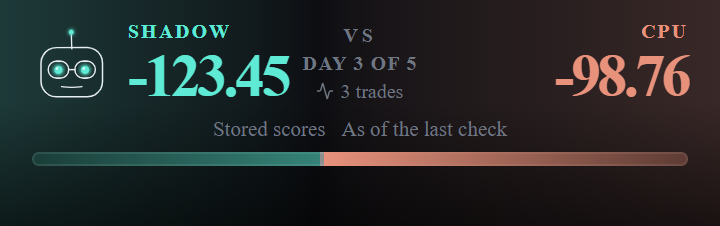
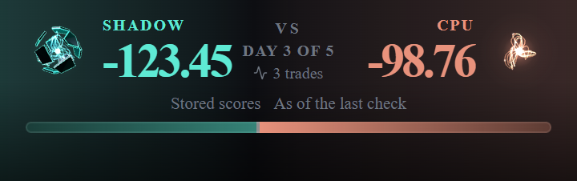
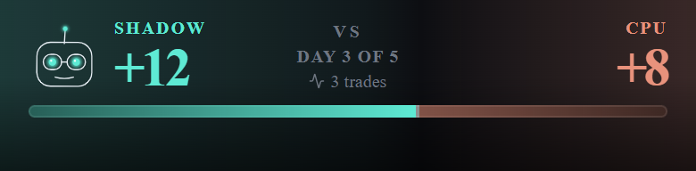
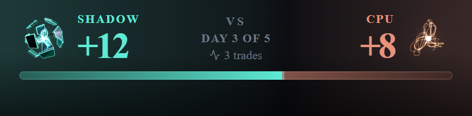
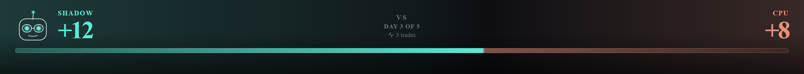
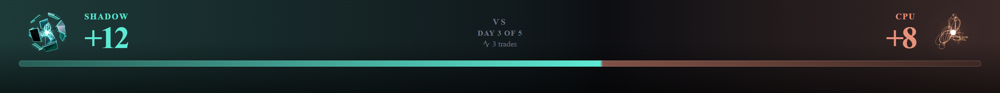

# Build S1: The armored agent in the Command Center and in BaggerBomb battles

**Run date:** October 29, 2026 · **Model:** Opus · **Branch:** `claude/agent-form-s1`, cut from `main` @ `fc0cb6f0` (PR #1007, S0, merged with its review fixes), pushed from the worktree branch `claude/agent-form-s1-49345c` by refspec · **Smoke branch:** `claude/agent-form-s1-smoke` · **Preview:** https://trade-seven-nkueav6ig-fais-projects-bc179554.vercel.app

**Preamble.** `git fetch origin` ran first: `origin/main` = `fc0cb6f0` = the merge of PR #1007, so S0 and its eight review fixes are on `main` (the prompt's STOP condition does not apply). The tree was clean. Every Phase 0 site was re-located on `main` before any write; none had moved in a way that changes this scope (§2). Fenced files read: `api/cron/agent-evaluate.js` is not fenced; it was read at `:231` and `:927-966` for the evaluation lock. Fenced functions called: none. Fenced files edited: none. Nothing under `api/` changed.

---

## Executive verdict

| # | Item | Result |
|---|---|---|
| 1 | Flag-off identity | **Both flags off, the build is byte-identical to `main` except for the bug fix.** All 44 JS chunks, the stylesheet and `index.html` were compared unminified with chunk hashes masked. **`main` → bug-fix commit: one line changes** (the hook's archetype read). **Bug-fix commit → code head: no difference at all.** The files match even unmasked, so every chunk hash is the same. |
| 2 | Bug fix (its own commit, the only flag-off change) | Every battle face drew "neutral" because the presence hook read `agent.archetype` from a battle document, and a battle carries `agentContext.archetype`. The hook now reads both (`useAgentPresence.js:38-42`). It fixes every face that takes a battle document: arena header, pane header, floating mark, the legacy score header, and the Film Room v2 mark. |
| 3 | Scope A: hub hero | `HubAgentForm` replaces `ShadowCanvas` at both stage sites behind `AGENT_FORM_HUB_ENABLED`, in the same `size × size` box. The suit-up plays only between two ready reads of the same agent, never on first mount. The size step from bare Shadow is smoothed (R5). Reduced motion gives the still and redraws it on a change. The phone draws at `AGENT_FORM_PHONE = 'live'`. Accessible name: "Shadow wearing <archetype> — <state>". |
| 4 | Scope B: battle | The arena header, pane header and floating mark draw the form behind `AGENT_FORM_BATTLE_ENABLED`. The header's CPU side gains a mirrored bare copper core. **The header height is unchanged at 320, 360, 390 and 1280 px, with short scores and with long two-decimal ones** (§4). On the phone the forms keep the old face's 40 px footprint. Moods follow R8/R9 through a new pure `deriveAgentMood`. |
| 5 | R6 guard amendments | (a) Exactly one lazy edge, `loadEngine.js -> engine/index.js`, pinned by path. (b) `three` is reachable only behind that edge; `PERMITTED_PACKAGES` is unchanged. (c) The wrapper joins the activity scan and the call-by-call activity guard. (d) A row shows the rate comes only from the constant and the size rule. **Every row was mutation-checked.** |
| 6 | R3 glow | **The glow did reach past the box**, faintly, where the connector leaves the hub hero (measured in headless Edge, §5). So the hero uses `contain: paint`; clipped, the spill is 0. |
| 7 | Tests | 10 new test files and amended guards. **Mutation: 39 of 39 mutants killed**: 31 in the first round, 7 in the second (one survivor, its row strengthened, then killed), and the bug fix's own (§7). `lint:gate` exit 0. Full suite on Linux, on the code head merged with `main`: **27,383 rows, 27,294 pass, 0 fail, 89 skipped.** |
| 8 | Smoke | `claude/agent-form-s1-smoke` = `c6210846`: both flags on, plus the hub hero's corner readout in S7's format. Preview: https://trade-seven-nkueav6ig-fais-projects-bc179554.vercel.app. |
| 9 | Review threshold | The code diff is **46 files, +2,009 / −87 lines** (the report and pictures add more), over both BUILD_RULES §2 thresholds, so **a review session runs before merge.** No review is claimed here. |

---

## 1. What was built

| Commit | What |
|---|---|
| `2cbfa84f` | **The bug fix**, alone: `useAgentPresence.js` reads `agent.agentContext.archetype` when `agent.archetype` is absent. This is the only change that applies with both flags off. Three rows sit in `AgentPresenceMount.reactivity.test.jsx`. |
| `6a246f46` | **Flags.** `AGENT_FORM_HUB_ENABLED = false` and `AGENT_FORM_BATTLE_ENABLED = false` in `src/config/agentFormFlags.js`, with `// Pinned by:`, `DARK_BY_DESIGN` entries and their pins. `AGENT_FORM_PHONE = 'live'` beside `PHONE_SHADOW` in `hub/hubFlags.js` (R1), pinned in `hubFlags.test.js`. |
| `d8c2dae6` | **Engine and wrapper.** See below. |
| `59955fad` | **Hub hero** and the R6 guards. |
| `d94813ab` | **Battle forms**, the mood derivation, and the token and motion guard registrations. |
| `59f3abdf` | **After the advisor's pass:** the battle slot's own error boundary (a failed chunk leaves the still and the screen) and a caught load of the outcome module; the hub label's status kept with the form's key; two honesty registrations the full suite asked for (§6). |
| `fb5e5d2a` | **The phone header footprint:** the 48 px forms overhang 4 px a side, so the phone header lays out exactly as before (§4). |

**Engine** (`src/components/AgentForm/engine/`):
- `swap(patch)` plays a change of form:
  - a new set suits up from nothing on the board's 900 ms equip;
  - a change to bare Shadow plays the old set's 700 ms unequip, then shows Shadow;
  - a change reversed mid-way continues from where the plates are.
- **R5:** the form's scale runs from the scale last drawn to the new form's across the tween, as a pure function of fit (`vocab.js swapScale`). At fit 1 the scale is exactly the form's own frame, so a settled form draws as before. `FRAME_SCALE` holds the design's frames in one table (1.25 bare; .74 / .95 / .9 / .95 / .95 / .95), and the builders read it.
- A `paused` view holds its frame and keeps the loop off (the hub's R-S7-5: it pauses while the deploy ceremony covers the page).
- The cached still is drawn where the view is headed (the settled fit), not at a tween's first frame. Otherwise a context loss after a swap would show a half-equipped still.
- Under reduced motion, the still rate or with no live context, a swap is `update()`: the new still at once (S0's SR-3 path).

**Wrapper** (`AgentForm.jsx`, `agentFormSpec.js`):
- `equipOnChange`: a change of archetype after mount is a swap; at mount, never.
- `paused` and `clip` (`contain: paint`).
- A form under 40 px is a still (`rateForSize`, R12).
- The pixel ratio is re-read on a window `resize` (the S0 review's §5 carry-over; no media query).
- `label={null}` makes the form decorative.
- The table's module-level calls carry `/* @__PURE__ */` so an unread `Object.freeze(Object.keys(…))` cannot survive into the flag-off bundle (§3).

**Hub hero** (`src/components/CommandCenter/HubAgentForm.jsx`):
- It reads the hub's own agent read through `HubAgentFormContext`, which `CommandCenterHub.jsx` provides around the shells with `readers.agent`. That is the same read the Loadout shows (`useHubRuntime.js:104-107` reads `agent?.archetype` from it).
- The form is keyed by the read: `pending` until ready, then `agent:<id>`. So the first answer, an agent or account switch, and any remount (a width change, a return to the hub) draw the form at once. Only a change between two ready reads of the same agent plays the suit-up.
- Mood: `researching` while the hub's `processing` status is set (a hub-started deploy submitting), else `idle`.
- Look: teal (R11), stage 1 through `getAgentGrowth` (R7), batched (R2), the CSS-blurred glow, clipped (R3).
- Rate: `AGENT_FORM_PHONE` on the phone, `live` on wider stages (R1, R6d).
- Accessible name: `AGENT_FORM_COPY` in `hub/hubCopy.js`, a separate export so the flag-off chunk keeps its bytes. The archetype's name comes from `hub/archetypeLines.js` only (R10). Bare Shadow keeps Shadow's own label, never "wearing Unknown".
- **Why a scope and not a prop "through both stages":** a new prop on `ShadowStage`, `PhoneStage` or the shells changes their compiled bytes with the flag off. Each site is instead one literal ternary on the flag, which Rollup folds to today's element (§3).

**Battle** (`src/screens/battleView/`):
- `BattleAgentForm.jsx`:
  - player: `agentContext.archetype` in teal;
  - CPU: bare copper core, mirrored (R9);
  - both decorative (R10), batched, stage 1.
- `battleAgentFormSlot.jsx`:
  - the screen's scope (cockpit feed and coarse clock);
  - `duelScores`, the pair the robot head is fed at each site, used as the mood's scores (§9);
  - the slot, which shows the SVG still while the lazy form loads.
- `agentMood.js`: `deriveAgentMood({ battle, cockpitFeed, side, scores, nowMs, outcomes })`.
  - Player (R8): celebrating > waiting > researching > confident / worried > idle.
  - **A completed battle is celebrating if won, otherwise idle.**
  - Celebrating comes from the hub's `deriveGameOutcome`, on a projection held equal to the hub's `outcomeInputOf` by a parity row.
  - Waiting means `needsYouCount > 0`.
  - Researching means `cronState.evaluatingAt` is set and younger than 120 s. That is the server's own `EVALUATING_LOCK_TIMEOUT_MS` (`agent-evaluate.js:231`), pinned by a tripwire. A crashed tick leaves its stamp until the lock ages out (`:1214`).
  - CPU: the sign-flipped standing only.
- **Sites:**
  - `ArenaHeader.jsx`: player 72 / 48 px. The box overhangs the row by `-8px` / `-4px`, so the header keeps its height. A new CPU cell: label and score, then the core on the outer edge.
  - `CharacterPane.jsx`: 40 px, overhanging today's 36 px box by 2 px a side, so the F2 name and archetype thresholds keep their room.
  - `CharacterAvatar.jsx`: 44 / 40 px, the mark's own size.
  - Every site keeps the presence gate. The form appears exactly where the robot head did.
- `CharacterAvatar.jsx`'s honesty rule 1 now records ruling R8 for the new form; the robot head keeps the rule.

**Other edits:**
- `ShadowStill.jsx:27-31`: the stale `#ECFFFB` comment now says the colour has had a token since S0 (`--ft-agent-teal-core`), and that the still keeps white as shipped.
- The equip tween is recorded as a stated BUILD_RULES §11 exception beside the hub's motion rows (`commandCenterHub.mount.guard.test.js`, above the "colour and motion" describe), with a row (S0's SR-15).

---

## 2. Sites, re-located on `main` @ `fc0cb6f0`

Every Phase 0 anchor was re-read; the line numbers hold.
- `ShadowStage.jsx:157` and `:190`: the two `ShadowCanvas` mounts.
- `CommandCenterHub.jsx:154-159`: `shadowSizeFor` (340 / 260 / 200 / 196). `:202-204`: the `processing` status.
- `useHubRuntime.js:104-107`: the agent read.
- `ArenaHeader.jsx`:
  - `:232-244`: the face;
  - `:221`: the `1fr auto 1fr` grid;
  - `:316-319`: the CPU cell.
- `CharacterPane.jsx:335-359` (the face, `PANE_FACE_PX` = 36) and `CharacterAvatar.jsx:263-281`.
- `AgentBattleScreen.jsx`:
  - `:1714-1723`: the displayed scores;
  - `:2610-2631`: the cockpit feed;
  - `:1222`: the cockpit gate;
  - `:1033`: the coarse clock.
- `useAgentPresence.js:38`.
- `commandCenterHub.mount.guard.test.js`: `:624` `PERMITTED_PACKAGES`, `:714` `ALLOWED_ACTIVITY`, `:790-796` the no-`import()` row.

One thing differed from Phase 0's picture: `CharacterPane` is in the **entry** chunk (reached statically from the main graph), not only the battle chunk. That shaped §3.

---

## 3. Flag-off identity, and what it took

**Method:**
- `vite build --minify false` on Linux (WSL, Node 20.20.2), on LF trees of `main`, the bug-fix commit and the code head.
- Every `-[8 chars].js/.css` hash masked in file names and contents, then `diff -r` (source maps excluded).
- The S0 memory explains why unminified: minified chunks differ in about 1,800 places when lazy-chunk names change, because esbuild renames.

| Pair | Result |
|---|---|
| `main` `fc0cb6f0` → bug fix `2cbfa84f` | 44 / 44 JS chunks, CSS, `index.html`: one file differs, the entry. **One line**, `useAgentPresence`'s read: `agent?.archetype ?? agent?.agentContext?.archetype ?? …`. Comments do not reach the output. |
| bug fix `2cbfa84f` → code heads `d94813ab`, `59f3abdf` and the final `f04cfedc` | **Identical, even unmasked.** Every non-map file matches, so every chunk hash is equal (the entry is `index-BypnjhBh.js` in both). |

**After merging `main`** (`a5c35ba6` → the merged head `30db3685`): the same check against the new `main` shows the same one line, the bug fix, and nothing else (44 / 44 JS chunks, CSS, `index.html`).

**Two leaks the build diff found during the build, and their fixes:**
1. **`agentFormSpec.js`'s code-id table survived into the entry chunk.**
   - Rollup kept `Object.freeze(Object.keys(FORM_BY_CODE_ID))` as a possible side effect once the module was statically reachable.
   - Fix: `/* @__PURE__ */` on its module-level calls.
2. **The battle form reordered the hub chunk.**
   - Rollup orders modules before it tree-shakes, and a folded `import()` stays in the module graph.
   - With the battle form importing the hub's `gameOutcome.js`, that module was ordered from the battle side first and moved up within the hub chunk. The code was unchanged, but the bytes were not.
   - First fix: the battle form loads lazily through a literal-ternary `lazy()` (S0's App pattern).
   - The full fix: the form loads `gameOutcome.js` one `import()` deeper (`BattleAgentForm.jsx`, read with React's `use()` under the slot's Suspense), so the hub claims the module's place first.

**Flag on** (Linux builds with both flags true; minified sizes from the smoke commit's production build: `BattleAgentForm` 1.94 kB / 1.02 kB gzip, `gameOutcome` 1.73 kB / 0.99 kB gzip, the hub chunk 141.18 kB / 42.94 kB gzip, the engine chunk 612.90 kB / 162.13 kB gzip):
- `BattleAgentForm` is its own lazy chunk (3,262 B unminified); `gameOutcome` is split into a shared chunk (3,155 B).
- The engine chunk is unchanged from S0.
- The hub chunk carries the hero and the wrapper.

---

## 4. The header, before and after

Rendered by a scratch harness of the real `ArenaHeader` (flags off and on), headless Edge 156, ANGLE D3D11, 2×, reduced motion (stills, for a steady picture). Fixture: Speculator, scores 12.4 and 8.1.

| Width | Height before → after (scores 12.4 vs 8.1) | Height before → after (gated, −123.45 vs −98.76) | Form | Horizontal overflow |
|---|---|---|---|---|
| 320 | 96 → **96** | 113 → **113** | 48 px (40 px footprint), both live | none |
| 360 | 96 → **96** | 113 → **113** | 48 px (40 px footprint), both live | none |
| 390 (phone) | 96 → **96** | 113 → **113** | 48 px (40 px footprint), both live | none |
| 1280 (desktop) | 120 → **120** | 139 → **139** | 72 px, both live | none |

The phone forms overhang 4 px on every side (`fb5e5d2a`), so the row lays out exactly as the 40 px face did. The first version overhung only vertically. At 360 a long gated score then reached the centre column, and at 320 the header grew 11 px. Measured, fixed, and re-measured: the table above is the fix. At 320 with long scores, the player's score already touched "DAY 3 OF 5" before this build. That is unchanged, not caused here.

Long gated scores at 360, before:

After:

Before, 390:

After, 390:

Before, 1280:

After, 1280:

What the pictures show:
- The robot head gives way to the Speculator in teal.
- The CPU side, which had no figure at all, now has the copper bare core, mirrored, on its outer edge.
- "CPU", both scores, the VS block and the bar are where they were.

---

## 5. R3: the glow's spill

Measured on the flag-on harness, headless Edge, 2×:
- the hub hero at 340 px over the hub's own surface colour, live, batched, CSS glow;
- four forms (Speculator, Trend Follower, Capital Preserver, bare Shadow) × two moods;
- the band 1–16 CSS px past the box's right edge, where the connector's dot sits, over the middle 280 px of its height.

| Form · mood | Without `contain` (max / mean over background, RGB sum) | With `contain: paint` |
|---|---|---|
| Speculator · idle / researching | 2 / 0.02 · 3 / 0.05 | 0 / 0 |
| Trend Follower · idle / researching | 4 / 0.61 · 3 / 0.46 | 0 / 0 |
| Capital Preserver · idle / researching | 5 / 0.65 · 5 / 0.69 | 0 / 0 |
| Bare Shadow · idle / researching | 2 / 0.33 · 2 / 0.35 | 0 / 0 |

**The glow reaches past the box.** The spill is faint, at most 5 levels summed over three channels, but it overlaps the connector's start. Per R3, the hero uses `contain: paint` (the wrapper's `clip`). That is also what the design's in-canvas glow does: it stops at the canvas edge. The area controls sit further away than the connector's dot. The phone stage has no connector.

---

## 6. The R6 guard amendments and other guard changes

| Ruling | Where | What |
|---|---|---|
| R6a | `commandCenterHub.mount.guard.test.js` | The "no `import()`" row (`:790-796` on `main`) becomes "exactly one lazy edge", `loadEngine.js -> lazy engine/index.js`, pinned by path. The import walk enters the agent form wrapper's six modules, which are pinned by path in the "stays in its directory" row, rather than stopping at a terminal that would hide the edge. |
| R6b | same | A row: `three` is not in the hub's static graph, no hub module imports it, `PERMITTED_PACKAGES` is still `framer-motion, react, react-dom`, and the engine's graph past the edge is where `three` is. |
| R6c | same, and `commandCenterHub.activity.guard.test.js` | `AgentForm.jsx` joins `ALLOWED_ACTIVITY` (`useEffect`, `addEventListener`). The directory's activity scan now covers the wrapper. Call by call: five effects plus `window` `resize` add and remove. `HubAgentForm.jsx` holds none. |
| R6d | `commandCenterHub.mount.guard.test.js` | `hubFormRate` is exactly `phone ? AGENT_FORM_PHONE : 'live'`; the wrapper lowers the rate only by size; no hub-side or wrapper file reads a frame, a cost or a performance clock. |
| R8 | same, the main-graph row | **Not one of the four R6 amendments; see Founder question 1.** It adds one load-time edge from `battleView/BattleAgentForm.jsx` into `hub/selectors/gameOutcome.js`, the existing outcome derivation R8 names. |
| — | `PERMITTED_TERMINALS` | `src/config/agentFormFlags.js`, the flag module the stage sites read (it imports nothing). |
| — | `hubCopy.guard.test.js` | `mood`, `bloom` and `allegiance` join the token-valued attributes (engine vocabulary, never shown). |
| — | `agentForm.guard.test.js` (S0) | App's static graph may reach one agent form module, the SVG still the battle slot shows while the form loads. The wrapper, engine, lab and `three` stay behind `import()`s. |
| — | `tokens.guard`, `motion.guard` and baselines | The four new files, at zero literals. |
| — | `deskHonesty.test.js` (the C1 guard) | The guard bans agent verbs, "researching" among them, in every battle-view source. R8 names a "researching" **mood**: a pose the engine draws, never a word on screen, shown only while an evaluation lock the server honours is live. A **statement-scoped** exemption covers the one line of `agentMood.js` that returns the token (the narrator precedent, review C-4), with a row keeping it earned. See Founder question 6. |
| — | `unconfirmedOutcome.census.test.js` | `agentMood.js` reads the status feed only for the presence of the `battle_complete` entry, as `hub/gamesDisplay.js` does; registered with that disposition. |

---

## 7. Tests and checks

**New test files:**

| File | Rows | What |
|---|---|---|
| `AgentPresenceMount.reactivity.test.jsx` (3 added) | 3 | The bug fix through the real hook |
| `engine/engine.lifecycle.jsdom.test.js` (11 added) | 11 | Swaps: bare → set (1.25 → .74, no step greater than .02 per frame, monotone, ends exact); set → set; set → bare (unequip, then bare at 1.25, no step at the switch); a reversal mid-way; mood change mid-swap; reduced motion and still rate (+2 renders); settling when motion stops; the settled still; the still redrawn when bare Shadow shows. Pause: loop stops and resumes; other views keep drawing. |
| `engine/vocab.test.js` (3 added) | 3 | `FRAME_SCALE` equals the design's frames; `swapProgress`; `swapScale` |
| `AgentForm.s1.jsdom.test.jsx` | 10 | The swap only on a change of form after mount; a change during chunk load; `paused`, `clip`, decorative label; R12; the resize re-read and the listener's removal |
| `HubAgentForm.jsdom.test.jsx` | 9 | The read and its key; the suit-up only between two ready reads of the same agent (counted mounts across load, change, switch, failure, remount); what the form is handed; the rate; reduced motion and pause; the name, armored and bare; the box |
| `ShadowStage.agentForm.jsdom.test.jsx` | 5 | Both sites flag on (sizes, rates, props) and flag off; the scope's value is `readers.agent` |
| `agentMood.test.js` | 9 | Every precedence pair; completed lost, tied or without a result → idle; waiting's inputs; the lock's age and the tripwire on the cron; the CPU's sign flip and that it never waits, researches or celebrates; the projection's parity with the hub's |
| `BattleAgentForm.jsdom.test.jsx` | 6 | The still while loading; player and CPU (copper, mirrored, bare via `agentFormSpec`); waiting, researching and celebrating through the scope and the loaded derivation |
| `battleAgentForm.sites.render.test.jsx` | 7 | Flag on at all three sites (sizes, overhangs, "CPU", the book's target); flag off (the static face, no slot); **parity: each slot's scores equal the pair that site feeds its face**, over three comparison states × three score shapes |
| `config/agentFormFlags.test.js` | 6 | The two pins; the module literal; registration; every read is a literal ternary that folds |
| guards (amended) | — | §6 |

**Mutation, first round** (Linux, at `d94813ab`'s tree; each mutant one exact replacement, its rows run, the file restored from `git show HEAD:` and checked clean): **31 of 31 killed**, plus the bug fix's own mutant (killed by its battle-doc row).

| Mutant | Killed by |
|---|---|
| MOOD-1 a completed loss shows the live standing | "a completed battle lost, drawn, or with no result is idle" |
| MOOD-2 researching above waiting · MOOD-3 the standing above researching | "every pair: the higher one wins" |
| MOOD-4 no sign flip for the CPU | the CPU's two rows |
| MOOD-5 the CPU may wait | "is never waiting, researching or celebrating" |
| MOOD-6 a stale lock still reads researching | the lock-age row |
| MOOD-7 celebrating from raw scores, not the derivation | the completed row (ended without final evidence) |
| MOOD-8 the mood's scores are not the face's pair | the sites' parity row |
| EQUIP-1 any change is a swap · EQUIP-2 the mount forgets its kind | "a mood, stage or size change … is update()" |
| EQUIP-3 a change is never played | the swap and chunk-loading rows |
| EQUIP-4 not re-keyed on the first answer · EQUIP-5 not re-keyed on an agent switch | `hubFormRead` and the counted-mounts row |
| EQUIP-6 the hero never asks for the change | the counted-mounts row and the §11 row |
| SIZE-1 a swap starts at the new scale · SIZE-2 the pose ignores the swap's scale | the bare → set and set → set rows |
| SIZE-3 a set coming off never leaves bare Shadow | the set → bare and reversal rows |
| SIZE-4 the still drawn at the tween's first frame | the settled-still row |
| RM-1 a reduced-motion swap does not redraw | the reduced-motion swap row |
| PAUSE-1 a paused view keeps the loop running | the pause row |
| R12-1 the floor at 30 px · R12-2 the wrapper ignores the size rule | the R12 rows (and the R6d row) |
| OPP-1 the CPU wears armor · OPP-2 the CPU in teal, unmirrored | the CPU row |
| FIELD-1 the form reads `battle.archetype` | the player row |
| GUARD-1 a second `import()` · GUARD-2 static `three` · GUARD-3 a timer in the wrapper · GUARD-4 rate from a frame cost · GUARD-5 another outside module | the R6a, R6b, R6c (both guards), R6d and directory rows respectively |
| FLAG-1 a stage site read with `&&` (a `false` child left) | the literal-ternary row |

**Mutation, second round** (the rows added after the advisor's pass, at `fb5e5d2a`): **7 of 7 killed after one fix.**

| Mutant | Killed by |
|---|---|
| BOUND-1 no boundary around the lazy form | "the form's chunk fails: the slot keeps the still, and the rest of the screen stays" |
| CATCH-1 a failed outcome module throws through the form | "the outcome module fails: the form still draws … idle" |
| KEYED-1 the label keeps the old form's status after a re-key | "a re-keyed form starts again from \"still\"" |
| HONEST-1 a second "researching" in the mood module · HONEST-2 the exempted statement changed | the C1 row and the "exemption is earned" row |
| CENSUS-1 the mood module reads `evaluations` | the census row |
| FOOT-1 the phone's player box loses its side overhang | **survived at first.** The row's `toContain` matched the opponent box's identical style. The row now requires the overhang on both boxes (`f04cfedc`), and the mutant is killed. |

**Other checks:**
- `lint:gate` exit 0.
- Flag-off builds: §3.
- Full suite, Linux (WSL, `TZ=UTC`, 8 workers, Node 20.20.2, under the suite lock):
  - at the merged head `30db3685`: **27,383 rows, 27,294 pass, 0 fail, 89 skipped** (6,636 files);
  - at the code head `f04cfedc`, before the merge: 27,315 rows, 27,226 pass, 0 fail, 89 skipped;
  - at `d94813ab`, it found the two honesty registrations of `59f3abdf` (the only reds, both real);
  - at `59f3abdf`: one red, `api/_utils/callRecords/publish.test.js`'s real-time deadline row. That file is untouched here and ran beside a build; PR #1010, merged since, fixes that family.
- `lint:gate` exit 0 at the merged head.
- A minified `vite build` (the deployed shape) of the smoke commit exits 0, and so does one of the pushed head (§10).
- The touched suites (208 files) were green on Linux before the regroup into commits; the regroup kept the same tree (`f075cc0b`).
- On Windows, a broad parallel run of the hub directory showed a few hub rows timing out at 5 s that pass alone: the known load class. Linux is the record.

---

## 8. The iPhone checklist (founder)

Open **https://trade-seven-nkueav6ig-fais-projects-bc179554.vercel.app** in Safari on the iPhone and sign in as usual.

**Command Center hero:**
1. On the Command Center, the hero is Shadow wearing your archetype's armor, in teal. A small black box in the top-right corner shows two lines of numbers.
2. Leave the phone still for **one minute**. Copy the box's second line (it starts with `60 s:`) into a note. You are looking for about 60 fps, a small `p95`, and `late` near 0 %.
3. **Change your archetype, with no game running** (the picker is locked during a game): Loadout → Change archetype, pick another, confirm. Back on the hub, the new armor should fly on in about a second, without the figure jumping in size. Change it once more to see it again.
4. **Reduce Motion:** Settings → Accessibility → Motion → Reduce Motion on. Back on the hub, the figure stands still. Change archetype: it switches to the new still at once. Turn Reduce Motion off again.
5. **Lock and unlock:** lock the phone on the hub, wait 10 seconds, unlock. The figure comes back moving, with no black square.
6. **Widths:** if you can, check on a narrow phone, or zoom, at about 360 and 390 px wide. The hero sits beside "Shadow / your research partner" with nothing overlapping.

**A live BaggerBomb battle (1v1 against the computer):**

7. Open a live battle. At the top:
   - **your figure is on the left, in teal and armored**;
   - **the computer's is on the right: a copper glowing core with no armor, facing you**;
   - "CPU" and both scores are where they were.
8. **Your mood follows the lead.** When you are ahead, your figure looks confident (brighter, leaning in). When you are behind, it looks worried (dimmer, fraying). The computer's does the opposite.
9. **"Waiting":** when the cockpit asks you something (a call with buttons), your figure goes into its waiting pose (slow, with a beacon) until you answer.
10. During an evaluation (the turn line says the agent is checking), your figure may show "researching" (a scanning turn) for a few seconds.
11. Open the side pane (the chat): the small figure in its header and the floating mark show the same form.

Paste the 60 s line and anything that looked wrong back to Claude.

**On the smoke branch, which tests are red and why.** With both flags on (flags only, no readout), 97 rows in 9 files go red, and every one pins what the flags replace:
- the two flag pins and `flagPinGuard`;
- the Command Center rows that assert `ShadowCanvas` or `ShadowStill` themselves: `CommandCenterHub.s7` (52) and three S1 rows in `CommandCenterHub.jsdom`;
- the battle rows that assert the robot face or its props: `ArenaHeader.render` (13), `CharacterAvatar.render` (3), `CharacterPane.comparison` (2) and `AgentBattleScreen.paneHeader` (4);
- `AgentBattleScreen.quoteAvailability` (15), whose references are flag-off captures.

No throw, no missing provider, no other row. The smoke commit's corner readout adds red rows of its own: it puts a `div` on `document.body` (the sheet-root count in `CommandCenterHub.realSheets`), and its effect and imports trip the hub guards. Those rows are green with the flags alone.

---

## 9. Not built in S1

- **The response bloom** S7 gives Shadow (a brief brightening when you select an area, and once when a deploy is confirmed) is not carried by the armored hero. The design's "emphasis by area" (board 5) is the same idea and is not built either (Founder question 5).
- Still not built, as S0 listed: the seam flash, celebrating's ring burst, unworn sets at 70 % light, trailing streams at 40 px.
- League battles (S2), the armory, small sizes (S4).

---

## Founder questions

1. **I reused the Command Center's own win rule for "celebrating".** R8 says celebrating comes from "the existing outcome derivation", and that rule lives inside the Command Center's code. The hub's tests keep a list of every file outside the Command Center allowed to reach into it. I added the battle figure to that list, loading the rule only when the battle figure itself loads. That list change is not one of the four guard changes you approved in R6. Is it all right?
2. **The hub figure's spoken name has a state at the end.** You ruled "Shadow wearing <archetype>". A screen reader hears "Shadow wearing Speculator — ambient", or "— still" or "— processing", because the Command Center spec asks the hero's label to say which of those it is showing. Keep the tail, or drop it?
3. **Any lead counts as a lead.** Your figure looks confident whenever you are ahead, even by a tenth of a point, and worried whenever you are behind. Keep it that way, or should a small margin stay neutral?
4. **After a battle ends, the computer still shows its final standing.** Your figure celebrates a win and goes neutral after a loss or tie, as you ruled. The computer's figure, ruled "standing only", stays confident if it won and worried if it lost. Is that what you want, or should it go neutral too when the battle ends?
5. **The armored hero does not brighten when you tap an area or when a deploy confirms**, as today's Shadow does. Add that in a later stage (with the design's "brighten the armor or the core by area"), or leave it out?
6. **One honesty test needed a narrow exception.** A long-standing test stops the battle screen from describing the agent as "researching", "thinking" and so on, because the agent is not awake between checks. You ruled a "researching" mood for the figure while an evaluation is really running. I exempted only the one line of code that names that mood. The word never appears on screen; the figure just changes pose. Is that exception all right?

---

## 10. Commits and artifacts

On `claude/agent-form-s1`:
- `2cbfa84f`: the bug fix;
- `6a246f46`: the flags;
- `d8c2dae6`: the engine and wrapper;
- `59955fad`: the hub hero and guards;
- `d94813ab`: the battle forms;
- `59f3abdf`: the advisor's pass (the slot's boundary, the caught outcome load, the keyed label status, two honesty registrations);
- `fb5e5d2a`: the phone header footprint;
- `f04cfedc`: the stronger header row (the code head);
- `30db3685`: `origin/main` merged in (`a5c35ba6`: PR #1009, the DRB stale fix, and PR #1010, the callRecords deadline-flake fix). The app's sync tool merged it cleanly; the one shared file, `hub/hubCopy.js`, has the DRB edits mid-file and this build's appended export.
- this report and its six pictures.

`claude/agent-form-s1-smoke` = `c6210846`: one commit on `30db3685` (the code head merged with `main`), "SMOKE ONLY, NEVER MERGE". It sets both flags `true` and adds the hero's corner readout (`HubAgentForm.jsx`, the S0 lab's `agentFormLabReadout.js` lines from the engine's own frame samples; late means over 25 ms, or over 50 ms at half rate, per R4). On it, the flag pins, `flagPinGuard` and the hub guards are red by design.

Not committed: the scratch harness (header, glow), the mutant runner and its spec, the WSL build and diff scripts. They live in the session scratchpad. A copy of this report is at `C:/Users/fashr/Documents/FantasyTrades/AgentForm/20261029_BUILD_AGENT_FORM_S1.md` (BUILD_RULES §3).
