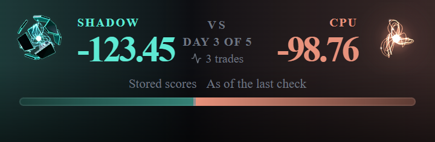
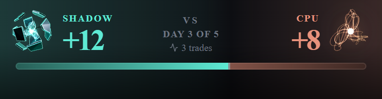
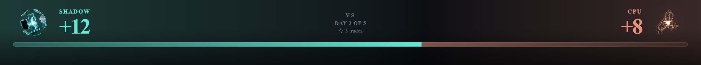
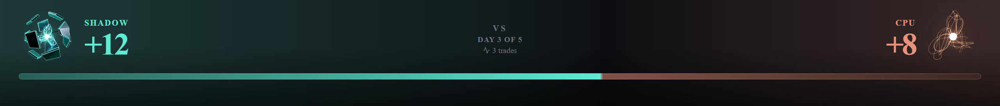

# Build S1: The armored agent in the Command Center and in BaggerBomb battles

**Run date:** October 29, 2026 · **Model:** Opus · **Branch:** `claude/agent-form-s1`, cut from `main` @ `fc0cb6f0` (PR #1007, S0, merged with its review fixes), pushed from the worktree branch `claude/agent-form-s1-49345c` by refspec · **Smoke branch:** `claude/agent-form-s1-smoke` · **Preview:** https://trade-seven-nkueav6ig-fais-projects-bc179554.vercel.app

**Preamble.** `git fetch origin` ran first: `origin/main` = `fc0cb6f0` = the merge of PR #1007, so S0 and its eight review fixes are on `main` (the prompt's STOP condition does not apply). The tree was clean. Every Phase 0 site was re-located on `main` before any write; none had moved in a way that changes this scope (§2). Fenced files read: `api/cron/agent-evaluate.js` is not fenced; it was read at `:231` and `:927-966` for the evaluation lock. Fenced functions called: none. Fenced files edited: none. Nothing under `api/` changed.

---

## Executive verdict

| # | Item | Result |
|---|---|---|
| 1 | Flag-off identity | **Both flags off, the build is byte-identical to `main` except for the bug fix.** All 44 JS chunks, the stylesheet and `index.html` were compared unminified with chunk hashes masked. **`main` → bug-fix commit: one line changes** (the hook's archetype read). **Bug-fix commit → code head: no difference at all.** The files match even unmasked, so every chunk hash is the same. |
| 2 | Bug fix (its own commit, the only flag-off change) | Every battle face drew "neutral" because the presence hook read `agent.archetype` from a battle document, and a battle carries `agentContext.archetype`. The hook now reads both (`useAgentPresence.js:38-42`). It fixes every face that takes a battle document: arena header, pane header, floating mark, the legacy score header, and the Film Room v2 mark. |
| 3 | Scope A: hub hero | `HubAgentForm` replaces `ShadowCanvas` at both stage sites behind `AGENT_FORM_HUB_ENABLED`, in the same `size × size` box. The suit-up plays only between two ready reads of the same agent, never on first mount. The size step from bare Shadow is smoothed (R5). Reduced motion gives the still and redraws it on a change. The phone draws at `AGENT_FORM_PHONE = 'live'`. Accessible name: "Shadow wearing <archetype> — <state>". |
| 4 | Scope B: battle | The arena header, pane header and floating mark draw the form behind `AGENT_FORM_BATTLE_ENABLED`. The header's CPU side gains a mirrored bare copper core. **The header height is unchanged at 320, 360, 390 and 1280 px, with short scores and with long two-decimal ones** (§4). On the phone the forms keep the old face's 40 px footprint. Moods follow R8/R9 through a new pure `deriveAgentMood`. |
| 5 | R6 guard amendments | (a) Exactly one lazy edge, `loadEngine.js -> engine/index.js`, pinned by path. (b) `three` is reachable only behind that edge; `PERMITTED_PACKAGES` is unchanged. (c) The wrapper joins the activity scan and the call-by-call activity guard. (d) A row shows the rate comes only from the constant and the size rule. **Every row was mutation-checked.** |
| 6 | R3 glow | **The glow did reach past the box**, faintly, where the connector leaves the hub hero (measured in headless Edge, §5). So the hero uses `contain: paint`; clipped, the spill is 0. |
| 7 | Tests | 8 new test files, rows added to 4 existing ones, and amended guards. **Mutation: 39 of 39 mutants killed**: 31 in the first round, 7 in the second (one survivor, its row strengthened, then killed), and the bug fix's own (§7). `lint:gate` exit 0. Full suite on Linux, on the code head merged with `main`: **27,383 rows, 27,294 pass, 0 fail, 89 skipped.** |
| 8 | Smoke | `claude/agent-form-s1-smoke` = `c6210846`: both flags on, plus the hub hero's corner readout in S7's format. Preview: https://trade-seven-nkueav6ig-fais-projects-bc179554.vercel.app. (Rebuilt by the size follow-up, with a size dial: §11.9.) |
| 9 | Review threshold | The code diff is **46 files, +2,009 / −87 lines** (the report and pictures add more), over both BUILD_RULES §2 thresholds, so **a review session runs before merge.** No review is claimed here. |
| 10 | Battle size follow-up (§11) | The founder's iPhone run found the battle figures a bit small. **Now 60 px on the phone header (was 48) and 90 on the desktop (was 72); 50 in the pane (was 40); 50 / 55 for the floating mark (was 40 / 44).** A tighter framing, used only by the battle views, adds 12 % for bare Shadow (the CPU's core) and 5 % for two sets. Every box grows ×1.25, so the figures read 25–40 % larger. The header grows 5 px on the phone and 16 on the desktop, within the 12 / 16 allowed. Both flags stay `false`; the flag-off build is unchanged. |

---

## 1. What was built

| Commit | What |
|---|---|
| `2cbfa84f` | **The bug fix**, alone: `useAgentPresence.js` reads `agent.agentContext.archetype` when `agent.archetype` is absent. This is the only change that applies with both flags off. Three rows sit in `AgentPresenceMount.reactivity.test.jsx`. |
| `6a246f46` | **Flags.** `AGENT_FORM_HUB_ENABLED = false` and `AGENT_FORM_BATTLE_ENABLED = false` in `src/config/agentFormFlags.js`, with `// Pinned by:`, `DARK_BY_DESIGN` entries and their pins. `AGENT_FORM_PHONE = 'live'` beside `PHONE_SHADOW` in `hub/hubFlags.js` (R1), pinned in `hubFlags.test.js`. |
| `d8c2dae6` | **Engine and wrapper.** See below. |
| `59955fad` | **Hub hero** and the R6 guards. |
| `d94813ab` | **Battle forms**, the mood derivation, and the token and motion guard registrations. |
| `59f3abdf` | **After the advisor's pass:** the battle slot's own error boundary (a failed chunk leaves the still and the screen) and a caught load of the outcome module; the hub label's status kept with the form's key; two honesty registrations the full suite asked for (§6). |
| `fb5e5d2a` | **The phone header footprint:** the 48 px forms overhang 4 px a side, so the phone header lays out exactly as before (§4). |

**Engine** (`src/components/AgentForm/engine/`):
- `swap(patch)` plays a change of form:
  - a new set suits up from nothing on the board's 900 ms equip;
  - a change to bare Shadow plays the old set's 700 ms unequip, then shows Shadow;
  - a change reversed mid-way continues from where the plates are.
- **R5:** the form's scale runs from the scale last drawn to the new form's across the tween, as a pure function of fit (`vocab.js swapScale`). At fit 1 the scale is exactly the form's own frame, so a settled form draws as before. `FRAME_SCALE` holds the design's frames in one table (1.25 bare; .74 / .95 / .9 / .95 / .95 / .95), and the builders read it.
- A `paused` view holds its frame and keeps the loop off (the hub's R-S7-5: it pauses while the deploy ceremony covers the page).
- The cached still is drawn where the view is headed (the settled fit), not at a tween's first frame. Otherwise a context loss after a swap would show a half-equipped still.
- Under reduced motion, the still rate or with no live context, a swap is `update()`: the new still at once (S0's SR-3 path).

**Wrapper** (`AgentForm.jsx`, `agentFormSpec.js`):
- `equipOnChange`: a change of archetype after mount is a swap; at mount, never.
- `paused` and `clip` (`contain: paint`).
- A form under 40 px is a still (`rateForSize`, R12).
- The pixel ratio is re-read on a window `resize` (the S0 review's §5 carry-over; no media query).
- `label={null}` makes the form decorative.
- The table's module-level calls carry `/* @__PURE__ */` so an unread `Object.freeze(Object.keys(…))` cannot survive into the flag-off bundle (§3).

**Hub hero** (`src/components/CommandCenter/HubAgentForm.jsx`):
- It reads the hub's own agent read through `HubAgentFormContext`, which `CommandCenterHub.jsx` provides around the shells with `readers.agent`. That is the same read the Loadout shows (`useHubRuntime.js:104-107` reads `agent?.archetype` from it).
- The form is keyed by the read: `pending` until ready, then `agent:<id>`. So the first answer, an agent or account switch, and any remount (a width change, a return to the hub) draw the form at once. Only a change between two ready reads of the same agent plays the suit-up.
- Mood: `researching` while the hub's `processing` status is set (a hub-started deploy submitting), else `idle`.
- Look: teal (R11), stage 1 through `getAgentGrowth` (R7), batched (R2), the CSS-blurred glow, clipped (R3).
- Rate: `AGENT_FORM_PHONE` on the phone, `live` on wider stages (R1, R6d).
- Accessible name: `AGENT_FORM_COPY` in `hub/hubCopy.js`, a separate export so the flag-off chunk keeps its bytes. The archetype's name comes from `hub/archetypeLines.js` only (R10). Bare Shadow keeps Shadow's own label, never "wearing Unknown".
- **Why a scope and not a prop "through both stages":** a new prop on `ShadowStage`, `PhoneStage` or the shells changes their compiled bytes with the flag off. Each site is instead one literal ternary on the flag, which Rollup folds to today's element (§3).

**Battle** (`src/screens/battleView/`):
- `BattleAgentForm.jsx`:
  - player: `agentContext.archetype` in teal;
  - CPU: bare copper core, mirrored (R9);
  - both decorative (R10), batched, stage 1.
- `battleAgentFormSlot.jsx`:
  - the screen's scope (cockpit feed and coarse clock);
  - `duelScores`, the pair the robot head is fed at each site, used as the mood's scores (§9);
  - the slot, which shows the SVG still while the lazy form loads.
- `agentMood.js`: `deriveAgentMood({ battle, cockpitFeed, side, scores, nowMs, outcomes })`.
  - Player (R8): celebrating > waiting > researching > confident / worried > idle.
  - **A completed battle is celebrating if won, otherwise idle.**
  - Celebrating comes from the hub's `deriveGameOutcome`, on a projection held equal to the hub's `outcomeInputOf` by a parity row.
  - Waiting means `needsYouCount > 0`.
  - Researching means `cronState.evaluatingAt` is set and younger than 120 s. That is the server's own `EVALUATING_LOCK_TIMEOUT_MS` (`agent-evaluate.js:231`), pinned by a tripwire. A crashed tick leaves its stamp until the lock ages out (`:1214`).
  - CPU: the sign-flipped standing only.
- **Sites:**
  - `ArenaHeader.jsx`: player 72 / 48 px. The box overhangs the row by `-8px` / `-4px`, so the header keeps its height. A new CPU cell: label and score, then the core on the outer edge.
  - `CharacterPane.jsx`: 40 px, overhanging today's 36 px box by 2 px a side, so the F2 name and archetype thresholds keep their room.
  - `CharacterAvatar.jsx`: 44 / 40 px, the mark's own size.
  - Every site keeps the presence gate. The form appears exactly where the robot head did.
- `CharacterAvatar.jsx`'s honesty rule 1 now records ruling R8 for the new form; the robot head keeps the rule.

**Other edits:**
- `ShadowStill.jsx:27-31`: the stale `#ECFFFB` comment now says the colour has had a token since S0 (`--ft-agent-teal-core`), and that the still keeps white as shipped.
- The equip tween is recorded as a stated BUILD_RULES §11 exception beside the hub's motion rows (`commandCenterHub.mount.guard.test.js`, above the "colour and motion" describe), with a row (S0's SR-15).

---

## 2. Sites, re-located on `main` @ `fc0cb6f0`

Every Phase 0 anchor was re-read; the line numbers hold.
- `ShadowStage.jsx:157` and `:190`: the two `ShadowCanvas` mounts.
- `CommandCenterHub.jsx:154-159`: `shadowSizeFor` (340 / 260 / 200 / 196). `:202-204`: the `processing` status.
- `useHubRuntime.js:104-107`: the agent read.
- `ArenaHeader.jsx`:
  - `:232-244`: the face;
  - `:221`: the `1fr auto 1fr` grid;
  - `:316-319`: the CPU cell.
- `CharacterPane.jsx:335-359` (the face, `PANE_FACE_PX` = 36) and `CharacterAvatar.jsx:263-281`.
- `AgentBattleScreen.jsx`:
  - `:1714-1723`: the displayed scores;
  - `:2610-2631`: the cockpit feed;
  - `:1222`: the cockpit gate;
  - `:1033`: the coarse clock.
- `useAgentPresence.js:38`.
- `commandCenterHub.mount.guard.test.js`: `:624` `PERMITTED_PACKAGES`, `:714` `ALLOWED_ACTIVITY`, `:790-796` the no-`import()` row.

One thing differed from Phase 0's picture: `CharacterPane` is in the **entry** chunk (reached statically from the main graph), not only the battle chunk. That shaped §3.

---

## 3. Flag-off identity, and what it took

**Method:**
- `vite build --minify false` on Linux (WSL, Node 20.20.2), on LF trees of `main`, the bug-fix commit and the code head.
- Every `-[8 chars].js/.css` hash masked in file names and contents, then `diff -r` (source maps excluded).
- The S0 memory explains why unminified: minified chunks differ in about 1,800 places when lazy-chunk names change, because esbuild renames.

| Pair | Result |
|---|---|
| `main` `fc0cb6f0` → bug fix `2cbfa84f` | 44 / 44 JS chunks, CSS, `index.html`: one file differs, the entry. **One line**, `useAgentPresence`'s read: `agent?.archetype ?? agent?.agentContext?.archetype ?? …`. Comments do not reach the output. |
| bug fix `2cbfa84f` → code heads `d94813ab`, `59f3abdf` and the final `f04cfedc` | **Identical, even unmasked.** Every non-map file matches, so every chunk hash is equal (the entry is `index-BypnjhBh.js` in both). |

**After merging `main`** (`a5c35ba6` → the merged head `30db3685`): the same check against the new `main` shows the same one line, the bug fix, and nothing else (44 / 44 JS chunks, CSS, `index.html`).

**Two leaks the build diff found during the build, and their fixes:**
1. **`agentFormSpec.js`'s code-id table survived into the entry chunk.**
   - Rollup kept `Object.freeze(Object.keys(FORM_BY_CODE_ID))` as a possible side effect once the module was statically reachable.
   - Fix: `/* @__PURE__ */` on its module-level calls.
2. **The battle form reordered the hub chunk.**
   - Rollup orders modules before it tree-shakes, and a folded `import()` stays in the module graph.
   - With the battle form importing the hub's `gameOutcome.js`, that module was ordered from the battle side first and moved up within the hub chunk. The code was unchanged, but the bytes were not.
   - First fix: the battle form loads lazily through a literal-ternary `lazy()` (S0's App pattern).
   - The full fix: the form loads `gameOutcome.js` one `import()` deeper (`BattleAgentForm.jsx`, read with React's `use()` under the slot's Suspense), so the hub claims the module's place first.

**Flag on** (Linux builds with both flags true; minified sizes from the smoke commit's production build: `BattleAgentForm` 1.94 kB / 1.02 kB gzip, `gameOutcome` 1.73 kB / 0.99 kB gzip, the hub chunk 141.18 kB / 42.94 kB gzip, the engine chunk 612.90 kB / 162.13 kB gzip):
- `BattleAgentForm` is its own lazy chunk (3,262 B unminified); `gameOutcome` is split into a shared chunk (3,155 B).
- The engine chunk is unchanged from S0.
- The hub chunk carries the hero and the wrapper.

---

## 4. The header, before and after

Rendered by a scratch harness of the real `ArenaHeader` (flags off and on), headless Edge 156, ANGLE D3D11, 2×, reduced motion (stills, for a steady picture). Fixture: Speculator, scores 12.4 and 8.1.

| Width | Height before → after (scores 12.4 vs 8.1) | Height before → after (gated, −123.45 vs −98.76) | Form | Horizontal overflow |
|---|---|---|---|---|
| 320 | 96 → **96** | 113 → **113** | 48 px (40 px footprint), both live | none |
| 360 | 96 → **96** | 113 → **113** | 48 px (40 px footprint), both live | none |
| 390 (phone) | 96 → **96** | 113 → **113** | 48 px (40 px footprint), both live | none |
| 1280 (desktop) | 120 → **120** | 139 → **139** | 72 px, both live | none |

The phone forms overhang 4 px on every side (`fb5e5d2a`), so the row lays out exactly as the 40 px face did. The first version overhung only vertically. At 360 a long gated score then reached the centre column, and at 320 the header grew 11 px. Measured, fixed, and re-measured: the table above is the fix. At 320 with long scores, the player's score already touched "DAY 3 OF 5" before this build. That is unchanged, not caused here.

Long gated scores at 360, before:

After:

Before, 390:

After, 390:

Before, 1280:

After, 1280:

What the pictures show:
- The robot head gives way to the Speculator in teal.
- The CPU side, which had no figure at all, now has the copper bare core, mirrored, on its outer edge.
- "CPU", both scores, the VS block and the bar are where they were.

---

## 5. R3: the glow's spill

Measured on the flag-on harness, headless Edge, 2×:
- the hub hero at 340 px over the hub's own surface colour, live, batched, CSS glow;
- four forms (Speculator, Trend Follower, Capital Preserver, bare Shadow) × two moods;
- the band 1–16 CSS px past the box's right edge, where the connector's dot sits, over the middle 280 px of its height.

| Form · mood | Without `contain` (max / mean over background, RGB sum) | With `contain: paint` |
|---|---|---|
| Speculator · idle / researching | 2 / 0.02 · 3 / 0.05 | 0 / 0 |
| Trend Follower · idle / researching | 4 / 0.61 · 3 / 0.46 | 0 / 0 |
| Capital Preserver · idle / researching | 5 / 0.65 · 5 / 0.69 | 0 / 0 |
| Bare Shadow · idle / researching | 2 / 0.33 · 2 / 0.35 | 0 / 0 |

**The glow reaches past the box.** The spill is faint, at most 5 levels summed over three channels, but it overlaps the connector's start. Per R3, the hero uses `contain: paint` (the wrapper's `clip`). That is also what the design's in-canvas glow does: it stops at the canvas edge. The area controls sit further away than the connector's dot. The phone stage has no connector.

---

## 6. The R6 guard amendments and other guard changes

| Ruling | Where | What |
|---|---|---|
| R6a | `commandCenterHub.mount.guard.test.js` | The "no `import()`" row (`:790-796` on `main`) becomes "exactly one lazy edge", `loadEngine.js -> lazy engine/index.js`, pinned by path. The import walk enters the agent form wrapper's six modules, which are pinned by path in the "stays in its directory" row, rather than stopping at a terminal that would hide the edge. |
| R6b | same | A row: `three` is not in the hub's static graph, no hub module imports it, `PERMITTED_PACKAGES` is still `framer-motion, react, react-dom`, and the engine's graph past the edge is where `three` is. |
| R6c | same, and `commandCenterHub.activity.guard.test.js` | `AgentForm.jsx` joins `ALLOWED_ACTIVITY` (`useEffect`, `addEventListener`). The directory's activity scan now covers the wrapper. Call by call: five effects plus `window` `resize` add and remove. `HubAgentForm.jsx` holds none. |
| R6d | `commandCenterHub.mount.guard.test.js` | `hubFormRate` is exactly `phone ? AGENT_FORM_PHONE : 'live'`; the wrapper lowers the rate only by size; no hub-side or wrapper file reads a frame, a cost or a performance clock. |
| R8 | same, the main-graph row | **Not one of the four R6 amendments; see Founder question 1.** It adds one load-time edge from `battleView/BattleAgentForm.jsx` into `hub/selectors/gameOutcome.js`, the existing outcome derivation R8 names. |
| — | `PERMITTED_TERMINALS` | `src/config/agentFormFlags.js`, the flag module the stage sites read (it imports nothing). |
| — | `hubCopy.guard.test.js` | `mood`, `bloom` and `allegiance` join the token-valued attributes (engine vocabulary, never shown). |
| — | `agentForm.guard.test.js` (S0) | App's static graph may reach one agent form module, the SVG still the battle slot shows while the form loads. The wrapper, engine, lab and `three` stay behind `import()`s. |
| — | `tokens.guard`, `motion.guard` and baselines | The four new files, at zero literals. |
| — | `deskHonesty.test.js` (the C1 guard) | The guard bans agent verbs, "researching" among them, in every battle-view source. R8 names a "researching" **mood**: a pose the engine draws, never a word on screen, shown only while an evaluation lock the server honours is live. A **statement-scoped** exemption covers the one line of `agentMood.js` that returns the token (the narrator precedent, review C-4), with a row keeping it earned. See Founder question 6. |
| — | `unconfirmedOutcome.census.test.js` | `agentMood.js` reads the status feed only for the presence of the `battle_complete` entry, as `hub/gamesDisplay.js` does; registered with that disposition. |

---

## 7. Tests and checks

**New test files:**

| File | Rows | What |
|---|---|---|
| `AgentPresenceMount.reactivity.test.jsx` (3 added) | 3 | The bug fix through the real hook |
| `engine/engine.lifecycle.jsdom.test.js` (11 added) | 11 | Swaps: bare → set (1.25 → .74, no step greater than .02 per frame, monotone, ends exact); set → set; set → bare (unequip, then bare at 1.25, no step at the switch); a reversal mid-way; mood change mid-swap; reduced motion and still rate (+2 renders); settling when motion stops; the settled still; the still redrawn when bare Shadow shows. Pause: loop stops and resumes; other views keep drawing. |
| `engine/vocab.test.js` (3 added) | 3 | `FRAME_SCALE` equals the design's frames; `swapProgress`; `swapScale` |
| `AgentForm.s1.jsdom.test.jsx` | 10 | The swap only on a change of form after mount; a change during chunk load; `paused`, `clip`, decorative label; R12; the resize re-read and the listener's removal |
| `HubAgentForm.jsdom.test.jsx` | 10 | The read and its key; the suit-up only between two ready reads of the same agent (counted mounts across load, change, switch, failure, remount); what the form is handed; the rate; reduced motion and pause; the name, armored and bare; a re-keyed form's label starts again from "still"; the box |
| `ShadowStage.agentForm.jsdom.test.jsx` | 5 | Both sites flag on (sizes, rates, props) and flag off; the scope's value is `readers.agent` |
| `agentMood.test.js` | 9 | Every precedence pair; completed lost, tied or without a result → idle; waiting's inputs; the lock's age and the tripwire on the cron; the CPU's sign flip and that it never waits, researches or celebrates; the projection's parity with the hub's |
| `BattleAgentForm.jsdom.test.jsx` | 6 | The still while loading; player and CPU (copper, mirrored, bare via `agentFormSpec`); waiting, researching and celebrating through the scope and the loaded derivation |
| `BattleAgentForm.failure.jsdom.test.jsx` | 2 | The form's chunk fails: the slot keeps the still and the rest of the screen stays. The outcome module fails: the form still draws, and a completed battle is idle. |
| `deskHonesty.test.js` (1 added) | 1 | The mood-token exemption is earned: the statement exists once, and the file is otherwise clean |
| `battleAgentForm.sites.render.test.jsx` | 7 | Flag on at all three sites (sizes, overhangs, "CPU", the book's target); flag off (the static face, no slot); **parity: each slot's scores equal the pair that site feeds its face**, over three comparison states × three score shapes |
| `config/agentFormFlags.test.js` | 6 | The two pins; the module literal; registration; every read is a literal ternary that folds |
| guards (amended) | — | §6 |

**Mutation, first round** (Linux, at `d94813ab`'s tree; each mutant one exact replacement, its rows run, the file restored from `git show HEAD:` and checked clean): **31 of 31 killed**, plus the bug fix's own mutant (killed by its battle-doc row).

| Mutant | Killed by |
|---|---|
| MOOD-1 a completed loss shows the live standing | "a completed battle lost, drawn, or with no result is idle" |
| MOOD-2 researching above waiting · MOOD-3 the standing above researching | "every pair: the higher one wins" |
| MOOD-4 no sign flip for the CPU | the CPU's two rows |
| MOOD-5 the CPU may wait | "is never waiting, researching or celebrating" |
| MOOD-6 a stale lock still reads researching | the lock-age row |
| MOOD-7 celebrating from raw scores, not the derivation | the completed row (ended without final evidence) |
| MOOD-8 the mood's scores are not the face's pair | the sites' parity row |
| EQUIP-1 any change is a swap · EQUIP-2 the mount forgets its kind | "a mood, stage or size change … is update()" |
| EQUIP-3 a change is never played | the swap and chunk-loading rows |
| EQUIP-4 not re-keyed on the first answer · EQUIP-5 not re-keyed on an agent switch | `hubFormRead` and the counted-mounts row |
| EQUIP-6 the hero never asks for the change | the counted-mounts row and the §11 row |
| SIZE-1 a swap starts at the new scale · SIZE-2 the pose ignores the swap's scale | the bare → set and set → set rows |
| SIZE-3 a set coming off never leaves bare Shadow | the set → bare and reversal rows |
| SIZE-4 the still drawn at the tween's first frame | the settled-still row |
| RM-1 a reduced-motion swap does not redraw | the reduced-motion swap row |
| PAUSE-1 a paused view keeps the loop running | the pause row |
| R12-1 the floor at 30 px · R12-2 the wrapper ignores the size rule | the R12 rows (and the R6d row) |
| OPP-1 the CPU wears armor · OPP-2 the CPU in teal, unmirrored | the CPU row |
| FIELD-1 the form reads `battle.archetype` | the player row |
| GUARD-1 a second `import()` · GUARD-2 static `three` · GUARD-3 a timer in the wrapper · GUARD-4 rate from a frame cost · GUARD-5 another outside module | the R6a, R6b, R6c (both guards), R6d and directory rows respectively |
| FLAG-1 a stage site read with `&&` (a `false` child left) | the literal-ternary row |

**Mutation, second round** (the rows added after the advisor's pass, at `fb5e5d2a`): **7 of 7 killed after one fix.**

| Mutant | Killed by |
|---|---|
| BOUND-1 no boundary around the lazy form | "the form's chunk fails: the slot keeps the still, and the rest of the screen stays" |
| CATCH-1 a failed outcome module throws through the form | "the outcome module fails: the form still draws … idle" |
| KEYED-1 the label keeps the old form's status after a re-key | "a re-keyed form starts again from \"still\"" |
| HONEST-1 a second "researching" in the mood module · HONEST-2 the exempted statement changed | the C1 row and the "exemption is earned" row |
| CENSUS-1 the mood module reads `evaluations` | the census row |
| FOOT-1 the phone's player box loses its side overhang | **survived at first.** The row's `toContain` matched the opponent box's identical style. The row now requires the overhang on both boxes (`f04cfedc`), and the mutant is killed. |

**Other checks:**
- `lint:gate` exit 0.
- Flag-off builds: §3.
- Full suite, Linux (WSL, `TZ=UTC`, 8 workers, Node 20.20.2, under the suite lock):
  - at the merged head `30db3685`: **27,383 rows, 27,294 pass, 0 fail, 89 skipped** (6,636 files);
  - at the code head `f04cfedc`, before the merge: 27,315 rows, 27,226 pass, 0 fail, 89 skipped;
  - at `d94813ab`, it found the two honesty registrations of `59f3abdf` (the only reds, both real);
  - at `59f3abdf`: one red, `api/_utils/callRecords/publish.test.js`'s real-time deadline row. That file is untouched here and ran beside a build; PR #1010, merged since, fixes that family.
- `lint:gate` exit 0 at the merged head.
- A minified `vite build` (the deployed shape) of the smoke commit exits 0, and so does one of the pushed head (§10).
- The touched suites (208 files) were green on Linux before the regroup into commits; the regroup kept the same tree (`f075cc0b`).
- On Windows, a broad parallel run of the hub directory showed a few hub rows timing out at 5 s that pass alone: the known load class. Linux is the record.

---

## 8. The iPhone checklist (founder)

Open **https://trade-seven-nkueav6ig-fais-projects-bc179554.vercel.app** in Safari on the iPhone and sign in as usual.

**Command Center hero:**
1. On the Command Center, the hero is Shadow wearing your archetype's armor, in teal. A small black box in the top-right corner shows two lines of numbers.
2. Leave the phone still for **one minute**. Copy the box's second line (it starts with `60 s:`) into a note. You are looking for about 60 fps, a small `p95`, and `late` near 0 %.
3. **Change your archetype, with no game running** (the picker is locked during a game): Loadout → Change archetype, pick another, confirm. Back on the hub, the new armor should fly on in about a second, without the figure jumping in size. Change it once more to see it again.
4. **Reduce Motion:** Settings → Accessibility → Motion → Reduce Motion on. Back on the hub, the figure stands still. Change archetype: it switches to the new still at once. Turn Reduce Motion off again.
5. **Lock and unlock:** lock the phone on the hub, wait 10 seconds, unlock. The figure comes back moving, with no black square.
6. **Widths:** if you can, check on a narrow phone, or zoom, at about 360 and 390 px wide. The hero sits beside "Shadow / your research partner" with nothing overlapping.

**A live BaggerBomb battle (1v1 against the computer):**

7. Open a live battle. At the top:
   - **your figure is on the left, in teal and armored**;
   - **the computer's is on the right: a copper glowing core with no armor, facing you**;
   - "CPU" and both scores are where they were.
8. **Your mood follows the lead.** When you are ahead, your figure looks confident (brighter, leaning in). When you are behind, it looks worried (dimmer, fraying). The computer's does the opposite.
9. **"Waiting":** when the cockpit asks you something (a call with buttons), your figure goes into its waiting pose (slow, with a beacon) until you answer.
10. During an evaluation (the turn line says the agent is checking), your figure may show "researching" (a scanning turn) for a few seconds.
11. Open the side pane (the chat): the small figure in its header and the floating mark show the same form.

Paste the 60 s line and anything that looked wrong back to Claude.

**The founder's result (iPhone, October 29, 2026).** The founder ran this checklist on the smoke preview. The rendering looked fantastic everywhere: the hub hero, the suit-up, Reduce Motion, lock and unlock, both battle figures, the moods and the side pane. His one issue: the figures in the BaggerBomb battle feel a bit too small, and he wants them larger. §11 is that change. **The raw `60 s:` line from step 2 was not kept**, so the hero's frame rate is attested by the founder's eye, not by the readout's numbers. The size check at the end of §11 asks for the line again.

**What was checked on the preview, and what was not.** On the deployed preview I checked only that it answers (HTTP 200). The hub and the battle need a signed-in account, so your run is the first real render of the flags-on app on a device. Before it, the flags-on code was rendered in two places:
- headless Edge, by the scratch harness (the real arena header and the real wrapper with the engine; §4, §5);
- jsdom, by the hub and battle suites with the flags flipped (below).

**On the smoke branch, which tests are red and why.** With both flags on (flags only, no readout), 97 rows in 9 files go red, and every one pins what the flags replace:
- the two flag pins and `flagPinGuard`;
- the Command Center rows that assert `ShadowCanvas` or `ShadowStill` themselves: `CommandCenterHub.s7` (52) and three S1 rows in `CommandCenterHub.jsdom`;
- the battle rows that assert the robot face or its props: `ArenaHeader.render` (13), `CharacterAvatar.render` (3), `CharacterPane.comparison` (2) and `AgentBattleScreen.paneHeader` (4);
- `AgentBattleScreen.quoteAvailability` (15), whose references are flag-off captures.

No throw, no missing provider, no other row. The smoke commit's corner readout adds red rows of its own: it puts a `div` on `document.body` (the sheet-root count in `CommandCenterHub.realSheets`), and its effect and imports trip the hub guards. Those rows are green with the flags alone.

---

## 9. Not built in S1

- **The response bloom** S7 gives Shadow (a brief brightening when you select an area, and once when a deploy is confirmed) is not carried by the armored hero. The design's "emphasis by area" (board 5) is the same idea and is not built either (Founder question 5).
- **Deferred to S2 by the founder's ruling (October 29, 2026; ruling 5 below):** the response brighten on an area tap and on a deploy confirm, built together with the design's "brighten by area". `AGENT_FORM_HUB_ENABLED` stays off for players until it lands.
- Still not built, as S0 listed: the seam flash, celebrating's ring burst, unworn sets at 70 % light, trailing streams at 40 px.
- League battles (S2), the armory, small sizes (S4).

---

## Founder questions

**Founder rulings (October 29, 2026).** The founder answered all six:

| # | Question | Ruling |
|---|---|---|
| 1 | The win rule's edge into the hub | **Approved.** The lazy edge `battleView/BattleAgentForm.jsx` → `hub/selectors/gameOutcome.js` stays, with its parity row. |
| 2 | The screen-reader tail | **Kept.** "Shadow wearing <archetype> — ambient / still / processing" stays, matching today's Shadow and the Command Center spec. |
| 3 | Any lead counts | **Kept.** No neutral margin. If close battles ever flicker, the fix is a short hold before the mood changes, not a margin. |
| 4 | The CPU after a battle ends | **Kept.** The CPU keeps its final standing after a battle ends. |
| 5 | The response brighten | **Deferred to S2**, together with the design's "brighten by area". `AGENT_FORM_HUB_ENABLED` stays off for players until it lands (§9). |
| 6 | The "researching" exemption in `deskHonesty.test.js` | **Approved, as scoped.** |

The questions as they were asked:

1. **I reused the Command Center's own win rule for "celebrating".** R8 says celebrating comes from "the existing outcome derivation", and that rule lives inside the Command Center's code. The hub's tests keep a list of every file outside the Command Center allowed to reach into it. I added the battle figure to that list, loading the rule only when the battle figure itself loads. That list change is not one of the four guard changes you approved in R6. Is it all right?
2. **The hub figure's spoken name has a state at the end.** You ruled "Shadow wearing <archetype>". A screen reader hears "Shadow wearing Speculator — ambient", or "— still" or "— processing", because the Command Center spec asks the hero's label to say which of those it is showing. Keep the tail, or drop it?
3. **Any lead counts as a lead.** Your figure looks confident whenever you are ahead, even by a tenth of a point, and worried whenever you are behind. Keep it that way, or should a small margin stay neutral?
4. **After a battle ends, the computer still shows its final standing.** Your figure celebrates a win and goes neutral after a loss or tie, as you ruled. The computer's figure, ruled "standing only", stays confident if it won and worried if it lost. Is that what you want, or should it go neutral too when the battle ends?
5. **The armored hero does not brighten when you tap an area or when a deploy confirms**, as today's Shadow does. Add that in a later stage (with the design's "brighten the armor or the core by area"), or leave it out?
6. **One honesty test needed a narrow exception.** A long-standing test stops the battle screen from describing the agent as "researching", "thinking" and so on, because the agent is not awake between checks. You ruled a "researching" mood for the figure while an evaluation is really running. I exempted only the one line of code that names that mood. The word never appears on screen; the figure just changes pose. Is that exception all right?

---

## 10. Commits and artifacts

On `claude/agent-form-s1`:
- `2cbfa84f`: the bug fix;
- `6a246f46`: the flags;
- `d8c2dae6`: the engine and wrapper;
- `59955fad`: the hub hero and guards;
- `d94813ab`: the battle forms;
- `59f3abdf`: the advisor's pass (the slot's boundary, the caught outcome load, the keyed label status, two honesty registrations);
- `fb5e5d2a`: the phone header footprint;
- `f04cfedc`: the stronger header row (the code head);
- `30db3685`: `origin/main` merged in (`a5c35ba6`: PR #1009, the DRB stale fix, and PR #1010, the callRecords deadline-flake fix). The app's sync tool merged it cleanly; the one shared file, `hub/hubCopy.js`, has the DRB edits mid-file and this build's appended export.
- this report and its six pictures, then the preview URL and these corrections (docs only). A minified `vite build` of the exact pushed head, on an LF checkout, exits 0, and so does one of the smoke commit.

`claude/agent-form-s1-smoke` = `c6210846`: one commit on `30db3685` (the code head merged with `main`), "SMOKE ONLY, NEVER MERGE". It sets both flags `true` and adds the hero's corner readout (`HubAgentForm.jsx`, the S0 lab's `agentFormLabReadout.js` lines from the engine's own frame samples; late means over 25 ms, or over 50 ms at half rate, per R4). On it, the flag pins, `flagPinGuard` and the hub guards are red by design. (The size follow-up rebuilt this branch on its own head: §11.9.)

Not committed: the scratch harness (header, glow), the mutant runner and its spec, the WSL build and diff scripts. They live in the session scratchpad. A copy of this report is at `C:/Users/fashr/Documents/FantasyTrades/AgentForm/20261029_BUILD_AGENT_FORM_S1.md` (BUILD_RULES §3).

---

## 11. Battle size follow-up

**Run date:** October 29, 2026 · **Model:** Opus · **Branch:** `claude/agent-form-s1` (PR #1011, draft), from head `2edd01dc` (checked after `git fetch origin`: the expected head, clean tree; `origin/main` = `a5c35ba6`, already merged in at `30db3685`), pushed from the worktree branch `claude/agent-form-s1-figures-b211be` by refspec. Fenced files read, called or edited: none. Nothing under `api/` changed.

**Why.** The founder's iPhone run (§8) found the figures in the BaggerBomb battle a bit too small. This section makes them larger, in two steps: first the figures fill more of their boxes, then the boxes grow.

| # | Item | Result |
|---|---|---|
| 1 | How full the boxes were | In the calm moods there was room: bare Shadow idle fills 58 % of its box, the Speculator 70 %. But **celebrating's spread uses nearly all of it** (78–88 %), and **two sets already reach the box's edge today**: Trend Follower in five of six moods, the Diversifier when celebrating (§11.1, §11.8). Every mood must fit, so framing could add little. |
| 2 | The tight framing | A wrapper option only the battle form asks for (`framing="tight"`), through the design's own camera distance. **Bare Shadow (the CPU's core) draws 12 % larger; Contrarian and Fundamental Investor 5 %; the other four sets keep the design's framing.** The hub, the lab and S0's stills are pixel-identical to before (56 hub frames and 56 stills compared; a control shows the check sees the framing). |
| 3 | The boxes | Arena header: **60 px on the phone (was 48), 90 on the desktop (was 72)**, player and CPU alike. Pane header: **50 (was 40)**. Floating mark: **50 on the phone (was 40), 55 on the desktop (was 44)**. |
| 4 | How much larger they read | **×1.25 to ×1.40 at every site**, depending on the form (bare Shadow most). The CPU's copper core reads as a 67 px form on the phone and a 101 px one on the desktop; a set reads as 60–63 and 90–95 (§11.2). |
| 5 | The header | **Phone 96 → 101 px (+5), desktop 120 → 136 (+16)**, with long gated scores 113 → 118 and 139 → 155: within the 12 / 16 px allowed. No overlap, no horizontal overflow at 320, 360, 390 and 1280. Every name, score, "CPU" and the VS block keeps its horizontal place (§11.3). |
| 6 | Flag-off identity | Unchanged: against `main`, the one bug-fix line; against the S1 head, no file differs even unmasked (§11.5). |
| 7 | Rows and mutation | 4 new rows, 6 changed. **18 of 18 mutants killed**, among them the three asked for: the framing applied to the hub (four ways), a site losing its new size (four sites), the phone header growing past its allowance (§11.6). |
| 8 | Checks | `lint:gate` exit 0. Full suite on Linux, under the suite lock, at the code head: **27,387 rows, 27,298 pass, 0 fail, 89 skipped** (§11.7). |
| 9 | Smoke | `claude/agent-form-s1-smoke` = `d4ca30cb`, rebuilt on the new head, with a size dial: `?formScale=` (0.8 to 1.6). Preview: https://trade-seven-njoav3t1k-fais-projects-bc179554.vercel.app. |

### 11.1 Step 1: how much of its box each figure fills

**Method.** A scratch harness drives the real engine in headless Edge (Edge 156, ANGLE D3D11) on a hand-run clock and reads every view's pixels after every frame. For each of the eight battle forms (the six sets and bare Shadow in teal, the copper core mirrored), in all six moods, it drew 1,000 frames: every 0.05 s for the first 20 s, then every 1.5 s to 920 s, past the slowest loop's turn. The battle's own look throughout: stage 1, batched, the CSS glow, live. It measured at the battle sizes (40, 48 and 72 px before; 48, 50, 55, 60, 88 and 90 px after) at the phone's 3× or the desktop's 2×. The share of the box a form fills is the same at every size to within a pixel, so the tables give the 48 px numbers.

**The drawn figure** is every pixel the form lights to 3 % or more (α ≥ 8). Bare Shadow's faint outer glow (its halo sprite) reaches the box's edge below that, at α 3, at the design's framing already.

**Before (the design's framing):** the union over every mood and frame, as a share of the box (width × height), and how close it comes to the edge.

| Form | Fills | Closest to the edge (48 px box) | At the edge |
|---|---|---|---|
| Bare Shadow (the CPU's core; a player with no archetype) | 77.8 × 80.6 % | 4.0 px (top) | the glow's faint tail, α 3 |
| Trend Follower | 91.0 × 61.8 % | 0 (left) | **cut, at full light**, in every mood but worried: the rear streams |
| Contrarian | 81.9 × 84.0 % | 3.0 px | — |
| Speculator | 86.8 × 87.5 % | 1.7 px | — |
| Capital Preserver | 85.4 × 86.1 % | 1.3 px | — |
| Diversifier | 100 × 68.1 % | 0 (both sides) | **cut** when celebrating (the pods), up to full light |
| Fundamental Investor | 89.6 × 83.3 % | 2.3 px | — |

**Where the margin goes.** It is the celebrating mood that fills the box: bare Shadow idle fills 58 × 58 %, celebrating 78 × 81 %; the Speculator idle 70 × 69 %, celebrating 87 × 88 %. Worried's spread is next. So the "empty margin" the prompt saw is real in the calm moods, but the same box must hold the celebration.

**The rule**, applied the same way to every form: at the tight framing, in every mood over the whole motion range, every pixel at α ≥ 8 keeps at least 1 CSS px inside a 48 px box: measured at 48, stricter than the smallest box the battle now uses (50). Values are rounded down to steps of .05, so a peak between two sampled frames has room.

**The framing.** The engine's camera stands at 4.7 × `zoom` (`engine/form.js:60`, unchanged; the design's own knob, which its board sets to 1.35). The option is a per-form table (`agentFormSpec.js:47` `TIGHT_ZOOM`, read only when `framing === 'tight'`, `:64`; the wrapper sends the zoom with every patch, `AgentForm.jsx:92-96`; only `BattleAgentForm.jsx:49` asks for it): **bare Shadow .90, Contrarian .95, Fundamental Investor .95, the others 1.** Trend Follower and the Diversifier already reach the edge. The Speculator (.97 passes) and Capital Preserver (.99) have less than a step to gain. A zoom moves the camera rather than cropping, so the "after" numbers below are measured, not extrapolated.

**After (the tight framing),** the same run:

| Form | Fills (before → after) | Closest to the edge (48 px) | Larger by |
|---|---|---|---|
| Bare Shadow (zoom .90) | 77.8 × 80.6 → **87.5 × 89.6 %** | 1.7 px | **×1.12** |
| Contrarian (.95) | 81.9 × 84.0 → **86.1 × 88.9 %** | 2.0 px | ×1.05 |
| Fundamental Investor (.95) | 89.6 × 83.3 → **94.4 × 87.5 %** | 1.3 px | ×1.05 |
| The other four (1) | unchanged | unchanged | — |

Bare Shadow's glow tail at the box edge rises from α 3 to α 6 (2.4 % light, under the drawn threshold); the sets' edges stay at 0.

**The hub, the lab and S0's stills are unchanged.** Without `framing="tight"` the spec carries no zoom, and the engine's own default is the same 1. A pixel comparison, S1 head against the new head, in headless Edge:
- S0's 28 stills (7 forms × armor stages 1 and 3 × idle and celebrating, 200 px, 1×, the design's bloom): **0 differ**; the same 28 at 2×, batched, with the CSS glow: **0 differ**;
- the hub hero as `HubAgentForm` hands it (teal, stage 1, batched, CSS glow, clipped, reduced motion), 7 forms × the hub's four sizes (340, 260, 200, 196), each started idle or researching and then sent a mood change (so the wrapper's update path draws too): **0 of 56 differ**, every canvas compared;
- control: the same hub page asking for the tight framing differs in exactly the 12 frames per start it should (bare Shadow, Contrarian and Fundamental Investor at four sizes), so the comparison sees a framing change.

The lab passes no framing (a source-scan row, §11.6), so it draws as the hub does.

### 11.2 Step 2: the boxes

One table holds the sizes (`battleView/battleAgentFormSlot.jsx:57` `BATTLE_FORM_PX`; `arenaFormBox`, `:64`, turns an arena box into its style). The sites read it at `ArenaHeader.jsx:246-247` (player) and `:357-358` (CPU), `CharacterPane.jsx:342-343` and `CharacterAvatar.jsx:280`, each inside its flag's literal ternary. Each box overhangs the room the layout gives it (its footprint) and **stays 2 px clear of the screen's edge, the name and the score, the header's top and the bar**.

| Site | Before | After | Footprint (the room it takes) | Larger by: four sets / Contrarian, Fundamental / bare Shadow | Reads as (today's framing) |
|---|---|---|---|---|---|
| Arena header, phone (player and CPU) | 48 px | **60 px** | 40 × 40 → **40 × 48**: today's width, so long scores keep their room | ×1.25 / ×1.31–1.32 / **×1.40** | 60 / 63 / 67 px |
| Arena header, desktop | 72 px | **90 px** | 72 × 56 → **72 × 72** | ×1.25 / ×1.31–1.32 / **×1.40** | 90 / 94–95 / 101 px |
| Pane header | 40 px | **50 px** | 36 × 36, unchanged | ×1.25 / ×1.31 / ×1.40 | 50 / 53 / 56 px |
| Floating mark, phone | 40 px | **50 px** | the tap target 48 → **50** | ×1.25 / ×1.31 / ×1.40 | 50 / 53 / 56 px |
| Floating mark, desktop | 44 px | **55 px** | the tap target 48 → **55** | ×1.25 / ×1.31 / ×1.40 | 55 / 58 / 62 px |

"Larger by" is the drawn figure's size after over before: the box's growth times the framing's. "Reads as" is the box that would draw the same figure at today's framing. The player's figure is a set, or bare Shadow when the battle carries no archetype; the CPU's is always bare Shadow in copper.

**Against the target** (a figure about a third to a half larger, about 64 px on the phone and 96 on the desktop): bare Shadow, so the CPU everywhere, is there (×1.40, reading 67 and 101). Contrarian and Fundamental Investor come close (×1.31–1.32, reading 63 and 94–95). The other four sets get ×1.25 (60 and 90).

**What going further would cost:**
- **Phone, 64 px:** the box needs 4 px more width. Either it touches the screen's edge and the name (no clearance left), or its footprint widens to 44 px. A wider footprint moves the name and score 4 px right, leaves a long gated score at 360 px 3.4 px from the centre column (7.4 px today), and makes the overlap at 320 px that predates S1 (§4) 4 px worse. The height would fit (+9 px).
- **Desktop, 96 px:** the header would grow 22 px (18 with the box touching the header's top and the bar), over the 16 allowed. **90 px is the most the allowance holds with the 2 px clearances (16 px of growth), so this build takes it.** One cost comes with it: from 90 px the engine stops brightening a small form's edges (×1.4) and rims (×1.5), so the armor draws a little dimmer-edged. Measured side by side in headless Edge, the plates' mean brightness is about 5 % lower than at 88 (Speculator 113 → 107, Contrarian 117 → 112, out of 255); bare Shadow, which has no plates, is unchanged. **88 px is the alternative** if the founder prefers the brighter edges: 2 px smaller, 14 px of growth, a small table change (`BATTLE_FORM_PX.arena.desktop`: box 88, 8 px over each side) and its row.
- **Pane, above 52 px:** the overhang would pass the 2 px clearance to the name (the gap is 10 px).
- **Mark:** the 55 px desktop mark already covers 31 % more of the board below it than the 48 px button did. The phone mark covers 8.5 % more.

R12 is untouched: every battle form is now 50 px or more, so all of them move; anything under 40 px would still be a still.

### 11.3 The header, re-measured

Headless Edge, 2×, reduced motion (stills, for a steady picture); the real `ArenaHeader`, built from `main`'s tree with the flags off (the robot head), from the S1 head with the flags on, and from the new head with the flags on. Fixture: Speculator, scores 12.4 and 8.1, or long gated −123.45 and −98.76.

| Width | Height, short scores: `main` → S1 → **now** | Height, long gated scores: `main` → S1 → **now** | Form (footprint) | Horizontal overflow |
|---|---|---|---|---|
| 320 | 96 → 96 → **101** | 113 → 113 → **118** | 60 px (40 × 48) | none |
| 360 | 96 → 96 → **101** | 113 → 113 → **118** | 60 px (40 × 48) | none |
| 390 | 96 → 96 → **101** | 113 → 113 → **118** | 60 px (40 × 48) | none |
| 1280 | 120 → 120 → **136** | 139 → 139 → **155** | 90 px (72 × 72) | none |

- **Growth:** 5 px on the phone (allowed 12), 16 on the desktop (allowed 16).
- **Positions:** every name, score, "CPU" and the VS block keeps its x, to the tenth of a pixel. (The score's own width varies by a pixel or two between captures: the number is caught mid-count, on `main` too.) The row's text moves down by half the growth (2.5 px, 8 px); the comparison label, the bar and the turn line by the growth.
- **Clearances:** each box is 2 px below the header's top and 2 px above the bar (or the label row). On the phone it is 2 px from the screen's side and 2 px from the name or the CPU's label column; on the desktop, 15 px and 3 px.
- **Overlap:** none new. At 320 px with long gated scores the player's score already reaches the centre column ("DAY 3 OF 5"): on `main`, on S1 and now, at the same x (§4).

Long gated scores at 360, before (the S1 head, flags on):

After:

Before, 390:

After, 390:

Before, 1280:

After, 1280:

(The harness reproduces S1's own render: the "before, 390" picture is byte-identical to §4's "after, 390".)

### 11.4 The pane header and the floating mark

**Pane header** (the real `CharacterPane`; the phone sheet at 320, 360 and 390, and the desktop pane at 307, 468 and 512 px wide, which are 40 % of a 768, 1170 and 1280 px window):
- Height unchanged everywhere: 57 px (104 at the 307 px pane, where the name wraps on `main` too).
- The name wraps exactly as before, and the archetype line keeps its width. No overlap, no overflow.
- The 50 px form overhangs its 36 px box by 7 px a side. It is 3 px clear of the name, 3–4 px of the header's top and bottom, and 5 px (phone) or 7 px (desktop) from the pane's edge.
- The 36 px box is the one `PANE_HEADER_FIXED_PX` counts (327), so `ARCHETYPE_MIN_VIEWPORT_PX` (1,170) and its cockpit twin (1,410) stand: **the F2 thresholds do not move.**

**Floating mark:**
- The button grows with its form: 48 → 50 px on the phone and 48 → 55 on the desktop, still 12 / 14 px and 16 / 16 px from the corner.
- The unread badge keeps its place at the button's top right.

### 11.5 Flag-off identity

As in §3: `vite build --minify false` on Linux (WSL, Node 20.20.2), LF trees, chunk hashes masked, source maps excluded.
- `main` `a5c35ba6` → `7ed271b9`, and again → the final code head `950104b5`: one file differs, the entry, by **one line, the bug fix** (`useAgentPresence`'s read).
- S1 head `2edd01dc` → `7ed271b9` and → `950104b5`: **no file differs, even unmasked** (47 files; the entry is `index-Ca817Ub5.js` in both).

The new code is either inside the flagged branches, which fold away, or in the wrapper, which only the flag-on chunks hold.

### 11.6 Rows and mutation

| File | Rows | What |
|---|---|---|
| `AgentForm.s1.jsdom.test.jsx` | +3 | `agentFormSpec`: no zoom unless the tight framing is asked for (every form, both allegiances, four other values), then the measured table; the wrapper mounts and patches with the zoom, and without it mounts with none and patches the engine's 1; a source scan: of the three files that draw the wrapper (the hub hero, the lab, the battle form), only `BattleAgentForm.jsx` asks for a framing, and the scan sees a planted one |
| `BattleAgentForm.jsdom.test.jsx` | 2 changed | the player and the CPU are handed `framing: 'tight'`; the CPU's spec carries zoom .9 |
| `HubAgentForm.jsdom.test.jsx` | 1 changed | the hub hands the form no framing |
| `battleAgentForm.sites.render.test.jsx` | 3 changed, +1 | the arena boxes (90 / 60, each side's overhang, the outer side toward the screen's edge); the pane (50 over 36, 7 px a side, both shells, its clearances, `PANE_HEADER_FIXED_PX`); the mark (55 / 50, the 48 px tap floor). New: the arena footprint keeps today's width; the clearances, read from the header's own paddings and gaps in the rendered HTML; the header's growth bounded by the allowance |
| `BattleAgentForm.jsdom.test.jsx`, `BattleAgentForm.failure.jsdom.test.jsx` | waits | the polls that wait for the lazy form to appear now wait up to 3 s (were 100 ms), ending as soon as it shows (§11.7). S1's five mutants killed by these files' rows (OPP-1, OPP-2, FIELD-1, BOUND-1, CATCH-1) were re-run: all still killed |

**The growth row is an upper bound.** jsdom lays nothing out. So the row bounds the growth by the new footprint height less the one that left the header as `main`'s: S1's 40 px phone footprint, and the 56 px desktop face. The bounds are 8 and 16 px, against 12 and 16 allowed. Headless Edge measures the real growth: 5 and 16 px.

**Mutation** (Linux; each mutant one exact replacement, its rows run, the file restored from `git show HEAD:` and checked clean): **18 of 18 killed.** The seven framing mutants ran at `7ed271b9`. The eleven site mutants ran at the final code head `950104b5`: the ten first run at `7ed271b9`, re-run after the desktop box moved to 90 px (SIZE-2 and GROW-2 with its numbers), and FOOT-D.

| Mutant | Killed by |
|---|---|
| FRAME-HUB-1 the hub hero asks for the tight framing | the hub's "what the form is handed" row and the source scan |
| FRAME-HUB-2 the spec applies the tight zoom unasked (the hub and the lab with it) | the table row and the wrapper row |
| FRAME-HUB-3 the wrapper frames every form tight | the wrapper row |
| FRAME-HUB-4 the lab asks for the tight framing | the source scan |
| FRAME-BATTLE-1 the battle form loses the framing | the player's and the CPU's rows, the source scan |
| FRAME-PATCH-1 the wrapper's patch drops the zoom | the wrapper row |
| FRAME-TABLE-1 bare Shadow framed closer than measured | the table row, the wrapper row, the CPU row |
| SIZE-1 / SIZE-2 the arena header's forms lose their new size (48, 72) | the arena row and the footprint row |
| SIZE-3 the pane's form loses its new size (40) | the pane row |
| SIZE-4 the mark's form loses its new size (the face's 44 / 40) | the mark row |
| SIZE-5 the arena boxes lose their overhang | the arena row |
| MIRROR-1 the CPU's box overhangs toward the centre | the arena row |
| GROW-1 / GROW-2 the phone header grows past 12 px (14), the desktop past 16 (18) | the growth bound (and the arena row's margins) |
| CLEAR-1 the phone box reaches the screen's edge; CLEAR-2 it widens its footprint | the clearance and footprint rows |
| FOOT-D the desktop box widens its footprint to 74 (the names move right) | the footprint row and the arena row |

### 11.7 Checks

- `lint:gate` exit 0 at `7ed271b9` and at `950104b5`.
- Full suite on Linux (WSL, `TZ=UTC`, 8 workers, Node 20.20.2, under `flock /tmp/pd-suite.lock`). The code head holds `main` `a5c35ba6`, which had not moved at the last fetch.
  - At `7ed271b9`: 27,387 rows, **1 red**. It was S1's `BattleAgentForm.jsdom` row "shows the SVG still first … then the form", which gave up after its 20 × 5 ms poll (151 ms) before the lazy form's first import in a busy worker had resolved. It passes alone, in every targeted run and in S1's own suite, and this follow-up does not change what it waits for. `fb740dda` lets the polls that wait for the form to appear run up to 3 s, ending as soon as it shows. It also gives the new whole-`src` scan row the repo's 30 s idiom for a tree walk.
  - At `fb740dda`: **27,387 rows, 27,298 pass, 0 fail, 89 skipped** (6,637 files).
  - At `950104b5`, the final code head (the desktop box at 90 px): **27,387 rows, 27,298 pass, 0 fail, 89 skipped** (6,637 files).
- A minified `vite build` (the deployed shape) of the pushed head, on an LF checkout, exits 0, and so does one of the smoke commit `d4ca30cb`. In the smoke build the battle form's chunk is 1.96 kB (1.03 kB gzip) and the hub chunk 142.36 kB (43.31 kB gzip); the engine chunk is unchanged at 612.90 kB (162.13 kB gzip).
- On Windows, the engine's three test files cannot load (the parent checkout's `node_modules` predates `three`), and a few whole-tree guard rows time out under parallel load. Linux is the record. In a targeted Linux run beside the Edge harness, one row outside this change timed out the same way: `backingBetaFlags`' importer walk took 7.5 s against its 5 s limit, and passes alone, 13 of 13.

### 11.8 For separate tasking: two sets reach their box's edge at the design's framing

At the design's framing, at every size measured:
- **Trend Follower** is cut at the box's left edge at full light in five of six moods (all but worried). Its rear streams run past the frame (`FRAME_SCALE` .74).
- **The Diversifier** is cut at both sides when it celebrates.

`FRAME_SCALE` does not depend on size, so this is the design's frame everywhere the forms draw: the hub's 340 px hero (clipped there by `contain: paint`, R3), the lab and the battle. Measured at the hub's 340 px (a shorter run, 301 frames), Trend Follower is cut at the left edge at full light just as in the battle; the Diversifier comes within 2 px of both sides. It predates this follow-up, and the tight framing leaves both sets at the design's distance. Loosening their frame is a design change, so it is reported here, not made (BUILD_RULES §3).

### 11.9 Commits, smoke and preview

On `claude/agent-form-s1`:
- `fae92bed`: the battle views' tight framing, with its rows;
- `7ed271b9`: the bigger battle forms at the three sites, with their rows;
- `fb740dda`: the battle form rows' longer waits for the lazy chunk (tests only);
- `950104b5`: the desktop header's forms at 90 px, the most the allowance holds (the code head);
- then this section, the founder's rulings, the §8 result, the §9 note and the six pictures (docs only).

The code diff against `main` is now **46 files, +2,166 / −91 lines** (this follow-up: 12 files, +207 / −54), so the review threshold of §2 still applies; the Fable review runs on this code next.

`claude/agent-form-s1-smoke` = `d4ca30cb`: rebuilt as one "SMOKE ONLY, NEVER MERGE" commit on the new code head `950104b5`, composed by git plumbing (3 files) and force-pushed. It replaces §10's `c6210846`. It carries:
- both flags `true`;
- the hub hero's corner readout, as before;
- **the size dial:** `?formScale=` in the address (0.8 to 1.6; anything else is 1) multiplies all three battle form sizes. Each site lays out the bigger or smaller box by its own rule: the arena header keeps its overhangs, so its row grows or shrinks; the pane keeps its 36 px box; the mark's button grows with its form. A small label in the battle screen's bottom-left corner shows the value and the header's two sizes.
- Checked before the push, in the harness built from the smoke tree (the real arena header inside the battle screen's scope): with no dial, 1, 2 or `abc` the boxes are 60 / 90 px and the label reads "formScale 1"; 0.8, 1.2, 1.4 and 1.6 give 48 / 72, 72 / 108, 84 / 126 and 96 / 144 px (the phone header then 96, 113, 125 and 137 px tall); one label however many scopes mount. The flag and readout files are byte-identical to the first smoke's (`c6210846`).

The dial exists only on the smoke branch and never reaches #1011. Preview: https://trade-seven-njoav3t1k-fais-projects-bc179554.vercel.app. On it I checked that it answers (HTTP 200) and that its entry chunk carries the dial and its label; the hub and the battle need a signed-in account, so the founder's run is again the first render on a device.

**What goes red on the smoke commit.** Measured in the battle, Command Center, agent form and config suites (not the full suite): 107 rows in 12 files. 97 are the rows S1 measured with the flags alone (§8), the same files and counts: the two flag pins and `flagPinGuard` (5), `CommandCenterHub.s7` (52), `CommandCenterHub.jsdom` (3), `ArenaHeader.render` (13), `CharacterAvatar.render` (3), `CharacterPane.comparison` (2), `AgentBattleScreen.paneHeader` (4) and `AgentBattleScreen.quoteAvailability` (15). The other 10 are the hub readout's: `CommandCenterHub.realSheets`' sheet-root count (5), the hub mount guard (4) and the activity guard (1). The dial adds none of its own in these suites.

### 11.10 The size check (founder)

1. Open **https://trade-seven-njoav3t1k-fais-projects-bc179554.vercel.app** in Safari on the iPhone and sign in.
2. On the Command Center, leave the phone still for **1 minute**. Copy the corner box's line that starts with `60 s:` into a note.
3. Open a live 1v1 battle. Are the figures big enough? Is anything crowded: the names, the scores, "CPU", the bar, the side pane's header, the floating mark?
4. To try other sizes, add `?formScale=1.2` or `?formScale=1.4` to the end of the address and press Go. If the address already has a `?` in it, add `&formScale=1.2` instead. The small label in the bottom-left corner shows the value in use. Note the value that looks right. `?formScale=1` goes back to this build's sizes.

Paste the `60 s:` line, the value you liked, and anything that looked crowded back to Claude.
