# Build S2: The armored agent in League games, plus the S1 carry list

**Run date:** October 30, 2026 · **Model:** Opus · **Branch:** `claude/agent-form-s2`, cut from `main` @ `f7be7f1b` (which holds PR #1011 and PR #1014), pushed from the worktree branch `claude/agent-form-s2-armored-16abc8` by refspec · **Smoke branch:** `claude/agent-form-s2-smoke` · **Preview:** https://trade-seven-exm6yeof6-fais-projects-bc179554.vercel.app

**Preamble.** `git fetch origin` ran first. `origin/main` = `f7be7f1b`, the merge of PR #1014, with PR #1011's merge `b1823fdd` beneath it, so the prompt's STOP does not apply. The tree was clean. Fenced files read: `api/agent/decide.js` (`:1382-1594`, the prescribed deploy, for R13). Fenced functions called: none. Fenced files edited: none. Nothing under `api/` changed. `tournamentAgentBoards.js`, `tournamentAgentDraft.js`, `tournamentCpu.js` and `agent-evaluate.js` were read for R13; none is edited.

---

## Executive verdict

| # | Item | Result |
|---|---|---|
| 1 | Flag-off identity | **All three flags off, the build differs from `main` in 2 of 47 files, on R20's and R22's lines only.** 44 JS chunks, the stylesheet and `index.html` were compared unminified with hashes masked. The list is in §8. |
| 2 | Step 1 map | **Two League sites, no STOP.** The fuse hero's tips (the live arena, ranked and training) and the climb's seats (the Training tab's preview). No site needs a server or fenced change, every opponent's archetype is already on the client, and two sites is under the eight allowed (§1). |
| 3 | R13: is the CPU's archetype real? | **Yes.** It ranks the board the CPU's six are drafted from, and the battle is deployed with it. One limit: a CPU's battle is passive, so the archetype picks the stocks and never trades during the day (§2). |
| 4 | League figures (R13–R16) | **Built behind `AGENT_FORM_LEAGUE_ENABLED = false`.** Yours teal; each CPU and human rival in copper, in their own armor; an unknown seat a bare copper core. Every phone seat was a 25–30 px head and is now a 44–50 px live figure. In headless Edge no figures overlap, and all stay inside the hero at 320, 360, 390 and 1280 px, and on the shortest phone hero (§7). |
| 5 | League moods (R15) | **Confident and worried follow the standing the screen shows,** taken from each screen's own order, never from a score. **Researching** works from your live battle. **Waiting** is unused, because League has no cockpit. **Celebrating does not fire in League today: see Founder question 1.** |
| 6 | Clipped sets (R18) | **Fixed.** The Trend Follower is 12.2 % smaller and the Diversifier 5.3 %. Over 1,000 frames in all six moods, neither reaches the box's edge at any size, up to the hub's 340 px. The other five forms are pixel-identical to `main` (§5). |
| 7 | Hub brighten (R19) | **Built, on S7's triggers and timing.** Board 5 covers all three areas: Equipped Archetype lights the armor's edges, Partnership and Shared Research the core. A deploy lights the whole form, as does the archetype area on bare Shadow, because board 5 is silent on those (§6). |
| 8 | Narrow-phone scores (R20) | **Fixed for everyone, flags off too.** Long gated scores clear "DAY 3 OF 5" by 4.7 px or more at 312, 320, 339, 360 and 390 px, flags off or on, with the app's stylesheet loaded. **Measured in Inter; SF Pro on the iPhone is unmeasured, so checklist step 11 is the real test** (§4). |
| 9 | R21, R22, R23 | **All built.** The battle forms have their own clock, the hook reads the battle's snapshot first, and a swap asked for while paused starts when the view resumes (§3). |
| 10 | Tests and mutation | **60 of 60 mutants killed** (§9). `lint:gate` exit 0. Full suite on Linux, code head `64783260`: **27,597 rows, 27,508 pass, 0 fail, 89 skipped.** |
| 11 | Smoke | `claude/agent-form-s2-smoke`: all three flags on, the hub readout, `?formScale=` over the battle and League forms, and `?leagueForms=1`, the real League arena on the repo's fixture data (§10). |
| 12 | Review threshold | The code diff is **46 files, +1,724 / −96 lines**, over both BUILD_RULES §2 thresholds, so **a review session runs before merge.** No review is claimed here. |

---

## Founder questions

**1. A League win never reaches the figure. Should it?** R15 sends "celebrating" to the existing outcome check, `deriveGameOutcome`. That check reads one day's battle, and for a League battle it only ever answers "banked" or "no result", never "won" (`hub/selectors/gameOutcome.js:109-113`). That is correct for it: a League result belongs to the group of four, not to one day. So I built your ruling exactly, and your figure never celebrates in League. A finished game shows it calm, even in first place.
- **My recommendation:** celebrate on the verdict the screen already prints. "You advanced" in ranked and first place in training are the same test as confident, so the change is one line in `leagueAgentMood.js`: `return won ? 'celebrating' : 'idle'` becomes `return standingMood(standing) === 'confident' ? 'celebrating' : 'idle'`.
- A row pins today's behaviour ("R15's letter on a League record"), and moves with that line.

**2. Your own armor on the Training tab's preview.** The preview in the lobby deliberately reads no battle, so it does not know your archetype, and your figure there is a bare teal core. Today's head has the same gap: it shows a neutral face. The rivals there still wear their armor when they are CPUs. Showing your armor needs one more value handed to the preview. Add it, or leave the bare core on that one surface?

**3. The archetype cards in League's loadout chooser.** `LoadoutChooserSheet.jsx:144` shows the shared `ArchetypeCard`, which draws the robot head at 72 and 46 px (`ArchetypePicker.jsx:88,92`). That is a League screen at 40 px or more, so it is on the map. I left it: it is a menu of six choices rather than a seat in a game, and the same card is the hub's "Change archetype" sheet, which is the armory's job (board 6). Do it with the armory?

**4. Human rivals after the bell.** Their armor comes from a read that runs only during the game. If you open a finished game fresh, human rivals draw as bare copper cores; CPUs keep their armor. That is allowed by R14, but you will see the difference. Keeping their armor is a small change to when the read runs. Worth it?

---

## 1. Step 1: the League map

Every surface in the League ranked and training flows that draws the robot head, `AgentPresence` or `youSeatArch` at 40 px or more. "Live" means a player reaches it today.

| # | Site | Reached from | Size today | Archetype source | Disposition |
|---|---|---|---|---|---|
| 1 | **The fuse hero's tips**, `FuseHero.jsx:94` (now `:101`) | `ArenaDesktop.jsx:87` and `ArenaMobile.jsx:157`, inside `LeagueBattleArenaLive`: ranked (`LeagueParticipantView.jsx:290`), training (`LeagueTrainingBattleView.jsx:212`), the card route (`leagueBattleViewRender.jsx:25`). **Live**: `LEAGUE_FUSE_HERO_ENABLED = true` | 44 you, 36 rival on desktop; 30 / 25 on the phone. **Only the desktop player is at 40 px or more today** | `seat.archId` (`buildArenaModel.js:176-178`) | **Built** |
| 2 | **The climb's seats**, `ClimbArena.jsx:225` | `TrainingClimbPreview.jsx:128`, the Training tab: `LeagueDeskParts.jsx:554`, `LeagueLobbyRedesign.jsx:422`. **Live**: `LEAGUE_TRAINING_CLIMB_PREVIEW_ENABLED = true`. Also `ArenaDesktop.jsx:90` and `ArenaMobile.jsx:160`, the arms that run only if the fuse flag is turned off | 64 / 58 / 50; 54 / 48 / 44 on the phone | Today `s.arch`, the owner-only label. The form reads `s.archId` | **Built** |
| 3 | The loadout chooser's cards, `LoadoutChooserSheet.jsx:144` → `ArchetypeCard` | The League loadout sheet. **Live** | 72 / 46 (`ArchetypePicker.jsx:88,92`) | Each of the six ids | **Not a seat. Left, Founder question 3** |
| 4 | The league dock's `surface === 'league'` path, `useAgentPresence.js:42,45,65` | **Nothing.** `AgentPresenceMount` has seven call sites, all `duel` or `command`; none passes `league` | — | `youSeatArch(model)`, unused | **Dead code. Nothing to replace** |

**Seat by seat, for sites 1 and 2:**
- **You:** `battle.agentContext.archetype`, your own snapshot. On the lobby preview `battle` is null, so a bare teal core (Founder question 2).
- **League CPU:** `cpuArchetypeForN(cpuNFromUserId(id))`, on the client with no read.
- **Human rival:** `useSpectatedTournamentBattles` → `agentContext.archetype`, in `PUBLIC_AGENT_CONTEXT` (`tournamentBattleView.js:45`). Polled while the fuse gate is on and the group is in BATTLE (`useArenaModel.js:62-65`). On the lobby preview it is not read, so a human rival there is a bare copper core.

**Looked at and out:**
- `CommandDock.jsx:129,451`: the dock's "agent orb" is `ArenaOrb`, a CSS orb at 22 and 38 px. So review §5 item 8 ("the dock's `surface === 'league'` path still draws the robot head") is stale: that path has no caller.
- `AgentAvatar` at 44 and 42 px (`LeagueClimbStanding.jsx:307`, `LeagueSpectate.jsx:204`): a CSS orb, not a head, and standings rows are out by R16.
- **"Training" is not S1's battle view.** A League battle is `gameMode: baggerbomb_tournament`, and `isLeagueBattle` (`battleViewRouting.js:13`) sends it to the League arena. Training mounts the same `LeagueBattleArenaLive` as ranked, so it is covered here, not by S1.

**STOP conditions:** no site needs a server or fenced change. Every opponent's archetype is on the client. The map has four rows and two sites to build.

---

## 2. R13: the League CPU's archetype

**Confirmed: it is the archetype the CPU plays with.**

1. `buildCpuAgentDoc` writes `archetype: cpuArchetypeForN(n)` on the agent document (`tournamentCpu.js:63-70`). The client's seat calls the same function from the same module, and `ensureCpuAgents` never rewrites a document. `CPU_ARCHETYPE_ORDER` has one commit in its history, so no document can predate a change to it.
2. `produceGroupBoards` reads that document: `const archetype = agent?.archetype || 'analyst'`, then `computeArchetypeRankings(stocks, archetype, …)` (`tournamentAgentBoards.js:465-470`), and a CPU's board is the top of that ranking (`:509-510`).
3. The snake draft takes the CPU's six from that board, and falls back to the same ranking when the board runs out (`tournamentAgentDraft.js:1-16`). The deploy prescribes those six, and `createAgentBattle` stamps the agent's archetype on the battle.

**The limit:** a CPU's battle is passive (`agent-evaluate.js:1457-1491`, P4 contract #5). It marks scores and skips everything triggered. So the archetype chooses what the CPU holds, and never trades during the day.

`leagueCpuArchetype.test.js` holds the client's seat to the server's document for nine CPU numbers, and trips if the board stops being ranked by the document's archetype.

---

## 3. R21, R22, R23

- **R21, the forms' clock.** `BattleAgentForm.jsx:38` reads `useCoarseNow(true)`, so it ticks with the cockpit controller on or off, and the screen's scope no longer hands the forms a clock. `evaluationInFlight` (`agentMood.js:48`) now answers "not in flight" for a non-finite clock. That reverses a line S1 pinned on purpose, so that row went with it. Every changed line sits behind `AGENT_FORM_BATTLE_ENABLED`.
- **R22, snapshot first.** `useAgentPresence.js:43` reads `agentContext.archetype` before `archetype`. No shipped document carries both, so nothing on screen changes. Its own commit.
- **R23, a swap while paused.** A tween now records when it was held (`engine.js:221-226`), and `swap()` holds one set up under a pause (`:486`). It starts on resume, whole, from the scale and shift last drawn. A tween already running when a pause arrives waits the same way. The paused view stays quiet: the loop asks for no frame.

---

## 4. R20: the header on a narrow phone

**Measured** in headless Edge at real viewport widths, with `index.css` loaded through the app's own PostCSS, on the real `ArenaHeader`. The S1 harness was narrow frames inside a wide window, which `vw` cannot see. Long gated scores are −123.45 / −98.76; "longer" is −1,234.56 / −987.65. This machine resolves the font stack to Inter; **SF Pro on the iPhone is unmeasured**, so checklist step 11 asks for your eye.

| Width | `main`: player's score vs the centre column | Now, flags off | Now, flags on | Score size now |
|---|---|---|---|---|
| 312 | **overlaps by 30.3 px** | clear by 5.8 | clear by 5.8 (CPU 15.3) | 18.5 px |
| 320 | **overlaps by 26.3** | clear by 5.9 | clear by 5.9 (CPU 16.1) | 19.7 px |
| 339 | **overlaps by 16.8** | clear by 6.1 | clear by 6.1 (CPU 17.8) | 22.7 px |
| 360 | **overlaps by 6.3** | clear by 6.3 | clear by 6.3 (CPU 19.7) | 26 px |
| 390 | clear by 8.7 | clear by 8.7 | clear by 8.7 (CPU 24.2) | 30 px, unchanged |

- The "longer" scores overlapped on `main` at every width to 390. They clear by 4.7 px or more now, flags off and on.
- Whole-number scores and the desktop header are unchanged. No horizontal overflow, and no header height changes, at any width.
- **How much room that leaves.** The tightest case is 4.7 px on a 98 px score, so a font up to about 5 % wider than Inter still clears; at the widths the ruling names, long scores keep 6–8 %. If SF Pro is wider than that, the score meets the column by a pixel or two, against 6–30 px on `main`, and `SCORE_CHAR_EM` is the one number to raise.
- **Picked: the shrink, two decimals.** One decimal at 320 px gains 3 px of type (23 vs 19.7) and still has to shrink, and it can print a tie while the bar and the emphasis show a lead (BUILD_RULES §9).
- **`minWidth: 0` on the CPU columns was tried and left out.** The measurements are the same without it, and it changed the legacy header's OFF-6 golden bytes.

The rule (`ArenaHeader.jsx:143`): each side takes what half the screen leaves past the row's inset, in the wider of the pair's digits, up to the row's own size.

Before, 320 px, long scores (flags off, `main`):

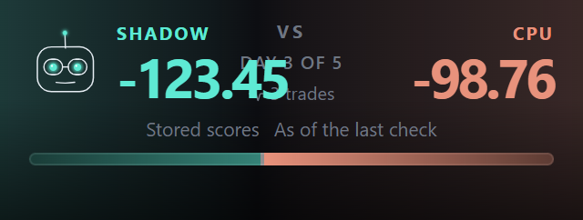

After, flags off:

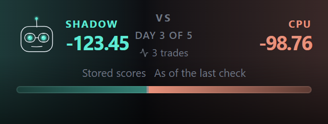

After, flags on:

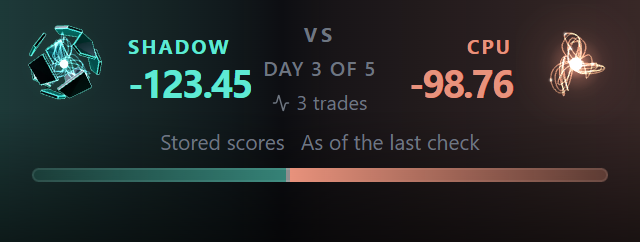

---

## 5. R18: the two sets' frames

**Why scale alone was not enough.** The Trend Follower's streams reach about 1.7 times as far as its nose: at .55 the left edge was still touched and the right had 9.7 px spare (48 px box). Scale alone needed about .53, 28 % smaller. So its frame also moves it sideways, around its own extent.

| Set | Frame before | Frame now | Size change | Why |
|---|---|---|---|---|
| Trend Follower | .74 | **.65, shifted .27 to the right** | **−12.2 %** | Rear streams cut at full light, in five moods of six |
| Diversifier | .95 | **.90** | **−5.3 %** | Pods cut at both sides when celebrating |

**Measured** with S1's method: the real engine on a hand-run clock, headless Edge, every view's pixels read after every frame, union of all six moods, α ≥ 8.

| Size | Frames | Trend Follower: left / right / top / bottom margin, % of box | Diversifier: same | Light at the box's edge |
|---|---|---|---|---|
| `main`, 48 px | 1,000 | **0** / 9 / 15.3 / 22.9 | **0 / 0** / 17.4 / 14.6 | **255 and 128 of 255** |
| **now, 48 px** | 1,000 | 2.8 / 3.5 / 19.4 / 25.7 | 2.8 / 2.8 / 19.4 / 16.7 | **0** |
| now, 60 px | 301 | 2.8 / 3.3 / 19.4 / 26.1 | 3.3 / 2.8 / 18.9 / 16.7 | 0 |
| now, 88 px | 301 | 2.3 / 3.4 / 19.3 / 26.1 | 3.4 / 2.8 / 19.3 / 17 | 0 |
| now, 200 px | 301 | 2.8 / 3.8 / 19.8 / 26.3 | 3.5 / 3.3 / 19 / 17.3 | 0 |
| **now, 340 px (the hub)** | 301 | 2.6 / 3.8 / 20 / 26.3 | 3.7 / 3.2 / 19.1 / 17.4 | **0** |

- **The other five forms did not move.** S0's 28 stills, `main` against this head: exactly 8 differ, the Trend Follower's and the Diversifier's four each.
- **In CI:** `builders.test.js` projects every vertex a frame lights through the frame's camera, with no GPU, over 161 moments in all six moods at 48, 60, 88 and 340 px, and holds both sets inside the box. Its plant shows the design's Trend frame leaving it.
- **R5 still holds.** The shift tweens with the scale, so a change to or from the Trend Follower does not jump sideways.
- **`FRAME_SCALE`'s pin** now says why two entries differ from the design (`vocab.test.js`). It is the only committed reference S0 left; the stills comparison was a harness run, repeated above.
- **A consequence to look at:** the Trend Follower's core now sits right of the box's centre, by about 11 % of the box. That is what framing it around its own length costs.

Before (the hub's 340 px; the dashed line is the box):

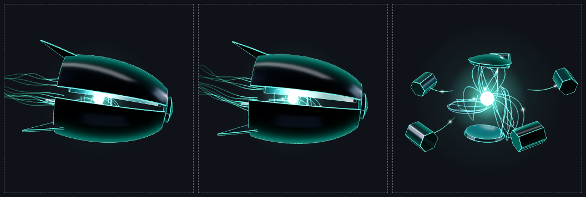

After:

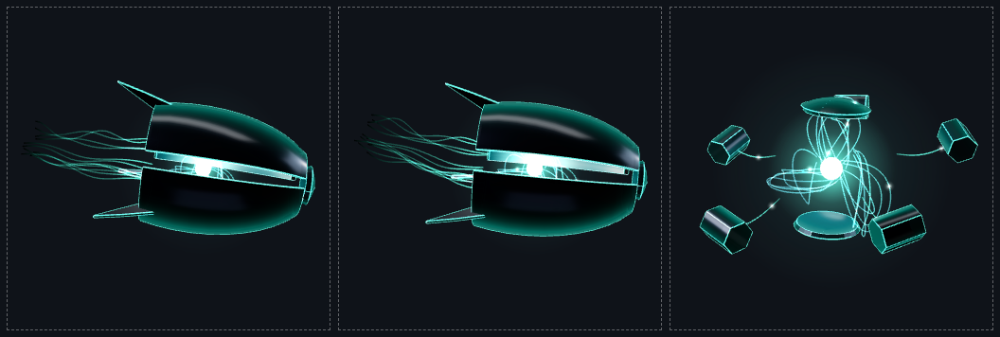

---

## 6. R19: the brighten

| | Today's Shadow (S7) | The armored hero |
|---|---|---|
| Triggers | `areaEvent` changing; a created terminal, once per attempt id; neither at mount; the phone's tabs never | The same memo (`hub/shadowBloom.js`), stepped above the keyed form (`HubAgentForm.jsx:82`), so a remount reads nothing as new |
| Timing | 1.2 s, `sin(π p)` | The same, held equal to `BLOOM_SECONDS` by a row |
| Clock | Shadow's own, which stops with the loop, and a step of 50 ms at most | The view's own (`engine.js:228`), the same two rules: hidden, offscreen or paused, it waits, then plays whole |
| Reduce Motion | The still's 420 ms flash at ×1.25; owed while paused, dropped if the route becomes the canvas | The same flash, on the engine's still (`respond`), with the same debt and the same drop |

**What lights (board 5, `agent-cc-v2.jsx.txt:61`):**

| Trigger | Part |
|---|---|
| Equipped Archetype | The armor's edges |
| Partnership, Shared Research | The core |
| **Fallback:** a deploy confirmed (board 5 is silent) | The whole form |
| **Fallback:** Equipped Archetype on bare Shadow (no armor to light) | The whole form |

**No area fell back.** Only those two cases do.

**One change after looking at it.** A plain multiplier was invisible on the armor: an edge at rest is already near full light, so the peak looked like idle (the first render). The edges now also run 60 % of the way to the core's white at the peak. All the way drained the teal, which is the allegiance colour.

**Other corners:** a response running when motion stops mid-way now ends rather than staying lit (found rereading the engine, with a row). With no WebGL at all, the fallback SVG shows no flash; it carries no response.

The hero holds no effect or timer: the wrapper gained one effect (registered in the activity guard, now six), and the timing is the engine's.

Top row: at rest, then the armor, core and whole-form peaks. Bottom row: the reduced-motion flash for each.

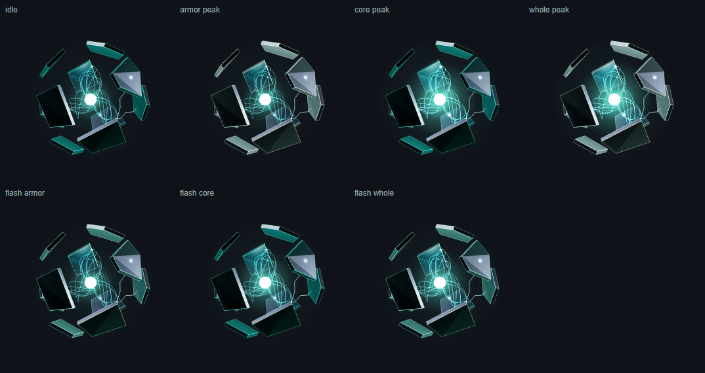

---

## 7. League figures

**One renderer** (`LeagueAgentForm.jsx`), loaded lazily through `leagueAgentFormSlot.jsx`, which also holds the still while it loads and its own boundary. Forms are decorative, batched, stage 1, in the tight framing.

**Sizes (R16).** The arena's tips are a new kind of slot, because four seats stack there, so S1's header sizes (60 / 88) do not fit.

| Site | Before | Now |
|---|---|---|
| Fuse tip, phone | 30 you, 25 rival | **50 you, 44 rival** |
| Fuse tip, desktop | 44 / 36 | **64 / 56** (the stage scales to fit: 59 / 51 at 1280 px) |
| Climb seat | 54 / 48 / 44; 64 / 58 / 50 | The same: the head's own footprint, all over 40 px |

Every seat is now over the 40 px floor, so every seat is live. The phone's top seat starts 14 px lower than today's, for the reason under "The scope toggle" below. Up to four forms draw at once in the arena. **Their frame rate on the iPhone is unmeasured**, so the fixture page carries the corner readout (checklist step 10).

**Measured** on the real arena, headless Edge, 2×, on the repo's `arenaFixtures` with every seat bunched:

| Viewport | Hero | Forms | Boxes that touch | Figures that touch | Past the hero | Value past the edge |
|---|---|---|---|---|---|---|
| 320 × 844 | 294 × 386 | 44 / 50 / 44 / 44 | 1 px, around yours | **none** | none | none |
| 360 × 740 | 334 × 374 | 44 / 50 / 44 / 44 | 1 px | **none** | none | none |
| 390 × 844 | 364 × 386 | 44 / 50 / 44 / 44 | 1 px | **none** | none | none |
| 390 × 553 (shortest) | 364 × 187 | 44 / 50 / 44 / 44 | 6–9 px | **none** | none | none |
| 1280 × 800 | 1209 × 387 | 51 / 59 / 51 / 51 | 1.8 px | **none** | none | none |
| Climb, 320 / 360 / 800 px | as shown | 44–64 | none | **none** | none | none |

On a short hero the gap gives way first (`leagueAgentFormSlot.jsx:47`), and the figures still clear each other because each fills under 90 % of its box.

**The scope toggle: a regression of mine, found by looking, and fixed.** On the real preview the leader's value was hidden behind the Today / The week toggle. `main` has this overlap too (the padT ticket in `fuseGeometry.js`), but the larger tips made it start an hour sooner, so none of the numbers above saw it. Measured through a day, the leader at the top of the board:

| Hours after the open | `main` | First build | Now |
|---|---|---|---|
| 1, 2 | clear | clear | clear |
| 3 | clear | **under by 11.6 px** | clear |
| 4.5, 5.8 | **under by 9.5 px** | **under by 11.6 px** | clear |

- **The fix:** on a phone hero tall enough for it (222 px or more), the stack starts below the toggle (`fuseFormTop`, `leagueAgentFormSlot.jsx:58`). Clear at 320, 360 and 390 px, and at 1280, where the toggle never reached it. So the forms fix this overlap for most phones, flag on.
- **The limit:** on the shortest hero (187 px, a 553 px usable screen) four forms below the toggle do not fit, so it keeps today's start, and the value goes under by 11.6 px against `main`'s 9.5.

4.5 hours into a day, `main`, then now:

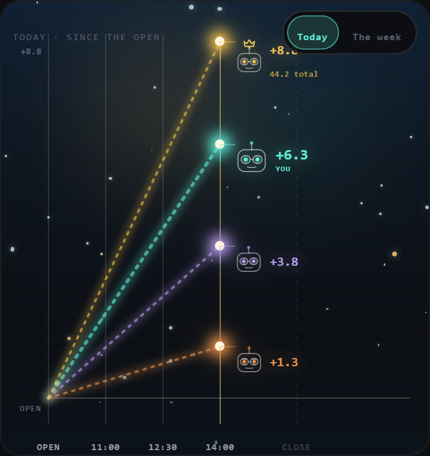

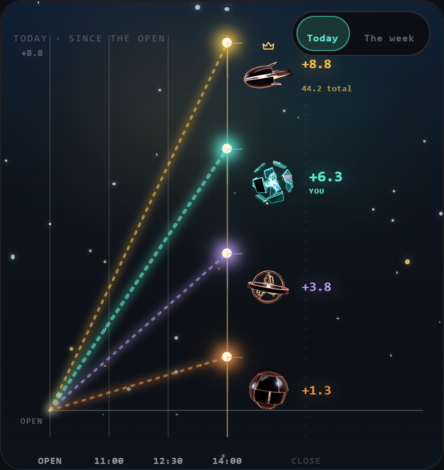

**Facing (R14).** The climb's lanes have a direction, so an opponent looks toward you from either side (`ClimbArena.jsx:234`). The fuse's tips stack at one x, so there is no left or right between seats, and an opponent keeps the form's own mirror.

**The glow.** The seat-coloured drop shadow around the head is off for forms: it would muddy the copper. The seat's colour stays on its line and its value.

**Moods (R15, `leagueAgentMood.js`).**

| Seat | Order |
|---|---|
| You | Celebrating (a win from `deriveGameOutcome`; not reachable in League, question 1) > researching (a live lock on your own battle) > the standing > idle |
| An opponent | Its own standing only, and it keeps its final standing at the end (S1's ruling 4) |

| The screen shows | Ranked | Training |
|---|---|---|
| First | Confident | Confident |
| Second | Confident (advancing) | Idle |
| Third | Worried (out of it) | Idle |
| Last | Worried | Worried |
| Before the bell, voided, or every seat level | Idle | Idle |

The order comes from each screen's own derivation: `deriveCut(…).ranked` on the fuse, the crown's own source (`FuseHero.jsx:410`), and `rankOf` on the climb. A row hands the fuse seats whose scores say the opposite and shows they are not read. A level board shows no standing, as the climb's "at rest" already does. Any lead counts, as you ruled in S1. The "2" is the cut the screen already draws ("TOP 2 ADVANCE", `deriveCut`), not a new threshold.

**Before, the phone arena (390 px):**

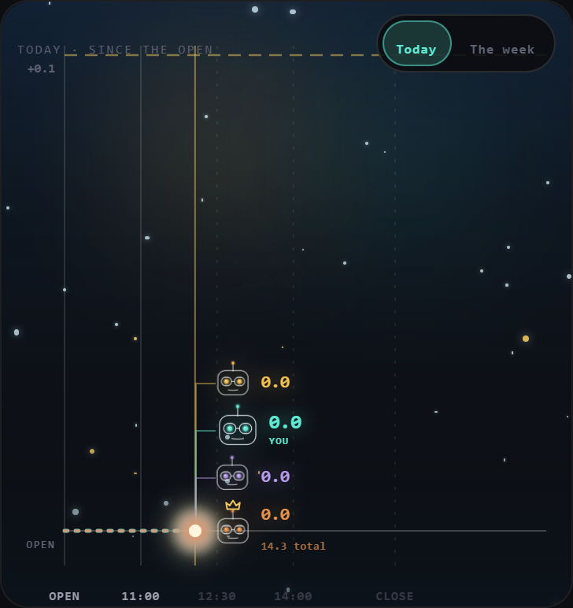

**After:**

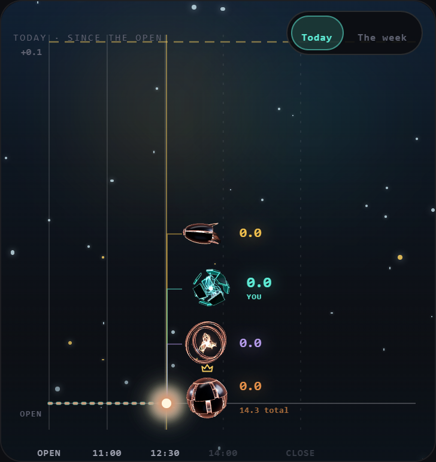

**After, 320:**

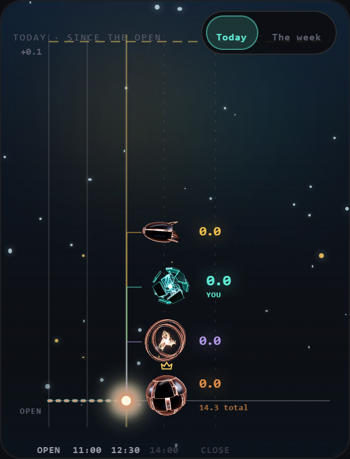

**Before, 320:**

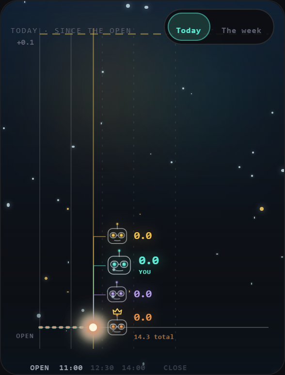

**After, 360:**

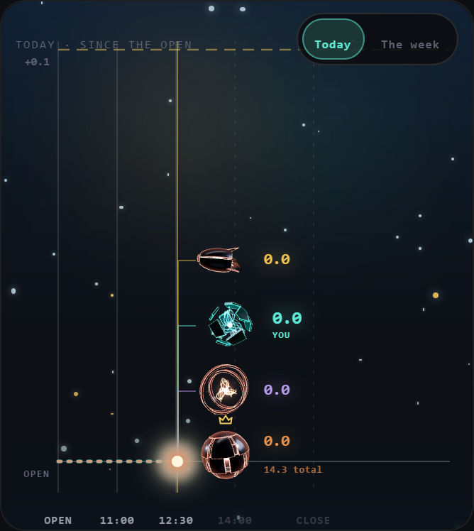

**Before, 360:**

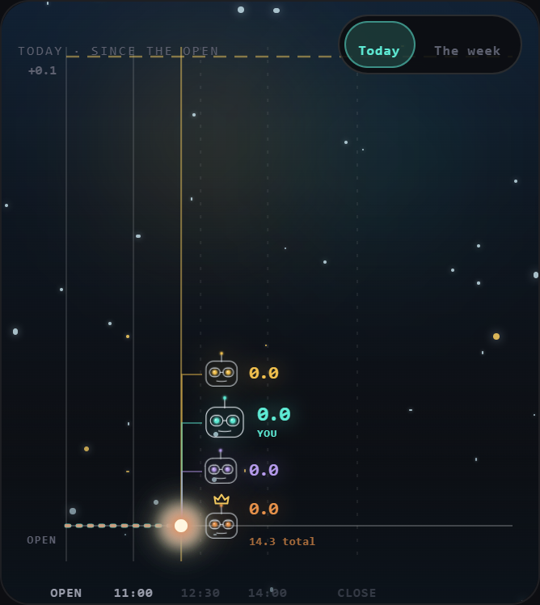

**After, the shortest phone hero (390 × 553):**

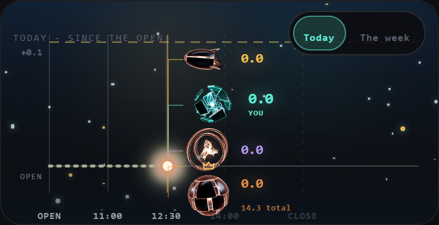

**After, 1280:**

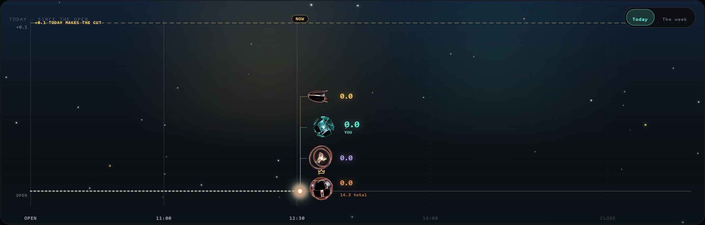

**Before, 1280:**

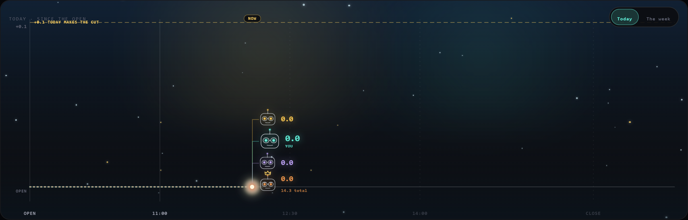

**The climb, before and after (360 px):**

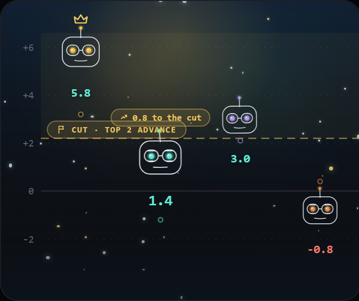

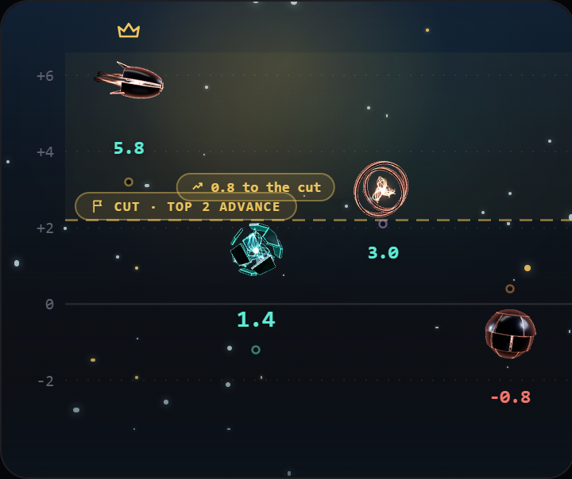

**The climb, desktop:**

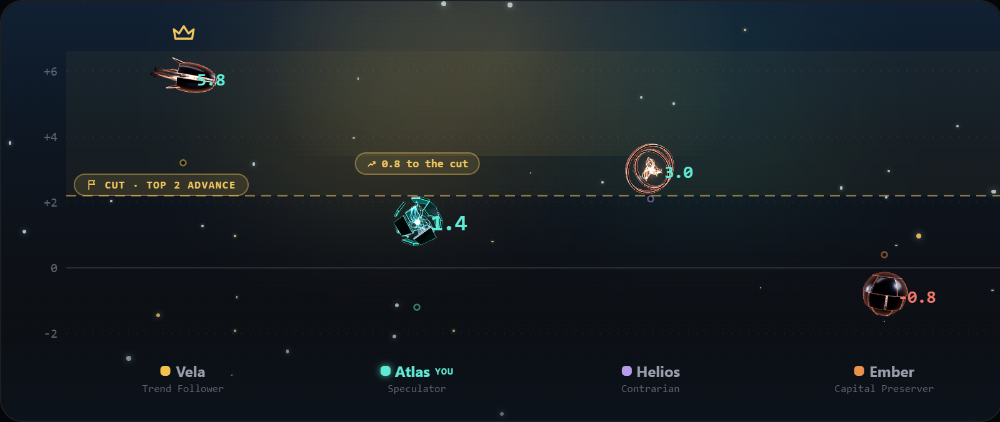

---

## 8. Flag-off identity

**Method:** `vite build --minify false` on Linux (WSL, Node 20.20.2), LF trees, every `-[8 chars].js/.css` masked in names and contents, `diff -r`, source maps excluded. `main` `f7be7f1b` against the code head `64783260`.

**Result: 47 files compared (44 JS), 2 differ.** The stylesheet, `index.html` and 42 chunks are identical, the hub's and the League's included.

| Chunk | Ruling | Lines out | Lines in |
|---|---|---|---|
| Entry | **R22** | 1 | 1 |
| `AgentBattleScreen` | **R20** | 2 | 10 |

**Exactly these lines:**

R22, the entry:
```diff
- const disposition = archetypeToDisposition(agent?.archetype ?? agent?.agentContext?.archetype ?? (surface === "league" ? youSeatArch(model) : void 0));
+ const disposition = archetypeToDisposition(agent?.agentContext?.archetype ?? agent?.archetype ?? (surface === "league" ? youSeatArch(model) : void 0));
```

R20, `AgentBattleScreen`:
```diff
+ const PHONE_SCORE_INSET_PX = 97;
+ const SCORE_CHAR_EM = 0.456;
+ function gatedScoreSize(comparison, size, isDesktop) {
+   if (isDesktop) return size;
+   const chars = Math.max(...comparison.pair.map((value) => formatScoreDisplay(value, { fractionDigits: comparison.fractionDigits }).length));
+   return `min(${size}px, calc((50vw - ${PHONE_SCORE_INSET_PX}px) / ${(chars * SCORE_CHAR_EM).toFixed(3)}))`;
+ }
+   const gatedSize = gated && available ? gatedScoreSize(comparison, scoreSize, isDesktop) : scoreSize;
- gated && available && …SwitchCounter, { value: myScore, …, size: scoreSize, …
+ gated && available && …SwitchCounter, { value: myScore, …, size: gatedSize, …
- gated && available && …SwitchCounter, { value: oppScore, …, size: scoreSize, …
+ gated && available && …SwitchCounter, { value: oppScore, …, size: gatedSize, …
```

The check ran after R19 and R21 went in, after the League sites went in (together, not one at a time), at the League commit and on the code head, and found no leak: the League's reads, the two new contexts, the forms' clock and the shared `signalMood` all fold away.

---

## 9. Tests and mutation

**New test files:**

| File | Rows | What |
|---|---|---|
| `screens/battleView/leagueAgentMood.test.js` | 16 | The standing, ranked and training; every precedence pair; opponents standing-only; the banked-day pin for question 1 |
| `League/battleArena/LeagueAgentForm.jsdom.test.jsx` | 11 | The still; player, CPU and human through the real `buildArenaModel`; bare when unknown; the code id, never the label; moods from the board, the standing and the arena's battle |
| `League/battleArena/LeagueAgentForm.failure.jsdom.test.jsx` | 2 | A failed chunk keeps the still and the arena; a failed outcome module still draws, idle |
| `League/battleArena/leagueAgentForm.sites.jsdom.test.jsx` | 21 | Both sites with the flag on: sizes, the face's lift gone, the order from `deriveCut` against contrary scores, no margin, the gap, facing, no remount on a surge, the arena's battle |
| `League/battleArena/leagueCpuArchetype.test.js` | 10 | R13: the seat equals the agent document for nine CPUs; the board tripwire |

**Added to existing files:** R18's bounds and the response in the pose (`builders.test.js`), R19 and R23 (`engine.lifecycle.jsdom.test.js`, 18 rows), the frames and curve (`vocab.test.js`), R19's triggers, parts and numbers against S7's (`HubAgentForm.jsdom.test.jsx`, 8), the stages (`ShadowStage.agentForm`), the wrapper (`AgentForm.s1`), R20 (`ArenaHeader.render`, 4), R21 (`BattleAgentForm.jsdom`, 2; `agentMood.test.js`), R22 (`AgentPresenceMount.reactivity`).

**Guards:** `leagueAgentMood.js`, `LeagueAgentForm.jsx` and `leagueAgentFormSlot.jsx` are registered in the token and motion guards and their baselines at zero; the flag in `flagPinGuard` and `agentFormFlags.test.js`, whose literal-ternary row now covers every League read; the League form's one lazy edge in the hub mount guard's main-graph row; the League slot in `agentForm.flagOffBundle.test.js`, with its marks and its flag planted; the wrapper's sixth effect in the activity guard. No guard's rule was loosened. S1's one "researching" statement moved into a shared `signalMood`, unchanged, so the `deskHonesty` exemption still names one line.

**Mutation** (Linux; each mutant one exact replacement, its rows run, the file restored from the commit's blob and checked equal). **60 of 60 killed**, from a green baseline. A first start was stopped before it produced anything: one of my own rows was red at that commit, and a red baseline fakes kills.

The first round killed 55 of 57. The two survivors were both useful:
- **R15-2, a points margin on the board.** My fixture's spread was too wide to feel a margin. A close-board row now kills it.
- **The wrapper's response ref.** The mutant changed nothing, because no view exists at mount, so the ref was dead code. It is gone, and a sharper mutant replaced it.

| Asked for | Mutant | Killed by |
|---|---|---|
| R13 | A League CPU drawn bare (R13-1); the display label read (R13-2); the seat loses the CPU map (R13-3); the board stops reading the archetype (R13-4) | The CPU, human and player rows; the CPU file's nine rows; the tripwire |
| R14 | Opponents in teal; the lanes' opponents look away; `facing` ignored | The allegiance rows; the lanes row; the facing rows |
| R15 | **An invented threshold** (third place advances; a points margin); **a standing from raw scores** (fuse, climb); a level board shows one; an opponent reads your lock; a banked day counts as a win; a finished game shows the live standing; last not worried in training; the arena drops its battle | The standing rows; the close-board row; the contrary-scores rows; the level row; the opponent rows; the banked pin; the finished rows; the training row; the arena row |
| R16 | A rival under 40 px; the gap ignores a short hero; the fuse keeps the old gap; the old size; the stack starts at today's top; a short hero loses its room | The floor row; the short-hero row; the spread row; the size row; the toggle row; the short-hero start row |
| R17 | The flag on | The pin, the literal, `flagPinGuard` |
| R18 | **A set's frame reverted** (both sets); the shift dropped; the shift jumps at a swap | The bounds row and the table pin; the bounds row; the no-jump row |
| R19 | **A trigger dropped** (area, created); **brightening under Reduce Motion**; the phone blooms on an area; board 5's parts swapped; a paused response on the wall clock; both lengths drifting from S7's; the flash not owed; the wrapper answering every render; a response left lit | The stage and created rows; the flash rows; the stage row; the parts rows; the 50 ms row; the parity row; the owed row; the wrapper row; the mid-response row |
| R20 | **The shrink removed**; each side its own digits; the desktop shrinks too | The site row; the pair row; the desktop row |
| R21 | **The clock tied back to the controller**; no clock reads as in flight | The ticking row and the scope row; the no-clock row |
| R22 | **The field order reversed** | The field-order row |
| R23 | **A paused swap settled at once**; its tween not held; a running tween not held; the hold never released | The two paused-swap rows; the running-tween row |
| Each new guard row | Not a literal ternary; a raw hex; a raw transition; a seventh effect; a static outcome import; a static form import; a pure mark off; a second "researching"; off the guard list; off `flagPinGuard`; the framing record | Each by its own row |

---

## 10. Checks and smoke

- **`lint:gate`:** exit 0 on the code head `64783260`.
- **Full suite** (Linux: WSL, `TZ=UTC`, 8 workers, Node 20.20.2, under `flock /tmp/pd-suite.lock`) on the code head `64783260`: **1,256 files, 27,597 rows, 27,508 pass, 0 fail, 89 skipped.**
- **`main`** had not moved at the last fetch (`f7be7f1b`), so the code head is `main` plus this build.
- **Flag-off identity:** §8, on `64783260`.
- **Not run:** the Firestore rules suite (no rules changed), and anything on a real device. The first real render on an iPhone is yours.

**`claude/agent-form-s2-smoke`** = `5a411055`: one "SMOKE ONLY, NEVER MERGE" commit on `64783260`, 8 files, composed in a scratch worktree. It carries:
- all three flags `true`;
- the hub hero's corner readout, as S1's;
- **the dial:** `?formScale=` (0.8 to 1.6) over the battle and League forms, with a small label at the top left;
- **`?leagueForms=1`:** the real `ArenaMobile`, `ArenaDesktop` and `ClimbArena` on fixture data, opened ahead of sign-in as the S0 lab is, with chips for the standing, the game's state, your armor, ranked or training, the lobby climb and an unknown rival, and the readout. The data is the repo's `arenaFixtures` with hand-set standings, not a recorded game: the components are real, the numbers are not.

**What goes red on the smoke commit, by design.** In the screens, Command Center, agent form, config and League suites: 112 rows in 14 files.
- The flag pins and `flagPinGuard` (6).
- The rows that assert what the flags replace, the same files and counts as S1's: `CommandCenterHub.s7` (52), `CommandCenterHub.jsdom` (3), `ArenaHeader.render` (13), `CharacterAvatar.render` (3), `CharacterPane.comparison` (2), `AgentBattleScreen.paneHeader` (4), `AgentBattleScreen.quoteAvailability` (15).
- The readout and dial: `CommandCenterHub.realSheets` (5), the hub mount guard (5), the activity guard (1), `HubAgentForm.jsdom` (1), the bundle row (2).
- **No League row goes red.**

**Checked on the deployed preview,** driven in headless Edge at 393 × 660 with touch, about an iPhone 16 with Safari's bars showing:
- The root and `?leagueForms=1` answer 200.
- Four forms reach live and move. Every one of the 22 chips works, and the forms stay live through them.
- `?formScale=1.2` gives 53 / 60 / 53 / 53 px, and its label says so.
- The chip bar is 152 px, and the whole arena sits above it. Its first version was about 400 px, because the app forces every `button` to 16 px, so the chips are now spans.
- Zero page errors.
- The readout runs: 61 fps, 3.4 ms a frame with four live forms. That is this laptop's Intel GPU, and it says nothing about an iPhone (checklist step 10).

**The hub and the battle need a signed-in account,** so on those I can claim HTTP 200 and nothing more. Your run is the first render of them, and of all of this, on a device.

---

## 11. The iPhone checklist (founder)

Open **https://trade-seven-exm6yeof6-fais-projects-bc179554.vercel.app** in Safari on the iPhone. Steps 1–6 need no sign-in and no live game.

**League figures** (add `?leagueForms=1` to the end of the address, or open https://trade-seven-exm6yeof6-fais-projects-bc179554.vercel.app/?leagueForms=1). The chips at the bottom change a made-up game; the figures and the arena are the real ones.

1. Your figure is **teal**, marked YOU. The others are **copper**, each in different armor.
2. Tap **One unknown** (the "rival" row): that rival becomes a plain copper glowing core with no armor.
3. **Moods follow the standing.** Tap **You first**: your figure looks confident (brighter, leaning in). Tap **You last**: it looks worried (dimmer, fraying). **You second** is confident and **You third** worried, because the top two advance. Tap **Training**: now only first and last change the mood, and the middle stays calm. Tap **All level**, then **Before the bell**: everyone is calm. The opponents move with their own places, not yours.
4. Tap **Lobby climb**: the Training tab's picture. Opponents look toward your figure from either side.
5. **The sizes.** Are four figures readable without feeling crowded? To try others, add `&formScale=1.2`. Note a value if you like one better.

**Trend Follower and Diversifier:**

6. Still on that page, tap **Trend Follower**, then **Diversifier**. Nothing should be cut off. The Trend Follower's trailing threads end inside its space, and it sits a little to the right of centre.
7. Sign in. On the Command Center, change your archetype to each of those two: same check on the big figure.

**The hub figure brightening:**

8. **On the phone, only a deploy brightens the figure.** Today's Shadow is the same: the phone's tabs never do. Deploy, and the whole figure brightens once for about a second when it is confirmed.
9. **On a computer or iPad,** tap the three areas beside the figure. **Equipped Archetype** brightens the armor's edges. **Partnership** and **Shared Research** brighten the centre. With Reduce Motion on, you get a brief, smaller flash instead.

**Frame rate, new with four figures:**

10. On `?leagueForms=1`, leave the phone still for **one minute**. Copy the corner box's line starting `60 s:` into a note. Do the same on the Command Center. You are looking for about 60 fps and `late` near 0 %. If the League page is noticeably rougher, say so: four live figures is new.

**A battle at a narrow width:**

11. Open a live BaggerBomb battle with long scores (two decimals, like −123.45). In Safari tap **aA** and raise the zoom to 125 % or 150 %. The scores get smaller, and nothing touches "DAY 3 OF 5". The figures keep their size.

Paste the `60 s:` lines, any `formScale` you liked, your answers to the Founder questions, and anything that looked wrong back to Claude.

---

## 12. Commits and artifacts

On `claude/agent-form-s2`:
- `6f90f32a`: R22, alone.
- `39e28cd3`: R20, alone.
- `2d1f6c77`: R18, R23 and the engine half of R19.
- `fa180fee`: R21.
- `d10cd9a5`: R19 and the wrapper's `facing`.
- `1670a738`: R13–R17, the League.
- `05df7eaf`: the armor's edges at the peak.
- `e512104f`: a row of mine that measured the wrong sprite.
- `80d406e0`: the fixes from the mutation pass.
- `64783260`: the phone's tip stack below the scope toggle (the code head).
- then this report and its pictures (docs only).

R20 and R22 are the only commits that touch flag-off bytes.

**Not committed** (session scratchpad): the harness (`league.jsx`, `run-league.mjs`, the extended `arena.jsx`, `fill.jsx`, `run-sites.mjs`), the mutant runner (`mutants.mjs`, `mut1.keep.log`), the WSL scripts, and the builds under `~/s2-runs`.

**To remove the WSL worktrees:** `~/pd-ci-s2`, `~/pd-ci-s2-main` and `~/pd-ci-s2-smoke` have `node_modules` linked to `~/pd-ci-af1`'s. Run `unlink <tree>/node_modules` first, then `git -C ~/pd-ci worktree remove --force <tree>`. The Windows scratch worktree that composed the smoke commit is already removed.

A copy of this report is at `C:/Users/fashr/Documents/FantasyTrades/AgentForm/20261030_BUILD_AGENT_FORM_S2.md` (BUILD_RULES §3).
