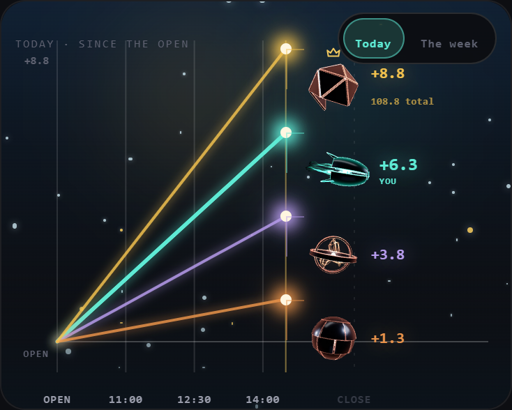
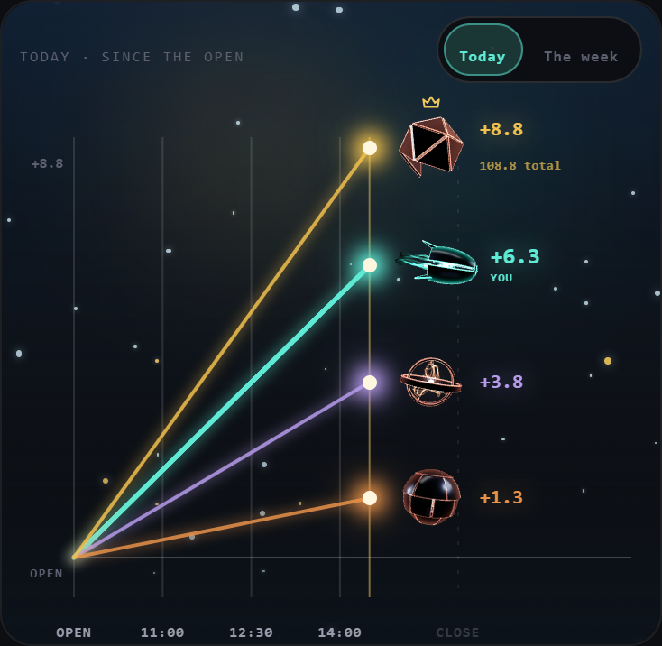
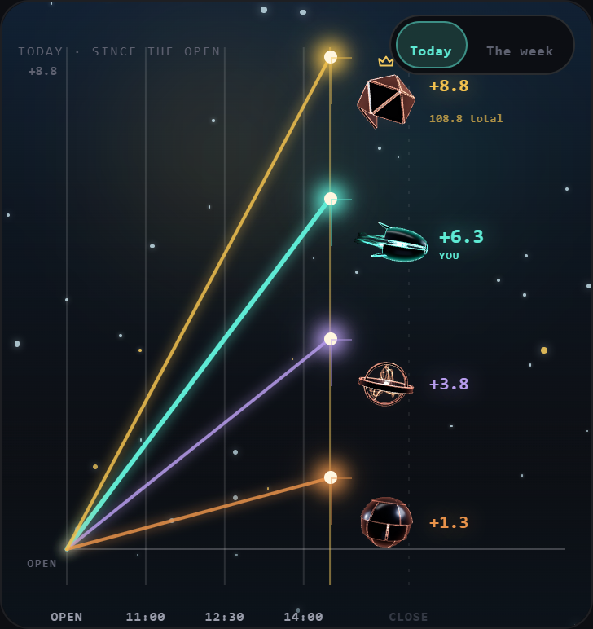
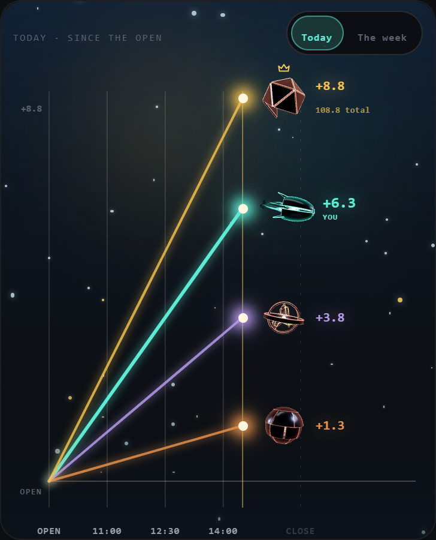
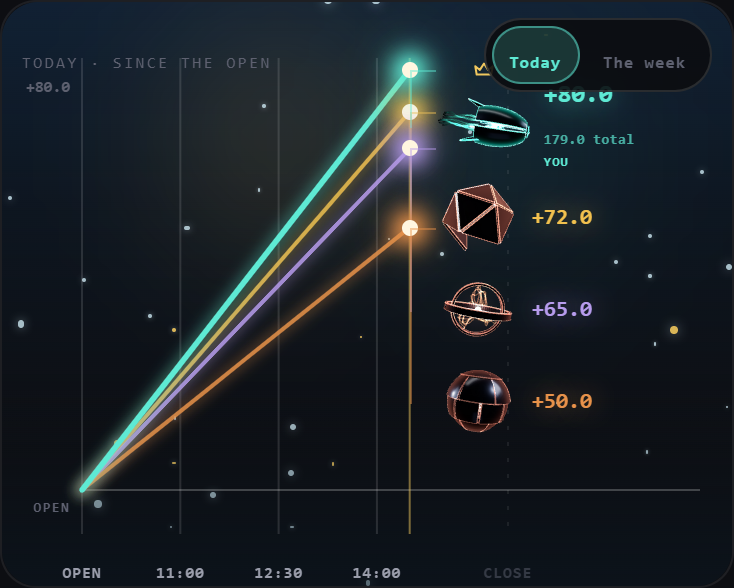
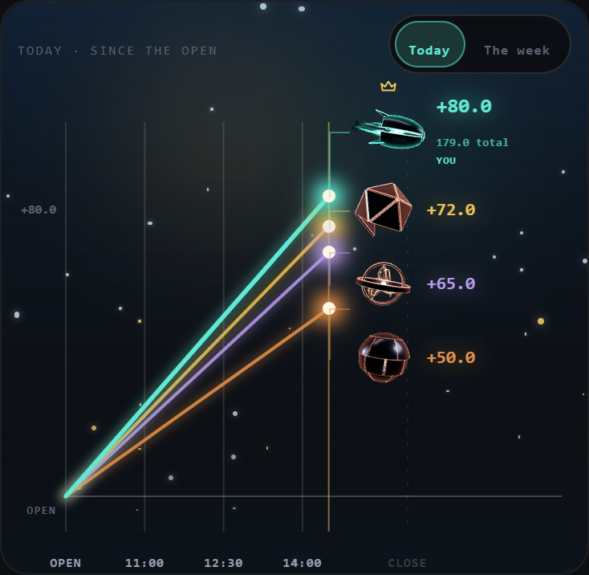
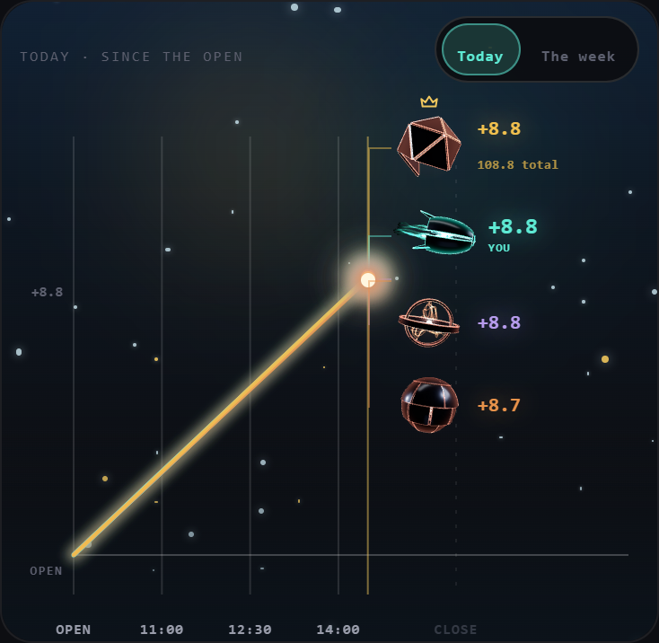
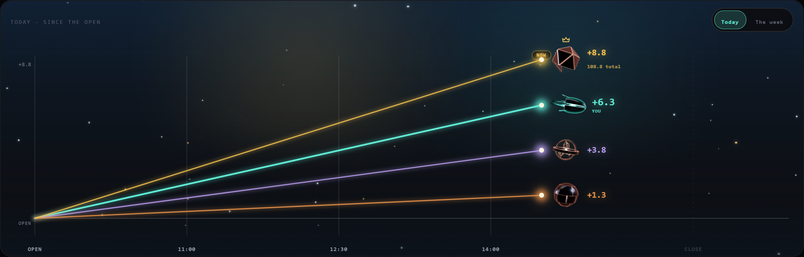
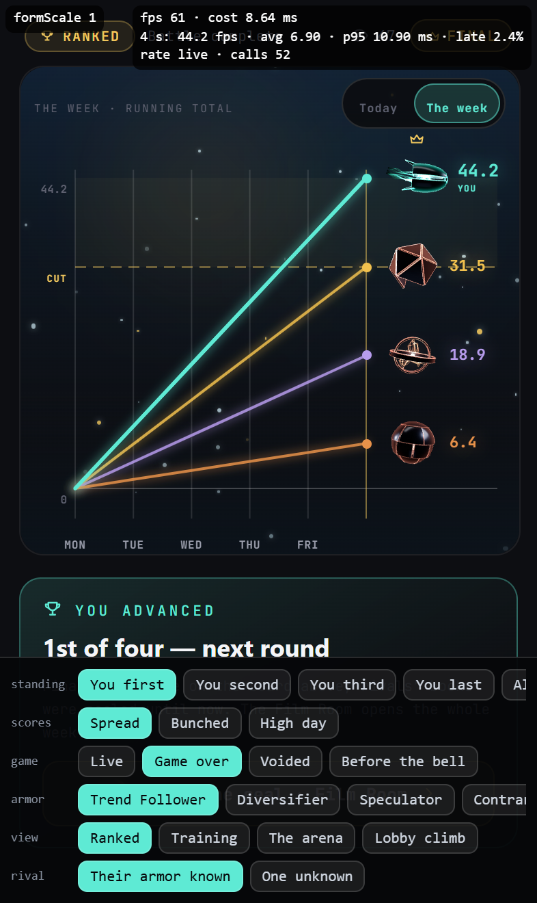
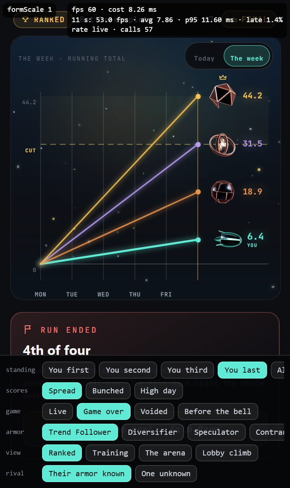

# Build S2: The armored agent in League games, plus the S1 carry list

**Run date:** October 30, 2026 · **Model:** Opus · **Branch:** `claude/agent-form-s2`, cut from `main` @ `f7be7f1b` (which holds PR #1011 and PR #1014), pushed from the worktree branch `claude/agent-form-s2-armored-16abc8` by refspec · **Smoke branch:** `claude/agent-form-s2-smoke` · **Preview:** https://trade-seven-lz95ui5x5-fais-projects-bc179554.vercel.app

**Updated after your iPhone run:** §13 holds the arena fit and your four rulings, and replaces what §7 says about where the figures sit.

**Updated after the review:** §14 holds the review's fixes and your ruling on a level board. The review itself is `docs/audits/20261030_REVIEW_AGENT_FORM_S2.md`.

**Preamble.** `git fetch origin` ran first. `origin/main` = `f7be7f1b`, the merge of PR #1014, with PR #1011's merge `b1823fdd` beneath it, so the prompt's STOP does not apply. The tree was clean. Fenced files read: `api/agent/decide.js` (`:1382-1594`, the prescribed deploy, for R13). Fenced functions called: none. Fenced files edited: none. Nothing under `api/` changed. `tournamentAgentBoards.js`, `tournamentAgentDraft.js`, `tournamentCpu.js` and `agent-evaluate.js` were read for R13; none is edited.

---

## Executive verdict

| # | Item | Result |
|---|---|---|
| 1 | Flag-off identity | **All three flags off, the build differs from `main` in 2 of 47 files, on R20's lines, R22's line and the level-crown gate's lines only.** 44 JS chunks, the stylesheet and `index.html` were compared unminified with hashes masked. §8 lists R20's and R22's; §14 repeats the check on the merged tree and lists all of them. |
| 2 | Step 1 map | **Two League sites, no STOP.** The fuse hero's tips (the live arena, ranked and training) and the climb's seats (the Training tab's preview). No site needs a server or fenced change, every opponent's archetype is already on the client, and two sites is under the eight allowed (§1). |
| 3 | R13: is the CPU's archetype real? | **Yes.** It ranks the board the CPU's six are drafted from, and the battle is deployed with it. One limit: a CPU's battle is passive, so the archetype picks the stocks and never trades during the day (§2). |
| 4 | League figures (R13–R16) | **Built behind `AGENT_FORM_LEAGUE_ENABLED = false`.** Yours teal; each CPU and human rival in copper, in their own armor; an unknown seat a bare copper core. Every phone seat was a 25–30 px head and is now a 44–50 px live figure. **Each figure now sits on its own line's end point, in a taller arena (§13).** |
| 5 | League moods (R15) | **Confident and worried follow the standing the screen shows,** taken from each screen's own order, never from a score. **Researching** works from your live battle. **Waiting** is unused, because League has no cockpit. **Celebrating fires on the group's final verdict (your ruling 1, §13).** |
| 6 | Clipped sets (R18) | **Fixed.** The Trend Follower is 12.2 % smaller and the Diversifier 5.3 %. Over 1,000 frames in all six moods, neither reaches the box's edge at any size, up to the hub's 340 px. The other five forms are pixel-identical to `main` (§5). |
| 7 | Hub brighten (R19) | **Built, on S7's triggers and timing.** Board 5 covers all three areas: Equipped Archetype lights the armor's edges, Partnership and Shared Research the core. A deploy lights the whole form, as does the archetype area on bare Shadow, because board 5 is silent on those (§6). |
| 8 | Narrow-phone scores (R20) | **Fixed for everyone, flags off too.** Long gated scores clear "DAY 3 OF 5" by 4.7 px or more at 312, 320, 339, 360 and 390 px, flags off or on, with the app's stylesheet loaded. **Measured in Segoe UI, the stack's tallest, not Inter; SF Pro on the iPhone is unmeasured, so checklist step 11 is the real test** (§4). |
| 9 | R21, R22, R23 | **All built.** The battle forms have their own clock, the hook reads the battle's snapshot first, and a swap asked for while paused starts when the view resumes (§3). |
| 10 | Tests and mutation | **60 of 60 mutants killed** (§9), and **43 of 43** on this pass (§13). `lint:gate` exit 0. Full suite on Linux, code head `140c3761`: **27,662 rows, 27,573 pass, 0 fail, 89 skipped.** |
| 11 | Smoke | `claude/agent-form-s2-smoke`: all three flags on, the hub readout, `?formScale=` over the battle and League forms, and `?leagueForms=1`, the real League arena on the repo's fixture data, now with bunched scores and a finished group (§10). |
| 12 | Review threshold | The code diff is **54 files, +2,526 / −102 lines**, over both BUILD_RULES §2 thresholds, so **a review session ran before merge: MERGE AFTER FIXES**, and §14 lands those fixes. |
| 13 | Your iPhone run | **Fixed (§13).** The figures were 28 px off because one stack moved all of them. Spread boards now sit at 0 px; bunched ones at most 72 px, symmetric. The hero at 393 × 660 goes 294 → 358 px. |

---

## Founder questions

**All four ruled on Oct 30, 2026; §13 has what was built.** (1) Celebrate only on the group's final verdict: built. (2) Add your armor to the preview: built. (3) No change to the loadout chooser's cards: they move to the armory. (4) Human rivals keep their armor after the bell, read once: built. The questions as asked:

**1. A League win never reaches the figure. Should it?** R15 sends "celebrating" to the existing outcome check, `deriveGameOutcome`. That check reads one day's battle, and for a League battle it only ever answers "banked" or "no result", never "won" (`hub/selectors/gameOutcome.js:109-113`). That is correct for it: a League result belongs to the group of four, not to one day. So I built your ruling exactly, and your figure never celebrates in League. A finished game shows it calm, even in first place.
- **My recommendation:** celebrate on the verdict the screen already prints. "You advanced" in ranked and first place in training are the same test as confident, so the change is one line in `leagueAgentMood.js`: `return won ? 'celebrating' : 'idle'` becomes `return standingMood(standing) === 'confident' ? 'celebrating' : 'idle'`.
- A row pins today's behaviour ("R15's letter on a League record"), and moves with that line.

**2. Your own armor on the Training tab's preview.** The preview in the lobby deliberately reads no battle, so it does not know your archetype, and your figure there is a bare teal core. Today's head has the same gap: it shows a neutral face. The rivals there still wear their armor when they are CPUs. Showing your armor needs one more value handed to the preview. Add it, or leave the bare core on that one surface?

**3. The archetype cards in League's loadout chooser.** `LoadoutChooserSheet.jsx:144` shows the shared `ArchetypeCard`, which draws the robot head at 72 and 46 px (`ArchetypePicker.jsx:88,92`). That is a League screen at 40 px or more, so it is on the map. I left it: it is a menu of six choices rather than a seat in a game, and the same card is the hub's "Change archetype" sheet, which is the armory's job (board 6). Do it with the armory?

**4. Human rivals after the bell.** Their armor comes from a read that runs only during the game. If you open a finished game fresh, human rivals draw as bare copper cores; CPUs keep their armor. That is allowed by R14, but you will see the difference. Keeping their armor is a small change to when the read runs. Worth it?

---

## 1. Step 1: the League map

Every surface in the League ranked and training flows that draws the robot head, `AgentPresence` or `youSeatArch` at 40 px or more. "Live" means a player reaches it today.

| # | Site | Reached from | Size today | Archetype source | Disposition |
|---|---|---|---|---|---|
| 1 | **The fuse hero's tips**, `FuseHero.jsx:94` (now `:101`) | `ArenaDesktop.jsx:87` and `ArenaMobile.jsx:157`, inside `LeagueBattleArenaLive`: ranked (`LeagueParticipantView.jsx:290`), training (`LeagueTrainingBattleView.jsx:212`), the card route (`leagueBattleViewRender.jsx:25`). **Live**: `LEAGUE_FUSE_HERO_ENABLED = true` | 44 you, 36 rival on desktop; 30 / 25 on the phone. **Only the desktop player is at 40 px or more today** | `seat.archId` (`buildArenaModel.js:176-178`) | **Built** |
| 2 | **The climb's seats**, `ClimbArena.jsx:225` | `TrainingClimbPreview.jsx:128`, the Training tab: `LeagueDeskParts.jsx:554`, `LeagueLobbyRedesign.jsx:422`. **Live**: `LEAGUE_TRAINING_CLIMB_PREVIEW_ENABLED = true`. Also `ArenaDesktop.jsx:90` and `ArenaMobile.jsx:160`, the arms that run only if the fuse flag is turned off | 64 / 58 / 50; 54 / 48 / 44 on the phone | Today `s.arch`, the owner-only label. The form reads `s.archId` | **Built** |
| 3 | The loadout chooser's cards, `LoadoutChooserSheet.jsx:144` → `ArchetypeCard` | The League loadout sheet. **Live** | 72 / 46 (`ArchetypePicker.jsx:88,92`) | Each of the six ids | **Not a seat. Left: ruled Oct 30, 2026, they move to the armory (§13)** |
| 4 | The league dock's `surface === 'league'` path, `useAgentPresence.js:42,45,65` | **Nothing.** `AgentPresenceMount` has seven call sites, all `duel` or `command`; none passes `league` | — | `youSeatArch(model)`, unused | **Dead code. Nothing to replace** |

**Seat by seat, for sites 1 and 2:**
- **You:** `battle.agentContext.archetype`, your own snapshot. On the lobby preview `battle` is null, so your armor comes from the lobby's own loadout read (ruling 2, §13).
- **League CPU:** `cpuArchetypeForN(cpuNFromUserId(id))`, on the client with no read.
- **Human rival:** `useSpectatedTournamentBattles` → `agentContext.archetype`, in `PUBLIC_AGENT_CONTEXT` (`tournamentBattleView.js:45`). Polled while the fuse gate is on and the group is in BATTLE (`useArenaModel.js:62-65`), and read once when a finished game opens (ruling 4, §13). On the lobby preview it is not read, so a human rival there is a bare copper core.

**Looked at and out:**
- `CommandDock.jsx:129,451`: the dock's "agent orb" is `ArenaOrb`, a CSS orb at 22 and 38 px. So review §5 item 8 ("the dock's `surface === 'league'` path still draws the robot head") is stale: that path has no caller.
- `AgentAvatar` at 44 and 42 px (`LeagueClimbStanding.jsx:307`, `LeagueSpectate.jsx:204`): a CSS orb, not a head, and standings rows are out by R16.
- **"Training" is not S1's battle view.** A League battle is `gameMode: baggerbomb_tournament`, and `isLeagueBattle` (`battleViewRouting.js:13`) sends it to the League arena. Training mounts the same `LeagueBattleArenaLive` as ranked, so it is covered here, not by S1.

**STOP conditions:** no site needs a server or fenced change. Every opponent's archetype is on the client. The map has four rows and two sites to build.

---

## 2. R13: the League CPU's archetype

**Confirmed: it is the archetype the CPU plays with.**

1. `buildCpuAgentDoc` writes `archetype: cpuArchetypeForN(n)` on the agent document (`tournamentCpu.js:63-70`). The client's seat calls the same function from the same module, and `ensureCpuAgents` never rewrites a document. `CPU_ARCHETYPE_ORDER` has one commit in its history, so no document can predate a change to it.
2. `produceGroupBoards` reads that document: `const archetype = agent?.archetype || 'analyst'`, then `computeArchetypeRankings(stocks, archetype, …)` (`tournamentAgentBoards.js:465-470`), and a CPU's board is the top of that ranking (`:509-510`).
3. The snake draft takes the CPU's six from that board, and falls back to the same ranking when the board runs out (`tournamentAgentDraft.js:1-16`). The deploy prescribes those six, and `createAgentBattle` stamps the agent's archetype on the battle.

**The limit:** a CPU's battle is passive (`agent-evaluate.js:1457-1491`, P4 contract #5). It marks scores and skips everything triggered. So the archetype chooses what the CPU holds, and never trades during the day.

`leagueCpuArchetype.test.js` holds the client's seat to the server's document for nine CPU numbers, and trips if the board stops being ranked by the document's archetype.

---

## 3. R21, R22, R23

- **R21, the forms' clock.** `BattleAgentForm.jsx:38` reads `useCoarseNow(true)`, so it ticks with the cockpit controller on or off, and the screen's scope no longer hands the forms a clock. `evaluationInFlight` (`agentMood.js:48`) now answers "not in flight" for a non-finite clock. That reverses a line S1 pinned on purpose, so that row went with it. Every changed line sits behind `AGENT_FORM_BATTLE_ENABLED`.
- **R22, snapshot first.** `useAgentPresence.js:43` reads `agentContext.archetype` before `archetype`. No shipped document carries both, so nothing on screen changes. Its own commit.
- **R23, a swap while paused.** A tween now records when it was held (`engine.js:221-226`), and `swap()` holds one set up under a pause (`:486`). It starts on resume, whole, from the scale and shift last drawn. A tween already running when a pause arrives waits the same way. The paused view stays quiet: the loop asks for no frame.

---

## 4. R20: the header on a narrow phone

**Measured** in headless Edge at real viewport widths, with `index.css` loaded through the app's own PostCSS, on the real `ArenaHeader`. The S1 harness was narrow frames inside a wide window, which `vw` cannot see. Long gated scores are −123.45 / −98.76; "longer" is −1,234.56 / −987.65. The font was Segoe UI, the stack's tallest, not Inter: Inter is not installed on this machine, and `document.fonts.check` cannot tell (the review's S2R-1). **SF Pro on the iPhone is unmeasured**, so checklist step 11 asks for your eye. The harness also ran with scrollbars hidden; §14's known limit gives the numbers with a desktop browser's bar.

| Width | `main`: player's score vs the centre column | Now, flags off | Now, flags on | Score size now |
|---|---|---|---|---|
| 312 | **overlaps by 30.3 px** | clear by 5.8 | clear by 5.8 (CPU 15.3) | 18.5 px |
| 320 | **overlaps by 26.3** | clear by 5.9 | clear by 5.9 (CPU 16.1) | 19.7 px |
| 339 | **overlaps by 16.8** | clear by 6.1 | clear by 6.1 (CPU 17.8) | 22.7 px |
| 360 | **overlaps by 6.3** | clear by 6.3 | clear by 6.3 (CPU 19.7) | 26 px |
| 390 | clear by 8.7 | clear by 8.7 | clear by 8.7 (CPU 24.2) | 30 px, unchanged |

- The "longer" scores overlapped on `main` at every width to 390. They clear by 4.7 px or more now, flags off and on.
- Whole-number scores and the desktop header are unchanged. No horizontal overflow, and no header height changes, at any width.
- **How much room that leaves.** The tightest case is 4.7 px on a 98 px score, so a font up to about 5 % wider than Segoe UI still clears; at the widths the ruling names, long scores keep 6–8 %. If SF Pro is wider than that, the score meets the column by a pixel or two, against 6–30 px on `main`, and `SCORE_CHAR_EM` is the one number to raise.
- **Picked: the shrink, two decimals.** One decimal at 320 px gains 3 px of type (23 vs 19.7) and still has to shrink, and it can print a tie while the bar and the emphasis show a lead (BUILD_RULES §9).
- **`minWidth: 0` on the CPU columns was tried and left out.** The measurements are the same without it, and it changed the legacy header's OFF-6 golden bytes.

The rule (`ArenaHeader.jsx:143`): each side takes what half the screen leaves past the row's inset, in the wider of the pair's digits, up to the row's own size.

Before, 320 px, long scores (flags off, `main`):


After, flags off:


After, flags on:


---

## 5. R18: the two sets' frames

**Why scale alone was not enough.** The Trend Follower's streams reach about 1.7 times as far as its nose: at .55 the left edge was still touched and the right had 9.7 px spare (48 px box). Scale alone needed about .53, 28 % smaller. So its frame also moves it sideways, around its own extent.

| Set | Frame before | Frame now | Size change | Why |
|---|---|---|---|---|
| Trend Follower | .74 | **.65, shifted .27 to the right** | **−12.2 %** | Rear streams cut at full light, in five moods of six |
| Diversifier | .95 | **.90** | **−5.3 %** | Pods cut at both sides when celebrating |

**Measured** with S1's method: the real engine on a hand-run clock, headless Edge, every view's pixels read after every frame, union of all six moods, α ≥ 8.

| Size | Frames | Trend Follower: left / right / top / bottom margin, % of box | Diversifier: same | Light at the box's edge |
|---|---|---|---|---|
| `main`, 48 px | 1,000 | **0** / 9 / 15.3 / 22.9 | **0 / 0** / 17.4 / 14.6 | **255 and 128 of 255** |
| **now, 48 px** | 1,000 | 2.8 / 3.5 / 19.4 / 25.7 | 2.8 / 2.8 / 19.4 / 16.7 | **0** |
| now, 60 px | 301 | 2.8 / 3.3 / 19.4 / 26.1 | 3.3 / 2.8 / 18.9 / 16.7 | 0 |
| now, 88 px | 301 | 2.3 / 3.4 / 19.3 / 26.1 | 3.4 / 2.8 / 19.3 / 17 | 0 |
| now, 200 px | 301 | 2.8 / 3.8 / 19.8 / 26.3 | 3.5 / 3.3 / 19 / 17.3 | 0 |
| **now, 340 px (the hub)** | 301 | 2.6 / 3.8 / 20 / 26.3 | 3.7 / 3.2 / 19.1 / 17.4 | **0** |

- **The other five forms did not move.** S0's 28 stills, `main` against this head: exactly 8 differ, the Trend Follower's and the Diversifier's four each.
- **In CI:** `builders.test.js` projects every vertex a frame lights through the frame's camera, with no GPU, over 161 moments in all six moods at 48, 60, 88 and 340 px, and holds both sets inside the box. Its plant shows the design's Trend frame leaving it.
- **R5 still holds.** The shift tweens with the scale, so a change to or from the Trend Follower does not jump sideways.
- **`FRAME_SCALE`'s pin** now says why two entries differ from the design (`vocab.test.js`). It is the only committed reference S0 left; the stills comparison was a harness run, repeated above.
- **A consequence to look at:** the Trend Follower's core now sits right of the box's centre, by about 11 % of the box. That is what framing it around its own length costs.

Before (the hub's 340 px; the dashed line is the box):


After:


---

## 6. R19: the brighten

| | Today's Shadow (S7) | The armored hero |
|---|---|---|
| Triggers | `areaEvent` changing; a created terminal, once per attempt id; neither at mount; the phone's tabs never | The same memo (`hub/shadowBloom.js`), stepped above the keyed form (`HubAgentForm.jsx:82`), so a remount reads nothing as new |
| Timing | 1.2 s, `sin(π p)` | The same, held equal to `BLOOM_SECONDS` by a row |
| Clock | Shadow's own, which stops with the loop, and a step of 50 ms at most | The view's own (`engine.js:228`), the same two rules: hidden, offscreen or paused, it waits, then plays whole |
| Reduce Motion | The still's 420 ms flash at ×1.25; owed while paused, dropped if the route becomes the canvas | The same flash, on the engine's still (`respond`), with the same debt and the same drop |

**What lights (board 5, `agent-cc-v2.jsx.txt:61`):**

| Trigger | Part |
|---|---|
| Equipped Archetype | The armor's edges |
| Partnership, Shared Research | The core |
| **Fallback:** a deploy confirmed (board 5 is silent) | The whole form |
| **Fallback:** Equipped Archetype on bare Shadow (no armor to light) | The whole form |

**No area fell back.** Only those two cases do.

**One change after looking at it.** A plain multiplier was invisible on the armor: an edge at rest is already near full light, so the peak looked like idle (the first render). The edges now also run 60 % of the way to the core's white at the peak. All the way drained the teal, which is the allegiance colour.

**Other corners:** a response running when motion stops mid-way now ends rather than staying lit (found rereading the engine, with a row). With no WebGL at all, the fallback SVG shows no flash; it carries no response.

The hero holds no effect or timer: the wrapper gained one effect (registered in the activity guard, now six), and the timing is the engine's.

Top row: at rest, then the armor, core and whole-form peaks. Bottom row: the reduced-motion flash for each.


---

## 7. League figures

**Replaced by §13 on one point: where the figures sit.** The push-down stack, its gap and its "short hero" limit below are gone, and the phone hero no longer has a 187 px height with the flag on. This section keeps the record of what was built and measured first; the sizes, facing, glow and moods stand.

**One renderer** (`LeagueAgentForm.jsx`), loaded lazily through `leagueAgentFormSlot.jsx`, which also holds the still while it loads and its own boundary. Forms are decorative, batched, stage 1, in the tight framing.

**Sizes (R16).** The arena's tips are a new kind of slot, because four seats stack there, so S1's header sizes (60 / 88) do not fit.

| Site | Before | Now |
|---|---|---|
| Fuse tip, phone | 30 you, 25 rival | **50 you, 44 rival** |
| Fuse tip, desktop | 44 / 36 | **64 / 56** (the stage scales to fit: 59 / 51 at 1280 px) |
| Climb seat | 54 / 48 / 44; 64 / 58 / 50 | The same: the head's own footprint, all over 40 px |

Every seat is now over the 40 px floor, so every seat is live. The phone's top seat starts 14 px lower than today's, for the reason under "The scope toggle" below. Up to four forms draw at once in the arena. **Their frame rate on the iPhone is unmeasured**, so the fixture page carries the corner readout (checklist step 10).

**Measured** on the real arena, headless Edge, 2×, on the repo's `arenaFixtures` with every seat bunched:

| Viewport | Hero | Forms | Boxes that touch | Figures that touch | Past the hero | Value past the edge |
|---|---|---|---|---|---|---|
| 320 × 844 | 294 × 386 | 44 / 50 / 44 / 44 | 1 px, around yours | **none** | none | none |
| 360 × 740 | 334 × 374 | 44 / 50 / 44 / 44 | 1 px | **none** | none | none |
| 390 × 844 | 364 × 386 | 44 / 50 / 44 / 44 | 1 px | **none** | none | none |
| 390 × 553 (shortest) | 364 × 187 | 44 / 50 / 44 / 44 | 6–9 px | **none** | none | none |
| 1280 × 800 | 1209 × 387 | 51 / 59 / 51 / 51 | 1.8 px | **none** | none | none |
| Climb, 320 / 360 / 800 px | as shown | 44–64 | none | **none** | none | none |

On a short hero the gap gives way first (`leagueAgentFormSlot.jsx:47`), and the figures still clear each other because each fills under 90 % of its box.

**The scope toggle: a regression of mine, found by looking, and fixed.** On the real preview the leader's value was hidden behind the Today / The week toggle. `main` has this overlap too (the padT ticket in `fuseGeometry.js`), but the larger tips made it start an hour sooner, so none of the numbers above saw it. Measured through a day, the leader at the top of the board:

| Hours after the open | `main` | First build | Now |
|---|---|---|---|
| 1, 2 | clear | clear | clear |
| 3 | clear | **under by 11.6 px** | clear |
| 4.5, 5.8 | **under by 9.5 px** | **under by 11.6 px** | clear |

- **The fix:** on a phone hero tall enough for it (222 px or more), the stack starts below the toggle (`fuseFormTop`, `leagueAgentFormSlot.jsx:58`). Clear at 320, 360 and 390 px, and at 1280, where the toggle never reached it. So the forms fix this overlap for most phones, flag on.
- **The limit:** on the shortest hero (187 px, a 553 px usable screen) four forms below the toggle do not fit, so it keeps today's start, and the value goes under by 11.6 px against `main`'s 9.5.

4.5 hours into a day, `main`, then now:


**Facing (R14).** The climb's lanes have a direction, so an opponent looks toward you from either side (`ClimbArena.jsx:234`). The fuse's tips stack at one x, so there is no left or right between seats, and an opponent keeps the form's own mirror.

**The glow.** The seat-coloured drop shadow around the head is off for forms: it would muddy the copper. The seat's colour stays on its line and its value.

**Moods (R15, `leagueAgentMood.js`).**

| Seat | Order |
|---|---|
| You | Celebrating (the group's final verdict, ruling 1, §13) > researching (a live lock on your own battle) > the standing > idle |
| An opponent | Its own standing only, and it keeps its final standing at the end (S1's ruling 4) |

| The screen shows | Ranked | Training |
|---|---|---|
| First | Confident | Confident |
| Second | Confident (advancing) | Idle |
| Third | Worried (out of it) | Idle |
| Last | Worried | Worried |
| Before the bell, voided, or a fully level board (nobody is crowned either, §14) | Idle | Idle |

The order comes from each screen's own derivation: `deriveCut(…).ranked` on the fuse, the crown's own source (`FuseHero.jsx:410`), and `rankOf` on the climb. A row hands the fuse seats whose scores say the opposite and shows they are not read. A fully level board has no leader: nobody is crowned and every figure is calm, on both surfaces, flags on or off (your ruling of Oct 30, an amendment to R15, §14). Any lead counts, as you ruled in S1, and a partial tie keeps its crown. The "2" is the cut the screen already draws ("TOP 2 ADVANCE", `deriveCut`), not a new threshold.

**Before, the phone arena (390 px):**


**After:**


**After, 320:**


**Before, 320:**


**After, 360:**


**Before, 360:**


**After, the shortest phone hero (390 × 553):**


**After, 1280:**


**Before, 1280:**


**The climb, before and after (360 px):**


**The climb, desktop:**


---

## 8. Flag-off identity

**Method:** `vite build --minify false` on Linux (WSL, Node 20.20.2), LF trees, every `-[8 chars].js/.css` masked in names and contents, `diff -r`, source maps excluded. `main` `f7be7f1b` against the code head `64783260`.

**Result: 47 files compared (44 JS), 2 differ.** The stylesheet, `index.html` and 42 chunks are identical, the hub's and the League's included.

| Chunk | Ruling | Lines out | Lines in |
|---|---|---|---|
| Entry | **R22** | 1 | 1 |
| `AgentBattleScreen` | **R20** | 2 | 10 |

**Exactly these lines:**

R22, the entry:
```diff
- const disposition = archetypeToDisposition(agent?.archetype ?? agent?.agentContext?.archetype ?? (surface === "league" ? youSeatArch(model) : void 0));
+ const disposition = archetypeToDisposition(agent?.agentContext?.archetype ?? agent?.archetype ?? (surface === "league" ? youSeatArch(model) : void 0));
```

R20, `AgentBattleScreen`:
```diff
+ const PHONE_SCORE_INSET_PX = 97;
+ const SCORE_CHAR_EM = 0.456;
+ function gatedScoreSize(comparison, size, isDesktop) {
+   if (isDesktop) return size;
+   const chars = Math.max(...comparison.pair.map((value) => formatScoreDisplay(value, { fractionDigits: comparison.fractionDigits }).length));
+   return `min(${size}px, calc((50vw - ${PHONE_SCORE_INSET_PX}px) / ${(chars * SCORE_CHAR_EM).toFixed(3)}))`;
+ }
+   const gatedSize = gated && available ? gatedScoreSize(comparison, scoreSize, isDesktop) : scoreSize;
- gated && available && …SwitchCounter, { value: myScore, …, size: scoreSize, …
+ gated && available && …SwitchCounter, { value: myScore, …, size: gatedSize, …
- gated && available && …SwitchCounter, { value: oppScore, …, size: scoreSize, …
+ gated && available && …SwitchCounter, { value: oppScore, …, size: gatedSize, …
```

The check ran after R19 and R21 went in, after the League sites went in (together, not one at a time), at the League commit and on the code head, and found no leak: the League's reads, the two new contexts, the forms' clock and the shared `signalMood` all fold away.

---

## 9. Tests and mutation

**New test files:**

| File | Rows | What |
|---|---|---|
| `screens/battleView/leagueAgentMood.test.js` | 16 | The standing, ranked and training; every precedence pair; opponents standing-only; the banked-day pin for question 1 |
| `League/battleArena/LeagueAgentForm.jsdom.test.jsx` | 11 | The still; player, CPU and human through the real `buildArenaModel`; bare when unknown; the code id, never the label; moods from the board, the standing and the arena's battle |
| `League/battleArena/LeagueAgentForm.failure.jsdom.test.jsx` | 2 | A failed chunk keeps the still and the arena; a failed outcome module still draws, idle |
| `League/battleArena/leagueAgentForm.sites.jsdom.test.jsx` | 21 | Both sites with the flag on: sizes, the face's lift gone, the order from `deriveCut` against contrary scores, no margin, the gap, facing, no remount on a surge, the arena's battle |
| `League/battleArena/leagueCpuArchetype.test.js` | 10 | R13: the seat equals the agent document for nine CPUs; the board tripwire |

**Added to existing files:** R18's bounds and the response in the pose (`builders.test.js`), R19 and R23 (`engine.lifecycle.jsdom.test.js`, 18 rows), the frames and curve (`vocab.test.js`), R19's triggers, parts and numbers against S7's (`HubAgentForm.jsdom.test.jsx`, 8), the stages (`ShadowStage.agentForm`), the wrapper (`AgentForm.s1`), R20 (`ArenaHeader.render`, 4), R21 (`BattleAgentForm.jsdom`, 2; `agentMood.test.js`), R22 (`AgentPresenceMount.reactivity`).

**Guards:** `leagueAgentMood.js`, `LeagueAgentForm.jsx` and `leagueAgentFormSlot.jsx` are registered in the token and motion guards and their baselines at zero; the flag in `flagPinGuard` and `agentFormFlags.test.js`, whose literal-ternary row now covers every League read; the League form's one lazy edge in the hub mount guard's main-graph row; the League slot in `agentForm.flagOffBundle.test.js`, with its marks and its flag planted; the wrapper's sixth effect in the activity guard. No guard's rule was loosened. S1's one "researching" statement moved into a shared `signalMood`, unchanged, so the `deskHonesty` exemption still names one line.

**Mutation** (Linux; each mutant one exact replacement, its rows run, the file restored from the commit's blob and checked equal). **60 of 60 killed**, from a green baseline. A first start was stopped before it produced anything: one of my own rows was red at that commit, and a red baseline fakes kills.

The first round killed 55 of 57. The two survivors were both useful:
- **R15-2, a points margin on the board.** My fixture's spread was too wide to feel a margin. A close-board row now kills it.
- **The wrapper's response ref.** The mutant changed nothing, because no view exists at mount, so the ref was dead code. It is gone, and a sharper mutant replaced it.

| Asked for | Mutant | Killed by |
|---|---|---|
| R13 | A League CPU drawn bare (R13-1); the display label read (R13-2); the seat loses the CPU map (R13-3); the board stops reading the archetype (R13-4) | The CPU, human and player rows; the CPU file's nine rows; the tripwire |
| R14 | Opponents in teal; the lanes' opponents look away; `facing` ignored | The allegiance rows; the lanes row; the facing rows |
| R15 | **An invented threshold** (third place advances; a points margin); **a standing from raw scores** (fuse, climb); a fully level board shows a standing, or keeps a crown (the crown's half and its mutants are §14's); an opponent reads your lock; a banked day counts as a win; a finished game shows the live standing; last not worried in training; the arena drops its battle | The standing rows; the close-board row; the contrary-scores rows; the level row; the opponent rows; the banked pin; the finished rows; the training row; the arena row |
| R16 | A rival under 40 px; the gap ignores a short hero; the fuse keeps the old gap; the old size; the stack starts at today's top; a short hero loses its room | The floor row; the short-hero row; the spread row; the size row; the toggle row; the short-hero start row |
| R17 | The flag on | The pin, the literal, `flagPinGuard` |
| R18 | **A set's frame reverted** (both sets); the shift dropped; the shift jumps at a swap | The bounds row and the table pin; the bounds row; the no-jump row |
| R19 | **A trigger dropped** (area, created); **brightening under Reduce Motion**; the phone blooms on an area; board 5's parts swapped; a paused response on the wall clock; both lengths drifting from S7's; the flash not owed; the wrapper answering every render; a response left lit | The stage and created rows; the flash rows; the stage row; the parts rows; the 50 ms row; the parity row; the owed row; the wrapper row; the mid-response row |
| R20 | **The shrink removed**; each side its own digits; the desktop shrinks too | The site row; the pair row; the desktop row |
| R21 | **The clock tied back to the controller**; no clock reads as in flight | The ticking row and the scope row; the no-clock row |
| R22 | **The field order reversed** | The field-order row |
| R23 | **A paused swap settled at once**; its tween not held; a running tween not held; the hold never released | The two paused-swap rows; the running-tween row |
| Each new guard row | Not a literal ternary; a raw hex; a raw transition; a seventh effect; a static outcome import; a static form import; a pure mark off; a second "researching"; off the guard list; off `flagPinGuard`; the framing record | Each by its own row |

---

## 10. Checks and smoke

- **`lint:gate`:** exit 0 on the code head `140c3761`.
- **Full suite** (Linux: WSL, `TZ=UTC`, 8 workers, Node 20.20.2, under `flock /tmp/pd-suite.lock`) on the code head `140c3761`: **1,259 files, 27,662 rows, 27,573 pass, 0 fail, 89 skipped.**
- **`main`** was not merged in, as the prompt asked, so the code head is `f7be7f1b` plus this build.
- **Flag-off identity:** §8's method and lines, repeated on `140c3761` (§13).
- **Not run:** the Firestore rules suite (no rules changed), and anything on a real device.

**`claude/agent-form-s2-smoke`** = `30a6b34f`: one "SMOKE ONLY, NEVER MERGE" commit on the code head `140c3761`, 9 files, composed by git plumbing (rebuilt on this round's code head with the same 9 files, §14). It carries:
- all three flags `true`;
- the hub hero's corner readout, as S1's;
- **the dial:** `?formScale=` (0.8 to 1.6) over the battle and League forms, with a small label at the top left;
- **`?leagueForms=1`:** the real `ArenaMobile`, `ArenaDesktop` and `ClimbArena` on fixture data, opened ahead of sign-in as the S0 lab is, with chips for the standing, **the scores (Spread, Bunched, High day)**, the game's state, your armor, ranked or training, the lobby climb and an unknown rival, and the readout. **Game over** now draws a finished group as a real one reads, five banked closes and no live trail. The data is hand-set, not a recorded game: the components are real, the numbers are not.

**What goes red on the smoke commit, by design.** Rerun at `30a6b34f`. In the screens, Command Center, agent form, config and League suites: 112 rows in 14 files, the same as the first smoke.
- The flag pins and `flagPinGuard` (6).
- The rows that assert what the flags replace, the same files and counts as S1's: `CommandCenterHub.s7` (52), `CommandCenterHub.jsdom` (3), `ArenaHeader.render` (13), `CharacterAvatar.render` (3), `CharacterPane.comparison` (2), `AgentBattleScreen.paneHeader` (4), `AgentBattleScreen.quoteAvailability` (15).
- The readout and dial: `CommandCenterHub.realSheets` (5), the hub mount guard (5), the activity guard (1), `HubAgentForm.jsdom` (1), the bundle row (2).
- **No League row goes red.**

**Checked on the deployed preview,** driven in headless Edge at 393 × 660 with touch, about an iPhone 16 with Safari's bars showing:
- The root and `?leagueForms=1` answer 200.
- Four forms reach live and move. Every chip works, and the forms stay live through them.
- Figures against their points: Spread 0.0 px; Bunched −71.7 / −23.4 / +24.9 / +70.2; High day −41.9 / −11.4 / +21.4 / +32.7.
- `?formScale=1.2` gives 53 / 60 / 53 / 53 px, its label says so, and the figures stay on their points.
- The chip bar is 180 px, and the hero sits above it.
- Every finish shows the right verdict and mood (§13).
- No `battle-view` request and zero page errors.
- The readout runs, but this laptop says nothing about an iPhone (checklist step 10).

**The hub and the battle need a signed-in account,** so on those I can claim HTTP 200 and nothing more. Your run is the first render of them, and of all of this, on a device.

---

## 11. The iPhone checklist (founder)

**Your result, Oct 30, 2026.** You ran the smoke preview on your iPhone 16 (`?leagueForms=1`, ranked, Day 5 of 5, Today). The rendering was "fantastic", and everything else looked great. The one issue was in the League arena: the figures were not near their line points, each one about 60–100 px below the end of its own line, with the YOU figure and its "+80.0" well below its point. You saw the cause as an arena too small for the larger figures, and ruled that it should grow so they fit at their points, with the figures unchanged. **Fixed in §13.** Your four answers to the Founder questions are there too.

**The re-check, on the new preview:**
1. The figures sit at the end of their own lines, spread and bunched (the **scores** chips), and nothing tucks under Today / The week.
2. A finished group: tap **Game over**, then **You first**, then **You last**. Your figure celebrates only when you advanced or won.
3. On the League page, leave the phone still for one minute and copy the corner's `60 s:` line. Four live figures is the one frame rate not yet measured on a phone.

**Your re-check, Oct 30, 2026.** You ran the re-check on the arena-fit smoke build and reported that it "went great": the figures on their points, the Game over verdicts, nothing under the toggle. **The `60 s:` line was not recorded**, so the frame rate with four live figures is still unmeasured on a phone. (The S2 review, written first, recorded the re-check as missing because nothing had been pasted under its brief; this entry replaces that one.)

The full checklist, which stands:

Open **https://trade-seven-lz95ui5x5-fais-projects-bc179554.vercel.app** in Safari on the iPhone. Steps 1–6 need no sign-in and no live game.

**League figures** (add `?leagueForms=1` to the end of the address, or open https://trade-seven-lz95ui5x5-fais-projects-bc179554.vercel.app/?leagueForms=1). The chips at the bottom change a made-up game; the figures and the arena are the real ones.

1. Your figure is **teal**, marked YOU. The others are **copper**, each in different armor.
2. Tap **One unknown** (the "rival" row): that rival becomes a plain copper glowing core with no armor.
3. **Moods follow the standing.** Tap **You first**: your figure looks confident (brighter, leaning in). Tap **You last**: it looks worried (dimmer, fraying). **You second** is confident and **You third** worried, because the top two advance. Tap **Training**: now only first and last change the mood, and the middle stays calm. Tap **All level**, then **Before the bell**: everyone is calm and nobody wears the crown. The opponents move with their own places, not yours.
4. Tap **Lobby climb**: the Training tab's picture. Opponents look toward your figure from either side.
5. **The sizes.** Are four figures readable without feeling crowded? To try others, add `&formScale=1.2`. Note a value if you like one better.

**Trend Follower and Diversifier:**

6. Still on that page, tap **Trend Follower**, then **Diversifier**. Nothing should be cut off. The Trend Follower's trailing threads end inside its space, and it sits a little to the right of centre.
7. Sign in. On the Command Center, change your archetype to each of those two: same check on the big figure.

**The hub figure brightening:**

8. **On the phone, only a deploy brightens the figure.** Today's Shadow is the same: the phone's tabs never do. Deploy, and the whole figure brightens once for about a second when it is confirmed.
9. **On a computer or iPad,** tap the three areas beside the figure. **Equipped Archetype** brightens the armor's edges. **Partnership** and **Shared Research** brighten the centre. With Reduce Motion on, you get a brief, smaller flash instead.

**Frame rate, new with four figures:**

10. On `?leagueForms=1`, leave the phone still for **one minute**. Copy the corner box's line starting `60 s:` into a note. Do the same on the Command Center. You are looking for about 60 fps and `late` near 0 %. If the League page is noticeably rougher, say so: four live figures is new.

**A battle at a narrow width:**

11. Open a live BaggerBomb battle with long scores (two decimals, like −123.45). In Safari tap **aA** and raise the zoom to 125 % or 150 %. The scores get smaller, and nothing touches "DAY 3 OF 5". The figures keep their size.

Paste the `60 s:` lines, any `formScale` you liked, your answers to the Founder questions, and anything that looked wrong back to Claude.

---

## 12. Commits and artifacts

On `claude/agent-form-s2`:
- `6f90f32a`: R22, alone.
- `39e28cd3`: R20, alone.
- `2d1f6c77`: R18, R23 and the engine half of R19.
- `fa180fee`: R21.
- `d10cd9a5`: R19 and the wrapper's `facing`.
- `1670a738`: R13–R17, the League.
- `05df7eaf`: the armor's edges at the peak.
- `e512104f`: a row of mine that measured the wrong sprite.
- `80d406e0`: the fixes from the mutation pass.
- `64783260`: the phone's tip stack below the scope toggle (replaced by the next commit).
- `7bff264d`: the report at that head (docs only).
- `071db904`: figures on their line points, and your rulings (§13).
- `efcf125a`: the fixes from that pass's mutation run.
- `140c3761`: the sticky offset removed (the code head of the build).
- then this report and its pictures (docs only), and the review (`29be4a84`).
- `223c8fe3`: `origin/main` `0de404e1` merged in.
- `594b2f1b`: the level-crown gate, alone (S2R-3).
- `1abdcb3d`: `fuseFormLayout.js` in the flag-off bundle guard (S2R-2).
- `d35fb94f`: the comments the review corrected (the code head of this round).
- then this report (docs only).

R20, R22 and the level-crown gate are the only commits that touch flag-off bytes.

**Not committed** (session scratchpad): the harness (`league.jsx`, `run-league.mjs`, the extended `arena.jsx`, `fill.jsx`, `run-sites.mjs`), the mutant runner (`mutants.mjs`, `mut1.keep.log`), the WSL scripts, and the builds under `~/s2-runs`.

**To remove the WSL worktrees:** `~/pd-ci-s2`, `~/pd-ci-s2-main`, `~/pd-ci-s2-smoke` and `~/pd-ci-s2-before` have `node_modules` linked to `~/pd-ci-af1`'s. Run `unlink <tree>/node_modules` first, then `git -C ~/pd-ci worktree remove --force <tree>`. The Windows scratch worktree that composed the first smoke commit is already removed; this pass's smoke commit used no second worktree.


---

## 13. Arena fit and rulings (Oct 30, 2026)

**Run.** Follow-up on the same branch, from your iPhone run. `git fetch origin` ran first; the branch head was `7bff264d`, so the prompt's STOP did not apply, and `main` was not merged in. Pushed from the worktree branch `claude/agent-form-s2-figures-b08c6e` by refspec. Fenced files edited: none. Fenced functions called: none. Nothing under `api/` changed. `api/tournament/battle-view.js` and `api/_utils/tournamentBattleView.js` were read for ruling 4.

| # | Item | Result |
|---|---|---|
| 1 | **Figures on their points** | **Spread boards: 0.0 px** at every viewport and hour, with two exceptions. At 390 × 553 the spread fixture's points fall 41 px apart, under a figure's height, so it parts by 19 px. On the desktop's shorter 374 px hero it is 0.7 px. **Bunched boards: at most 72.3 px on a phone, 83.3 px at 1280**, symmetric around the points, against 163 and 174 before. |
| 2 | **The arena** | **390 × 844: hero 386 → 450 px. 393 × 660: 294 → 358 px. 390 × 553: 187 → 275 px.** The figures did not shrink. The plot grew at every height. |
| 3 | **The toggle** | Nothing under it in 56 measured boards: no value, figure or crown. The fix is flag-on only; flag off keeps today's overlap, as you ruled. |
| 4 | **Bunched order** | Kept in all 56, with no two boxes overlapping. |
| 5 | **Desktop** | It had the same fault, so it has the same rule. Its total height is unchanged, including the shorter 374 px hero under the strip. |
| 6 | **Rulings 1, 2, 4** | Built. Ruling 3 changes no code (below). |
| 7 | **Flag off** | 47 files compared, 2 differ, on exactly the R20 and R22 lines. The entry chunk is identical to the earlier S2 head. |
| 8 | **Checks** | `lint:gate` exit 0. Production build exit 0. **43 of 43 mutants killed.** Full suite on Linux at `140c3761`: **1,259 files, 27,662 rows, 27,573 pass, 0 fail, 89 skipped.** |
| 9 | **Not proven** | Nothing here has run on a real iPhone. The frame rate with four live figures, and ruling 4 on a real finished game, are still unmeasured. |

### The cause

The old stack had a top limit, and when the highest figure hit it, `spreadLabels` moved **every** figure by the same amount. So each figure sat exactly **28 CSS px** below its point on a phone, and 18.4 px at 1280. An iPhone 16 draws 3 device pixels to each CSS pixel, so 28 px is **84 px in a screenshot**, inside the 60–100 you saw.

I did not have your screenshot, and one thing in it does not fit. This page tops out at +8.8 and reads Day 2 of 5, so it cannot print "+80.0" or "Day 5 of 5". That looks like a real game. I built a fixture of that shape, all four seats high and close (+80 / +72 / +65 / +50). Before, it sat 28–87 px off, with +80.0 under the toggle. Now it is 10–40 px off, with nothing under the toggle. It is the same fault either way.

### What changed

Everything is in one new pure file, `src/components/League/battleArena/fuseFormLayout.js`, and every read is a literal ternary that folds away with the flag off.

- **The anchor** (`anchorFigures`, `:58`; used at `FuseHero.jsx:276`). Each figure's centre is its own line's end point, 12 px to the right, as the heads were. The push-down stack (`fuseFormTop`) and the shrinking gap (`fuseFormGap`) are gone.
- **The top padding** (`fuseFormFrame`, `:81`; `FuseHero.jsx:211`). The plot's top sits below the toggle's row, by the crown and half the player's figure: 81 px on a phone, 97 on the desktop's stage. **The toggle's row ends at 46 px, not the 43 in the old note**, because the app's stylesheet forces every button to 16 px. My first build used 43, and a crown still went under the toggle.
- **The phone hero** (`fuseFormHeroBox`, `:135`; `ArenaMobile.jsx:157`). `clamp(273px, 100svh − 304px, 448px)`, plus a plain `min-height: 273px`. It is inline because a rule in `battleArena.css` would ship with the flag off.
  - **The floor, 273 px:** 81 for the plot's top, 144 for the tallest stack of four, 48 below the floor.
  - **The reserve, 304 px:** the 110 px of chrome and one and a half dock rows, in place of two.
  - **The ceiling, 448 px:** today's 384, the 47 px the plot's top moved down, and 17 px of plot.
- **Bunched points** (`anchorFigures`). Figures part by the least movement, spreading around the mean of their points. Their gap is their own sizes plus 2 px, so 49 px around you and 46 between rivals. Order is the lines' order, always.
- **Room for a bunch at an edge** (`fuseFormScale`, `:98`; `FuseHero.jsx:255`). See below.
- **Desktop.** The same anchor, frame and scale. Its hero keeps its height, so its plot gives up the 55 px its top moved. Four figures still fit: a 215 px plot on the shorter 374 px hero, for a stack of 182.

### Why the scale moves for a bunch

The plain scale always puts the highest point at the plot's top. So if figures are held to the plot, a bunch near the top can only hang downward. That is the normal shape late in a week, when every line has climbed together. I tried it first:

| Four points inside 2 px, at the top, 393 × 660 | Offsets, top to bottom |
|---|---|
| Held to the plot | 0 / +47 / +95 / +140 |
| **The scale makes room (built)** | **−71 / −23 / +25 / +70** |

You asked for symmetric offsets and for nothing under the toggle, and only the second row gives both. When a bunch would reach past the plot's top or floor, the scale draws in by that much, so the lines end a little lower or higher and the figures part both ways. The frame, the grid and the labels stay where they are, and a spread board takes the plain scale untouched.

**About 72 px is the floor for four seats at one point:** half of a 144 px stack. It cannot be smaller without shrinking the figures or letting them overlap.

**It does not jump.** I slid seats through a sweep. As a bunch forms and breaks, no figure moves more than 0.4 px per step, and the scale no more than 0.5 px. The one real step is two lines crossing: their figures swap places, about 49 px at once, because order has to follow the lines.

### Hero, plot and dock

"Under the block" is what is left on screen below the top strip, hero and tabs, at rest, in dock rows of 129 px. "With the strip" adds the decomposition strip and the history button, which a live ranked game shows.

| Viewport | Hero | Plot | Under the block | With the strip |
|---|---|---|---|---|
| 390 × 844 | 386 → **450** | 302 → **319** | 2.78 → **2.29** rows | 1.65 → **1.16** rows |
| 360 × 740 | 374 → **438** | 290 → **307** | 2.07 → **1.57** rows | not measured |
| 393 × 660 | 294 → **358** | 210 → **227** | 2.07 → **1.57** rows | 0.94 → **0.44** rows |
| 390 × 553 | 187 → **275** | 103 → **144** | 2.07 → **1.39** rows | 0.94 → **0.26** rows |

Heights are rendered, with the hero's 2 px border; the CSS heights are 448, 356 and 273. 320 × 844 matches 390 × 844.

**This is the trade you accepted.** Ruling H1 kept two dock rows on the shortest phone. With the flag on that gives way to "the arena fits, and the page scrolls". The strip's row is the one to look at: 0.44 of a row at 393 × 660 means the first portfolio card starts near the bottom of the screen, and you scroll to it. H1's numbers never counted the strip, which is why it reads 0.94, not 2, today.

### Found, not fixed: the "pinned" block does not pin on a phone

`ArenaMobile.jsx` marks the top block sticky, and its comments call it pinned. On a phone it scrolls away with the page. Both phone hosts scroll the document, and `index.css:69-83` gives `#root` `overflow-x: hidden`, which makes it the block's scroll box, and `#root` never scrolls. Measured in Edge, not on a device: on the earlier head's deployed preview, the block's top is at −150 after a 150 px scroll, and this head's harness does the same. `main` has the same block and the same stylesheet.

Those two pages mount the arena directly, so I traced the real route as well. Ranked: `#root` → `App.jsx:10195`'s margin wrapper → `LeagueScreen` → `LeagueParticipantView.jsx:289` (`minHeight: 100vh`) → `LeagueBattleArenaLive.jsx:90` (`minHeight: 100%`). Training on a phone: `App.jsx:9552` → `LeagueTrainingBattleView` (`minHeight: 100vh`). Nothing between `#root` and the block has a bounded height, so a real game behaves as the fixture page does. This is from the code; I have not scrolled a real game.

This helps here: below the floor the page already scrolls, as you ruled, and at 390 × 420 the tabs come on screen after scrolling. I had written a sticky offset for short screens, and removed it (`140c3761`), because no phone can run it. **If someone later makes the block really pin, the taller hero will leave the 33–57 px gaps above in place while you scroll.** That fix needs its own decision, so it is reported here for separate tasking and not touched.

### The alignment table

Headless Edge, the real `ArenaMobile` and `ArenaDesktop`, with the app's stylesheet, at 2×. A centre is the form's box; a point is where the drawn line ends. "Before" is the same measurement on `7bff264d`. Hour changes where a figure sits across the plot, and so what it can run into, but not its height, so hours 1, 3 and 5 read the same. At 1280 the numbers are screen px, after the stage's 0.92 scale.

| Viewport | Fixture | Hour | Hero | Offsets, top to bottom (px) | Largest | Before | Order kept | Boxes overlap | Under the toggle | Past the edge |
|---|---|---|---|---|---|---|---|---|---|---|
| 320 × 844 | spread | 1 | 450 | 0.0 / 0.0 / 0.0 / 0.0 | **0.0** | 28.0 | yes | none | none | none |
| 320 × 844 | spread | 3 | 450 | 0.0 / 0.0 / 0.0 / 0.0 | **0.0** | 28.0 | yes | none | none | none |
| 320 × 844 | spread | 5 | 450 | 0.0 / 0.0 / 0.0 / 0.0 | **0.0** | 28.0 | yes | none | none | none |
| 320 × 844 | bunched | 1 | 450 | -71.1 / -23.2 / +24.7 / +69.6 | **71.1** | 161.9 | yes | none | none | none |
| 320 × 844 | bunched | 3 | 450 | -71.1 / -23.2 / +24.7 / +69.6 | **71.1** | 161.9 | yes | none | none | none |
| 320 × 844 | bunched | 5 | 450 | -71.1 / -23.2 / +24.7 / +69.6 | **71.1** | 161.9 | yes | none | none | none |
| 360 × 740 | spread | 1 | 438 | 0.0 / 0.0 / 0.0 / 0.0 | **0.0** | 28.0 | yes | none | none | none |
| 360 × 740 | spread | 3 | 438 | 0.0 / 0.0 / 0.0 / 0.0 | **0.0** | 28.0 | yes | none | none | none |
| 360 × 740 | spread | 5 | 438 | 0.0 / 0.0 / 0.0 / 0.0 | **0.0** | 28.0 | yes | none | none | none |
| 360 × 740 | bunched | 1 | 438 | -71.1 / -23.2 / +24.7 / +69.7 | **71.1** | 162.1 | yes | none | none | none |
| 360 × 740 | bunched | 3 | 438 | -71.1 / -23.2 / +24.7 / +69.7 | **71.1** | 162.1 | yes | none | none | none |
| 360 × 740 | bunched | 5 | 438 | -71.1 / -23.2 / +24.7 / +69.7 | **71.1** | 162.1 | yes | none | none | none |
| 390 × 844 | spread | 1 | 450 | 0.0 / 0.0 / 0.0 / 0.0 | **0.0** | 28.0 | yes | none | none | none |
| 390 × 844 | spread | 3 | 450 | 0.0 / 0.0 / 0.0 / 0.0 | **0.0** | 28.0 | yes | none | none | none |
| 390 × 844 | spread | 5 | 450 | 0.0 / 0.0 / 0.0 / 0.0 | **0.0** | 28.0 | yes | none | none | none |
| 390 × 844 | bunched | 1 | 450 | -71.1 / -23.2 / +24.7 / +69.6 | **71.1** | 161.9 | yes | none | none | none |
| 390 × 844 | bunched | 3 | 450 | -71.1 / -23.2 / +24.7 / +69.6 | **71.1** | 161.9 | yes | none | none | none |
| 390 × 844 | bunched | 5 | 450 | -71.1 / -23.2 / +24.7 / +69.6 | **71.1** | 161.9 | yes | none | none | none |
| 390 × 553 | spread | 1 | 275 | -19.0 / -5.9 / +7.5 / +18.1 | **19.0** | 39.9 | yes | none | none | none |
| 390 × 553 | spread | 3 | 275 | -19.0 / -5.9 / +7.5 / +18.1 | **19.0** | 39.9 | yes | none | none | none |
| 390 × 553 | spread | 5 | 275 | -19.0 / -5.9 / +7.5 / +18.1 | **19.0** | 39.9 | yes | none | none | none |
| 390 × 553 | bunched | 1 | 275 | -72.3 / -23.6 / +25.1 / +70.8 | **72.3** | 126.6 | yes | none | none | none |
| 390 × 553 | bunched | 3 | 275 | -72.3 / -23.6 / +25.1 / +70.8 | **72.3** | 126.6 | yes | none | none | none |
| 390 × 553 | bunched | 5 | 275 | -72.3 / -23.6 / +25.1 / +70.8 | **72.3** | 126.6 | yes | none | none | none |
| 393 × 660 | spread | 1 | 358 | 0.0 / 0.0 / 0.0 / 0.0 | **0.0** | 28.0 | yes | none | none | none |
| 393 × 660 | spread | 3 | 358 | 0.0 / 0.0 / 0.0 / 0.0 | **0.0** | 28.0 | yes | none | none | none |
| 393 × 660 | spread | 5 | 358 | 0.0 / 0.0 / 0.0 / 0.0 | **0.0** | 28.0 | yes | none | none | none |
| 393 × 660 | bunched | 1 | 358 | -71.7 / -23.4 / +24.9 / +70.2 | **71.7** | 163.1 | yes | none | none | none |
| 393 × 660 | bunched | 3 | 358 | -71.7 / -23.4 / +24.9 / +70.2 | **71.7** | 163.1 | yes | none | none | none |
| 393 × 660 | bunched | 5 | 358 | -71.7 / -23.4 / +24.9 / +70.2 | **71.7** | 163.1 | yes | none | none | none |
| 1280 × 800 | spread | 1 | 387.2 | 0.0 / 0.0 / 0.0 / 0.0 | **0.0** | 18.4 | yes | none | none | none |
| 1280 × 800 | spread | 3 | 387.2 | 0.0 / 0.0 / 0.0 / 0.0 | **0.0** | 18.4 | yes | none | none | none |
| 1280 × 800 | spread | 5 | 387.2 | 0.0 / 0.0 / 0.0 / 0.0 | **0.0** | 18.4 | yes | none | none | none |
| 1280 × 800 | bunched | 1 | 387.2 | -83.3 / -27.2 / +29.0 / +81.5 | **83.3** | 174.1 | yes | none | none | none |
| 1280 × 800 | bunched | 3 | 387.2 | -83.3 / -27.2 / +29.0 / +81.5 | **83.3** | 174.1 | yes | none | none | none |
| 1280 × 800 | bunched | 5 | 387.2 | -83.3 / -27.2 / +29.0 / +81.5 | **83.3** | 174.1 | yes | none | none | none |

**Pass bar:** spread within 4 px, **passed**; the one spread row above it, 390 × 553, has points 41 px apart, so it is a bunch by the rule. Bunched order kept and offsets minimal, **passed**. The highest value never under the toggle, **passed**.

Other boards, all at hour 5 unless named, with **no fault of any kind** in any row. The last two "before" columns show what each board did before:

| Case | Hero | Offsets, top to bottom (px) | Largest | Before | Under the toggle, before | Past the edge, before |
|---|---|---|---|---|---|---|
| High day, 393 × 660 | 358 | -40.2 / -9.8 / +19.8 / +30.8 | **40.2** | 87.2 | atlas "+80.0", atlas form, atlas crown | none |
| High day, 390 × 844 | 450 | -22.0 / -2.7 / +17.3 / +7.6 | **22.0** | 63.4 | atlas "+80.0", atlas form, atlas crown | none |
| High day, 1280 × 800 | 387.2 | -51.2 / -13.1 / +23.6 / +41.5 | **51.2** | 70.4 | none | none |
| Bunch at the floor, 393 × 660 | 358 | 0.0 / -46.4 / +1.0 / +45.3 | **46.4** | 116.2 | vela form, vela crown | helios form, helios "-8.8", ember form, ember "-8.9" |
| Bunch at the floor, 390 × 844 | 450 | 0.0 / -45.5 / +1.0 / +44.5 | **45.5** | 114.5 | vela form, vela crown | helios form, helios "-8.8", ember form, ember "-8.9" |
| Bunch at the floor, 1280 × 800 | 387.2 | 0.0 / -54.0 / +1.2 / +52.8 | **54.0** | 119.5 | none | helios form, helios "-8.8", ember form, ember "-8.9" |
| One pair in open space, 393 × 660 | 358 | 0.0 / -21.9 / +21.9 / 0.0 | **21.9** | 69.2 | vela form, vela crown | none |
| All level, 393 × 660 | 358 | -72.8 / -23.8 / +25.2 / +71.2 | **72.8** | 142.0 | none | none |
| Before the bell, 393 × 660 | 358 | -72.8 / -23.8 / +25.3 / +71.3 | **72.8** | 142.0 | none | none |
| The week, bunched, 390 × 844 | 450 | -69.2 / -22.5 / +24.1 / +67.7 | **69.2** | 157.3 | none | none |
| Finished, The week, 393 × 660 | 358 | -64.7 / -21.0 / +22.8 / +63.5 | **64.7** | 145.6 | vela form, vela crown | none |
| Spread, desktop with the strip (374 px) | 345 | -0.4 / -0.1 / +0.7 / 0.0 | **0.7** | 18.4 | none | none |
| Bunched, desktop with the strip (374 px) | 345 | -83.7 / -27.3 / +29.1 / +81.9 | **83.7** | 174.6 | none | none |

The floor rows are a fault nobody had reported: before, bunched low figures ran past the hero's bottom edge.

Before and after, 393 × 660, the spread fixture:





Before and after, 390 × 844:





The high day, 393 × 660, before and after:





Bunched, 393 × 660, four lines ending at one point:



Desktop, 1280:



### The rulings, Oct 30, 2026

**Ruling 1: League celebrating, only on the group's final verdict. Built.**
- **The signal:** the arena's own `complete` state (`arenaStateMap.js:29`), which comes from the group's status. A day's close leaves the group in `battle`, so an interim day can never reach it.
- **The rank:** `youRank`, the number the screen prints in "You advanced" (`ArenaMobile.jsx:350`, `CommandDock.jsx:493`), handed down through the scope (`LeagueBattleArenaLive.jsx:94,114`) and read at `leagueAgentMood.js:56`. So the mood and the verdict are one number (BUILD_RULES §9).
- **Voided or level:** no verdict, so idle. That also covers an expired pod that never played.
- **Opponents** never celebrate; they keep their final standing (S1's ruling 4).
- "R15's letter on a League record" now has six rows, one each for the ranked verdict, the training winner, an interim day, a voided or level finish and the printed rank, plus the day's `banked` record, which no longer decides anything. The form no longer reaches the hub's outcome derivation, so that edge left the hub mount guard.

Measured on the deployed preview, reading the mood each form was handed:

| Game over | The screen prints | Your figure |
|---|---|---|
| Ranked, first | YOU ADVANCED, 1st of four | **celebrating** |
| Ranked, second | YOU ADVANCED, 2nd of four | **celebrating** |
| Ranked, third | RUN ENDED, 3rd of four | idle |
| Ranked, last | RUN ENDED, 4th of four | idle |
| Training, first | TRAINING · FINISH, 1st of four | **celebrating** |
| Training, second to last | TRAINING · FINISH | idle |
| Voided | RUN VOIDED | idle |
| Live, first (a day still being played) | nothing | confident |

A finished win, and a finished loss:





**Ruling 2: your armor on the Training tab preview. Built.** The lobby already holds it: `agentLoadout.archetype` (`App.jsx:10203`), the code id (`LoadoutChooserSheet.jsx:71`). Both lobby sites hand it down through the scope (`LeagueDeskParts.jsx:557`, `LeagueLobbyRedesign.jsx:425`), so `TrainingClimbPreview.jsx` itself is unchanged, and there is no new collection, listener or read. Unknown still draws the bare teal core, and a rival never wears it. **One limit:** this is your agent's current archetype. If you change it mid-week, the preview follows the change, while the pod's battle keeps the one it deployed with.

**Ruling 3: the loadout chooser's archetype cards. No change.** See "Not built".

**Ruling 4: human rivals keep their armor after the bell. Built.** When a finished game opens and a human rival's seat has no archetype, the form reads the group's battle view once (`finishedRivalRead.js`), through the same endpoint the live poll uses. The response is each seat's completed battle in full, minus the frozen idea, and only `agentContext.archetype` is kept. There is no timer. Unknown stays a bare copper core. A failed read also stays a bare core until the page reloads, so a failure cannot turn into a retry loop.

| Opening | Endpoint calls added | Firestore documents |
|---|---|---|
| A finished game, a human rival's armor unknown | **1** | One query with no limit or mask: the group's battles, **nominally 4 × 5 = 20 documents**, not an enforced cap. The response is one battle per seat, at roughly 120–320 KB a read |
| The same game again, same page load | **0** | 0 |
| A finished CPU-only pod (training) | **0** | 0 |
| A game you watched to the bell | **0** | 0: the poll's last answer stays on the seat |
| A live game | **0** | 0 beyond today's poll |

The read sits in the form's own lazy chunk, because a new hook in `useArenaModel` could not fold away with the flag off. **Not exercised on a device:** the smoke page has no group or sign-in, so this one is proven by rows only.

### Not built

- **The loadout chooser's archetype cards** (`LoadoutChooserSheet.jsx:144`, the 72 and 46 px robot heads). Ruled Oct 30, 2026: no change here. They move to the armory (board 6).
- **A field-masked read for ruling 4.** No endpoint serves the one field, so the after-bell read parses whole documents for four short strings. A field-masked variant of `battle-view` would be the smaller read. It is a later `api/` task (the review's S2R-4), out of this build's scope.

### Rows and mutation

**New:** `fuseFormLayout.test.js` (25 rows), `finishedRivalRead.test.js` (5), `leagueAgentForm.hero.jsdom.test.jsx` (4 rows, one parameterized across both lobby sites). **Reworked:** `leagueAgentForm.sites.jsdom.test.jsx`, `LeagueAgentForm.jsdom.test.jsx`, `LeagueAgentForm.failure.jsdom.test.jsx`, `leagueAgentMood.test.js`, and the flag, token, motion and mount guards. Both new modules are on the token and motion guards at zero. The old `fuseFormTop` and `fuseFormGap` rows were replaced, not dropped.

Mutation ran on Linux at `140c3761`, from a green baseline, one exact replacement each, with each file restored from the commit and checked equal. **43 of 43 killed.**

| You asked for | Mutants | Killed by |
|---|---|---|
| **A figure anchored to the old stack** | The push-down restored | 6 rows, led by the anchor row |
| **The bunched order flipped** | Sort reversed | 14 rows, led by the order rows |
| **The minimum height removed** | The floor back to 180; no `min-height` | The fit rows; the height rows |
| **Celebrating on an interim day** | A banked battle counts; the board calls a live group complete | The interim rows; the verdict rows |
| **The preview losing your archetype** | The form ignores the scope; the desktop panel drops it; the phone lobby drops it | The ruling-2 rows; each site's own row |
| **The after-bell read polling, or skipped** | A timer; every call reads again; the read skipped; the arena hands no group, phone and desktop | The no-poll rows; the one-promise row; the read rows; each site's own row |

The other 29 cover the frame, the scale's headroom at each edge, the passes, the gap, pooling, the bounds, the toggle's measure, the crown, the height's reserve and ceiling, the verdict's rank on both arenas, a voided finish, a rival wearing your armor, the read's three conditions, its failure paths and the literal-ternary guard.

**What the pass found:** the first run killed 44 of 45. The survivor showed the read's status check was dead code, because the `catch` and an error body with no battles both answer "no armor" already, so that line is gone. The same pass showed the no-poll row only caught a timer through a source scan, so it now fires every timer that started and counts the reads. The list is 43 because the two sticky-offset mutants went with that code.

### Checks

- **Flag-off identity** at `140c3761`: `vite build --minify false` on Linux, hash-masked, against `f7be7f1b`. 47 files (44 JS), 2 differ: `AgentBattleScreen` 2 lines out and 10 in (R20), the entry 1 and 1 (R22). The same lines as §8.
- **`lint:gate`:** exit 0. **Production `vite build`:** exit 0.
- **Full suite:** Linux, WSL, `TZ=UTC`, 8 workers, under `flock /tmp/pd-suite.lock`, at `140c3761`: 1,259 files, 27,662 rows, 27,573 pass, 0 fail, 89 skipped.
- **Not run:** the Firestore rules suite (no rules changed), and anything on a real device.
- **What the iPhone's fonts could move:** measurements used this machine's fonts, not the iPhone's, and those were Segoe UI, the stack's tallest, not Inter (the review's S2R-1). A font changes how wide a value is and how tall the toggle's row is, as the button rule already moved it from 43 to 46 px. The leader's value has about 16 px to spare under the toggle. **Your crown clears the toggle by 2 px on Windows and by 3–4 px in phone fonts** when you lead, so a phone's shorter fonts only widen it, and the review found no mainstream font that tucks it. Check item 1 asks you to look.

---

## 14. Review fixes (Oct 30, 2026)

**Run.** Follow-up on the same branch, from the review's verdict, MERGE AFTER FIXES (`docs/audits/20261030_REVIEW_AGENT_FORM_S2.md`). `git fetch origin` ran first; the branch head was `29be4a84`, so the prompt's STOP did not apply. Pushed from the worktree branch `claude/agent-form-s2-review-fixes-478d84` by refspec. Fenced files read or edited: none. Fenced functions called: none. This round edits nothing under `api/`.

| # | Item | Result |
|---|---|---|
| 1 | **S2R-3, your ruling** | **Built, in its own commit (`594b2f1b`).** A fully level board draws no crown and calm figures, on the fuse and the climb, flag on and flag off. A partial tie keeps its crown. Each surface reads one gate, so the crown and the mood cannot disagree. |
| 2 | **S2R-2** | `fuseFormLayout.js` is in the flag-off bundle guard, with its row and the review's plant. |
| 3 | **S2R-1, 4, 5, 7** | The comments and this report are corrected. No behaviour change. |
| 4 | **S2R-6** | Recorded below as a known limit. No code change. |
| 5 | **`main`** | `0de404e1` (PR #1016) merged as `223c8fe3`. No conflict: the two sides share no file. |
| 6 | **Flag-off identity** | Against `0de404e1`: **47 files, 2 differ, on R20's lines, R22's line and the level-crown gate's lines only.** Every line is listed below. |
| 7 | **Mutation** | **21 of 21 killed**, every one you asked for on the rows you named. |
| 8 | **Checks** | `lint:gate` exit 0. Full Linux suite: **1,261 files, 27,822 rows, 27,733 pass, 0 fail, 89 skipped.** A minified build of the exact pushed head: exit 0. |
| 9 | **Flags** | All four agent-form flags are still `false`. |
| 10 | **Smoke** | Rebuilt as `5b718e1e`. **New preview: https://trade-seven-lz95ui5x5-fais-projects-bc179554.vercel.app.** Driven and looked at below. |
| 11 | **Not proven** | The `60 s:` line with four live figures, ruling 4 on a real finished game, and the real pre-bell board on a device. Nothing in this round has run on a phone. |

### Your ruling on S2R-3

**A fully level board has no leader. With every seat's total equal, nobody is crowned and every figure is calm.** It ratifies the build's level clause as an amendment to R15, and it fits S1's "any lead counts": a level board has no lead.

**The change for everyone.** Today's hero crowns the first seat of every pod's all-zero board before the bell, because a tie breaks by seat order. That claim is gone, flags off too.

**One gate.** `isLevelBoard` (`arenaStateMap.js:77`) is the one predicate: every seat's total exactly equal. Each surface reads it once, into one value, `hasLeader` (`FuseHero.jsx:206`, `ClimbArena.jsx:91`), and everything that claims a leader reads that value:

| What reads `hasLeader` | Fuse | Climb |
|---|---|---|
| The crown | `FuseHero.jsx:434,453` | `ClimbArena.jsx:171` |
| The crown's "N total" line | `:437,456` | none |
| The leader's halo and enlarged head | none | `:171` |
| The forms' mood (`shown`) | `:424` | `:238` |
| The old head's mood, flag off | a literal 0 | `:248` |

The totals are the numbers each surface ranks by: `snap.values` on the fuse, `deriveCut`'s own, and `vals` on the climb, what `ranking` sorts. The predicate sits in `arenaStateMap.js` because the climb already imports that file, so it moves no module in the bundle.

**What the ruling left to the build, decided here:**
- **The "N total" line goes with the crown.** The code calls it the crown's annotation, and a voided board already drops the two together. "+5.0 total" under one seat of a level board would still say who leads.
- **The climb's "at rest" is unchanged.** It says where the seats sit, and its comment rejects a bare tie on purpose. Four seats level at +5 still plot at +5. They lose the crown, the halo and the enlarged head.
- **Level is exact, on the totals, not the printed tenths.** 5.03 / 5.02 / 5.01 / 5.00 prints 5.0 four times and still crowns the first seat. That is S1's "any lead counts", and a row pins it.
- **A lone seat has no leader either.** The mood already called it idle, so this keeps the two in step. A pod in battle has four seats, so only sparse data reaches this.

**"Flip the two sites rows."** Under the ratified clause `shown` stays false on a level board, so those rows' `shown` assertions did not invert; inverting them was the review's other option, which your ruling set aside. What pinned the split was their silence on the crown. Both now assert the crown as well, and the climb's row gained a board level at altitude.

**The rows.** `leagueLevelBoard.jsdom.test.jsx` (71 rows) runs every board on both surfaces with the flag on and off: all zero, a cold mount, a trail with no head, all equal mid-day, the player in the first seat, six partial ties, and a spread control. It reads each crown by its seat and each figure through the real `deriveLeagueMood`, or the old head's `standing` with the flag off. `arenaStateMap.test.js` adds 4 rows for the predicate.

**The crown and the mood can't disagree.** One block hands both the same board and compares them, on boards where a second source would answer differently: on the fuse, level totals whose days differ (it prints +4 / +3 / +2 / +1 and nobody leads) and days alike with totals apart (it prints +5 four times and one seat leads); on the climb, banked level with a seat live above, and banked apart with every seat live level.

### The other fixes

- **S2R-2.** `[FUSE_LAYOUT, []]` is in `REACHED` (`agentForm.flagOffBundle.test.js`), with a row asserting the unused bundle is empty and that only the entry and the module were loaded, and the review's plant in "the check bites".
- **S2R-1.** The `HEAD_ROW_BOTTOM` comment and §4 and §13 here now say the measurements were Segoe UI, the stack's tallest, not Inter. The crown clears by 2 px on Windows and 3–4 px in phone fonts.
- **S2R-4.** The ruling-4 table and text now say what the read returns: each seat's completed battle in full, minus the frozen idea, with only `agentContext.archetype` kept; nominally 4 × 5 = 20 documents, no limit or mask, roughly 120–320 KB a read. `finishedRivalRead.js` says the same. A field-masked endpoint is listed under "Not built" as a later `api/` task.
- **S2R-5.** The slot's header no longer describes the outcome edge, and the §11 exception in `commandCenterHub.mount.guard.test.js` names R19's response (the 1.2 s curve and the 420 ms flash) beside the equip tween.
- **S2R-7.** The inset comment (`ArenaHeader.jsx:131`) now says the phone grid's gap is 10, so the row's real inset is 103, and the 6 px between that and 97 is the whole measured clearance. The value stays 97.

**Known limit (S2R-6), no code change.** `50vw` counts a classic scrollbar and the row does not. Phones draw overlay bars, so the iPhone keeps §4's full clearance. Desktop Chromium under 768 px always draws the app's 8 px bar and keeps 1.8–4.7 px. A browser drawing a 15–17 px classic bar meets the column by 1–3 px. Container units (`cqw`) would be the fix if it is ever wanted.

### Left as they are, for you to know

- **The cut line on a level board.** Not ruled, so unchanged. On the climb in ranked, which runs only with the fuse flag off, the "CUT · TOP 2 ADVANCE" label sits across four level seats; the smoke page's Lobby climb shows it. The real lobby climb is training, which has no cut.
- **Paint order.** The fuse draws the first seat's line last on a level board. Some line has to be on top, and all four lie together, so it claims nothing.
- **The old orb's rank digit.** It would print 1–4 on a level board, but `AGENT_PRESENCE_ENABLED` is true, so no player reaches the orb.
- **A third crown, reported for separate tasking.** `DeskLeaderboard` (`LeagueDeskParts.jsx:173`) crowns row 0 of the whole field by list position, so a level field crowns its first row too. It is a season list, not a game board, and outside this ruling. `LeagueClimbStanding.jsx` and `LeagueClimbChart.jsx` also crown, from fixture data only.

### Mutation

On an LF snapshot of `d35fb94f`, from a green baseline (120 rows in the four files), one exact replacement each, each file restored byte for byte and checked. **21 of 21 killed.** No row total dropped, so no mutant passed by breaking a file.

| You asked for | Mutants | Result | Killed by |
|---|---|---|---|
| **The crown ignores the level gate (fuse)** | Flag-on tip; flag-off tip | **2 of 2 killed** | The all-zero, all-equal, first-seat and cold-mount rows, and the flag-on sites rows |
| **The crown ignores the level gate (climb)** | `lead` back to `!calm && !voided` | **1 of 1 killed** | The same level rows on the climb, and the halo-and-size row |
| **The mood ignores the level gate** | Fuse `shown`; climb `shown`; the flag-off climb head's `standing` | **3 of 3 killed** | The level rows, the sites rows, the one-board block |
| **A partial tie treated as level** | Three distinct totals count as level; two do; the top two tied do | **3 of 3 killed** | The partial-tie rows and the predicate's rows |
| **The crown and the mood reading different sources** | Fuse: mood on today's change; crown on today's change; mood on seats' own `score`. Climb: mood on the banked series; crown on the banked series | **5 of 5 killed** | The no-disagreement block. The four that split on a real source die there and nowhere else |
| **The review's `fuseFormLayout.js` plant** | `FUSE_FORM_KEYS` appended | **1 of 1 killed** | S2R-2's row, and the pristine loop in "the check bites" |
| Beyond the table | The gate itself on today's change; on the banked series; the "total" line on the old gate, flag on and off; a level board reading as at rest; a lone seat keeping a lead | **6 of 6 killed** | The one-board block, the "total" rows, the altitude row, the predicate's row |

### Flag-off identity

`vite build --minify false` on Linux (WSL, Node 22.22.2 on both trees, where CI runs 20), LF trees, every `-[8 chars].js/.css` masked in names and contents, `diff -r`, source maps excluded. `origin/main` `0de404e1` against the code head `d35fb94f`, on `~/pd-ci-s2f-main` and `~/pd-ci-s2f`. **91 files built each, 47 after the maps, 2 differ.** The stylesheet, `index.html` and the other 42 chunks are identical, and no module moved.

| Chunk | Why | Lines out | Lines in |
|---|---|---|---|
| `AgentBattleScreen` | R20 | 2 | 10 |
| Entry | R22 | 1 | 1 |
| Entry | The level-crown gate | 5 | 10 |

**R20 and R22** are the lines in §8, unchanged. **The level-crown gate, exactly:**

```diff
+ function isLevelBoard(totals) {
+   return new Set(totals).size < 2;
+ }

  ClimbArena:
+   const hasLeader = !calm && !voided && !isLevelBoard(vals);
-       const lead = s.id === leaderId && !voided;
+       const lead = s.id === leaderId && hasLeader;
-                       standing: you && !atRest && !voided ? standingFromRank(rk, rows.length) : 0,
+                       standing: you && hasLeader ? standingFromRank(rk, rows.length) : 0,
-                 lead && !calm && !voided && /* @__PURE__ */ jsxRuntimeExports.jsx("div", { … crown … }),
+                 lead && /* @__PURE__ */ jsxRuntimeExports.jsx("div", { … crown … }),

  FuseHero:
+   const hasLeader = !calm && !voided && !isLevelBoard(ids.map((id2) => snap.values[id2]));
-         lead: d2.seat.id === leaderId && !calm && !voided,
+         lead: d2.seat.id === leaderId && hasLeader,
-         subValue: !calm && DAY && d2.seat.id === leaderId && !voided ? `${fmt(snap.values[d2.seat.id])} total` : null,
+         subValue: DAY && d2.seat.id === leaderId && hasLeader ? `${fmt(snap.values[d2.seat.id])} total` : null,
```

One side effect of `lead` carrying the whole gate: a board before the bell no longer enlarges its first seat, whatever the scores. Its crown and halo never showed there.

### Checks

- **`lint:gate`:** exit 0 on `d35fb94f` (Linux).
- **Full suite:** Linux, WSL, `TZ=UTC`, 8 workers, under `flock /tmp/pd-suite.lock`, on the merged tree at `d35fb94f`: **1,261 files (1,253 passed, 8 skipped), 27,822 rows, 27,733 pass, 0 fail, 89 skipped, 228 s.** The commits above it are this report only.
- **Minified `vite build`** of the exact pushed head, on Linux: exit 0.
- **The League suites on Windows** show two reds outside this build, `LeagueSpectate.honesty` and `backingDark`, both source scans. Neither is red on Linux, which is the record.
- **Not run:** the Firestore rules suite (no rules changed), and anything on a real device.

### Smoke

`claude/agent-form-s2-smoke` = `5b718e1e`: the same one "SMOKE ONLY, NEVER MERGE" commit, on the code head `d35fb94f`, composed by git plumbing from the old commit's own diff. Same 9 files, same flags, readout, dial and `?leagueForms=1` page, its delta identical line for line. The commits above the code head are docs only.

**New preview: https://trade-seven-lz95ui5x5-fais-projects-bc179554.vercel.app** (add `?leagueForms=1` for the League page).

Driven on the deployed preview in headless Edge at 393 × 660 with touch, reading the crown and the mood each form was handed. Both addresses answered 200, with zero page errors.

| Chips | Crown | "Total" line | Moods, first place to last |
|---|---|---|---|
| You first, Live (control) | **on you** | 44.2 total | confident, confident, worried, worried |
| You second, Bunched (control) | **on Vela** | 44.2 total | confident, confident, worried, worried |
| **All level, Live** | **none** | none | all idle |
| **All level, Game over** | **none** | none | all idle |
| **All level, Before the bell** | **none** | none | all idle |
| **All level, Training** | **none** | none | all idle |
| **You first, Before the bell** | **none** | none | all idle |
| Lobby climb, All level | **none** | n/a | not read |
| Lobby climb, You first | one | n/a | not read |

**One limit of the page:** its "Before the bell" chip is the `awaiting` state, which never had a crown. The picture your ruling changes is a live board at zero before the first sample. The rows cover that one directly, and "All level" shows the rule on a live board. **To see it:** tap **All level** with **Live**: nobody is crowned, there is no "total" line, and all four figures are calm around one point. Tap **You first**: the crown comes back.

**To remove the WSL worktrees:** `~/pd-ci-s2f` and `~/pd-ci-s2f-main` have `node_modules` linked to `~/pd-ci-af1`'s. Run `unlink <tree>/node_modules` first, then `git -C ~/pd-ci worktree remove --force <tree>`.

A copy of this report is at `C:/Users/fashr/Documents/FantasyTrades/AgentForm/20261030_BUILD_AGENT_FORM_S2.md` (BUILD_RULES §3).
