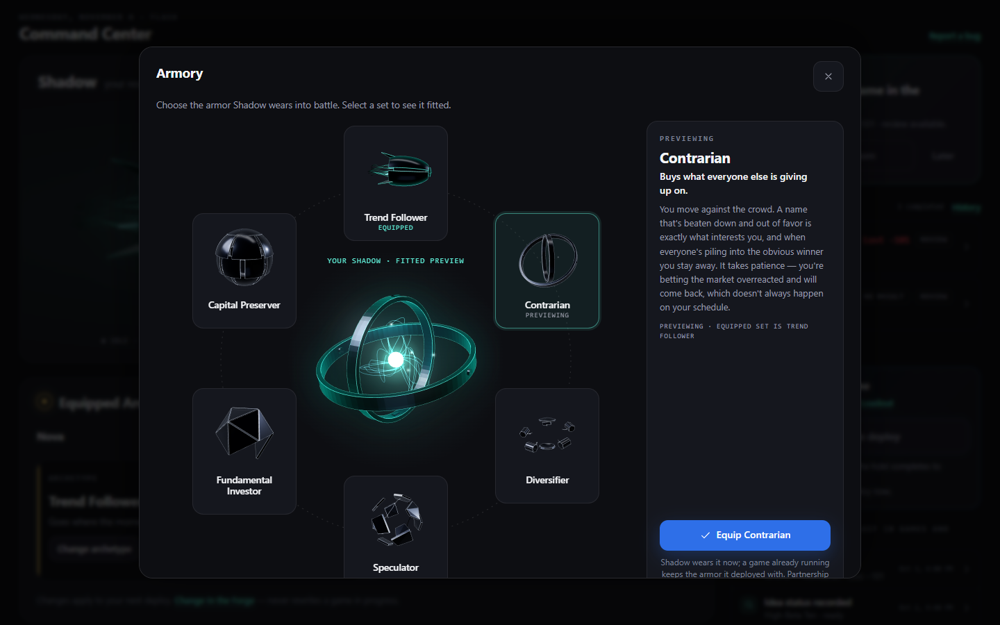
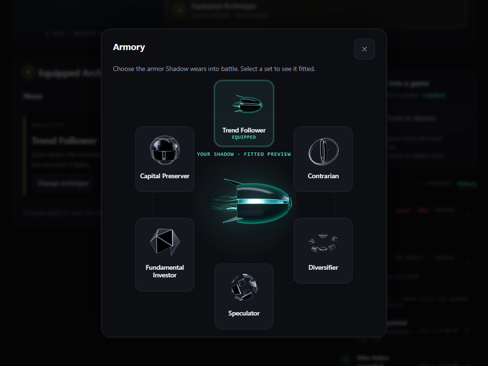
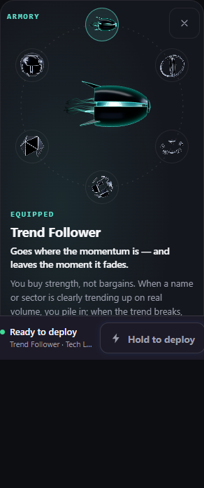
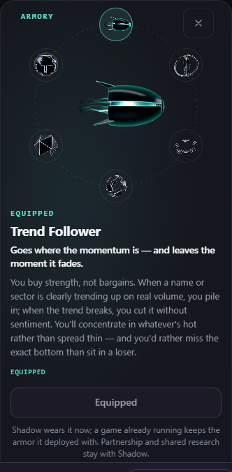
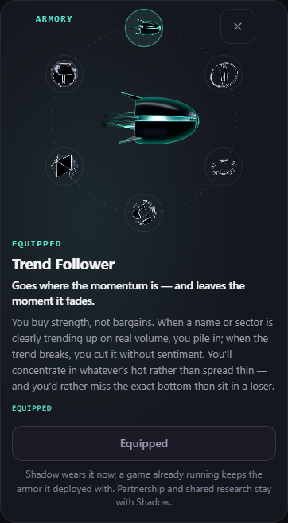
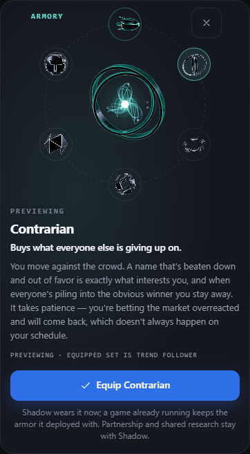
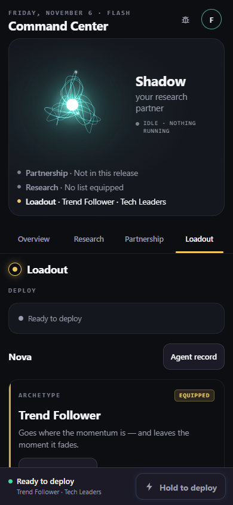
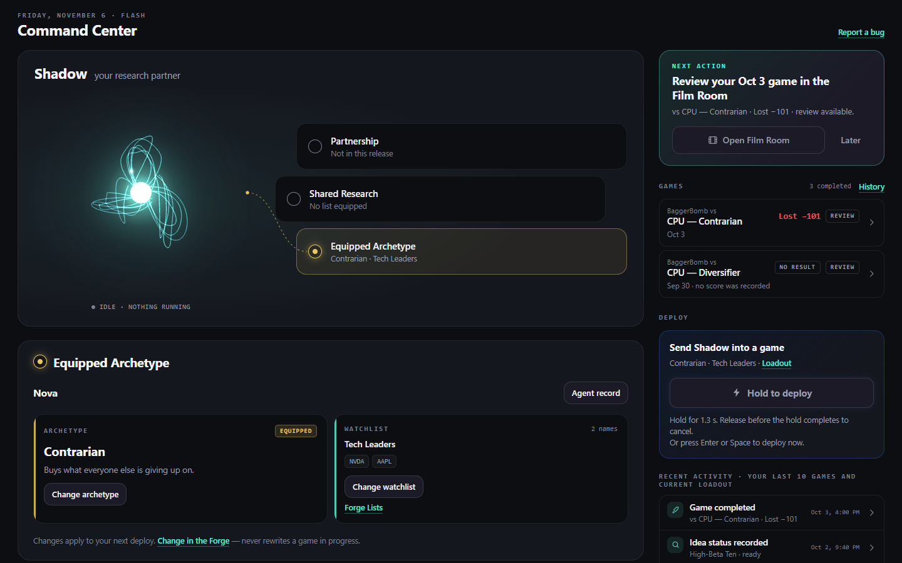

# Build A1: the armory replaces the archetype picker

**Run date:** November 4, 2026 · **Model:** Claude Opus 5.5 · **Branch:** `claude/armory-a1`, cut from `origin/claude/phase0-armory` @ `bbad5e71` (the Phase 0 report alone, one commit over `main` @ `40641486`), with `origin/main` @ `31574600` merged in (`5dee1679`, no conflict) and, before the final checks, `origin/main` @ `9d97b396` (PRs #1021 and #1022) merged in again (`e89aaba3`, no conflict); pushed by refspec from the worktree branch `claude/armory-a1-9010a6` · **Smoke branch:** `claude/armory-a1-smoke` · **PR:** [#1024](https://github.com/fashraf94/TradeSeven/pull/1024), draft · **Preview (follow-up):** https://trade-seven-nj8izdnrc-fais-projects-bc179554.vercel.app (the smoke head `7af066e6`; confirmed by the armory's new lock line and the readout's strings in the served Command Center chunk, and the dropped footnote sentence absent). A1's preview, https://trade-seven-9l683tqhp-fais-projects-bc179554.vercel.app (`079f0abd`), is superseded

**Follow-up run (§13, §14):** November 6, 2026 · Claude Opus 5.5 · the same branch, from its head `da4950f6` (checked before any write: PR #1024 open, draft, head `da4950f6`), worked in the app worktree branch `claude/armory-a1-followup-c5229e` and pushed by refspec to `claude/armory-a1`; `main` not merged in (the fix pass after the review does that). `git fetch origin` ran first. Fenced files read: `api/agent/decide.js` (§14's no-book check, read only). Edited: none. Nothing under `api/` changed. The old §13 "Commits and artifacts" is now §15.

**Preamble.** `git fetch origin` ran first. `origin/claude/phase0-armory` was `bbad5e71`, one commit over `main`, as the prompt required, and the merge of `origin/main` was clean, so neither STOP applied. The tree was clean at the start. Fenced files read: none. Fenced files edited: none. Fenced functions called: none (the armory calls `agentService.changeArchetype`, the client of the non-fenced `api/agent/change-archetype.js`, exactly as the picker does). Nothing under `api/` changed, no server, record or rules change. Line numbers below are this branch's.

---

## 0. Founder rulings (Nov 2, 2026), as given

| # | Ruling |
|---|---|
| D1–D5 | As in the Phase 0 prompt: loadouts per game (A2), the picker replaced by the armory (this build), the training chooser removed (A2), **growth display deferred** (no XP, levels, stages, thresholds or battle counts anywhere in A1), each archetype its own character (A3). |
| FD-1 | An equip takes effect on the next deploy once A2 lands. **In A1 the commit path is unchanged** (`changeArchetype`, immediate, 409 while the ranked agent is in a battle), so the armory's copy says what happens: *Shadow wears it now; a game already running keeps the armor it deployed with.* The old picker's copy is not touched in A1 (flag-off bytes stay identical). |
| FD-2, FD-3, FD-5, FD-10, FD-11 | League's loadout on the ranked record; a League week frozen; a save carries memory, paragraph, cycle, lessons, stats, traits and Character settings; the Forge strategy stays on the agent; the ranked field is the default. **All A2/A3; nothing in A1.** |
| FD-6 | Record facts (counts, first/last played, "Never worn") are A4. **A1's status line is "Equipped" or "Previewing" only.** |
| FD-7 | The hub hero wears the loadout of its surface. In A1 that is still the ranked record's field: unchanged. **Superseded by N1 below (Nov 4, 2026).** |
| FD-8 | **Phone: the armory opens in the hero's box.** The hero's text column folds away, the figure shrinks to 150–160 px live and centres, and the six sets sit on a ring at 44–48 px. Confirm it fits at 320, 360 and 390 px; if it can't at 320, fall back to the board's bottom sheet there and say so. |
| FD-9 | **Unworn sets are stills, live on touch** (phone) or hover (desktop). Only the centre figure and at most one touched set are live at once. |
| R1–R12, R18–R19 (S1/S2) | Hold. In particular R12 (under 40 px is a still), R10 (names from `hub/archetypeLines.js` only, the §2.3 import ratchet) and the hub copy guard. |

### Founder rulings of Nov 4, 2026 (built in the follow-up, §13)

| # | Ruling |
|---|---|
| **N1** | **Shadow outside a game is always neutral.** Shadow is drawn bare everywhere except the game seats (the battle header, pane and mark; the League fuse and climb; the League lobby's climb preview, which depicts a pod's seats), the loadout cards (A2, as stills) and the armory while a set is being previewed. It settles what the hub hero wears when two games run different archetypes, and **supersedes FD-7**. Behind `AGENT_FORM_ARMORY_ENABLED` only: flag off, the hero keeps wearing the archetype exactly as today. Flag on: the hub hero (wide and phone) draws bare Shadow whatever `agent.archetype` says, under bare Shadow's own label, and nothing on the hub reads "Shadow wearing X". Desktop: the dialog's centre wears the preview, the hero behind it stays bare throughout, and after an equip it neither changes nor suits up; the change shows on the Loadout panel's Archetype card, which still names the archetype. Phone: the centre figure (the hero, resized) suits up as sets are previewed; on close, by cancel, equip or N2(d)'s steps, the armor comes off with the 700 ms unequip as the box collapses (instant under Reduce Motion): one motion, no flash, no black square, no second suit-up. This replaces §3's "after an equip the hero keeps the new set while the record catches up". R19's brighten: the Equipped Archetype area on a bare hero lights the whole form (the built fallback, confirmed by a row). The hub's suit-up on an archetype change never fires while the hero is bare; the path stays for a flag-off rollback. Seats keep their armor; the battle and League sites are not touched. |
| **N2(a)** | The refused-equip line is the armory's own: "Locked while a game is running · nothing changed. Try again when it ends." (reworded only if the A1 copy guard rejects a word; it did not). The hub's `nextDeployLocked` stays as it is for the Loadout card. |
| **N2(b)** | Drop "Partnership and shared research stay with Shadow." for now; it returns in A3, when each archetype keeps its own save. The footnote is FD-1's sentence alone. |
| **N2(c)** | Accept the desktop dialog's inner scroll at 900 px tall; re-measure after (b) and report it. |
| **N2(d)** | The phone page stays usable while the armory is open, but the armory steps aside: switching hub tabs, starting a deploy, opening a sheet or leaving the hub closes the armory and discards the preview (no equip, N1's unequip). Rows for each. |
| A2 notes | For the loadout boards (§14), recorded for A2, no A1 code: N1 overrides board 6's premise and board 7's decisions #8, #16 and #17; **decision #6 ("No book blocks Deploy") is reversed**: a loadout with no book reads "No book · open market", and Deploy keeps working. |

---

## Executive verdict

| # | Item | Result |
|---|---|---|
| 1 | **The flag** | `AGENT_FORM_ARMORY_ENABLED = false` (`src/config/agentFormFlags.js:98`), pinned, in `DARK_BY_DESIGN`. Nothing changes for players until it is flipped. |
| 2 | **Flag-off identity** | **Byte-identical to `main`.** Unminified Linux build, hashes masked: 53 files against 53, **0 lines differ**, at the fix commit `54bae5a4` and at the merged head `e4af2f9b`; the minified build emits the same files under the same content hashes (§6). |
| 3 | **Desktop (board 6)** | Built: the 1040 px dialog, Shadow at 300 live in the centre wearing the previewed set, six sets on the ring (each alone, pewter unless equipped, a still until hovered), the aside with the set's name, one-liner, paragraph, the status line and Equip with the FD-1 footnote. The hero behind it is paused. Not built, as ruled: growth tiles, counts, seam flash, ring burst, hook return (§1). |
| 4 | **Phone (FD-8)** | **In the hero's box, at all three widths; no bottom-sheet fallback was needed at 320.** The hero itself shrinks to 152 px, centres and wears the preview; six sets drawn at 46 px in 48 px tap circles on a ring of 116; measured in a real browser: no overlap, no overflow, every target ≥ 44 px (§2). |
| 5 | **No flash, no black square, no second suit-up** | Measured frame by frame in headless Edge on the real GPU: **0 placeholder frames on open or close**, the hero's canvas never hidden, at desktop and at 320 / 360 / 390. The hero never remounts. *Follow-up (N1):* with the flag on the hub hero is bare Shadow; on the phone it wears the preview only while the armory is open, and any close takes the armor off once, on the 700 ms unequip (§3, §13). |
| 6 | **Equip** | `changeArchetype` once, with the chosen set; a battle lock (409 `battle_active`) shows *(follow-up, N2(a))* the armory's own line, "Locked while a game is running · nothing changed. Try again when it ends."; other refusals keep the server's words; a tempo-dial reset shows its notice (§1.4). |
| 7 | **Lab** | Four presets for FD-9: one live at 160 + six stills at 48, one live at 300 + six stills at 112, and both with all seven live (§4). The lab flag stays `false`. |
| 8 | **Guards** | **None loosened.** The token, motion and framing scans and the mount guard's no-frame-read row now cover `Armory.jsx`; the mount guard's agentService names gained the armory's write (`changeArchetype`, the picker's own); the flag pins, the flag-off bundle and the copy guard gained rows (§5). |
| 9 | **Mutation** | **26 of 26 killed**, the eight the prompt names among them; one control survives, as it must (§7). |
| 10 | **Checks** | `lint:gate` exit 0. Full suite on Linux at the merged head: 1,281 files, 28,396 rows, 28,307 pass, **0 fail**, 89 skipped. Minified build of the pushed head: exit 0, every chunk byte-identical to `main`'s (§8). |
| 11 | **Review threshold** | **Over it: stop at the draft PR.** The cumulative branch diff against `main` is 34 files, +2,365 / −49 lines, the two reports and six screenshots included; without `docs/`, 26 files, +1,719 / −49 (the app's source 11 files, +734 / −37; tests, guards and baselines 15 files, +985 / −12). BUILD_RULES §2 asks for a review at 10 files or 1,500 lines, so a review session runs before merge. |
| 12 | **Not proven** | Nothing here has run on an iPhone. The checklist (§10) is how the phone decides FD-9 and the sizes. *Follow-up:* the founder's iPhone smoke passed on Nov 6 (§10); the `60 s:` lines were not recorded, so FD-9 stays as built. |
| 13 | **Follow-up (Nov 6): N1, N2, the boards** | Built and checked (§13): the hub hero bare with the flag on; the armory's own lock line; the footnote alone; the phone armory stepping aside for a tab switch, a deploy, a sheet or leaving. Flag-off build still byte-identical to `main` `9d97b396` at both code commits. 17 of 17 mutants killed, the control survives. The desktop scroll at 900 px is **65 px, unchanged** (the ring, not the footnote, sets the dialog's height). The loadout boards are committed with their sources, and §14 says what A2 inherits; a no-book deploy works today. |

---

## 1. What was built

### 1.1 The files

| File | What |
|---|---|
| `src/config/agentFormFlags.js:85-98` | The flag, `false`, with its docstring and `Pinned by:` pointer |
| `src/components/CommandCenter/Armory.jsx` (new) | The armory: the wide dialog (`ArmoryDialog`, `:290`), the phone's state (`PhoneArmoryScope`, `:365`) and ring (`PhoneArmoryRing`, `:425`), the shared aside (`ArmoryDetails`), the equip (`useArmoryEquip`, `:115`), the geometry (`DESKTOP_RING` `:61`, `PHONE_ARMORY` `:72`) |
| `src/components/CommandCenter/LoadoutSheets.jsx:142` | The archetype sheet: the armory with the flag on, the picker with it off (one literal ternary). `ArchetypePicker.jsx` is untouched |
| `src/components/CommandCenter/ShadowStage.jsx:196`, `:265` | `PhoneStage` is `PhoneArmoryStage` with the flag on: its closed layout is `PhoneStage`'s own; open, the armory takes the hero's box |
| `src/components/CommandCenter/HubAgentForm.jsx:106` | One prop: a preview taken off on close is drawn at once (`instant`) |
| `src/components/CommandCenter/CommandCenterHub.jsx:353`, `:481` | The phone stage wrapped in the armory's scope; the wide hero paused while the dialog is open |
| `src/components/CommandCenter/hub/useHubSheets.js:75` | With the flag on the archetype sheet is not a "shipped sheet": the dialog registers itself; the phone armory is part of the hub, not an overlay |
| `src/components/AgentForm/agentFormSpec.js:57-85` | The wrapper's two looks (Phase 0 §7.2), values of props it already takes (below) |
| `src/components/CommandCenter/hub/hubCopy.js:530` | `ARMORY_COPY`, a table of its own |
| `src/components/CommandCenter/hub/archetypeLines.js:44` | `armoryLines`: name, one-liner and paragraph, through the hub's one §2.3 importer |
| `src/screens/AgentFormLab.jsx:26` | The four armory presets |

### 1.2 The wrapper's two options, and why they are values

The engine already draws a set with no brain (`brain: false`) and in the pewter palette (`pal: 'unlit'`). The wrapper takes them as **values of props it already has**: `coreStage={SET_ALONE}` (0) is the set alone, `allegiance={UNLIT}` is pewter. A new prop or a new spec key would have changed the bytes of every chunk the wrapper is in, flag off; a value is read inside the flag's literal ternary (`agentFormSpec.js:81`, `:85`) and folds away. The equipped set keeps the player's teal. R12 still holds: a set under 40 px is a still whatever it is asked.

### 1.3 Desktop (board 6)

- **Layout:** board 6's numbers exactly: a 1040 px dialog (the hub's own `HubSheet`), a 690 × 700 listbox, Shadow at 300 px live in the centre under "Your Shadow · fitted preview", six cards of 150 px holding each set at 112 px on a ring of 252, and the aside. On the tablet and stacked compositions the same dialog is drawn smaller (`COMPACT_RING`: Shadow at 220, sets at 84) with the aside under the ring.
- **The sets:** each set alone, pewter unless equipped, a still; hovered, it goes live (a rate flip on the same view), and a still again on leaving. One set at a time.
- **Preview:** selecting a set (click, or the arrow keys) plays the engine's swap on the centre (900 ms on, 700 ms off, the size tweened, R5). The status line reads "Equipped" or "Previewing · Equipped set is X"; the button "Equip X".
- **The hero behind:** paused while the dialog is open (`paused`, as under the deploy ceremony). *Follow-up (N1):* with the flag on it is bare Shadow throughout, so an equip neither changes it nor suits it up; the Loadout panel's Archetype card names the new set once the record changes. (A1 had it suit up through its own change path.)

The tablet composition (1024 × 768), the compact ring, the aside under it (scrolled to): measured 600 px wide, no horizontal overflow, the same at 800 px.

### 1.4 Equip

Exactly the picker's write: `changeArchetype(agent.id, codeId)` once (`Armory.jsx` `useArmoryEquip`), nothing while one is in flight, and a result that lands after the armory closed is dropped (a session token, bumped on close and at unmount). On success the armory closes.

- **409 `battle_active`:** *follow-up (N2(a)):* the armory's own line, `ARMORY_COPY.locked`, "Locked while a game is running · nothing changed. Try again when it ends." (A1 showed the hub's "Locked in battle" line, `HUB_COPY.loadout.nextDeployLocked`, which stays the Loadout card's), and the armory stays open. The route's other 409s (`epoch_closed`, `composition_blocked`) are not battle locks, so they keep the server's own words, as the picker shows them; anything without words shows the picker's "Could not change archetype. Please try again."
- **The tempo-dial reset** (`dialInvalidated`, unreachable while mastery is dark): its notice shows and the armory stays open (the picker shows it for 2.6 s and closes; the hub side holds no timer). Only the mastery-dark wording is carried: the picker's lit wording uses words the hub copy guard bans.

### 1.5 Copy (`ARMORY_COPY`)

Title "Armory"; intro "Choose the armor Shadow wears into battle. Select a set to see it fitted." (board 6's, less "a change applies on your next deploy", which FD-1 rules out); "Your Shadow · fitted preview"; "Armor sets" (the listbox); "Equipped", "Previewing", "Previewing · Equipped set is X"; "Equip X", "Equipping…"; the footnote, FD-1's sentence exactly (*follow-up, N2(b):* alone; A1 followed it with board 6's "Partnership and shared research stay with Shadow.", which returns in A3); the lock line (N2(a)). Names, one-liners and paragraphs come from the identity table through `hub/archetypeLines.js` alone (the one-liner is the identity table's disposition, the paragraph its reveal, the picker's subhead and body).

### 1.6 Accessibility

The ring is a single-select listbox ("Armor sets"); each set is an option named by the set's name; selection follows focus, and the arrows, Home and End move round the ring. The figures are decorative (`label={null}`; on the phone the hero is `aria-hidden` while the armory is open). The dialog is named "Armory"; the status line is a polite live region. Escape closes; on the phone, focus starts on the equipped set and returns to Change archetype.

---

## 2. The phone (FD-8): sizes, measured

**Settled:** the hero at **152 px** live, centred; six sets drawn at **46 px** inside **48 px** tap circles on a ring of **116 px**; all inside a **280 px** square; the stage's side padding 5 px while the armory is open. The name, one-liner, paragraph, status line, Equip and the footnote sit under the ring and scroll with the page. The "Armory" mark and Close (44 × 44) sit in the ring's two empty top corners.

Why these numbers: a set at ±30° from the horizontal is `radius × cos 30°` from the centre, so its box clears the hero's when `116 × 0.866 − 24 = 76.5 ≥ 152 / 2`. At 320 px the stage's inner width is 290 (320 − 2 × 14 gutter − 2 × 1 border), and the ring is 280.

Measured in headless Edge 156 on the real GPU (ANGLE, Iris Xe, D3D11), phone context with touch, the real hub with the flag on (§9 has the harness):

| Width | Stage | Ring | Hero | Sets | Set ↔ hero | Set ↔ set, Close ↔ set | All inside the stage | Smallest tap target | Page overflow |
|---|---|---|---|---|---|---|---|---|---|
| 320 | 292 | 280 | 152 | 48 | no overlap (0.45 px clear) | none | yes | 44 | 0 px |
| 360 | 332 | 280 | 152 | 48 | no overlap (0.45 px clear) | none | yes | 44 | 0 px |
| 390 | 362 | 280 | 152 | 48 | no overlap (0.45 px clear) | none | yes | 44 | 0 px |

**No 320 px fallback was needed:** the ring fits in the hero's box at all three widths. The stage scrolls into view when the armory opens. At 320 × 568 the Equip button is below the first screen and is reached by scrolling, as FD-8 allows.

| 320 | 360 | 390 |
|---|---|---|
|  |  |  |

Previewing the Contrarian on the hero itself, 390: 

---

## 3. No flash, no black square, no second suit-up

**How the centre relates to the hero (the prompt's choice to make):** on the phone **the hero view stays and resizes**. It is the same element in both layouts, one path through the tree, behind a wrapper that is `display: contents` while the armory is closed, so it never remounts: no placeholder, no canvas made fresh, on open or close. On the wide compositions the dialog has its own centre, over the paused hero.

- **The sets and the dialog's centre** are new views when the armory opens. Each is hidden until its view has reported, so the wrapper's placeholder never shows for the frame before the engine draws (`Armory.jsx` `Figure`).
- **Close, by any path (follow-up, N1; this replaces A1's cancel and equip behaviour):** with the flag on the hub hero is bare Shadow (§13.1). On the phone it wears the previewed set only while the armory is open, so opening suits it up in the equipped set and each preview is a swap; closing, by Close, Escape, an equip or any of N2(d)'s steps, is **one** change of the hero, to bare Shadow, in the same render as its return to the stage's size: the engine's 700 ms unequip as the box collapses (`engine.js` `swap()`), at once under Reduce Motion. After it nothing changes the hero again: the record catching up after an equip is not a second suit-up, because the hero reads no archetype. On the wide compositions the hero behind the dialog stays bare throughout.
- *A1, retired by N1:* a cancel drew the preview's removal at once (`instant`, read in `HubAgentForm.jsx`), and after an equip the hero kept the new set until the record caught up. `HubAgentForm.jsx` is `main`'s file again.

**Measured** (headless Edge, the real GPU, the harness built from the code head `c515d020`), every animation frame for the 45 frames after the click (an earlier run on `7560e7cb` read the same, the sets first visible at frames 3–5):

| Surface | Open: placeholder frames | Open: hero canvas hidden | Close: placeholder frames | Close: hero canvas hidden | Sets first visible |
|---|---|---|---|---|---|
| Desktop, 1440 × 900 | 0 | 0 | 0 | 0 | frame 5 |
| Phone 320 | 0 | 0 | 0 | 0 | frame 5 |
| Phone 360 | 0 | 0 | 0 | 0 | frame 4 |
| Phone 390 | 0 | 0 | 0 | 0 | frame 4 |

After closing, the hero's label read "Shadow wearing Trend Follower", the equipped set (A1; with N1 it reads Shadow's own label, measured again in §13.4). Reduced Motion (the jsdom rows; the browser run had it off): every view is told, every set stays a still even when hovered or touched, and a preview is the same archetype change, which the engine draws at once under reduced motion (its swap is an update there).

---

## 4. The lab presets (FD-9)

`?agentFormLab=1` (smoke branch only) gains four presets (`AgentFormLab.jsx:26`). The first view is Shadow in the Form control's set at the Rate control's rate; the six after it are the sets on their hooks, alone and pewter but for the one Shadow wears:

| Preset | Views |
|---|---|
| Armory phone: 1 live at 160 + 6 stills at 48 | the phone armory as built (FD-9) |
| Armory desktop: 1 live at 300 + 6 stills at 112 | the desktop dialog as built |
| Armory phone, all live: 160 + 6 at 48 | FD-9's alternative |
| Armory desktop, all live: 300 + 6 at 112 | FD-9's alternative |

The Copy reading line names the preset and "armory sets stills" or "live". Phase 0 §7.5 has this laptop's numbers for the same cells: one live and six stills cost what the hero alone costs; seven live cost 3.4–10 ms a frame. The phone decides.

---

## 5. The guards

| Guard | Change | Why |
|---|---|---|
| `agentFormFlags.test.js` | **Added:** the pin, the literal, the `DARK_BY_DESIGN` entry, every read site's exact line, no other reader, and "the armory is on only while the hub's form is" | BUILD_RULES §2; a hub rollback must take the armory with it |
| `flagPinGuard.test.js` | **Added** the `DARK_BY_DESIGN` entry | Its own rule for a dark flag |
| `agentForm.flagOffBundle.test.js` | **Added** `Armory.jsx` (nothing), `archetypeLines.js` (`archetypeLines` alone), `ShadowStage.jsx` (its four exports alone) and `agentFormSpec.js` with the spec used (no look survives); one plant (the armory context's pure mark); the flag count 4 → 5 | The prompt's instruction, as for the League slot |
| `hubCopy.guard.test.js` | **Added** an A1 block: no digit, no count or growth word (`stage`, `battles`, `level`, `worn`, …) in `ARMORY_COPY`'s source or sampled output; each function takes one argument, a name; the status words; FD-1's footnote; plants that red | D4, FD-6, FD-1 |
| `commandCenterHub.mount.guard.test.js` | **`changeArchetype` added** to the agentService names the hub may import, and `Armory.jsx` to its writers; **`Armory.jsx` added** to the no-frame-read, no-device-read row | The armory's Equip is the picker's own write, now made from a hub file. The rows still pin the exact set. No new lazy edge: the armory uses the existing wrapper |
| `tokens.guard.test.js`, `motion.guard.test.js` + baselines | **`Armory.jsx` registered**, count 0 | Their own instruction for a new hub file |
| `AgentForm.s1.jsdom.test.jsx` (the framing scan) | **`Armory.jsx` added** to the files that draw the wrapper, with no framing | The scan's list is exact |
| The activity guard | **No change.** `Armory.jsx` holds no effect, timer or listener: focus on open is a ref callback, an in-flight result is dropped by a session token | — |
| The §2.3 import ratchet | **No change.** The armory's words reach it through `hub/archetypeLines.js` | R10 |

**Retired: none. Loosened: none.**

---

## 6. Flag-off identity

`vite build --minify false --sourcemap false` on Linux (WSL), LF trees from git, hashes masked (`-[A-Za-z0-9_-]{8}.js|css`):

| Compared | Files | Lines that differ |
|---|---|---|
| `main` `31574600` vs the fix commit `54bae5a4` | 53 / 53 | **0** |
| `main` `9d97b396` (after PRs #1021, #1022) vs the merged head `e4af2f9b` | 53 / 53 | **0** |
| *Follow-up:* `main` `9d97b396` vs the N1 commit `f44804c0` | 55 / 55 | **0** |
| *Follow-up:* `main` `9d97b396` vs the N2 commit `470fb2b5` | 55 / 55 | **0** |

*(The follow-up compares all 55 files of `dist/` (52 scripts, the stylesheet, `index.html`, `vite.svg`). Its first script let the two `index-<hash>.js` chunks collide on their masked name and compared 54; it now keys each file by its own masked first bytes, and all 55 compare equal. A1's script, which counted 53, was not kept, so whether it had the same collision is not known; the minified byte comparisons, A1's and this one's, cover every file regardless.)*

A first local probe of the app code alone (before the tests and the lab presets; not in the branch's history) read the same, 0 lines, on the first build. The **minified** build (as Vercel builds it) agrees: `main` `9d97b396` and `e4af2f9b` emit the same files under the same content hashes (`index-BYnPCOYp.js`, `CommandCenterHub-B9LroiTM.js`, `agentGrowth-CNRf8kTV.js`, `index-C9h9-yhu.js`, `index-Bt3Ms9P_.css`), so every chunk is byte-identical. Only the source maps differ: they carry the new source text.

---

## 7. Mutation

On Linux, in a WSL worktree of its own at `c515d020`, from a green baseline of the 202 rows the mutants target. One exact replacement each, its rows run, the file restored from the commit and checked clean. **26 of 26 killed**, and the one control survives, as it must.

| Id | The prompt's mutant, or an extra | Killed by |
|---|---|---|
| M1 | **A slot drawn with a brain** (`coreStage={1}`) | "each is the set alone (no brain)…", the hover and touch rows |
| M1b | The wrapper's set alone keeps its brain | the spec's SET_ALONE rows |
| M2 | **The equipped slot unlit** | "…pewter unless it is the equipped one" |
| M2b | The wrapper draws unlit as teal | the spec's UNLIT row, the mount and equip rows |
| M3 | **A stage in the status copy** ("· stage one") | the copy guard's A1 rows (growth word; the status words) |
| M3b | **A count in the status copy, passed as an argument** (`(n) => \`Equipped · ${n} battles\``) | the copy guard's A1 rows (a growth word in the source; a function that takes a count) |
| M4 | **Equip not calling `changeArchetype`** | "Equip calls changeArchetype once…", the lock rows, the phone equip row |
| M4b | Equip with the equipped set, not the chosen one | the same, and the phone equip row |
| M5 | **The 409 not surfaced** | the desktop and phone lock rows |
| M5b | The 409 shown as the server's words, not the lock line | the lock rows, `equipErrorOf`'s row |
| M6 | **A name read from outside `archetypeLines.js`** (`getArchetypeDisplayName` imported into `Armory.jsx`) | the mount guard's "legacy tables imported by exactly one hub file" and the §2.3 ratchet (`api/_utils/archetypeRegistry.test.js`, "no NEW production module imports a legacy archetype table") |
| M7 | **A seventh live view** (every set live) | the still rows, "never more than two live views" |
| M7b | Two hot sets at once (a hover never cleared) | the hover and touch rows |
| M8 | **The hero not paused under the dialog** | "is paused while the armory is open…", the live-views count |
| X1 | Phone: the preview taken off on close is suited up (the second suit-up) | "a cancel takes it off at once…" |
| X2 | Phone: after an equip the hero steps back to the old set | "an equip keeps the new set on the hero…" |
| X3 | *Control:* the ring wrapped in a fragment (no change to the hero's path) | **survives**, as it must |
| X3b | Phone: the hero remounted when the armory opens (a key on its scope) | the phone rows: the test worker dies before they report, so the file fails. The runner's tally read the crashed run as "0 failed"; re-run by hand, the file exits with an error (§12, F3) |
| X4 | Phone: the armory registered as an overlay (the page goes inert) | "the page around the phone armory is not made inert" |
| X5 | The no-flash gate removed | "no flash on open…" |
| X6 | A flag read outside its literal ternary | the exact-sites row, and the flag-off picker row |
| X7 | The armory's context loses its pure mark | the flag-off bundle row (Armory.jsx bundles to nothing) |
| X8 | The flag flipped on without its pin | the pin, flagPinGuard |
| X9 | ArrowRight does not move the preview | the listbox row |
| X10 | Reduced motion ignored by the sets | both reduced-motion rows |
| X11 | The phone ring overlaps the hero (radius 110) | the ranges and overlap rows |
| X12 | A tap target under 44 (slot 42) | the ranges and tap-target rows |

---

## 8. Checks and sizes

- **`lint:gate`:** exit 0, on Linux, at `c515d020` and at the merged head `e4af2f9b`.
- **Full suite:** Linux (WSL), `TZ=UTC`, 8 workers, under `flock /tmp/pd-suite.lock`, at the merged head `e4af2f9b` (the tree CI tests: this branch with `main` `9d97b396` in it): **1,281 files, 28,396 rows, 28,307 pass, 0 fail, 89 skipped.** The first run, at `7560e7cb`, had four reds, all mine (a named import the hub suites' picker mock lacks, a second pin of the flag, the framing scan's file list, a fourth `PHONE_SHADOW` read); `54bae5a4` fixed them and its run was green (28,387 rows, 0 fail). The commits after `e4af2f9b` change only this report.
- **Minified `vite build` of the pushed head:** exit 0 (§6: the same bytes as `main`).
- **Windows:** the targeted files only; the three engine suites cannot run there (no `three` in the Windows checkout), which is the known split.
- **Not run:** the Firestore rules suite (no rules changed), and anything on a real device.

| Chunk (minified, as Vercel builds it) | `main` `9d97b396` | This head |
|---|---|---|
| Entry | 4,843.05 kB, 1,307.59 kB gzip | the same file |
| Command Center | 141.72 kB, 42.74 kB gzip | the same file |
| The forms' shared chunk (`agentGrowth`) | 5.49 kB, 2.33 kB gzip | the same file |
| Engine | 614.83 kB, 162.83 kB gzip | the same file |
| Stylesheet | 36.83 kB, 8.44 kB gzip | the same file |

With the flags on (the smoke build `079f0abd`: the armory, the lab and the corner readout), the Command Center chunk is 155.40 kB, 47.23 kB gzip (+13.68 kB, +4.49 kB gzip, the readout included), the lab's chunk 10.05 kB, and the entry +0.36 kB (the lab's own lazy edge in App). The armory loads no chunk of its own and adds no `import()`: the mount guard's one lazy edge holds.

---

## 9. The harness (not committed)

A WSL worktree of the code head with the flag set `true`, an untracked Vite page rendering the real `CommandCenterHub` (the app's three stylesheets, the hub fixtures' sections), and the network seams stubbed as the jsdom suites stub them (`useHubReaders`, `agentService`, the list and idea services, `UserContext`, `firebase/config`, `useMasteryProfile`); the stubbed equip answers in 300 ms and the record changes 400 ms later. Driven from Windows by `playwright-core` 1.61.1 with Edge 156, `--use-angle=d3d11`. Nothing from it is committed.

---

## 10. Your iPhone checklist

Open the preview link (A1's: https://trade-seven-9l683tqhp-fais-projects-bc179554.vercel.app; the follow-up's is in §15) on the iPhone and sign in.

1. **Command Center → Loadout → Change archetype.** The armory opens in place: the figure shrinks to the middle and the six sets appear around it. Nothing should flash or go black.
2. **Tap each set.** It lights up while your finger is on it, and the centre figure suits up in about a second. The line under the ring says "Previewing · Equipped set is …".
3. **Equip one.** The armory closes and the Command Center figure is wearing it. Later, start a casual game and check it deploys with that armor.
4. **Turn Reduce Motion on** (Settings → Accessibility → Motion). Open the armory again: everything is still, and tapping a set switches the figure at once. Turn it off again.
5. **With the armory open, leave the phone still for one minute,** then copy the `60 s:` line from the small readout in the top-right corner.
6. **Open the preview link with `?agentFormLab=1` added at the end.** Tap each of the four "Armory" presets in turn (the two with stills and the two "all live"), wait a minute on each, and copy each `60 s:` line. These four lines decide FD-9 for good.

### The founder's result (Nov 6, 2026)

**The smoke test passed:** "the armory looks great and switching between the archetypes was smooth and very satisfying." The `60 s:` lines from the armory and from the four lab presets were not recorded. **FD-9 therefore stays as built:** unworn sets are stills, live on touch. The all-live lab presets stay in the lab for a later reading.

### The follow-up's phone check (the new smoke preview, §15)

Open https://trade-seven-nj8izdnrc-fais-projects-bc179554.vercel.app on the iPhone and sign in.

1. **The hero is bare Shadow** on the Command Center, on every tab, whatever archetype is equipped.
2. **Loadout → Change archetype:** the centre suits up in the equipped set; tapping a set suits it up in that one. **Closing takes the armor off once** (Close, Equip, or anything below), as the box shrinks back; nothing suits up again afterwards.
3. **With the armory open, tap another tab:** the armory closes, the preview is gone, nothing was equipped.

---

## 11. Founder questions

**All four answered on Nov 4, 2026 (§0, N2):** (1) the armory gets its own lock line, N2(a); (2) the second sentence is dropped until A3, N2(b); (3) the scroll is accepted, N2(c), re-measured in §13.5; (4) the page stays usable and the armory steps aside, N2(d). Built in §13. The questions as asked:

1. **The "Locked in battle" words on a refused equip.** As the prompt said, a battle lock shows the hub's existing line: "Locked in battle · changes apply to your next deploy." In the Loadout card that line is about changes made in the Forge. In the armory, after a refused equip, its second half can read as if the change will happen later, and in A1 it will not: nothing was changed. Keep it, or give the armory a line of its own (for example "Locked in battle · try again when the game ends")?
2. **Board 6's second footnote sentence.** After your FD-1 sentence the footnote keeps the board's "Partnership and shared research stay with Shadow." It is true today. Keep it, or drop it?
3. **The desktop dialog's height.** Board 6's dialog is about 830 px tall. On a window 900 px tall it scrolls about 60 px inside: Equip stays in view, and the footnote's last line needs a scroll. Accept it, or shrink the desktop ring so it fits?
4. **The phone armory does not lock the page.** It is part of the Command Center, not a pop-up, so the tabs, the deploy strip and the bottom bar stay usable while it is open (a deploy could be started mid-preview). Is that what you want, or should the rest of the page be locked while the armory is open?

---

## 12. Found, not fixed

| # | Finding | Note |
|---|---|---|
| F1 | **Safari on a desktop: focus after the dialog closes** goes back to the page, not to Change archetype. The hub's own sheets keep the clicked button from the click (Safari does not focus a clicked button); the armory dialog is reached through `LoadoutSheets` with no new prop, to keep the flag-off bytes, so it falls back to the browser's focused element. The phone armory returns focus correctly | A2 can hand it the opener when the flag flips |
| F2 | **The tempo-dial notice's lit wording** ("unlocks at mastery level 2") uses words the hub copy guard bans, so the armory carries only the mastery-dark wording, which is what shows today | needs a ruling when mastery lights |
| F3 | **A remount of the hero while the phone armory opens crashes the test worker** (mutant X3b). The shipped code never remounts it there; the one real remount path, an agent or account switch while the armory is open, was probed and runs clean (the form remounts once, nothing hangs) | for the review session to look at |
| F4 | The flag-off picker still says "applies on your next deploy" (Phase 0's R2) | untouched in A1, as FD-1 rules |
| F5 | The mutation runner counted a crashed test worker as a pass (X3b) | the scratch runner's own bug, fixed by hand; nothing in the repo |

---

## 13. Follow-up (Nov 6, 2026): N1 and N2

### 13.0 Verdict

| # | Item | Result |
|---|---|---|
| 1 | **N1: the hub hero bare with the flag on** | Built at the hub's one hero read: the same agent, wearing nothing (`CommandCenterHub.jsx:651`, `Armory.jsx` `armoryHeroRead` `:366`). Wide and phone, whatever `agent.archetype` says; Shadow's own label; an equip never changes the hero; the Loadout card names the set. `HubAgentForm.jsx` is `main`'s file again. |
| 2 | **N1 on the phone: one unequip on close** | The hero wears the preview only while the armory is open (`Armory.jsx:404`); every close is one change to bare Shadow, the engine's 700 ms unequip as the box collapses, at once under Reduce Motion. Measured in the browser: 0 placeholder frames, the hero's canvas never hidden (§13.4). |
| 3 | **N2(a) the lock line** | "Locked while a game is running · nothing changed. Try again when it ends." The copy guard took it as written, no reword (`hub/hubCopy.js:548`). |
| 4 | **N2(b) the footnote** | FD-1's sentence alone. |
| 5 | **N2(c) the desktop scroll at 900 px** | **65 px, unchanged** from A1 (A1 reported "about 60"): the dialog's height is set by the ring, not the aside, so the shorter footnote moved Equip down 17 px and the footnote's line still sits 21 px below the fold. No scroll from about 975 px tall (§13.5). |
| 6 | **N2(d) the phone armory steps aside** | A tab switch, a deploy starting (a hold; the strip's Retry), another sheet opening, or the hub being left closes it, the preview discarded, nothing equipped, with N1's one unequip. Rows for each. |
| 7 | **Flag-off identity** | Linux, unminified, hashes masked, against `main` `9d97b396`: **55 / 55 files, 0 lines differ** at the N1 commit and at the N2 commit. Minified: the same 107 file names under the same content hashes; all 55 non-map files byte-identical (only source maps differ). |
| 8 | **Mutation** | **17 of 17 killed** (the 8 the prompt names, two of them in two forms, and 7 more); the control survives (§13.3). |
| 9 | **Checks** | `lint:gate` exit 0; full suite on Linux green; minified build of the pushed head exit 0 (§13.6). |
| 10 | **Review threshold** | Still over it: the follow-up's own diff is 12 source files, +515 / −95 (with the report, the boards and two screenshots, more). The Fable review runs next, on this head. |

### 13.1 What changed

| File | What |
|---|---|
| `src/components/CommandCenter/CommandCenterHub.jsx:651` | N1: the hero's read is `armoryHeroRead(readers.agent)` with the flag on, `readers.agent` with it off (one literal ternary at the Provider's existing prop) |
| `src/components/CommandCenter/Armory.jsx:366` | `armoryHeroRead(read, shown)`: the same agent, its id kept (so the hero keeps its key and its view), wearing `shown`; nothing shown is bare Shadow. A1's `instant` is gone |
| `src/components/CommandCenter/Armory.jsx:381-413` | `PhoneArmoryScope`: `shown` is the preview while open and nothing while closed; A1's `committed` hold and `trail` are gone; each open resets the equip's words (`reset`); the details' root carries the equip's `detach` (`:485`), so a result in flight when the armory closes by any path is dropped |
| `src/components/CommandCenter/ShadowStage.jsx:270` | The phone stage hands the hero `armoryHeroRead(read, scope.shown)` |
| `src/components/CommandCenter/HubAgentForm.jsx` | **Back to `main`'s text** (A1's `equipOnChange` ternary and its imports removed): the hero's suit-up path is the flag-off rollback path, and it never fires while the hero is bare |
| `src/components/CommandCenter/hub/hubCopy.js:548` | N2(a): `ARMORY_COPY.locked`; N2(b): `stays` removed |
| `src/components/CommandCenter/Armory.jsx:103-104`, `:294` | N2(a): `equipErrorOf` returns the armory's line; N2(b): the footnote renders FD-1's sentence alone (`data-armory-footnote`) |
| `src/components/CommandCenter/CommandCenterHub.jsx:337-343` | N2(d): `selectTab` closes the armory on a switch to another tab (a literal ternary over the whole arrow); while the phone hub renders, a hold's phase (charging, or committed with its beat) closes it |
| `src/components/CommandCenter/CommandCenterHub.jsx:415` | N2(d): the strip's Retry closes it before the deploy starts again (`FLAG && actions.deployAction ? … : actions.deployAction`) |

**Why the hold's close is made while the hub renders.** `Armory.jsx` and `CommandCenterHub.jsx` hold no effect (the mount guard's activity rows), and a hold starts in the provider, not in a hub handler. The close is the phone hub's own sheet state, set in its own render (React's "adjust state while rendering"), and the archetype sheet is not registered with the overlay stack while the armory is on (`hub/useHubSheets.js:75`), so it releases nothing outside the component. A row checks React logs no cross-component update.

**Opening a sheet and leaving the hub need no code.** The hub has one sheet slot (`useHubSheets`), so any other sheet replaces the armory's; the Forge doors close the sheet before they leave (`useHubRuntime.js:166`); a screen change unmounts the hub and its state with it.

**Found in A1's code and fixed here** (N2(d) makes external closes ordinary): a phone equip still in flight when something else closed the armory would, on landing, close whatever sheet had opened since and move focus to Change archetype; and its "Equipping…" would survive into the next open. Both have rows and mutants (X2, X3).

### 13.2 The rows

| Suite | Rows (new or rewritten) |
|---|---|
| `CommandCenterHub.armory.jsdom.test.jsx` | **N1:** the hero bare for four archetypes (one of them `unknown`), wide and phone, under Shadow's own label, and nothing on the hub reading "wearing"; the flag-off control (the archetype, "Shadow wearing …"); the hero keeps its view across a record change; the Loadout card still names the archetype; R19: the Equipped Archetype response lights `all` on the bare hero (flag off: `armor`); the desktop hero bare through open, preview and equip, never suiting up (every render of it, from mount on), the card naming the new set; phone: the open suits the bare hero up in the equipped set, a tap previews; Close is one unequip as the box collapses, with Reduce Motion off and on, and the record's later change changes nothing; an equip closes it with one unequip, the record catching up changes nothing, the card names the set; a result landing after an external close is dropped and the next open starts clean. **N2(a):** the lock line, desktop and phone, never the card's. **N2(b):** the footnote alone, phone and dialog. **N2(d):** a switch to Overview, Research and Partnership each closes it (one unequip, nothing equipped, the next open on the equipped set); the Loadout tab itself does not; the watchlist sheet and the agent record each close it; the Forge door closes it before it leaves; an unmount and a fresh hub find it closed, the hero bare, nothing equipped |
| `CommandCenterHub.s2b.jsdom.test.jsx` (the real deploy provider) | **N2(d):** pressing the strip's hold closes it (the stage shows "Holding to deploy", the deploy goes ahead, the preview is discarded, React logs no cross-component update); after a refusal, Retry closes it; the control: Dismiss leaves it open and starts nothing |
| `armory.seats.jsdom.test.jsx` (new) | **N1, seats keep their armor with the flag on:** the battle form wears the battle's archetype; a League seat in battle wears it; the League lobby's climb preview wears the archetype the lobby holds |
| `Armory.test.js` | `armoryHeroRead`: wears the shown set, the same agent, no `instant`; with nothing shown it is bare whatever the agent wears, its id kept; the lock line is the armory's |
| `hubCopy.guard.test.js` | N2(a): the line exactly, not the card's, nothing about "next deploy" or "apply"; N2(b): no literal in `ARMORY_COPY` names partnership or shared research, no `stays` key |
| `agentFormFlags.test.js` | The flag's exact read sites (the hub gains the Provider, `selectTab`, the hold's close and the strip's action; `HubAgentForm.jsx` reads it no more) and the reader list |
| `ShadowStage.agentForm.jsdom.test.jsx` | S1's Provider row: the read is the literal ternary that folds to `readers.agent` |

### 13.3 Mutation

On Linux, in a WSL worktree of its own at the N2 commit `470fb2b5`, from a green baseline of the 164 rows the mutants target (nine files). One exact replacement each (its anchor checked to occur once), the files run with 8 workers, the file restored from git and the tree checked clean; **a mutant counts as killed on a non-zero exit**, never on the JSON alone (A1's F5).

| Id | Mutant | Killed by |
|---|---|---|
| M1 | **The hero wearing the archetype with the flag on** (`archetype: shown ?? read.agent.archetype`) | the bare rows (wide, phone), the desktop equip row, the phone open, close and equip rows, R19, the tab rows, `armoryHeroRead`'s bare row |
| M2 | **The desktop hero suiting up after an equip** (the hero follows the record once it leaves its first set) | the desktop equip row ("never suits up"), the bare rows, the phone close and equip rows |
| M3 | **The phone close playing a second suit-up** (closing swaps back into the equipped set) | the Close rows (Reduce Motion off and on), the equip row, every N2(d) close row |
| M4 | **The phone close leaving the preview on** | the same rows |
| M5 | **A tab switch not closing the armory** | the three tab rows |
| M6 | **A deploy started with the armory still open** (the hold's close removed) | the provider's hold row; the exact-sites row |
| M6b | The same through the strip's Retry | the provider's Retry row; the exact-sites row |
| M7 | **The old `nextDeployLocked` line on a refused equip** | the lock rows (desktop, phone), `equipErrorOf`'s row |
| M8 | **The dropped sentence back in the footnote**, rendered | the footnote row; the copy guard's "no copy written in place" |
| M8b | The same, back in the copy table | the copy guard's N2(b) row |
| X1 | R19: the archetype area lights the armor even on bare Shadow | the hub's R19 row; `HubAgentForm.jsdom`'s bare-Shadow row |
| X2 | An external close does not drop an equip in flight (no `detach` on the phone details) | the late-result row |
| X3 | An open does not start clean (no `reset`) | the late-result row |
| X4 | The Loadout tab itself counted as a switch | the Loadout-tab row |
| X5 | Every strip action closes it (Dismiss too) | the provider's Dismiss control; the exact-sites row |
| X6 | The bare read loses the agent's id | `armoryHeroRead`'s rows |
| X7 | A flag read outside its literal ternary (the tab close compiled in flag-off) | the exact-sites row |
| C1 | *Control:* a comment beside the bare read | **survives**, as it must |

### 13.4 In the browser

The A1 harness (§9), rebuilt (its stubs had gone with their worktree), at A1's head `da4950f6` and at the N2 commit `470fb2b5`, the flag on, headless Edge 156 on the real GPU (ANGLE, Iris Xe, D3D11). Before → after:

| What | A1 `da4950f6` | Follow-up `470fb2b5` |
|---|---|---|
| Desktop hero's name at load | "Shadow wearing Trend Follower — ambient; …" | "Shadow — ambient; Equipped Archetype selected" |
| Desktop hero after an equip (record now Contrarian) | "Shadow wearing Contrarian — …" | "Shadow — …" (bare); the Loadout card reads Contrarian |
| Phone hero at load | "Shadow wearing Trend Follower — ambient" | "Shadow — ambient" |
| Phone, open | wears the equipped set | suits up in the equipped set ("Shadow wearing Trend Follower …") |
| Phone, Close after a preview | back to the equipped set, drawn at once | bare: "Shadow — …"; 60 frames sampled, **0 placeholder frames, the hero's canvas never hidden**, its box 152 → 200 |
| Phone, a tab switch with the armory open | the armory stays open | closed; 0 placeholder frames; no equip |
| Refused equip's line | "Locked in battle · changes apply to your next deploy." | "Locked while a game is running · nothing changed. Try again when it ends." |

| Phone, 390: the hero bare | Desktop after an equip: the hero bare, the card naming Contrarian |
|---|---|
|  |  |

### 13.5 The desktop scroll at 900 px (N2(c))

The dialog's scroll box (`HubSheet`, `max-height: 90%`, `overflow-y: auto`), measured at 1440 × 900 and 1280 × 900, as it opens, previewing another set, and with the lock line showing (all six the same):

| | Content | Box | **Scrolls** | Equip's bottom | Footnote's bottom | Box's bottom |
|---|---|---|---|---|---|---|
| A1 `da4950f6` | 830 | 765 | **65 px** | 793 (in view) | 853 (below) | 832 |
| Follow-up `470fb2b5` | 830 | 765 | **65 px** | 810 (in view) | 853 (below) | 832 |

**N2(b) did not shorten the scroll.** The dialog's height is set by the ring's 700 px listbox; the aside stretches to the same row, its spacer above Equip takes up the slack, and the footnote sits at the row's bottom either way. The shorter footnote (one line, was two) moved Equip down 17 px; the footnote's line still needs the 21 px scroll. Equip stays in view. **No scroll from about 975 px tall** (940: 29 px; 960: 11 px; 980: 0). Accepted as ruled; shrinking the ring is the only lever.

### 13.6 Checks

- **Flag-off identity:** Linux, `vite build --minify false --sourcemap false`, LF trees from git, hashes masked, against `main` `9d97b396`: **55 / 55 files, 0 lines differ** at `f44804c0` (N1) and at `470fb2b5` (N2). Minified, as Vercel builds it: both commits emit the same 107 file names as `main`, under the same content hashes; all 55 non-map files are byte-identical; 49 of the 52 source maps differ (they carry the new source text and the build's path).
- **`lint:gate`:** exit 0, on Linux, at `0d59f3ef` (the code and the boards), at `de45aef9` and at the pushed head.
- **Full suite:** Linux (WSL), `TZ=UTC`, 8 workers, under `flock /tmp/pd-suite.lock`, at `0d59f3ef` (every code change and the boards): **1,282 files, 28,423 rows, 28,334 pass, 0 fail, 89 skipped**, 271 s (A1's merged head: 1,281 files, 28,396 rows). **On a throwaway merge with today's `main` `f3da14a3`** (the tree CI tests; `main` is not merged into the branch): 1,283 files, 28,465 rows, 28,376 pass, **0 fail**, 89 skipped, 328 s. Again at the report-draft head `de45aef9` (the code, the boards, the report draft and its two screenshots): **1,282 files, 28,423 rows, 0 fail**, 89 skipped, 295 s. The pushed head changes only this report's text; at it the full suite, `lint:gate` and the minified build ran once more before the push, green (their numbers are in the PR description).
- **Minified build:** exit 0 at `de45aef9` (the Command Center chunk `main`'s own file, `CommandCenterHub-B9LroiTM.js`) and at the pushed head; the smoke head `7af066e6` builds too.
- **Windows:** the touched suites and the hub's guards, green (the engine suites stay Linux-only, as in A1).
- **Sizes:** flag off, every chunk is `main`'s file (the Command Center chunk is `CommandCenterHub-B9LroiTM.js`, 141.72 kB, 42.74 kB gzip, at the report-draft head `de45aef9` as at `main`). Flag on (the smoke build): the Command Center chunk 155.34 kB, 47.15 kB gzip (A1's smoke: 155.40 kB, 47.23 kB), the entry +0.36 kB.

### 13.7 Readings, and two questions

Readings (built this way; say if any is wrong):
1. **Opening suits the bare hero up** in the equipped set (900 ms), because the armory starts on it and the centre wears the preview.
2. **The Loadout tab itself is no switch** (nor the strip's loadout line, which leads there): the armory stays open.
3. **A deploy starts at the hold's first phase**, not its commit: the stage's status line shows "Holding to deploy", which the open armory folds away. A hold already charging when Change archetype is tapped closes it again at once: the deploy wins.
4. **Of the strip's actions only Retry starts a deploy**, so only Retry closes it; Dismiss and Check deployment leave it open; Enter battle and Open game leave the hub.
5. **Leaving the hub** has no motion to show: the hub unmounts, and its state goes with it; back on the hub the hero is bare and the armory closed.

Questions:
1. **The footnote next to a bare Shadow.** FD-1's sentence, "Shadow wears it now; a game already running keeps the armor it deployed with.", stays as ruled (N2(b)). With N1 the Command Center's Shadow stays bare after an equip, so "wears it now" now means the next game, not the figure on the hub. Keep it until A2 rewrites the line, or reword it now?
2. **The App's menu and "Report a bug"** open over the hub without leaving it (the sidebar; the ClashBot chat). They are not hub sheets, so the armory stays open under them and is there on return. Close it for those too?

---

## 14. Loadout boards: what A2 inherits

`docs/design/20261104_LOADOUT_BOARDS_V1.html` (the founder's Claude Design export, byte for byte) and its three board sources, decoded under `docs/design/loadout-v1/` (README: uuids, sizes, SHA-256). Seven boards. What stands, board by board, with the founder's adjustments of Nov 4 (§0); nothing here is A1 code.

| Board | What stands for A2 | Adjusted |
|---|---|---|
| **System** | A loadout is archetype + book, per game (BaggerBomb; League, which Training wears, D3). League set at registration and frozen for the week (FD-3 (a)); BaggerBomb changes any time and applies to the next deploy, a running game keeping its armor. Stills on cards at 40 / 48 / 56 px; teal yours, copper the opponent's, pewter unworn. One state tag per card. A lock always says why and until when. The dashed "record facts · later" slot (A4) | "The figure" panel (the hero wears the BaggerBomb loadout, the lobby's figure the League loadout): **N1 overrides it**. "No book is gold: the only state that blocks a deploy": **reversed (#6)** |
| **1 · The loadout overview** | The Loadout tab's two cards, BaggerBomb then League, each with its set, its book, its state and a door on each half; the running strip; League's locked and open states; every state at 320; the desktop tab with the two cards side by side under the stage; the card's still swapping on Equip | The "no book" card: "Deploy waits until it exists" → **"No book · open market"**, Deploy works. The motion note's "the hero plays the equip sequence at the same time" → **the hero stays bare (N1)**; only the card's still swaps |
| **2 · The Deploy card's line** | One line beside Deploy: the set small, the book, its count; a door to the BaggerBomb card; split into "Running now" and "Next deploy carries" while a game runs; wraps at 320 | The "No book" variant ("Deploy · needs a book", disabled; "Deploy waits for a book") → **the line reads "No book · open market", and Deploy stays live** |
| **3 · The League lobby's line** | One line on the League tab with the lock state and a door only while the week is open; the Training tab's Customize loadout button and sheet go, replaced by "Training uses your League loadout" (FD-4) | The lobby's figure wearing the League loadout (the "League hero" and its "Contrarian · for League" line) → **dropped (#16, #17)**: the line's still shows the set. The lobby's climb preview keeps its seats' armor (N1: it depicts a pod's seats) |
| **4 · The armory with a loadout context** | Board 6 as built in A1, plus the context line ("Choosing armor for BaggerBomb · applies to the next deploy"; locked: pewter, the lock, the date), Equip naming the game ("Equip Trend Follower for BaggerBomb"), the locked context where Equip is the lock line and previewing still works, "Worn now for BaggerBomb". N1 keeps the armory's preview | The board's phone ring (56 px stills, a 140 px figure; 48 / 120 at 320) differs from A1's measured one (46 px sets in 48 px circles round a 152 px centre, the same at 320; §2); its status words ("Worn now") differ from A1's ("Equipped"). For A2 to settle; A1's stand until then |
| **5 · The flow** | Loadout tab → the armory in the hero's box → try sets → Equip → back on the tab with the card updated; the League run that ends where it started; the 320 ms open and 280 ms collapse | Step 05, "the hero wears it", and "the figure returns to its hero size while still finishing the equip" → **N1: the close takes the armor off as the box collapses; the hero is bare** |
| **6 · The hero wears the surface's loadout** | Nothing as drawn | **Overridden by N1**: the Command Center hero is bare Shadow; the League lobby keeps no figure (#16). Its point, that two games may wear different sets at once, now shows on the cards and lines, not on a figure |
| **7 · Decisions** | #1 card order; #2 still sizes on cards and lines; #3 the tags (No book is no longer a blocking state); #4 doors; #5 both halves lock; #7 the running strip; #9 lock copy; #10 open copy; #11 the record slot; #12 the context line; #13 Equip reads the game; #14 the Deploy line's door; #15 the Training line; #19 the desktop tab (its third control names both loadouts, a Loadout summary, not the figure); #21 dates (placeholders); #22 what was not designed (the book picker, Deploy's rules while a game runs, a desktop armory inside the hero) | **#6 reversed** (below). **#8, #16, #17 overridden by N1.** #2's and #18's ring sizes and #20's ring labels: A1's measured ring stands until A2 rules |

**#6 reversed: "No book · open market", and Deploy keeps working. Confirmed from code (read only; `decide.js` is fenced): a BaggerBomb deploy with no equipped watchlist works today.** **V**
- `api/agent/decide.js:379-382`: with no `equippedWatchlistId` nothing is read; the list's data and snapshot stay `null` and its symbols `[]`. The agent ranks the whole universe for its archetype (`:367`, `:371`), which is the open market.
- `:406` the carriage resolves with no list; `:431` the strategy prompt and `:552-554` the portfolio prompt are handed `null`; `:964-971` the battle is created with `equippedWatchlist: null`, stored as `null` (`api/_utils/agentBattleService.js:208-209`).
- The deploy golden records it: scenario `self_select_no_equip` (`api/_utils/__fixtures__/deployScenarios.js:48-51`, `equippedWatchlistId: null`) answers **200, `battleCreated: true`, `agentContext.equippedWatchlist: null`** in `api/_utils/__fixtures__/deployCarriageOffGolden.json`, pinned by `api/agent/decide.carriage.test.js:203-209`.
- The client blocks nothing: the hub's deploy selector (`hub/selectors/deployState.js`), the deploy provider (`src/contexts/DeployAttemptContext.jsx`), the casual clone (`api/_utils/casualClone.js`, `api/agent/ensure-casual-clone.js`) name no watchlist, and the due-idea screen returns nothing without one (`src/services/dueIdeaCheck.js:66-67`).

So A2's "No book" needs words and a state, not a new path.

---

## 15. Commits and artifacts

*(§13 before the follow-up.)* On `claude/armory-a1` (PR [#1024](https://github.com/fashraf94/TradeSeven/pull/1024), draft), over `main`:

| Commit | What |
|---|---|
| `bbad5e71` | The Phase 0 report (this PR carries it) |
| `5dee1679` | Merge of `main` `31574600` |
| `7560e7cb` | The build: the flag, the armory, the phone stage, the wrapper's looks, the copy, the lab presets, the rows and guards |
| `54bae5a4` | The first full suite's four reds, fixed (§8) |
| `c515d020` | The no-flash gate's row |
| `e89aaba3` | Merge of `main` `9d97b396` (PRs #1021, #1022) |
| `e4af2f9b` | This report's draft and its six screenshots (`docs/audits/assets/armory-a1-*.png`) |
| `da4950f6` | This report, final (A1) |
| *Follow-up, Nov 6* | |
| `f44804c0` | N1: the hub hero bare with the flag on; the phone close one unequip; `HubAgentForm.jsx` back to `main`; the rows and the seats suite |
| `470fb2b5` | N2: the lock line, the footnote alone, the phone armory stepping aside; the rows (with the provider's) |
| `0d59f3ef` | The loadout boards and their three sources (docs) |
| `de45aef9` | This report's follow-up (§0, §10, §11, §13, §14) and two screenshots (`docs/audits/assets/armory-a1-followup-*.png`) |
| the head | This report, final (the smoke's SHA and preview) |

On `claude/armory-a1-smoke` (A1): `079f0abd`, one commit on `e4af2f9b`, "SMOKE ONLY, NEVER MERGE": `AGENT_FORM_ARMORY_ENABLED` and `AGENT_FORM_LAB_ENABLED` set `true` and the hub hero's corner readout (S7's format, as the S1 and S2 smokes had it, plus the engine's view count). Two files, +35 / −3. Its pins and guards red by design.

On `claude/armory-a1-smoke` (follow-up, force-pushed): **`7af066e6`**, one commit on `de45aef9`, "SMOKE ONLY, NEVER MERGE": `AGENT_FORM_ARMORY_ENABLED` and `AGENT_FORM_LAB_ENABLED` set `true` and the hub hero's corner readout, re-anchored on `HubAgentForm.jsx` (now `main`'s text). Two files, +35 / −3, made by git plumbing. Its pins and guards red by design. Its minified build on Linux: exit 0. **Preview: https://trade-seven-nj8izdnrc-fais-projects-bc179554.vercel.app**: the served Command Center chunk (155,341 bytes) carries the armory's new lock line and the readout, and not the dropped footnote sentence.

A copy of this report is in `C:/Users/fashr/Documents/FantasyTrades/AgentForm/20261104_BUILD_ARMORY_A1.md` (BUILD_RULES §3). The harness (§9, rebuilt in the follow-up) and the mutation runners live in the sessions' scratchpads and are not committed.
