# Build A2 — Per-game loadouts (build report)

**Date:** 2026-11-07 (built Nov 6–7). **Branch:** `claude/armory-a2` (draft PR TBD-FINAL), cut from `main` @ `7969c350` (contains PR #1024's merge, Armory A1).
**Flags on the PR:** `PER_GAME_LOADOUT_ENABLED = false` (new, `src/config/perGameLoadoutFlags.js`), `AGENT_FORM_ARMORY_ENABLED = false` (unchanged).
**Smoke:** `claude/armory-a2-smoke` @ `06e5ff02`, one SMOKE ONLY commit, both flags on. Preview: https://trade-seven-dl38v18bk-fais-projects-bc179554.vercel.app/?loadoutStates=1
**Diff:** TBD-FINAL lines against `main` (64 code and test files, 4,563 lines, before this report and its screenshots). That is past the 1,500-line threshold: **this PR goes to a review session before merge.**
**Fence:** untouched. `decide.js`, `agentBattleService.js` and `createAgentBattle` have no diff; the end-to-end row runs them as they are.

---

## §0 Founder rulings

| # | Ruling |
|---|---|
| D1 | **Loadouts are per game.** Two kinds: **BaggerBomb** (deployed from the Command Center, on the casual clone) and **League** (ranked; training pods wear it). They may run at the same time in different archetypes. |
| FD-1 | **A change applies to the next deploy.** A BaggerBomb loadout can change at any time, even while a BaggerBomb game runs; the running game keeps what it deployed with. |
| FD-2 | **The League loadout is the ranked agent record's own fields** (`archetype`, `equippedWatchlistId`, `equippedWatchlistName`). |
| FD-11 | **Those fields are also the default** for any game with no choice of its own. |
| FD-3 | **A League loadout is frozen from registration until the player's ranked group completes** (or expires or is voided). The archetype and the book lock together. It changes only between weeks. This closes Phase 0's R1: no overnight change under Monday's board and draft. |
| FD-4 | **Training reads the League loadout.** `LoadoutChooserSheet` and its two mounts go, and `lobby-quickplay-training`'s `loadoutSpec` becomes the League loadout. |
| FD-10 | The Forge strategy stays on the agent and rides into both games. |
| N1 | **Shadow outside a game is always bare** (built in A1). No surface wears a loadout's archetype on a figure, except game seats, the loadout cards' stills and the armory's preview. |
| Boards | Build boards 1–5 as drawn, with these founder adjustments (A1 report §14): <br>• board 6's premise and decisions #8, #16 and #17 are dropped (N1; no League lobby figure);<br>• decision #6 is reversed: **a loadout with no book reads "No book · open market" and Deploy keeps working**;<br>• the "record facts · later" slot is **not rendered** (A4 fills that space later; leave no dashed pill on screen). |
| A1 carry | AR-5: pass the opener through `LoadoutSheets` → `Armory` → `HubSheet` (the History sheet is the template). AR-6: below 315 CSS px of viewport, the phone ring becomes a 3 × 2 grid of the same stills under the hero, inside the hero's box. Re-measure the phone close (AR-1) with the real loadout cards below the hero. |

Where each one lives:

| # | Built in | Proved by |
|---|---|---|
| D1 | the slot `agents/{rankedId}.loadouts.baggerbomb` (§2); the casual clone wears it, the ranked record stays League's | e2e row (§8): one week, BaggerBomb `degen`, League `contrarian` |
| FD-1 | BaggerBomb writes touch only the slot, with no battle lock and no League lock (§3); the clone takes it at the next deploy's resync; GUARD 1 unchanged | writer rows; `casualClone.perGame` GUARD 1 row; e2e step 4 |
| FD-2 / FD-11 | `leagueLoadoutOf` = the ranked fields; with no slot BaggerBomb wears them (`baggerbombLoadoutOf … isDefault`) | `src/constants/perGameLoadout.test.js`; "no slot yet" card row |
| FD-3 | the derived lock (§4), read inside the League writers' transactions and by the client | lock rows per status; e2e step 4; M3, M4, M10, M10b |
| FD-4 | training clones ignore `loadoutSpecByUser`; the lobby endpoint ignores `loadoutSpec`; both lobby mounts of the chooser render nothing; the Training tab carries "Training uses your League loadout" | `trainingClone.test.js`, `lobby-endpoints.test.js`, `LeagueLoadoutLine.jsdom.test.jsx`; M7, M7b |
| FD-10 | the Loadout tab's Forge line: "Your Forge strategy rides into both games." (no Forge data moves) | card rows |
| N1 | the hub hero's read stays the bare read (`armoryHeroRead`); the only dressed figures are 48/40 px stills and the armory's preview | N1 row (every live form bare); M12 |
| Boards | §6 | §6 rows and screenshots |
| A1 carry | §7 | AR-5 row, AR-6 row + 300 px measurement, AR-1 re-measured in headless Edge |

---

## §1 What the PR holds

| Commit | What |
|---|---|
| `2d1cfdb0` | server: the flag, the slot, the three writers by `loadout`, the League lock, the clone's resync and trait seed, training, R3 and R4, and their rows |
| `32df11b5` | client: boards 1–5 behind both flags |
| `6d08fbf8` | the League lines load through a folded `lazy()` slot (flag-off bundle identity: a static import moved hub modules between chunks) |
| `85ececdc` | the model's module constants are plain literals (flag-off bundle identity: a `PURE` initializer that read another binding's property survived tree-shaking) |
| `72eb4073` | the shared pieces out of the hub, every guard registered, the surface rows |
| `66cbaeab` | two rows the mutation check asked for (M10c, M11 survived the first pass) |
| `fb256283` | the League line and its slot under the token and motion guards |
| (this commit) | this report and 18 screenshots |

`LoadoutChooserSheet.jsx` itself stays in the tree: with the flag off both lobbies still mount it (flag-off identity). With the flag on its two mounts render nothing. Delete the file in the flip PR's cleanup.

---

## §2 The data

```
agents/{rankedId}.loadouts.baggerbomb = {
  archetype: 'degen',                                   // an archetype code id
  book: { ref: { watchlistId: 'wl-…' } | null,          // null = "No book · open market"
          name: 'Energy Movers' | null,                 // the name it was set with
          pin: null },                                  // always null in A2
}
```

- **League** is the ranked record's existing `archetype`, `equippedWatchlistId`, `equippedWatchlistName` (FD-2). No new League field.
- **Default (FD-11).** With no slot, BaggerBomb wears the League fields. `baggerbombSlotOf` reads a slot defensively (no archetype → treated as absent).
- **Materialize on first write.** The first loadout write of either kind writes the slot from the ranked fields *as they were before the write*, in the same transaction (`materializeOnLeagueWrite`, `baggerbombSlotWith`). After that, a League change never moves BaggerBomb (M1 shows the rows that catch it).
- **The clone** (`casual-agent-{uid}`) never holds a slot; a loadout write aimed at a clone is refused `409 not_ranked_agent`.
- **No client write is added.** `firestore.rules`: the client's agent `update` allowlist is `directives`, `lastViewedEvolutionCycle`, `starterKitCompleted`, `updatedAt`, so no client can write `loadouts` on an existing agent. **One gap, see Q1:** the agent `create` rule does not deny a `loadouts` key.

---

## §3 The writers

All three take `loadout: 'baggerbomb' | 'league'` in the body; absent means `'league'` (today's behaviour); anything else is `400 invalid_loadout` before any read. With the flag off the field is ignored and every path is today's (rows in `perGameLoadout.writers.flagOff.test.js`).

| Endpoint | `loadout: 'baggerbomb'` | `loadout: 'league'` (or absent) |
|---|---|---|
| `POST /api/agent/change-archetype` `{ agentId, archetype, loadout }` | writes `loadouts.baggerbomb.archetype` only (slot snapshotted first if absent). No battle lock, no League lock. Same composition legality check as today. Idempotent → 200, no write, no log. Shadow log carries `loadout`. Ranked archetype, traits and `settingsRev` untouched. → `200 { agentId, archetype, idempotent, loadout: 'baggerbomb' }` | as today (archetype + born-with traits in one transaction, dial revalidation), plus: slot snapshotted first; **refused while the League lock holds** → `409`; refused while the ranked record has an active battle → `409 battle_active` (today's) |
| `POST /api/agent/equip-watchlist` `{ agentId, watchlistId, loadout }` | writes `loadouts.baggerbomb.book` only; the same list checks as today (committed, owned); no locks; same list again → no-op | as today, under the League lock; slot snapshotted first |
| `POST /api/agent/unequip-watchlist` `{ agentId, loadout }` | `book: { ref: null, name: null, pin: null }` on the slot ("No book · open market"); no locks | as today, under the League lock; slot snapshotted first |

The lock refusal (typed, names the lock and its end):

```json
409 {
  "error": "league_locked",
  "message": "The League loadout is locked until your League week ends. It changes between weeks.",
  "lock": { "kind": "league_week", "groupId": "grp-…", "status": "battle", "endsAt": "2026-11-06T21:00:00.000Z" }
}
```

The client's thin writers are `src/services/loadoutService.js` (`changeLoadoutArchetype`, `equipLoadoutBook`, `unequipLoadoutBook`, `isLeagueLock`), a module of their own so nothing the flag-off build ships changes.

---

## §4 The League lock (FD-3)

**Rule.** Locked while the player has a ranked group in `forming`, `drafting`, `awaiting_open` or `battle`: the existing `selectMyGroup` allowlist, which already excludes training pods (`isTraining`). `complete`, `expired` and `voided` do not lock. One function, `leagueLockOf(groupDocs)` in `src/constants/perGameLoadout.js`, is the rule for both sides.

**Query.** `tournamentGroups where groupMembers array-contains <uid>`.
- **Server:** `readLeagueLockInTx(tx, db, uid)` runs it with `tx.get(query)` in the read phase of each League write's transaction, so a registration racing the write is serialized with it.
- **Client:** `src/services/leagueLockService.js` `subscribeLeagueLock` runs the same query with one `onSnapshot` and judges it with the same `leagueLockOf`. It is the same query `tournamentGroupService.subscribeMyGroup` already runs.
- **Index:** none needed. A single-field `array-contains` uses Firestore's automatic index; no composite; `firestore.indexes.json` unchanged.
- **Rules:** `tournamentGroups` already allows authenticated reads; no change.

**The week's end** (what the line shows): the market close of the 5th trading day (`WEEK_DAYS_REQUIRED`) from the pod's first battle day, from `marketCalendar`. The first battle day comes from the pod's own fields, in order: `startAnchor.anchorEtDate`, `dailyScores.day1.recordedDate`, `battleStartWeek.anchorEtDate`, else the formation instant through a read-side twin of `deriveBattleStartWeek` (rows hold the twin and the writer in agreement across a calendar of instants). Shown in ET as "Fri Nov 6, 4:00 PM". If no anchor is readable the lock still holds and the line names no date ("Locked until the week ends. Set when you registered.").

**Training pods** never lock it (their clone copies the loadout once at provisioning). Rows for every status, a training pod in each status, and the in-transaction read.

---

## §5 The readers

- **Casual clone** (`api/_utils/casualClone.js`). Both builders (`buildCasualCloneDoc` at creation, `buildCasualCloneResync` at each deploy) apply the BaggerBomb loadout over the inherited fields: the slot's archetype and book, or the default. When the slot's archetype differs from the ranked record's, `seedBaggerbombTraits` seeds that archetype's born-with traits on the clone, as the training override does, and retires the parent's trait docs on the clone; going back to the parent's archetype takes the parent's traits back. The seed is a write phase, so the lease is re-checked after it. **GUARD 1 unchanged:** a clone mid-battle is never resynced (row + e2e step 4).
- **Character-settings validation** (Phase 0 §3.2): a row confirms the battle snapshot judges the clone's leans against the clone's archetype (the slot's), not the parent's.
- **Training** (`trainingClone.js`, `lobby-quickplay-training.js`): the clone copies the League loadout with no override; `loadoutSpecByUser` is not read (a pod written before the flip included), and the endpoint ignores `loadoutSpec`, valid or not, rather than refusing an old client.
- **League board production and the daily deploy:** unchanged; they read the ranked record, which FD-3 now holds still for the week.
- **R3** (`src/adapters/baggerbombAdapter.js`): with the flag on, the battle's own `agentContext.archetype` wins and the live agent is only the fallback.
- **R4, the plays ledger** (`api/_utils/filmRoom/cardStore.js`, `api/film-room/card.js`). **The Film Room arc owns this file; A2 changes only the predicate, behind the flag:** an entry is active when either loadout wears its archetype (`loadoutArchetypesOf`) and shelved otherwise; a card is refused only when its tape day's archetype differs from that battle's own `agentContext.archetype` (passed in by `card.js`).

---

## §6 The surfaces

All behind `PER_GAME_LOADOUT_ENABLED && AGENT_FORM_ARMORY_ENABLED`. Words: `src/constants/loadoutCopy.js` (`LOADOUT_COPY`), a hub copy guard table. Names: `hub/archetypeLines.js` only. Screenshots are from two places: the **real hub** (both flags on, the A1 review's headless-Edge harness, network seams stubbed, the League week Nov 2–6) and the smoke's **`?loadoutStates=1`** page.

### Board 1 — the Loadout tab's two cards

BaggerBomb first, League second; stacked on the phone, side by side on desktop. Each card: the set as a 48 px still, the book (name and count of names), one tag, a door on each half (the whole 60 px row, chevron). States: Next deploy · Game running (a strip in the armor it deployed with) · Locked (lock glyphs; the armor row still opens the armory to look; the book row is no door) · Open · No book · open market · Checking (until the lock read answers, or if it fails: never claims open). Lines: "Locked until the week ends · Fri Nov 6, 4:00 PM. Set when you registered." / "Open until you register for next week. It locks then." / "The next deploy wears this." The "record facts · later" slot is not rendered. Under the cards: "Your Forge strategy rides into both games. Change in the Forge".

| 390 open | 390 locked | 320 open | 320 locked |
|---|---|---|---|
| 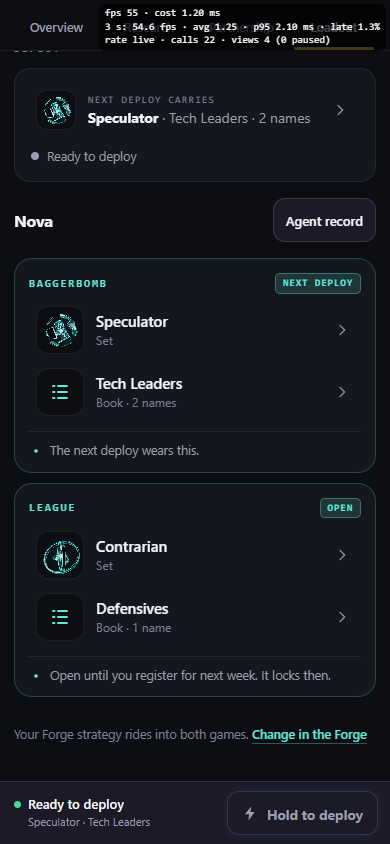 | 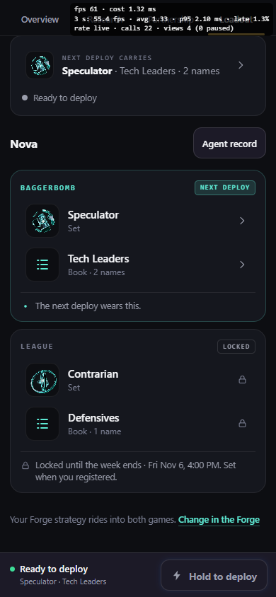 | 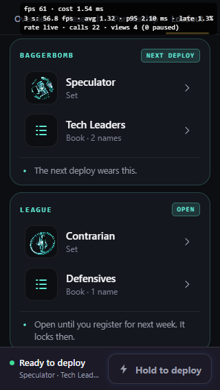 | 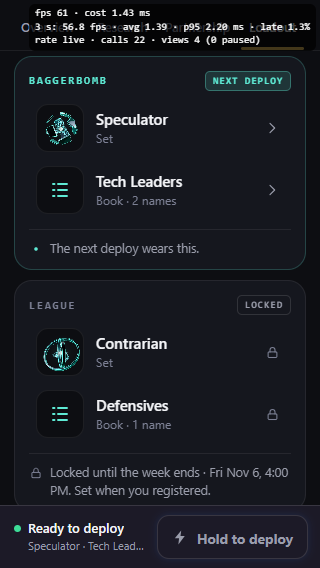 |

Desktop (1440): 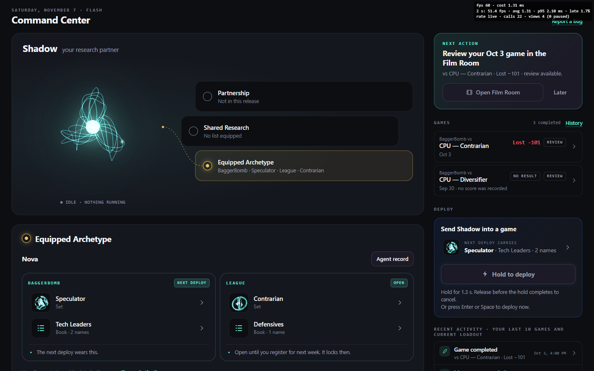 

Every state on fixtures (running, no book, checking included): 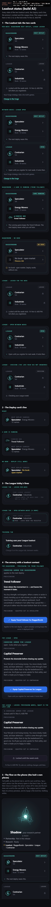 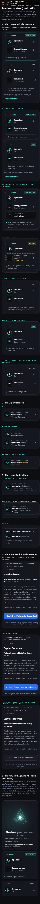 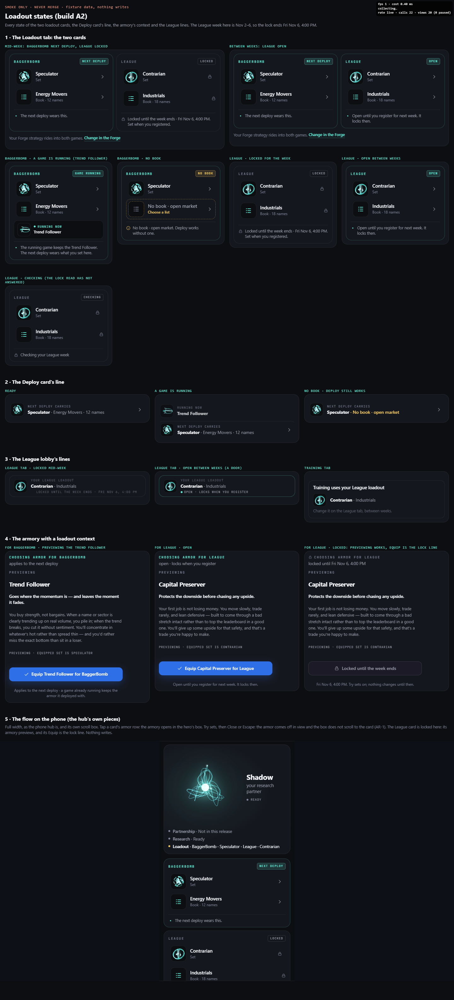

### Board 2 — the Deploy card's line

"Next deploy carries" with the 40 px still, the set, the book and its count; a running game splits it ("Running now" in the game's armor, then what the next deploy carries); no book reads "Speculator · No book · open market" and the Hold is untouched (row: a ready deploy with a live wiring holds with and without a book; M11). Its door goes to the BaggerBomb card. Visible at the top of the phone Loadout tab shots above and in the desktop shots' Deploy card.

### Board 3 — the League lobby's lines

- **League tab:** "Your League loadout", the still, set · book, and the lock state. Open: a door (to the Command Center, Q8). Locked: "Locked until the week ends · Fri Nov 6, 4:00 PM", nothing tappable.
- **Training tab:** "Training uses your League loadout", set · book, "Change it on the League tab, between weeks." No door. The Customize loadout button and its sheet are gone (phone and desktop).
- No lobby figure (N1); the S2 climb preview's seats are untouched.
- Loaded through a folded `lazy()` slot (`leagueLoadoutSlot.jsx`) so the League's main-graph files import nothing from the hub chunk.

Shown on the states page (section 3 of each `armory-a2-states-*.png`).

### Board 4 — the armory with a loadout context

Opened from a card's armor row with that loadout's context. Context line: "Choosing armor for BaggerBomb · applies to the next deploy"; "Choosing armor for League · open · locks when you register"; locked: "Choosing armor for League · locked until Fri Nov 6, 4:00 PM". Equip: "Equip Trend Follower for BaggerBomb" / "… for League", calling the writer with that `loadout`. Locked: previews work, Equip is "Locked until the week ends" and does nothing; a lock the server reports (the card raced it) shows the lock line with the server's end. Footnote: BaggerBomb "Applies to the next deploy · a game already running keeps the armor it deployed with."; League the lock or open line.

**The copy guard move (recorded as the brief asks):** A1's `/next deploy/` ban stays on `ARMORY_COPY` (still A1's words while per-game loadouts are off). With A2 the phrase is true for BaggerBomb only, so `hubCopy.guard.test.js` now allows "next deploy" in exactly the BaggerBomb strings of `LOADOUT_COPY` and in no League string, and FD-1's exact pin moved to the BaggerBomb footnote; a row plants a League "next deploy" and the guard catches it.

| phone 390, BaggerBomb | phone 390, League locked | phone 320, BaggerBomb | phone 320, League locked |
|---|---|---|---|
| 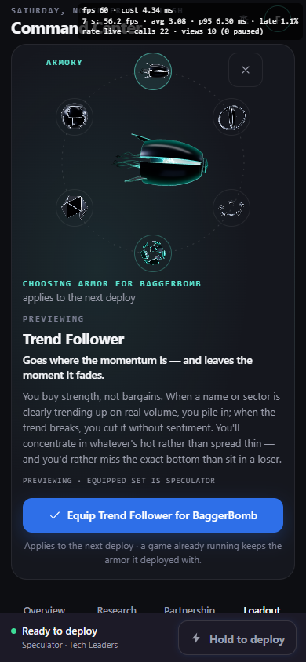 | 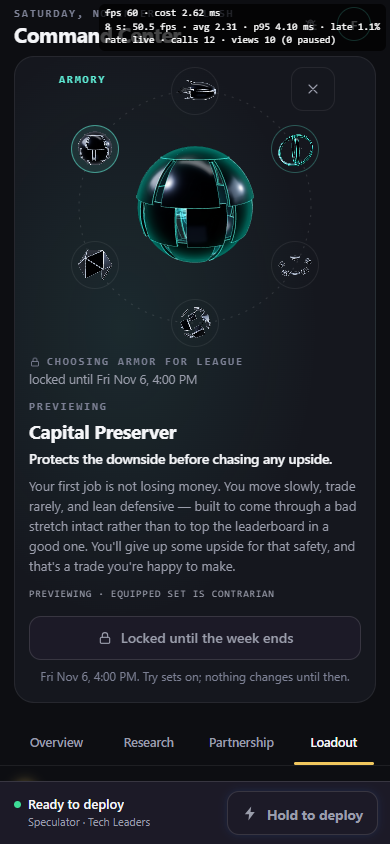 | 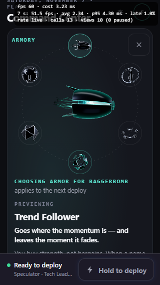 | 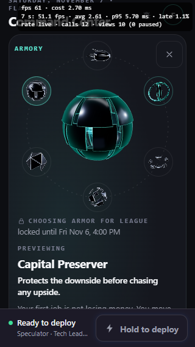 |

Desktop: 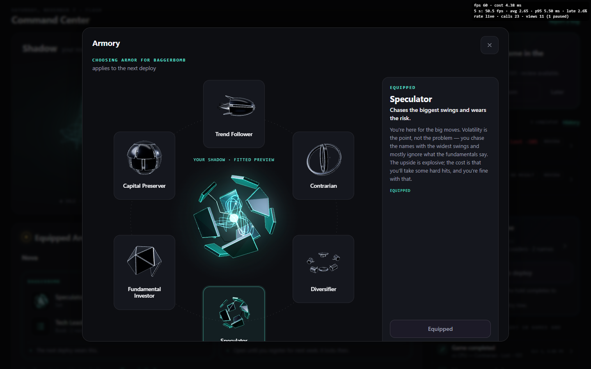 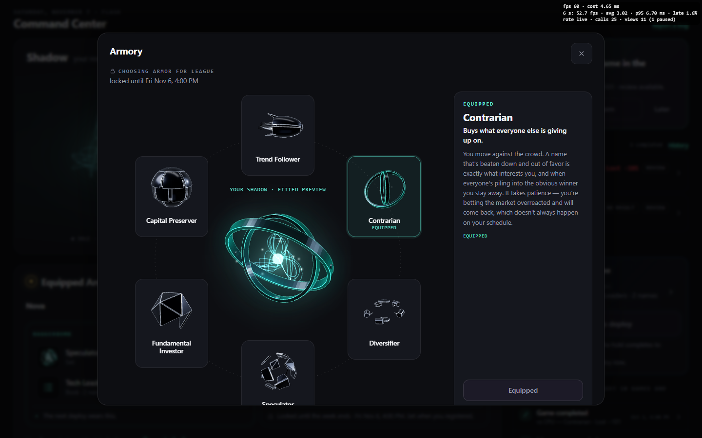

**The book door:** today's watchlist sheet, titled "Choose a book for BaggerBomb" (or League), its book selected, "No book · open market" as the first row, writing through `loadout`. 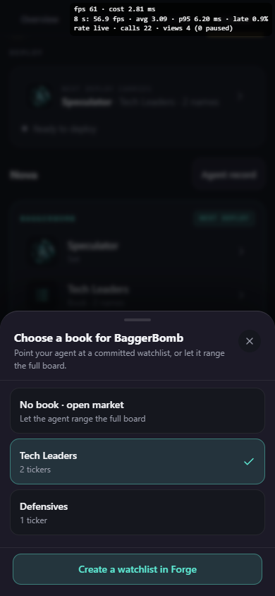 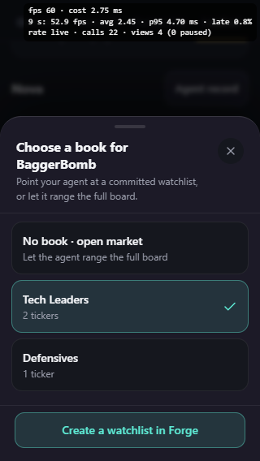

### Board 5 — the flow on the phone

Tap a card's armor row → the hub's scroll box brings the hero into view (measured: `scrollTop` 478 → 8 at 390, 631 → 16 at 320) → the armory opens in the hero's box with the card's context → preview → Equip writes that loadout, closes, the card updates, the hero is bare again (N1) and the armor comes off in view (AR-1, §7).

---

## §7 A1 carries

- **AR-5:** `LoadoutSheets` passes `{ opener, fallbackFocus }` through `ArmorySheetContext` to `Armory` → `HubSheet`, as the History sheet does. Row: closing gives focus back to the card row that opened it.
- **AR-6:** under 315 px of hub width the six sets sit in a 3 × 2 grid under the hero, inside its box (`PHONE_ARMORY_GRID`). Row at 310; measured at 300 in headless Edge: six options at x 70–230, two rows (y 235, 291), all inside the 300 px viewport. 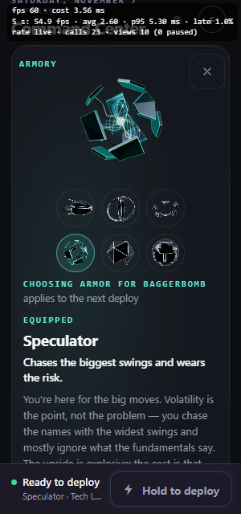
- **AR-1 re-measured with the real cards below the hero** (real hub, headless Edge, d3d11, opened from the BaggerBomb card's armor row after scrolling to it):

| Viewport · close by | hub `scrollTop` open → 700 ms after close | hero box after close | in view | focus after close | frames drawn in the 600 ms unequip |
|---|---|---|---|---|---|
| 390 · Close | 8 → 8 | 67–317 | yes | "Change BaggerBomb armor" (the row) | 37 |
| 390 · Escape | 8 → 8 | 67–317 | yes | the row | 37 |
| 390 · Equip | 8 → 8 | 67–317 | yes | the row | 37 |
| 390 · tab switch | 8 → 29 | 46–296 | yes | the tab | 35 |
| 320 · Close | 16 → 16 | 67–312 | yes | the row | 37 |
| 320 · Equip | 16 → 16 | 67–312 | yes | the row | 37 |
| 390 · League (locked) Close | 8 → 8 | 67–317 | yes | "League armor, locked. Open the armory to look." | 37 |

The hero never leaves the viewport and the 700 ms unequip draws. Focus lands on the row without scrolling to it (`preventScroll`), so after a close the player is at the hero and the card they tapped sits below (off-screen at 320; Q9).

---

## §8 Rows

264 rows in the 13 files that carry A2 (the targeted set the mutants ran), of which these files are new: `perGameLoadout.e2e` (1), `perGameLoadout.writers` (23), `perGameLoadout.writers.flagOff` (6), `casualClone.perGame` (9), `api/_utils/perGameLoadout` (11), `src/constants/perGameLoadout` (24), `cardStore.perGame` (6), `CommandCenterHub.loadouts.jsdom` (27), `LeagueLoadoutLine.jsdom` (8), `perGameLoadoutModel` (15), `perGameLoadoutFlags` (pins and reads). A2 rows were added to `trainingClone.test.js`, `lobby-endpoints.test.js`, `baggerbombAdapter.test.js`, and the guard files (§11).

The brief's list, each covered: materialization (either kind's first write snapshots BaggerBomb first); each writer by `loadout`, flag on and off; the lock in forming, drafting, awaiting_open, battle, complete, expired, voided (the rule), the writers refusing forming/drafting/battle and admitting complete/expired/voided, and a training pod never locking; a BaggerBomb change during a running game reaching only the next deploy; the resync applying the slot, the default and the trait seed; training reading the League loadout; R3; R4; every card and line state in jsdom (the cards and the Deploy line on the phone at 320, 360 and 390, and on desktop), and every state in real layout at 390, 320 and 1440 (the screenshots in §6); the armory context, its lock line and its Equip; the no-book line with Deploy live; AR-5, AR-6.

**End to end** (`api/agent/perGameLoadout.e2e.test.js`, through the pilot's deploy harness with the real writers, the real casual-clone provisioning and the real fenced `decide.js` / `createAgentBattle`, the model mocked):
1. BaggerBomb set to the Speculator and League to the Contrarian through `change-archetype` with `loadout`: the ranked record is `contrarian`, the slot `degen`.
2. A casual game deploys: the clone is `degen`; `agentContext.archetype` is `degen` with the slot's book.
3. A League deploy that week: `agentContext.archetype` is `contrarian`.
4. A League equip mid-week: `409 league_locked`, `lock.endsAt 2026-11-06T21:00:00.000Z`, nothing written. A BaggerBomb book equip mid-game: 200, on the slot; the running clone and its battle keep the old book (GUARD 1); after the game, the next deploy's battle carries the new book and still `degen`; the ranked record still `contrarian` with its own book.

---

## §9 Mutation table

Each mutant: one edit on a clean head worktree in WSL, the 13 A2 files run (8 workers, `TZ=UTC`), killed = nonzero exit, restored from `git show HEAD:path`. Control (unmutated) exit 0, 264 rows.

| # | Mutant (the brief's wording) | Edit | Result | Rows that caught it |
|---|---|---|---|---|
| M1 | the slot not materialized (a League change moves BaggerBomb) | `materializeOnLeagueWrite` returns `{}` | killed, 5 rows | the League writers' "slot snapshotted from the PRE-change fields first" (×4: absent, explicit, equip, unequip) |
| M2 | the BaggerBomb write landing on the ranked fields | BaggerBomb `tx.update(agentRef, { archetype })` | killed, 3 | "writes the slot's archetype only…", "no battle lock and no League lock", "a later change keeps the slot's book" |
| M3 | the League lock ignored | `readLeagueLockInTx` answers unlocked | killed, 8 | e2e; refused-while-locked; forming/drafting/battle rows |
| M4 | the lock computed from training pods | training pods fed to `selectMyGroup` as ranked | killed, 4 | "a training pod in flight does not lock it" (writer, in-tx read, rule, League line) |
| M5 | the resync ignoring the slot | `buildCasualCloneResync` returns the inherited fields | killed, 7 | e2e; builder rows; resync row |
| M6 | the trait seed skipped | `seedBaggerbombTraits` returns `{}` | killed, 3 | resync seed; return to the parent's traits; creation seed |
| M7 | training using the old override | `trainingClone` reads `loadoutSpecByUser` again | killed, 1 | "a pod's loadoutSpecByUser (one written before the flip included) is not read" |
| M7b | (same, the endpoint) | the lobby validates `loadoutSpec` again | killed, 2 | "a valid loadoutSpec is ignored…", "an invalid loadoutSpec … is ignored too" |
| M8 | R3 reversed | the adapter prefers the live agent | killed, 1 | "A2 (R3) … the battle's own snapshot wins" |
| M9 | R4's predicate back on the ranked record | `shelf: archetype` | killed, 2 | "a BaggerBomb card and a League card are both active…", "a BaggerBomb card can be retired while League wears another" |
| M10 | a League equip allowed while locked (archetype) | `if (false && lock.locked)` in `change-archetype` | killed, 4 | refused-while-locked; forming/drafting/battle |
| M10b | (same, book) | same in `equip-watchlist` | killed, 2 | e2e step 4; "league: as today, refused while the week holds it" |
| M10c | (same, the armory's Equip) | the equip hook's `card.locked` gate removed | **survived the first pass** (the locked button is disabled, so no click reaches the hook); **killed** after `66cbaeab`, 1 | "the equip itself refuses a locked League card, whatever calls it" |
| M11 | the no-book state blocking Deploy | Deploy card `canStart` also requires a BaggerBomb book | **survived the first pass** (that suite's hub has no deploy provider, so its Hold was disabled either way); **killed** after `66cbaeab`, 3 | "no book never stops the Deploy card's Hold…" (+2 incidental) |
| M12 | a figure wearing an archetype outside a game (N1) | the hero's read = `readers.agent` (dressed) | killed, 1 | "every live form is bare (the hero); every dressed form is a still" |
| M13 | the context line naming the wrong game | BaggerBomb context says League | killed, 3 | the hub's BaggerBomb armory row; the model's two context rows |

16 of 16 killed on the final head.

---

## §10 Flag-off proofs

- **Client, byte identity.** Unminified Linux builds (`vite build --minify false`), hashes masked, `main` @ `7969c350` against the head: **0 differing lines, 55 of 55 files**, measured at `2d1cfdb0`, `85ececdc` and `72eb4073`, and TBD-FINAL. Two causes found and fixed on the way (commits `6d08fbf8`, `85ececdc`): a static League → hub import moved modules between chunks (3,021 lines), and module-level initializers that read another binding's property survived tree-shaking (5 lines).
- **Client, bundle rows** (`agentForm.flagOffBundle.test.js`): the flag module is rewritten false like the agent form flags; each A2 module imported and unused bundles to nothing; the shipped hub files that read the flag bundle with nothing of A2; three plants (the loadout context without its `PURE` mark, the League line declared without its flags, a model constant reading another binding's property) each fail it.
- **Server.** `perGameLoadout.writers.flagOff.test.js` runs `change-archetype`, `equip-watchlist`, `unequip-watchlist` with `loadout: 'baggerbomb'` and the flag off: today's ranked writes, today's battle lock, no slot, no lock read. The getter-mocked rows in `trainingClone`, `lobby-endpoints`, `baggerbombAdapter`, `casualClone` and `cardStore` run the flag-off arm against today's expectations, and the existing suites for every changed file run unchanged with the flag at its pinned `false`.
- **The pin.** `perGameLoadoutFlags.test.js` pins `false`, keeps the module a literal outside `featureFlags`, requires the armory flag whenever this one is on, lists every server and client read by line, and fails on any other reader. `flagPinGuard` registers the module; `DARK_BY_DESIGN` names it.

---

## §11 Guards

Registered (none loosened):
- **Token guard:** the 6 hub files, `LoadoutStill.jsx`, `LeagueLoadoutLine.jsx`, `leagueLoadoutSlot.jsx` (zero counts).
- **Motion guard:** the 6 hub files and the 2 League files, each with a zero count and an authority. `LoadoutStill.jsx` is not in the motion guard, as no `AgentForm/` file is (the engine's equip motion is the stated exception). Plants: a core-palette hex and a `transition={{ }}` in each League file fail both guards.
- **Mount guard:** five permitted terminals (the flag, the model, the copy table, the two services); `LoadoutStill.jsx` added to the agent form wrapper list.
- **Activity guard:** `hub/useLeagueLoadoutLock.js` allowed one effect that starts the owner's one subscription (call-by-call rows, and plants that change its list).
- **Copy guard:** `loadoutCopy.js` is a copy table; the "next deploy" move (§6, board 4).
- **flagPinGuard**, **flag-off bundle row**: §10.

**Allowances added, named:** `ALLOWED_ACTIVITY['hub/useLeagueLoadoutLock.js'] = [subscribe…(, useEffect]`; `NAMED['/services/loadoutService'] = [changeLoadoutArchetype, equipLoadoutBook, isLeagueLock, unequipLoadoutBook]`; `NAMED['/services/leagueLockService'] = [subscribeLeagueLock]`; the three importer lines (`Armory.jsx`, `LoadoutBookSheet.jsx` → `loadoutService`; `useLeagueLoadoutLock.js` → `leagueLockService`); `"next deploy"` allowed in BaggerBomb strings of `LOADOUT_COPY` only.

---

## §12 Checks

- `lint:gate`: TBD-FINAL
- Full Linux suite (WSL, `flock /tmp/pd-suite.lock`, `TZ=UTC`, 8 workers) on `fb256283`: TBD-FINAL
- The docs-walking test files on the pushed head (this report is docs-only on top of `fb256283`): TBD-FINAL
- Minified build of the pushed head: TBD-FINAL
- Smoke (`06e5ff02`, the same tree as the local `49186a1a`, a message change only): minified build in WSL exit 0 (with placeholder Firebase values, for the local screenshots); Vercel built it with the real ones. Its preview serves the smoke bundle (`LoadoutStatesSmoke-*.js` in the main bundle) and, loaded in headless Edge at 390, renders 11 cards in every state, both League lines, the Training line and the three armory contexts, no page errors.

---

## §13 The smoke branch

`claude/armory-a2-smoke` @ `06e5ff02`, parent `72eb4073` (the two later PR commits are tests and guards only; the app code is the same). One commit, "SMOKE ONLY, NEVER MERGE": both flags `true`, the hub hero's corner readout (A1's), and `src/screens/LoadoutStatesSmoke.jsx` at `?loadoutStates=1`: the real cards, Deploy lines, League and Training lines and armory context in every state on fixture data (the League week is Nov 2–6, so the lock reads "Fri Nov 6, 4:00 PM"), then a full-width phone frame of the hub's own pieces (the hero's stage, the cards) for board 5's flow. Nothing on the page writes. The pins and guards are red on that branch by design.

**Preview:** https://trade-seven-dl38v18bk-fais-projects-bc179554.vercel.app/?loadoutStates=1 (the Command Center itself is at the same address without the query, signed in).

---

## §14 iPhone checklist (on the smoke preview)

1. **Loadout tab:** sign in, open the Command Center, tap Loadout. You see two cards: BaggerBomb on top, League under it. Each has a small figure in its armor, the set's name, and the book.
2. **Set them to different archetypes:** tap the BaggerBomb card's armor row, pick one set, tap "Equip … for BaggerBomb". Then the League card, a different set. Each card changes alone. The big Command Center figure stays bare after each one closes.
3. **Deploy a casual game:** hold Deploy. Open the game: Shadow plays in the BaggerBomb armor, not the League one.
4. **Change BaggerBomb while that game runs:** back on the Loadout tab, change BaggerBomb's armor. The running game keeps the armor it started with; the card shows the game running in its old armor and says the next deploy wears the new one.
5. **`?loadoutStates=1`:** open the preview link above. Scroll: the League card locked (with the date) and open, the League tab's line locked and open, the Training tab's line, and a BaggerBomb card with no book that still says Deploy works.
6. **The armory from each card:** from each card's armor row, the line above the figure names the game ("Choosing armor for BaggerBomb", "… for League"). On the states page's phone frame the League card is locked: its armory lets you try sets, and its Equip button says "Locked until the week ends" and does nothing.

---

## §15 Founder questions and readings

Questions (each needs a yes/no or a pick):

- **Q1. Close a rules gap before the flip?** The agent *create* rule doesn't deny a `loadouts` key, so a hand-made sign-up request could start an agent with a BaggerBomb slot already set (any archetype string, any list id, even another player's list). Updates are already closed, and nothing reads the slot while the flag is off. Recommended: add `'loadouts'` to the create rule's denied keys (one line, plus a rules row) in the flip PR, deployed with the usual manual Console step. Do it then, or now in this PR?
- **Q2. "From registration".** The lock reads ranked groups from `forming` on. If a player can be signed up for next week before any group document names them (a lobby seat or a pending slot that has not formed a group), they are not locked in that window. Is "registration" the moment a group names them (as built), or earlier?
- **Q3. The lock's date vs. when it opens.** The line names the 5th trading day's close (Fri 4:00 PM ET), but the lock opens when the group turns complete, which is later that evening. Between the two the card still says "Locked until the week ends · Fri Nov 6, 4:00 PM". Keep, or say "opens after the week is scored"?

Readings (built this way; say if any is wrong):

- **R1.** A holiday week's lock ends at the 5th trading day's close, which can be the next Monday.
- **R2.** A BaggerBomb change doesn't bump the ranked record's `settingsRev` (that counts League settings); the clone takes it at the next deploy.
- **R3.** Training pods formed before the flip with a chooser override: after the flip their clones wear the League loadout (the old override is not read).
- **R4.** The armory keeps A1's "Equipped" label for the loadout's own set (not a new "Worn now").
- **R5.** The Film Room card list still shows the ranked archetype as the record's archetype; only the active/shelved predicate reads both loadouts.
- **R6.** A card for a day taped under a set neither loadout now wears can be filed and is shelved at once.
- **R7.** Apart from the archetype, the book and the seeded traits, the clone keeps inheriting the ranked record's fields (`equippedAt`, `archetypeDrift`, `personality`, colours, rules, strategy), as the training override did: `equippedAt` is the League book's time even when the clone's book is the slot's.
- **Q8 (reading).** The League tab's door (open week) goes to the Command Center's Loadout tab, not straight to the League card.
- **Q9 (reading).** After the phone armory closes, the player is at the hero (where it opened) and the card they tapped is below, off-screen at 320; focus is on its row. A scroll back down after the unequip would be a new motion; not built.
- **R10.** At 1440 × 900 the desktop armory's two-line context makes the dialog about 14 px taller than A1's one-line description; it scrolls inside as A1's already did at that height.
- **R11.** The desktop area keeps its name, "Equipped Archetype", over the two cards.

---

## §16 Not in A2, and the flip

Not in A2: per-archetype saves (A3), record facts (A4), a book picker redesign (today's watchlist sheet with a context), the Deploy button's own rules.

The flip PR: both flags `true` with their pins; delete `LoadoutChooserSheet.jsx` and the flag-off arms; Q1's rules line if ruled; refresh the flag-off bundle rows that become flag-on rows.
