# Build report — Battle Research, Slice 1 (Nov 14, 2026)

**Spec of record:** `docs/specs/BATTLE_RESEARCH_SLICE1_SPEC_V1.md` (the build prompt of Nov 13 at V1.1, Nov 14; committed with PR B).
**Base:** `origin/main` = `5a8c3620` (fetched first; unchanged through the session).
**Rules followed:** no fenced file edited (BUILD_RULES §1; the PRs name the fenced functions they *call*); no provider call (EODHD) and no model call (Anthropic, OpenRouter) anywhere in the build, its tests or its checks; production reads in Phase 0 only (two read-only Admin SDK `.get()` runs); no uid or email in this report or the PRs; nothing merged, CI not watched.

## Executive verdict

| PR | Branch | Head | Holds | Flag | Checks |
|---|---|---|---|---|---|
| A | `claude/battle-research-s1-engine` | ⟪A-HEAD⟫ | the route, the pure engine, `researchGroupsOf`, the shared rankings read, the flag and its gate | `'off'` | ⟪A-CHECKS⟫ |
| B | `claude/battle-research-s1-surface` (on A) | ⟪B-HEAD⟫ | the store, the surface, state 2's research blocks, the draft handoff, the screen wiring, the spec, this report | `'off'` | ⟪B-CHECKS⟫ |
| C | `claude/battle-research-s1-allowlist` (on B) | ⟪C-HEAD⟫ | `BATTLE_RESEARCH_MODE = 'allowlist'` and its pin, one commit | `'allowlist'` | ⟪C-CHECKS⟫ |

- **Merge order:** A, then B, then C, each by hand. B was rebased onto A after A's refuter round (and again after its last fix); its description says so.
- **With the flag off** (A and B as merged), the Research pill opens the bench sheet **byte for byte as main does**: the sheet and the whole screen behind it hash to goldens captured on `5a8c3620` (`AgentBattleScreen.battleResearch.jsdom.test.jsx`), on Windows and on Linux.
- **Nothing stopped on a ruling.** The readings made where the spec is silent are in §3; none blocks the build.
- **The live checklist** is §8 below.

---

## 1. Phase 0 — the nine findings

1. **The entry — confirmed.** The bench sheet opens in browse mode at exactly one place, `openCockpitBenchBrowse` (AgentBattleScreen.jsx, handed only to `ThisTurnStrip`'s `onResearch` while cockpit 2b is on); the card's own bench door always carries its callId (Cockpit2b.jsx:590).
2. **The snapshot's fields — confirmed, two differences.** Doc-level `sweepId` (string), `sweepAt` / `lastSuccessfulSweepAt` (epoch-ms numbers); per symbol `price.{value, previousClose, changePercent, priceAsOf}` (ms), `sessionEtDate`, `collectionStalled`. (A) `collectionStalled` is never `true` in the stored doc (facts.js writes `false`; the stall is derived at view time), so §4's `collector_stalled` row is built and fixture-tested but unreachable today; `old_sweep` covers that case in session. (B) At the Friday post-close sweep 87 of 249 symbols (84 of the 228 ranked) had null `previousClose` / `changePercent`; those classify `missing` ("No price yet"), never a derived change. Rankings: `computedAt` / `expiresAt` are Timestamps, 228 rows, no names.
3. **Company names.** No source covers the 228: `COMPANY_NAMES` holds 107. Built: the bench row's own `name`, else `COMPANY_NAMES`, else the ticker alone — never invented.
4. **The session clock.** `marketCalendar.getSessionForDate` (pure; early closes; 2026 and 2027 maintained) and `tapeSchedule.nextSessionDate`. §15's 2027 note concerns `marketSchedule.js` / `marketHolidays.js`, which this build does not read; the next horizon for the calendar it reads is 2028 (past it the line says nothing, never guesses).
5. **The phone path to the chat — works.** `handleAskFollowUp` opens the chat pane, a fixed overlay at the root (z 40) over the phone cockpit screen, holding the one AgentChat; the prefill reaches the composer with `PHONE_SCREEN.COCKPIT` showing.
6. **The research incumbent in the modal.** The one string naming the cockpit or a call is `SHEET_COPY.srcCall` ('its call in the cockpit', the incumbent item's source label; a client kind). Built: a research wording for that label only ("your research question"), keyed off `sheetContext.research`; no vocabulary change.
7. **H3 is fixed — confirmed.** A non-held stock with a measured battle arms the ATR reading (`stockTechnicalScores/{SYM}`), never percentile × 8 or the 2.5 default (AssetResearchModal.jsx:447-483). Battle Research seeds that reading from the row (BRS-10), so the modal makes no second read.
8. **Prefill vs unsent text — the draft was dropped.** A typed draft won and a prefill only filled an empty composer (AgentChat.jsx:937-965). Built: an append mode on the same path (`composerPrefill.mode = 'append'`), the variant that fits chosen whole; the follow-up and scope doors keep theirs.
9. **The length limit: 2000 on both sides.** Composer (AgentChat.jsx:939, :1661) and server (`sanitizeChatText`, chatTextSanitize.js:26-37, which also flattens newlines and strips `<>{}` on send). The draft builder fits 2000 minus the kept text and the blank line, trimming the sector line, then the rung line, then to the head, the comparison and the close — never mid-line.

Also found: `pctText` prints one decimal (the spec's examples print two; built with `pctText`, moved into an import-free module and re-exported, never copied); `battleViewRouting.js` gained a `.js` extension on one import so the route can load it under Node ESM (behaviour identical); the sheet's packs read rankings rows outside the battle's names, so the current result keeps the whole doc and an older one the frozen subset (§6's own fallback).

---

## 2. The rulings as built

| Ruling | Built in | Note |
|---|---|---|
| BRS-1 Where it runs | `battleResearchMode.js` `battleResearchAvailable` | active, not League, cockpit 2b, the shell on — and the flag |
| BRS-2 The entry | `AgentBattleScreen.jsx` (`brOn ? openBattleResearch : openCockpitBenchBrowse`) | only one of the bench sheet and the surface is ever open |
| BRS-3 The flag | `researchModalFlags.js` `BATTLE_RESEARCH_MODE` + `battleResearchFlag.test.js` pin; `battleResearchGate.js` | tri-state; 'allowlist' reads the cached cockpit-status verdict; the route re-checks at every call |
| BRS-4 Two groups | `battleUniverse.js` `researchGroupsOf`; `groups.js` | bench and agent watchlist, held names left out |
| BRS-5 The proposal | `explain.js` `proposalOf`; `ResearchOpening.jsx` | the four starters; *What's moving* off until one usable quote |
| BRS-6 The weakest question | `result.js` `incumbentOf` (book.js `weakestOf`) | the reference line; the two no-weakest cases never share words |
| BRS-7 Group questions | `investigation.js` `switchGroup` | *Same question on my {other group}* |
| BRS-8 Times | `readings.js` (`moveText` = `pctText`, `whenText`), `explain.js` `rankText` | a time beside every number; nothing called live |
| BRS-9 Reading states | `readings.js` `classifyMove` | §4's table in order; classified once, frozen |
| BRS-10 Row = modal | `researchContext.js` `atrReading`; `AssetResearchModal.jsx` seed | 💣 prints the row's number and time, no `stockTechnicalScores` read |
| BRS-11 Ordering | `result.js` `outcomeOf` | ties on the PRINTED move, then rank, then symbol |
| BRS-12 Conditions | `result.js` `testCondition`, `investigation.js` | up/down exclusive; zero belongs to neither |
| BRS-13 Steps | `investigation.js`; `explain.js` `bannerOf` | Previous, Undo, Start over; the banner says what came and went |
| BRS-14 Frozen + Refresh | `useBattleResearch.js`; `investigation.js` (`refreshWith`, `refreshGate`, `noticeOf`) | one in flight, once a minute (client clock), a failed refresh changes nothing |
| BRS-15 Eligibility | `groups.js` `eligibilityOf` (`canComeIn`, called not edited) | frozen against each comparable holding |
| BRS-16 The explanation | `explain.js` `explainOf`; `AgentColumn.jsx` | phone: the first paragraph in the bottom bar, *Read more · history* |
| BRS-17 Research context | `researchContext.js`; `Sheet/ResearchBlocks.jsx`; `AnalysisSheet.jsx`; `useSheetView.js` | prepended to state 1's blocks, which render unchanged |
| BRS-18 / 18a Compare, Use across | `explain.js` `compareOf`; `result.js` `conditionCounts` | counts over the whole frozen group |
| BRS-19 Draft | `explain.js` `draftOf`; `AgentBattleScreen.jsx` `handleBrDraft`; `AgentChat.jsx` append mode | nothing sent; typed words kept |
| BRS-20 Ask | `explain.js` `askDraftOf` | the top three placed names; no free-text box |
| BRS-21 Memory only | `useBattleResearch.js` | no Firestore, no browser storage; cleared on a change of battle |

The route (§5) answers only the battle's own symbols, owner-only, in the order of checks the spec sets; it reads one Admin SDK document (cached 30 s by sweep); it never calls a provider.

---

## 3. Readings made where the spec is silent (none stopped the build)

- **R-1 pctText's one decimal.** The spec's examples print two decimals; `pctText` (the named formatter) prints one. Built with `pctText`; every decision reads the printed digits (`shownMove`), so a label never disagrees with the number beside it.
- **R-2 A zero move's sign.** `pctText` prints `+0.0%` / `−0.0%` for a move under 0.05%; that text is printed as is (BRS-8, display agreement with the cockpit), and the move counts as zero (flat) for every decision (refuter RF-5).
- **R-3 Regular trading's edges.** 9:30:00 and 4:00:00 ET are inside the session; before and after are strictly before and after.
- **R-4 After the close with no usable quote:** the *Market closed* line, with the next session from the calendar.
- **R-5 Unranked names in today's-move order (BR1-4).** BRS-11 sends a name absent from the rankings to *Not ranked* in the rank order; it is silent on today's-move order. Built: such a name with an ok move is placed by its move in move order (*What's moving today* answers by move), and the banner says so when the order switches (RF-2). Crypto stays *Not ranked* always.
- **R-6 A quote with no session date of its own** is `earlier_session` by §4's letter, but its words never name a day or "an earlier session": *+1.2% · 1:43 PM · session not recorded*.
- **R-7 "'ll".** §9 bans *will*; §9's own copy says *I'll rank by today's move once they arrive* (the agent's own next step). The sweep bans "'ll" on every subject but "I".
- **R-8 Direction-true move words.** *ahead / behind on today's move*, *down less today*, *up today while X is down* — "more" only against a rise.
- **R-9 The group line** keeps §9's *{u} are up today, {d} down, {x} without a reading yet* and adds *{f} flat* and *{c} crypto not compared* only when a name is in them, so the parts always sum to the group's count.
- **R-10 Evidence reuse:** a question within 60 s of the opening's bundle reuses it (one read of each per open-and-ask), measured on the client's clock.
- **R-11 takenAt is the server's instant** (the route's `servedAt`); the client's `receivedAt` drives only the Refresh gate and evidence reuse, and "since passed" reads the server's now (the arrival offset).
- **R-12 The opponent's label** comes from the header through one constant (`BATTLE_VIEW_COPY.opponentLabel`); the header now reads it too, so the two can never differ.
- **R-13 The voice** is *{Agent} · {the sheet's own lens label}* (`lensOf`), the sheet's wording.
- **R-14 The phone's explanation** lives in the bottom bar (two lines, *Read more · history*), which stays on top of the list; measured in Edge (§5).
- **R-15 `collector_stalled`** is unreachable with today's stored doc (Phase 0 point 2A); built and tested on a fixture.
- **R-17 The strip's player label** is *You*, the label the sheet's own standing uses ("the same `standing` the sheet gets"); the arena header names the agent there. The digits and the opponent's label are the header's.
- **R-18 The research strip's height.** Sticky as BRS-17 says; measured at 320 × 640 it takes about 44% of the modal's scroller with one refinement (55% with the tab strip stuck too). Recorded, not changed.
- **R-16 The question's own incumbent (BR1-13).** Each result carries its own incumbent (a Refresh on the weakest question may change it, and says so); `question.incumbent` records what the question was first asked about and nothing reads it. Left as is for Slice 2's record.

---

## 4. The review

Four lenses (BUILD_RULES §2; spec §12), each with a refuter; every confirmed finding got a row that failed before its fix. Commits are on the branches as listed (B's commits were rebased; the hashes are the final ones).

### 4.1 PR A — lenses 1–3 on `edc9588e`, fixed in `24a1f1b6` (rows: `review.findings.test.js`, the route's `battle-research-quotes.test.js`)

| Id | Finding | Verdict | Fixed |
|---|---|---|---|
| BR1-1 | after the incumbent's swap, Refresh compared with it again | confirmed | `24a1f1b6`; swap-out-and-back completed in `b1c51209` |
| BR1-2 / BR1-14 | order, ties, reference, counts read the raw move, not the printed one | confirmed | `24a1f1b6` |
| BR1-3 | client clock used as the result's instant | confirmed | `24a1f1b6`; completed in `b1c51209` (`since`, server now) |
| BR1-4 | *What's moving* left an unranked name with a move out | confirmed (reading R-5) | `24a1f1b6`; its banner in `b1c51209` |
| BR1-5 | a bare crypto ticker read as a stock | confirmed | `24a1f1b6`; eligibility completed in `b1c51209` |
| BR1-6 – BR1-11 | lists notice, placed in/out, use-across replacement, trail folding, "was #n" across groups, a dateless quote named as a close | confirmed | `24a1f1b6`; BR1-11 completed in `b1c51209` |
| BR1-12 | two questions at one instant shared an id | confirmed | PR B's store (monotonic creation instant) |
| BR1-13 | the question's incumbent is not updated by Refresh | refuted as a defect; open reading R-16 | — |
| BR2-1 – BR2-15 | eligibility per holding; locks named; banner counts; direction words; days on times; ranks with times; drafts never cut mid-reading; ranges; missing said once; no verdict from nothing; group count; passed locks; "+0"; "of N" | confirmed | `24a1f1b6`; BR2-3, BR2-5, BR2-6, BR2-7/14 completed in `b1c51209` |
| BR2-16 | the honesty sweep missed whole families of output | confirmed | rebuilt in `24a1f1b6`; gaps closed in `b1c51209` |
| BR3 | no security defect; 12 surviving route mutants (X1–X12); a battleId with "/" gave a 500 (BR3-6); a wider no-network scan (BR3-7); the crypto-key note (BR3-10) | confirmed (test gaps, hardening) | `24a1f1b6`; BR3-6 completed in `b1c51209` |

### 4.2 PR A — the refuter's round on `24a1f1b6`, fixed in `b1c51209` and `ec71031b` (rows: `refuter.findings.test.js`, 18 + the route's BR3-6 row; every row failed on `23010d10`)

| Id | Finding | Verdict | Fixed |
|---|---|---|---|
| RF-1 | the sweep's setup at the edge of the 10 s hook timeout | confirmed | `23010d10` (120 s) |
| BR1-1 (back) | a holding swapped out and back kept its OLD reading | fix incomplete → confirmed | `b1c51209` (by positionId; its own notice) |
| BR1-3 | the gate's argument named the wrong clock; "since passed" judged by the client clock | fix incomplete → confirmed | `b1c51209` |
| BR1-5 | a hot-bench "BTC" could "come in" for a stock | fix incomplete → confirmed | `b1c51209` |
| BR1-11 | a dateless quote called "an earlier session's move", no time | fix incomplete → confirmed | `b1c51209` (R-6) |
| RF-2 / BR2-3 | an order switch said "the names are the same" when they were not | confirmed | `b1c51209` |
| RF-3 | the group line's counts disagreed within one result | confirmed | `b1c51209`, §9's letter restored in `ec71031b` |
| RF-4 | the lists notice named the wrong list ("0 in, 0 out") | confirmed | `b1c51209` |
| RF-5 | a zero move printed differently from the cockpit | confirmed | `b1c51209` (R-2) |
| RF-6 | a sector set-aside showed move words, not why | confirmed | `b1c51209` (board in PR B) |
| RF-7 | the banner's total differed from the note line's | confirmed | `b1c51209` |
| BR2-5 (residual) | "up more today" against a fall or a flat | confirmed | `b1c51209` |
| BR2-6 (notices) | notices named no day | confirmed | `b1c51209` |
| BR2-7 / 14 | the Ask printed ranks with no time | confirmed | `b1c51209` |
| BR3-6 | ".", "..", `__name__` ids reached Firestore (500) | confirmed | `b1c51209` |
| Sweep P4 – P8 | 5 of the refuter's 17 plants survived (zero moves in drafts and compare cells, "It'll", step wordings, UI-only templates) | confirmed | `b1c51209`; all five caught now (plant runner, files restored by hash) |

### 4.3 PR B — lenses 1, 2 and 4 on `b238431e` and the refuter

Each lens ran on its own snapshot of `b238431e` and proved every finding with a probe that failed; the fixes are two commits on B (lenses 1 and 4: ⟪H:l14⟫; lens 2: ⟪H:l2⟫) and one on A (`d5a5f468`, BL2-8). Every row named failed before its fix.

| Id | Finding | Verdict | Fixed |
|---|---|---|---|
| BL1-1 / BL2-4 | Use across lost its "3 remain · Undo" line when the screen rebuilt the context for the step Apply added | confirmed | ⟪H:l14⟫ (the finding is keyed on the step the row was opened from) |
| BL1-2 | a Refresh landing under an open row moved the modal to Result 2 while 💣 kept Result 1's seed, and its "left the result" line could Undo the refresh | confirmed | ⟪H:l14⟫ (a row never opens while a Refresh is in flight; the surface is inert under the modal, so none can start) |
| BL1-3 | a question tapped while the opening read made a second read | confirmed | ⟪H:l14⟫ (the read in flight is shared) |
| BL1-4 | a Refresh banner or error showed on another investigation | confirmed | ⟪H:l14⟫ (stamped with its investigation) |
| BL1-5 | on a change of battle: the old battle's failure shown, the new battle's first tap swallowed, the opening never re-read | confirmed | ⟪H:l14⟫ |
| BL1-6 / BL4-2 | *Show all* reset on reopen and on a step undone | confirmed | ⟪H:l14⟫ (kept per step in the store) |
| BL1-7 | the opening's one-minute reuse judged on the server's clock | confirmed | ⟪H:l14⟫ |
| R1 (lens 1) | the incumbent read when the evidence landed, not at the tap (BRS-6: "at that moment") | built to the letter | ⟪H:l14⟫ |
| BL4-1 | the modal's research strip never stuck (its block box held it) | confirmed (code and Edge) | ⟪H:l14⟫; measured after: the strip stays at the scroller's top, a new tab starts clear of both strips |
| BL4-3 | every scroll frame re-rendered the whole battle screen | confirmed | ⟪H:l14⟫ (the scroll is a ref) |
| BL4-4 | the phone layer ignored the browser toolbar's inset | confirmed (by precedent) | ⟪H:l14⟫ (the bench sheet's `viewportInset`); an iPhone check is item 1 of §9 |
| BL4-5 | the action row's Draft door could crowd the Ask at 320 px | confirmed in Edge (20-letter name) | ⟪H:l14⟫ (wraps, at most half the row; Ask keeps 139 px at 320) |
| BL4-6 | the bar's button under 44 px | confirmed | = PH-1, ⟪H:phone⟫ |
| BL4-7 | the history sheet was not a layer | confirmed | ⟪H:l14⟫ |
| BL4-8 / BL4-11 | hidden rows of the collapsed list were focus stops; no expand marker | confirmed | ⟪H:l14⟫ (a button with `aria-expanded`, rows only while open) |
| BL4-9 | long score digits could squeeze the title at 320 | confirmed in code; no overlap measured after | ⟪H:l14⟫ |
| BL4-10 | research links narrower than 44 px | confirmed | ⟪H:l14⟫ |
| BL4-12 | no overscroll containment | confirmed | ⟪H:l14⟫ |
| BL4-13 | a quote notice (gated path) would paint under the surface | confirmed, **latent** | not fixed: the gated path's flag (`SHADOW_CPU_QUOTE_INTEGRITY_ENABLED`) is false; noted for its flip |
| BL4-14 | under the research modal, Tab from `<body>` reaches the screen behind | confirmed, **inherited** | not fixed: the shipped research modal has no focus trap (the bench sheet's CB4-9 shape); out of this slice |
| BL4-15 | the surface test's motion mock remounted the panel every render | confirmed (test fidelity) | ⟪H:l14⟫ |
| BL2-1 | the chat forgot typed words on a second draft or a shipped door | confirmed (high) | ⟪H:l2⟫ |
| BL2-2 | the action row's Draft ignored the holding picked in Compare | confirmed | ⟪H:l2⟫ |
| BL2-3 | the board said a lapsed lock was still locked while the modal said "since passed" | confirmed | ⟪H:l2⟫ (one clock: a timer at the lapse) |
| BL2-5 | the Ranks line's frozen time sits over the tab's own live list (whose badge is the sector rank) | reading | not changed — open question 2 (§9) |
| BL2-6 | the strip's times and group bypassed the copy file and dropped "older than usual"; "— ET" | confirmed | ⟪H:l2⟫ |
| BL2-7 | the then-chain dropped folded steps | confirmed | ⟪H:l2⟫ |
| BL2-8 | a passed lock's time lowercased ("thu 10:00 am") | confirmed | `d5a5f468` (A) |
| BL2-9 | the explanation names a lock as at the result; the row adds "since passed" | reading | not changed — open question 3 (§9) |
| BL2-10 / R3 (lens 1) | a row of the opening's list opened with no frozen readings | confirmed | ⟪H:l2⟫ (the opening's ATR seed and rankings doc) |
| BL2-11 | the research blocks never said "no message cost" | confirmed (BRS-20's letter) | ⟪H:l2⟫ |
| BL2-12 | the voice rule differed from the sheet's; the phone bar used the bare name | confirmed | ⟪H:l2⟫ |
| BL2-13 | the legacy ScoreHeader printed a literal "CPU" | confirmed | ⟪H:l2⟫; the strip's "You" stays the sheet's own label (R-17) |
| BL2-14 | the shipped 💣 names a day against now, the row against the result | reading | not changed (💣 is "the shipped one", BRS-17) |
| R2, R4 (lens 1) | the Ranks line's time (= BL2-5); after an undone Refresh, Result 1 hands the subset | readings | not changed |

⟪B-REFUTER⟫

### 4.4 PR B — the phone checks in a real browser (§11)

Headless Edge (playwright-core), 390 × 844 and 320 × 640, deviceScaleFactor 2, touch; the real surface, store and research modal on the build's own fixtures (a smoke-only page in a scratch tree, never committed; every non-local request blocked):

| Id | Finding | Verdict | Fixed |
|---|---|---|---|
| PH-1 | the phone's explanation button drew 39.1 px tall (under 44) | confirmed | ⟪H:phone⟫ |
| PH-2 | closing the surface left focus on `<body>` when the pill's tap took no focus (iOS Safari never focuses a tapped button) | confirmed | ⟪H:phone⟫ |

After the fixes (and again after the review round, on its final code), at both widths and in a reduced-motion pass: no sideways scroll; nothing past the right edge; every tap target ≥ 44 px (6 on the opening with its list collapsed, 21 on the board, 24 with the history sheet, 4 in the modal's research blocks); the explanation bar inside the viewport and the topmost element over the list, also with the list scrolled to its end; focus in on open; Escape closes the history sheet, then only the modal (focus back on the row), then the surface (focus back on the pill). Screenshots:

| | 390 × 844 | 320 × 640 |
|---|---|---|
| The opening | 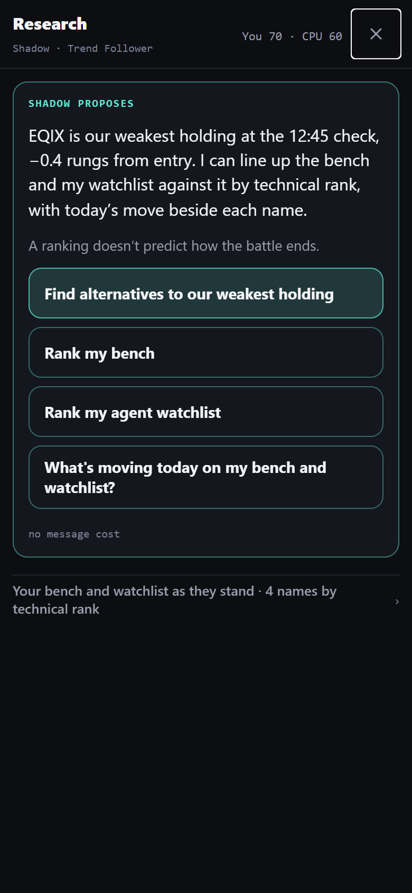 | 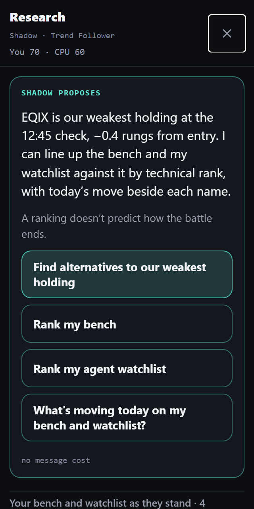 |
| The board | 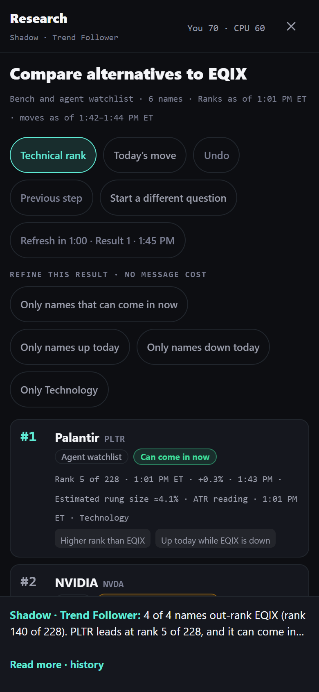 | 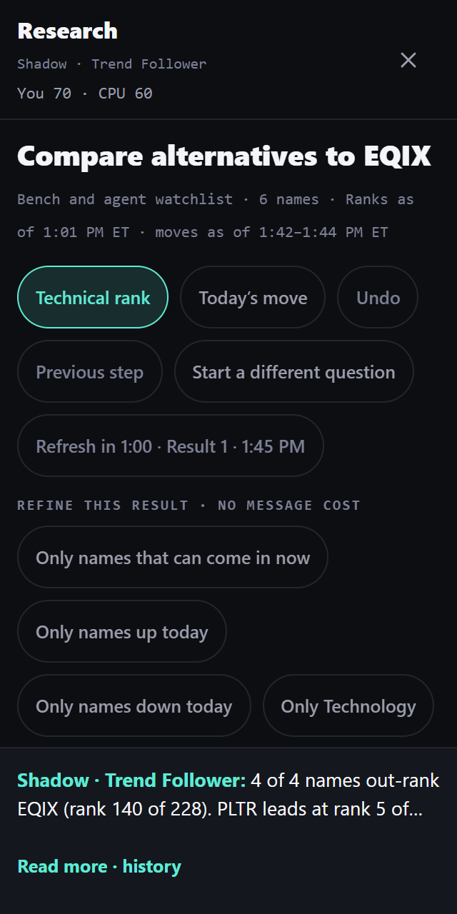 |
| The board, scrolled | 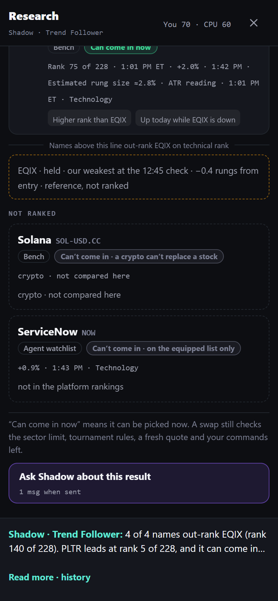 | 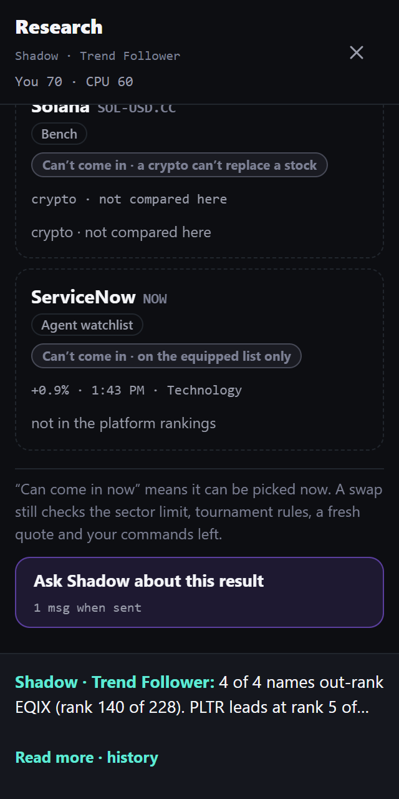 |
| The history sheet | 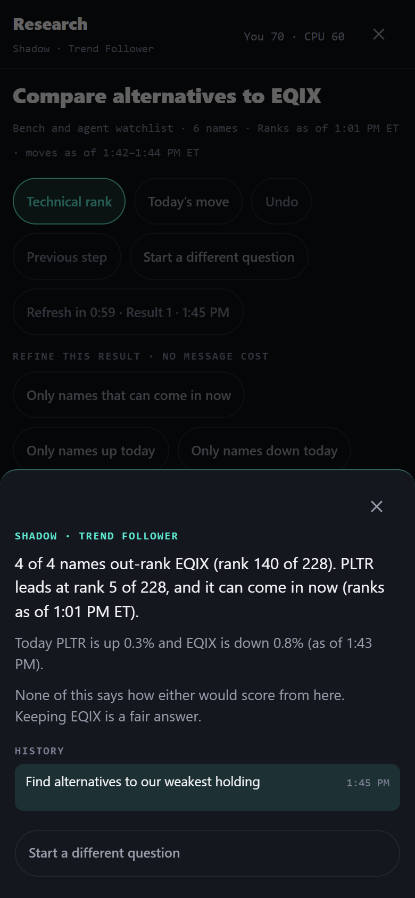 | 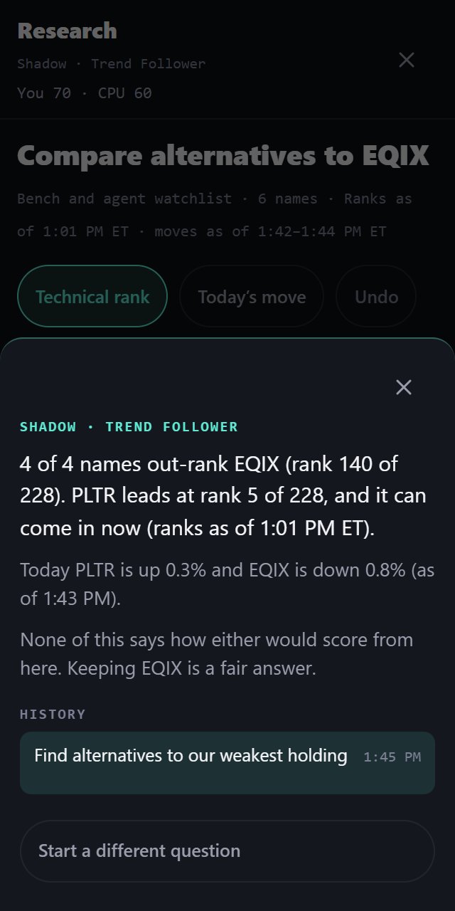 |
| The modal's research state | 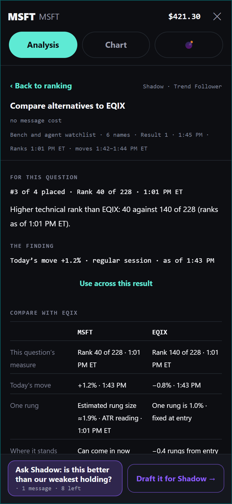 | 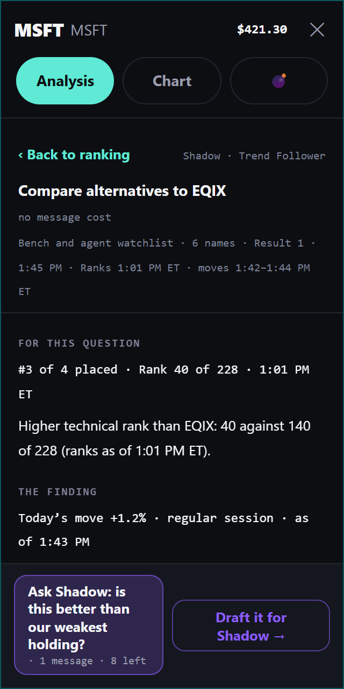 |
| The modal scrolled 800 px: the strip stuck; a 20-letter agent name, two-decimal scores | 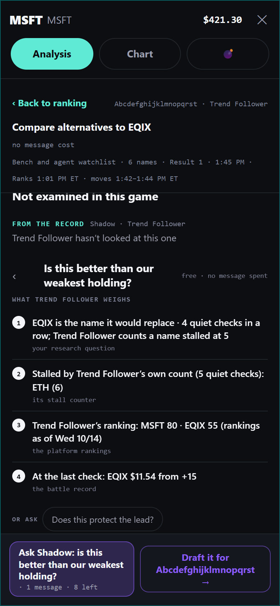 | 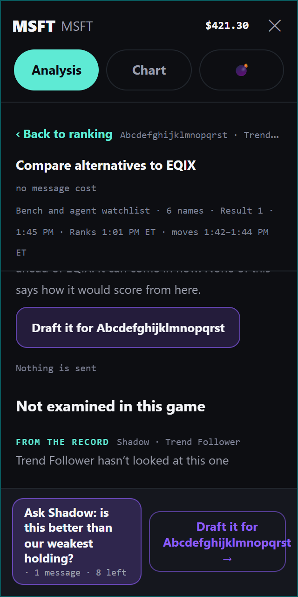 |

Lens 4's own measures, after the review round (both widths; a default pass and a hard pass with a 20-letter agent name and two-decimal scores): the top strip's title never meets the score pair and Close stays inside the viewport; the board's scroller is exactly the viewport wide with no row or toolbar button past its edge; the surface covers all four corners and the centre; *Read more · history* is the top element at its centre; the action row never scrolls sideways (the Draft door 147–182 px, the Ask 139–193 px); scrolled 800 px, the research strip's top equals the scroller's and is the element 10 px under it; a tab tapped while stuck starts its note clear of both strips. Not measured here: an iPhone with Safari's toolbar (BL4-4, §9 item 1) and a 4× CPU-throttled fling (BL4-3 removed the cause).

---

## 5. Tests and checks

⟪CHECKS⟫

---

## 6. File and line counts

⟪COUNTS⟫

---

## 7. The cost line

- **Provider calls: 0. Model calls: 0.** The route reads the snapshot document the collector already writes (one Admin SDK `.get()`, cached 30 s per sweep); nothing in Battle Research calls EODHD, Anthropic or OpenRouter, and every tap is free. Only a message the player sends costs one message, as any chat.
- **Per open:** one evidence bundle — one route call (one cached document read server side) and one read of the public rankings document.
- **Per question:** none within 60 s of the opening's bundle; otherwise one bundle.
- **Per refinement, reopen, modal, draft:** none.
- **Per Refresh:** one bundle, at most once a minute, one at a time.

---

## 8. The founder's live checklist

Phone, an allowlisted agent battle, market open, after C is merged; steps 6 and 8 need a desktop and a closed market respectively.

1. The **Research** pill opens Battle Research, not the bench sheet. The proposal uses your agent's name and archetype, and names the weakest holding with its check time.
2. **Find alternatives to our weakest holding.** The title names the holding. The reference line sits in the list. Ranks and moves each show a time.
3. **Today's move**, then **Only names that can come in now**, then **Undo.** The banner says what moved and why.
4. **Open a candidate.** The question stays at the top, with *For this question* and the comparison. 💣 shows the same rung size and time as the row. **‹ Back to ranking** returns to the same list, same place.
5. **Type a few words in the chat first, then Draft it for {Agent}.** The chat opens with your words kept and the draft added after them: the question, the refinements, both names and their readings with times. Nothing sent, and the message count is unchanged. Reopen **Research**: the same result, at the same place in the list.
6. **Open a candidate, then press Escape** (desktop). Only the modal closes, and you're back on the same row.
7. **Wait for the next check.** The notice appears and the order doesn't move. **Refresh** shows *Result 2* with its time. The Refresh button then counts down a minute.
8. **Optional, before 9:30 AM, or on a weekend:** the moves name the last session's day; today's-move ordering, conditions and the fourth starter say *Today's session opens at 9:30 AM ET*, or on a weekend *Market closed · next session …*; the weakest question still works on rank.

---

## 9. Open items for the founder

1. **An iPhone check of the bottom bar** (BL4-4): the bar and the history sheet now pad the browser toolbar the way the bench sheet does; the live checklist on a phone covers it.
2. **The Ranks line in state 2** (BL2-5, lens 1 R2): it prints the frozen result's rank time, as §3 says, over the Ranks tab's own live list, whose badge is the sector rank. Should the line label the tab's own reading instead (its doc's time), or should the tab read the frozen doc?
3. **A lock that has passed, in the explanation** (BL2-9): the explanation is "built from the frozen result alone" (BRS-16) and says *it's locked until Thu 10:00 AM*; the row and the modal follow BRS-15's *Locked until … at this result · since passed*. Should the explanation say *since passed* too?
4. **💣's time against the row's** (BL2-14): the shipped 💣 names a day against now (*Wed 1:01 PM* when read on Thursday); the row names it against the result (*1:01 PM*). Same number and instant; BRS-17 keeps 💣 as shipped.
5. **The latent quote notice** (BL4-13): if `SHADOW_CPU_QUOTE_INTEGRITY_ENABLED` is ever turned on, its notice (z 60) must stand above the surface (z 1000).
